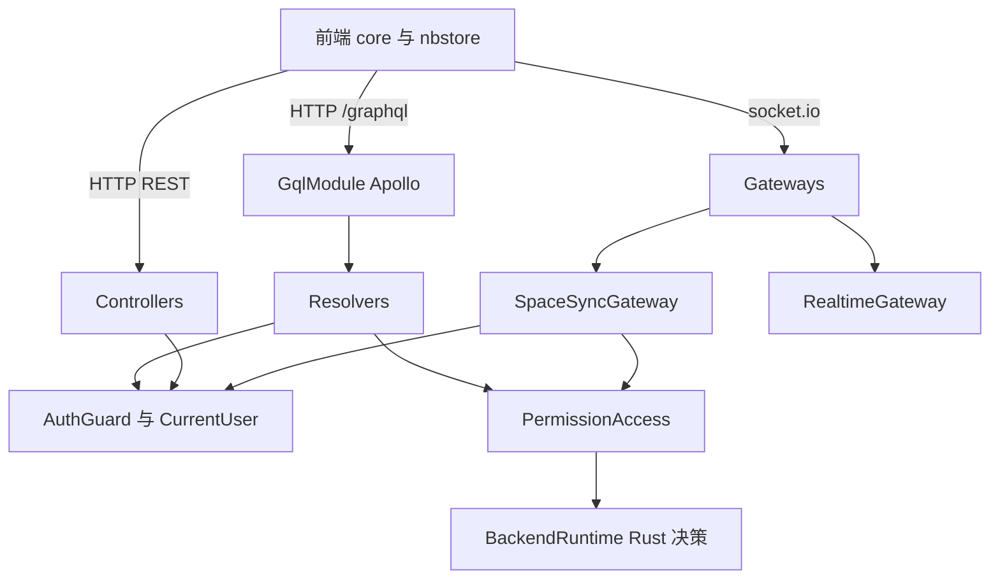
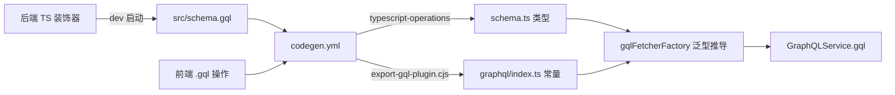
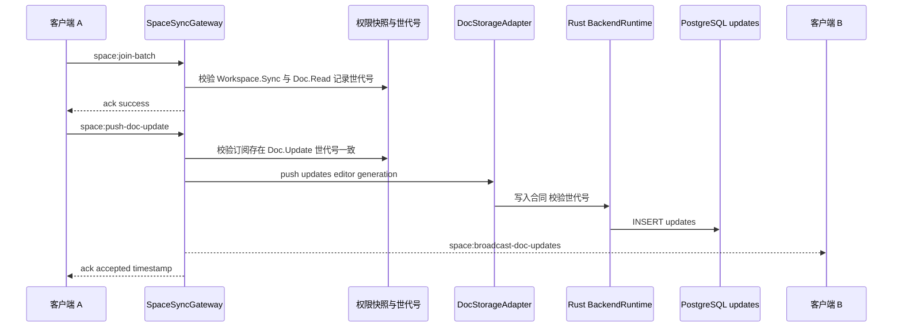
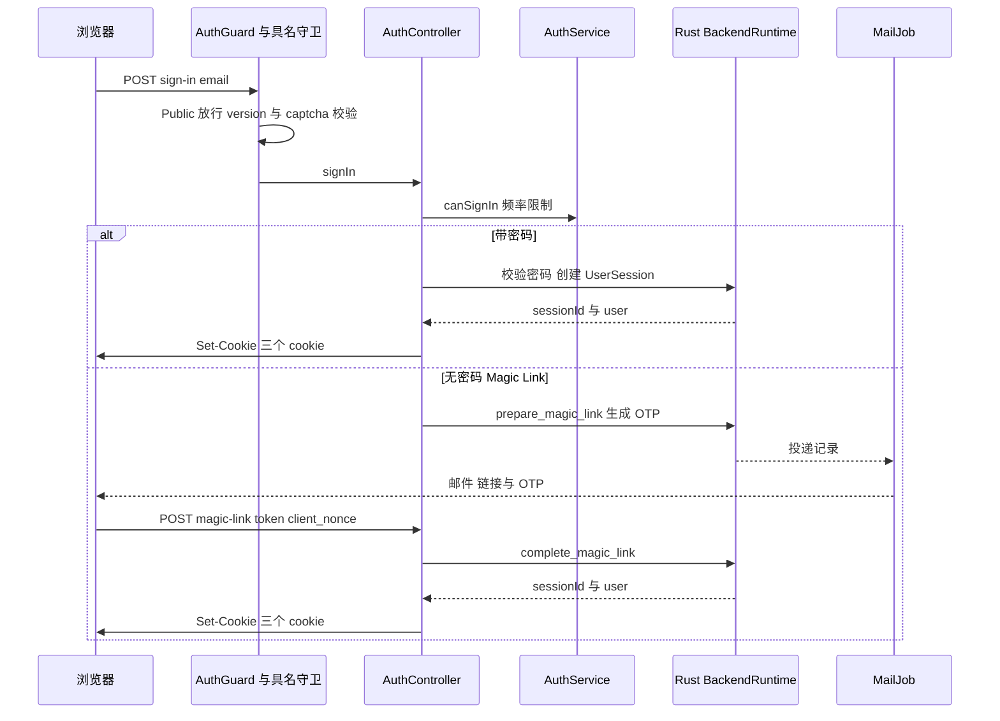
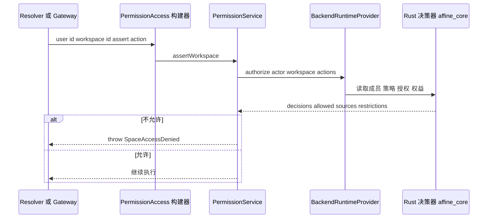

# 第 23 章 API 层：GraphQL、WebSocket、认证与权限

> 三类入口共享一套横切能力；真正的领域规则下沉到 Rust 运行时

第 7 部分 · 后端服务 ｜ 难度 ★★★★★ ｜ 建议学时 12 小时

===

## 本章要解决的问题

<p class="lead">第 21 章讲“进程如何组装”，第 22 章讲“数据存在哪里”，本章讲<b>前端怎样和后端说话</b>——全栈开发中最常打交道、也是 AFFiNE 后端最复杂的一层。</p>

AFFiNE 同时用了三类协议，各有适用场景；而每一次调用都要先回答“你是谁”和“你能做什么”。

<div class="cards cols-2">
  <div class="card"><div class="card__icon">📡</div><h4>GraphQL</h4><p>绝大多数业务 API，前端经 180+ 个 <code>.gql</code> 文件调用。</p></div>
  <div class="card"><div class="card__icon">🔌</div><h4>REST</h4><p>认证、Blob 下载、二进制、SSE 流、第三方回调等。</p></div>
  <div class="card"><div class="card__icon">🔄</div><h4>WebSocket</h4><p>文档实时协同（Yjs 增量、awareness）与 <code>realtime:*</code> 订阅。</p></div>
  <div class="card"><div class="card__icon">🔐</div><h4>认证与权限</h4><p>会话 cookie / JWT / 刷新令牌 + 工作区/文档两级 action。</p></div>
</div>

<div class="note note--warn">

读本章的钥匙：**权限决策、配额计算、会话签发、文档写入合同等核心逻辑已下沉到 Rust 运行时**，TS 层主要负责协议适配（GraphQL/HTTP/WS）、参数校验与错误映射。理解这条“TS 协议层 → Rust 领域核心”分界线，比记住每个文件更重要。

</div>

===

## 知识地图

三类入口在顶部分流，但都汇聚到同一套守卫、权限与 Rust 决策。



<div class="note">

所有入口——Resolver、Controller、Gateway——共享：`AuthGuard` 识别身份、`PermissionAccess` 判定权限、`UserFriendlyError` 统一错误、`CallMetric` 记录指标。

</div>

===

## 学习目标

<ol class="goals">
  <li>解释 GraphQL 的 Query/Mutation/ResolveField 与 code-first 模式，说明 <code>src/schema.gql</code> 如何自动生成</li>
  <li>描述前端 <code>.gql</code> → <code>codegen.yml</code> → <code>gqlFetcherFactory</code> → <code>GraphQLService.gql</code> 的完整调用链</li>
  <li>列出 <code>SpaceSyncGateway</code> 的客户端与服务端事件，说明一次文档更新的推送流程与<b>权限世代号</b></li>
  <li>画出密码登录、Magic Link 的时序图，说出三个认证 cookie 的作用</li>
  <li>用 <code>PermissionAccess</code> 链式 API 做权限检查，说明 Action 目录与 Rust 决策器的关系</li>
</ol>

===

<!-- section -->
## 一、GraphQL 与 REST

code-first：写 TS 类 + 装饰器，框架生成 SDL；前端据此生成类型，前后端类型共享。

===

## code-first 与动态 ObjectType

AFFiNE 用 `@nestjs/graphql` 的 code-first：非生产环境把 Schema 写入 `src/schema.gql`（3026 行），`sortSchema: true` 便于 diff 审查。最有意思的是 `WorkspacePermissions`——它**根据权限 Action 列表动态生成** ObjectType。

<div class="annotate">

```ts [2|4-5|9]
const WorkspacePermissions = registerObjectType(
  Object.fromEntries(
    WORKSPACE_ACTIONS.map(action => [
      action.replaceAll('.', '_'),
      { type: () => Boolean, options: { name: action.replaceAll('.', '_') } },
    ])
  ),
  { name: 'WorkspacePermissions' }
);
```

<ol class="annotate__notes">
  <li><b>第 2 行</b>：遍历全部 <code>WORKSPACE_ACTIONS</code> 叶子路径。</li>
  <li><b>第 4–5 行</b>：GraphQL 字段名不能含点号，<code>Workspace.Settings.Update</code> 变成字段 <code>Workspace_Settings_Update</code>；TS 侧用 <code>DotToUnderline</code> 类型同步转换。</li>
  <li><b>第 9 行</b>：<b>新增一个权限 Action，GraphQL Schema 自动多一个布尔字段</b>，无需手改。</li>
</ol>
</div>

===

## Resolver 三段式与 ResolveField

Resolver 几乎是固定模板：**取当前用户 → 断言权限 → 调 Model**。没有 `@Public()` 的 Resolver 由全局 `AuthGuard` 保证 `user` 一定存在。

<div class="split">
<div class="split__main">

`ResolveField` 按需计算字段，且是**避免 N+1 查询**的经典手法：`workspaces` 列表查询已批量查好角色并放在父对象上，`role` 字段解析器直接复用 `if ('role' in workspace) return workspace.role`，不再对每个工作区重发权限查询。

`UserResolver.user(email)` 则是防用户枚举范例：“邮箱不存在”与“无权查看”都返回 `null`，攻击者无法区分邮箱是否注册——源码注释直写 *"prevent user enumeration"*。

</div>
<div class="split__aside">

```ts
@Query(() => WorkspaceType)
async workspace(
  @CurrentUser() user: CurrentUser,
  @Args('id') id: string
) {
  await this.ac.user(user.id)
    .workspace(id)
    .assert('Workspace.Read');
  const ws =
    await this.models.workspace.get(id);
  if (!ws) throw new SpaceNotFound(...);
  return ws;
}
```

</div>
</div>

===

## 前端 GraphQL 生成链

前端不手写请求：`.gql` 文件经 GraphQL Code Generator + 自研 `export-gql-plugin.cjs` 生成运行时常量与 TS 类型，`gqlFetcherFactory` 据此**从操作 id 推导出变量与响应类型**——传错变量或读错字段都会编译报错。



<div class="note">

`export-gql-plugin.cjs` 还做几件 codegen 自带插件不做的事：按 `操作名 + Query/Mutation` 生成导出名并检测重名、解析 `#import` 拼接 fragment、检测 `Upload` 类型标记走 multipart、收集查询用到的废弃字段。`GraphQLService.gql` 在 401 时自动触发 `AuthService.session.revalidate()`——与第 21 章 `UserFriendlyError` 闭环。

</div>

===

## REST：来源作用域的 Blob 下载

GraphQL 不适合二进制流、cookie 写入、第三方回调、SSE。全项目 Controller 覆盖 `/api/auth`、`/api/workspaces`、`/api/storage`、`/api/copilot`、`/api/calendar`、支付 Webhook 等。最常用的 Blob 下载有三个设计点。

<ol class="steps">
  <li><h4>来源作用域协议</h4><p>下载必须声明 Blob 来自哪篇文档（<code>sourceType=currentDoc&docId=...</code>）或哪个历史版本，Rust 运行时据此判断“这个 Blob 是否真被该文档引用、你是否能读它”。旧接口 <code>GET /:id/blobs/:name</code> 直接抛 <code>UnsupportedClientVersion</code>，要求客户端 <code>&gt;=0.27.0</code>。</p></li>
  <li><h4>流式传输</h4><p>用异步生成器分块从 Rust 读取、<code>pipeline</code> 写入响应，大文件不占满内存，<code>finally</code> 保证关闭流。</p></li>
  <li><h4>上传走 GraphQL</h4><p><code>WorkspaceBlobResolver</code> 提供 <code>setBlob</code>（小文件直传）与 <code>createBlobUpload → completeBlobUpload</code> 分片流程，R2 场景再经 <code>/api/storage</code> 代理。</p></li>
</ol>

===

<!-- section -->
## 二、WebSocket 与实时层

文档协同同步靠 `SpaceSyncGateway`；此外还有一套通用“实时查询/主题订阅”协议 `realtime:*`。

===

## 同步事件清单

握手阶段就完成鉴权（复用 `AuthGuard.signIn()` 识别 cookie 或 JWT），所以 Gateway 方法里的 `@CurrentUser()` 总是有值。客户端事件均带 ack 回包 `{ data }` 或 `{ error }`。

<div class="compare">
  <div class="compare__col"><h4>客户端 → 服务端（@SubscribeMessage）</h4>

- `space:join-batch`：批量加入订阅，校验版本 `>=0.27.5-0`，需 `Workspace.Sync`
- `space:load-doc`：拉取文档（可带 `stateVector`）
- `space:push-doc-update`：推 Yjs 增量，需 `Doc.Update`
- `space:update-awareness`：上报光标/选区
- `space:doc-lifecycle`：trash / restore / delete

  </div>
  <div class="compare__col compare__col--good"><h4>服务端 → 客户端（emit）</h4>

- `space:broadcast-doc-updates`：有人推了更新
- `space:broadcast-doc-invalidation`：订阅失效，需重新加入
- `space:collect-awareness`：请你上报 awareness
- `space:broadcast-awareness-update`：转发他人 awareness
- `realtime:event`：实时主题事件

  </div>
</div>

<div class="note">

事件名与负载在前后端各声明一份（后端 `gateway.ts` 接口、前端 `nbstore/.../cloud/socket.ts` 的 `ServerEvents`/`ClientEvents`），**靠测试与版本校验保证一致**。房间名用 `${spaceId}:sync` 或 `${spaceId}:sync-027` 按客户端版本隔离协议。

</div>

===

## 一次推送与权限世代号

**权限世代号（permission generation）**是这里最精巧的设计：加入订阅时记录当时的世代号，此后每次推送都交给 Rust 写入合同核对。一旦管理员移除某人编辑权限、世代号变化，旧订阅推送的更新会被拒绝并触发 invalidation——**权限不是连接时检查一次，而是整个长连接生命周期内持续有效**。



<div class="note note--tip">

测试 `permission revocation removes an active document subscription` 正在验证这一点。`update` 字段用 base64 是因为 socket.io 的 JSON 传输承载二进制不便。

</div>

===

## 通用实时层：通知 + 拉取

文档同步之外还有很多“实时更新的小数据”：成员列表、通知数、配额、转写进度……过去靠 GraphQL 轮询，0.27 引入统一的实时查询协议。类型契约放在共享包 `@affine/realtime`，**一处声明、两端类型安全**。

| 事件 | 处理 |
| --- | --- |
| `realtime:request` | 校验版本 → `registry.getRequest` → Zod 校验 → `handler.handle` |
| `realtime:subscribe` | `getTopic` → `authorize` → `client.join(room)`，返回 `subscriptionId` |
| `realtime:unsubscribe` | 离开房间 |

<div class="note">

数据变化时业务代码调 `RealtimePublisher.publishChanged(topic, input, reason)`：先本地 emit、再经 EventBus 广播到其他实例。前端收到 `{ changed: true }` 后**再发一次 `realtime:request` 拉最新快照**——这种“通知 + 拉取”避免在推送里携带可能越权的数据。`required-handlers.ts` 列出必须存在的 14 个 request + 13 个 topic，`front`/`sync` 启动时检查，缺任何一个直接拒绝启动——把“漏装模块”这种运维错误前置到启动期。

</div>

===

<!-- section -->
## 三、认证与权限

每次调用先回答“你是谁”（认证）与“你能做什么”（权限）。两者的领域核心都在 Rust。

===

## 三种凭证与三个 cookie

三类客户端用三种凭证；Web 的会话由三个 cookie 协作完成。

| 凭证 | 载体 | 客户端 |
| --- | --- | --- |
| Cookie 会话 | `affine_session` 等三个 cookie | Web 浏览器 |
| 访问令牌 JWT | `Authorization: Bearer` 或 socket `handshake.auth` | 桌面/移动原生 |
| 刷新令牌 | 请求体，`/session/refresh` 轮换 | 原生客户端 |

<div class="cards cols-3">
  <div class="card"><h4><code>affine_session</code></h4><p>httpOnly 的会话 ID，服务端认证用。</p></div>
  <div class="card"><h4><code>affine_user_id</code></h4><p>非 httpOnly，仅供前端识别当前是哪个用户。</p></div>
  <div class="card"><h4><code>affine_csrf_token</code></h4><p>非 httpOnly 的双提交令牌，前端读取放入 <code>x-affine-csrf-token</code> 头防 CSRF。</p></div>
</div>

<div class="note note--warn">

对 cookie 会话执行“修改会话”类操作时，`AuthController.assertSessionMutationAuthorized` 要求请求头 `x-affine-csrf-token` 与 cookie 一致——**双提交 Cookie 防 CSRF**。后两个 cookie 必须非 httpOnly，正因为前端要读它们。

</div>

===

## 登录时序图

同一个 `/sign-in` 端点：有密码走密码登录、无密码则发送 Magic Link（含链接与 6 位 OTP）。`canSignIn` 按邮箱与 IP 做频率限制，`client_nonce` 把“发起登录的浏览器”与“完成登录的请求”绑定，防链接被转发后在别人设备登录。



===

## 原生客户端：交换码 → 轮换

桌面与移动端不依赖浏览器 cookie（WebView/系统浏览器 cookie 不可靠、跨进程难共享）。登录成功后服务端只返回一次性 `exchangeCode`。

<ol class="steps">
  <li><h4>交换</h4><p>客户端 <code>POST /api/auth/session/exchange</code> 用 code 换取令牌对——对应第 22 章的 <code>AuthSession</code> + <code>AuthRefreshToken</code>。</p></li>
  <li><h4>访问</h4><p>每次请求携带访问令牌（JWT），经 <code>AuthGuard.signInWithJwt</code> → Rust <code>resolveAuthPrincipalV1</code> 校验。</p></li>
  <li><h4>轮换</h4><p>JWT 过期后用刷新令牌调 <code>/session/refresh</code>，服务端按 <code>generation</code> 轮换并检测重放；<code>/sessions</code> 让用户在“设备管理”查看与吊销。</p></li>
</ol>

<div class="note">

OAuth（Google/GitHub/Apple/OIDC）由 `src/plugins/oauth` 提供（第 24 章）：`preflight` 返回授权地址，`callback` 结果为 `login` 时写 cookie、为 `handoff` 时把 code 交回原生应用。`state` 校验失败映射为 `InvalidOauthCallbackState` 等 UserFriendlyError。

</div>

===

## Action 目录与角色

权限以“**资源 × 动作**”建模，`types.ts` 用嵌套常量对象描述全部 Action。注释写得很直白：*"Rust owns permission decisions"*——完整的“角色 × Action 矩阵”**不在本仓库 TS 里**，而在 Rust 依赖 `affine_core` 的 `access_control` 模块。

<div class="split">
<div class="split__main">

TS 侧用模板字面量 + `LeafPaths` 从这棵树推导出 `'Workspace.Settings.Update'` 这样的联合类型。测试 `TypeScript action facade exactly matches the native core catalog` 断言 TS 的 Action 列表与 Rust `permissionActionCatalogV1()` **完全一致**。

角色用数值枚举便于比较（`DocRole`：Reader=10、Editor=20、Owner=99；`WorkspaceRole`：Collaborator=1、Admin=10、Owner=99）。数据库里存的是字符串，这两个枚举是面向 GraphQL 的“兼容角色”。

</div>
<div class="split__aside">

```ts
export const Actions = {
  Workspace: {
    Read: '', Sync: '', Delete: '',
    Settings: { Read: '', Update: '' },
    Users: { Read: '', Manage: '' },
    // ...
  },
  Doc: {
    Read: '', Update: '', Publish: '',
    Comments: { Read: '', Create: '',
      Moderate: '' },
    // ...
  },
} as const;
```

</div>
</div>

===

## PermissionAccess 链式 API

`PermissionModule` 把 `AccessControllerBuilder` 以别名 `PermissionAccess` 导出，提供链式三步 `user(id).workspace(id).assert(action)`。`PermissionService` 只做三件事：组装 Rust 输入、映射结果为 `legacyApiRole + decisions`、把拒绝转成 `SpaceAccessDenied`/`DocActionDenied`。



<div class="note note--tip">

**设计取舍**：把权限决策集中到 Rust 单点，好处是 GraphQL、REST、WebSocket、AI 工具、MCP 所有入口得到**完全一致**的判定，性能也更好；代价是 TS 开发者看不到矩阵源码，需通过测试与 API 理解行为。查某用户实际权限，最可靠的是 `workspace(id) { role permissions { ... } }`——它由同一个 Rust 决策器计算。

</div>

===

## 配额、权益与其他模块

`quota`/`entitlement`/`features` 三个模块的数据来源都是 Rust 运行时，TS 层主要负责展示。注意 `Number(state.usedStorageQuota)`：Rust 侧用 64 位整数，经 NAPI 传到 JS 需显式转换。配额的“强制执行”（上传前预留、超额拒绝）发生在 Rust（第 22 章 `Blob.reservationId`）。

| 模块 | 职责 | 数据来源 |
| --- | --- | --- |
| `core/quota` | 存储配额、单文件上限、席位数、只读状态 | `runtime.getWorkspaceQuotaStateV1` |
| `core/entitlement` | 商业权益判断、管理员发放/撤销 | Rust，落库 `Entitlement` |
| `core/features` | `isAdmin`、`isStaff`、功能开关 | `Models.userFeature` |
| `doc-renderer` | 分享页 SSR / OG 元信息 / Markdown 输出 | `DatabaseDocReader` |

<div class="note">

文档存储模块 `core/doc` 是典型**模板方法模式**：基类 `DocStorageAdapter` 定义“加锁 → 读快照 → 读增量 → 合并 → 写回 → 记历史”骨架，子类只实现存取细节。读时如有积压增量就顺手合并回快照（读修复），配合第 22 章的定时合并保证 `updates` 表不无限膨胀。

</div>

===

## 动手实践

<ol class="steps">
  <li><h4>在 GraphiQL 探索 Schema</h4><p>开发模式启动后端访问 <code>/graphql</code>，执行 <code>query { workspaces { id role permissions { Workspace_Settings_Update } } }</code>；在 <code>schema.gql</code> 找到 <code>WorkspacePermissions</code> 与 <code>types.ts</code> 的 <code>Actions.Workspace</code> 对照。<b>验收</b>：解释字段名为何是下划线，新增 Action 后 Schema 如何变化。</p></li>
  <li><h4>抓包观察同步协议</h4><p>开发者工具 Network→WS 打开云端文档，找到 <code>space:join-batch</code> 的发送帧与 ack，输入文字观察 <code>space:push-doc-update</code> 的 <code>timestamp</code>；再开一窗口观察广播与 awareness。<b>验收</b>：把至少 6 个事件对上事件表，解释 <code>update</code> 为何是 base64。</p></li>
  <li><h4>追踪一次权限拒绝</h4><p>用 Reader 角色尝试评论或编辑，观察 GraphQL 响应的 <code>extensions.name</code>/<code>extensions.data</code>；从 Resolver 的 <code>assert</code> 追到 <code>PermissionService.assertDoc</code> 与 <code>DocActionDenied</code>。<b>验收</b>：说出错误名、HTTP 状态码与 <code>data</code> 字段。</p></li>
</ol>

===

## 自测：点击揭晓答案

<details class="quiz">
<summary>Q1. WorkspacePermissions 为什么动态生成？字段名为何是下划线？</summary>

让 GraphQL 权限字段与 Action 目录自动保持一致，新增 Action 无需手改 Schema；GraphQL 字段名不允许点号，故用 `replaceAll('.', '_')`，TS 侧用 `DotToUnderline` 同步。

</details>

<details class="quiz">
<summary>Q2. 什么是“权限世代号”？它解决了长连接中的什么问题？</summary>

加入订阅时记录的权限版本号，后续每次推送都交给 Rust 写入合同核对。它保证权限撤销能立刻作用于已建立的长连接，而不是只在连接时检查一次。

</details>

<details class="quiz">
<summary>Q3. realtime:subscribe 后前端为何还要再发 realtime:request？</summary>

主题事件只携带 `{ changed: true, reason }`、不含数据本身；前端再通过 request 拉最新快照，这样推送通道不会泄露越权数据，多实例推送逻辑也更简单。

</details>

<details class="quiz">
<summary>Q4. 角色 × Action 矩阵在哪定义？TS 如何保证与 Rust 一致？</summary>

在 Rust 依赖 `affine_core` 的 `access_control` 模块；`actions.spec.ts` 断言 `WORKSPACE_ACTIONS`/`DOC_ACTIONS` 与 `permissionActionCatalogV1()` 返回的目录完全一致。

</details>

===

## 小结与下一步

<ul class="takeaways">
  <li>GraphQL（code-first + 动态 ObjectType）、REST（二进制/回调/SSE）、WebSocket（协同同步 + 实时订阅）三类入口各司其职。</li>
  <li>前端 <code>.gql</code> 经生成链得到类型安全的 <code>gqlFetcherFactory</code>，传错即编译报错。</li>
  <li>同步靠事件表 + 权限世代号，实现“权限撤销实时生效”；实时层用“通知 + 拉取”避免越权。</li>
  <li>三种凭证、三个 cookie；登录统一经 Rust 签发会话，原生客户端走交换码与令牌轮换。</li>
  <li>权限以资源×动作建模，<b>Rust 单点决策</b>保证多入口一致，TS 只做协议适配与错误映射。</li>
</ul>

<div class="note note--tip">

**下一章预告**：第 24 章进入 `src/plugins` 九个业务插件——Copilot（AI）、indexer（搜索）、payment（支付）等如何“按 Flavor 装载、按配置开关、按守卫拦截”，以及同一条“TS 协议入口 → Rust 领域核心”分界线如何在 SSE 流式对话、向量检索、支付状态机中反复出现。

</div>
