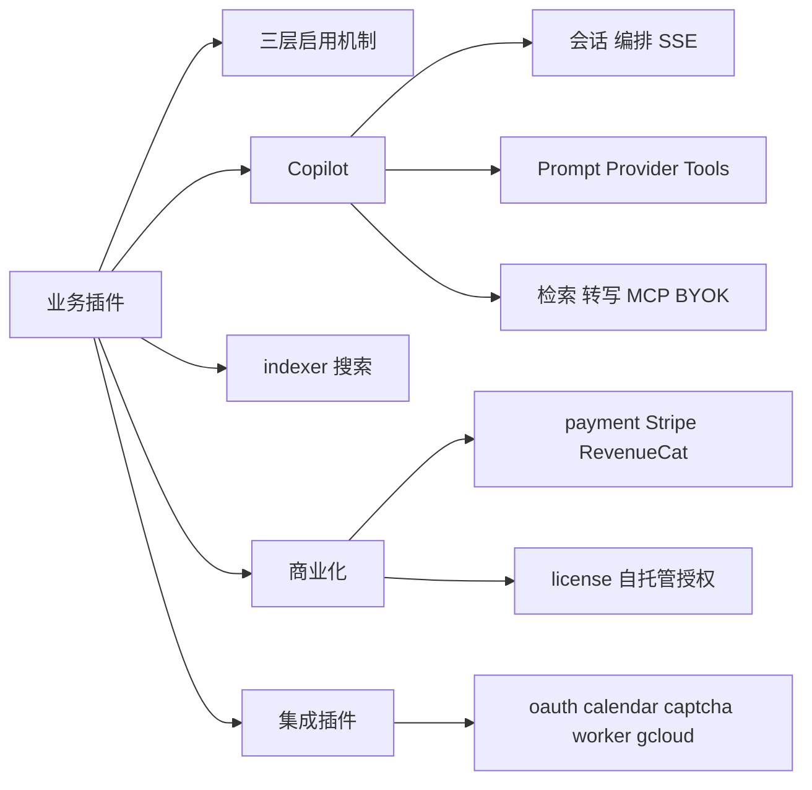
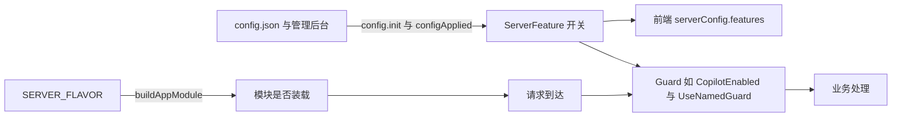
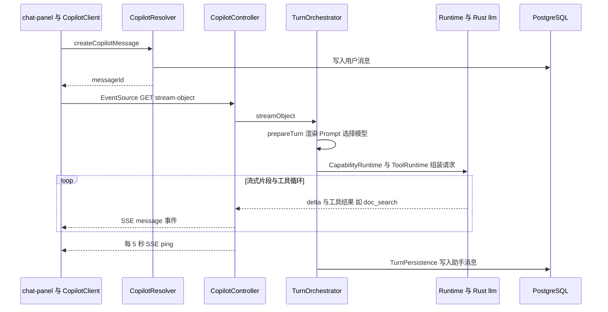
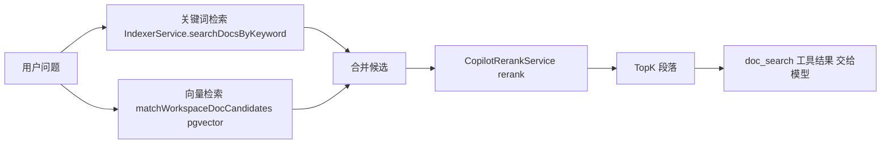
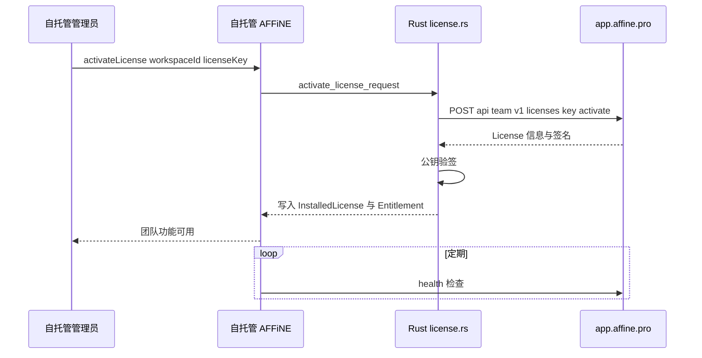

# 第 24 章 业务插件：AI、搜索、支付等

`src/plugins` 九个插件的启用机制、Copilot 深读与商业化集成

第 7 部分 · 后端服务 ｜ 难度 ★★★★☆ ｜ 建议学时 12 小时

Note:
这一章我们打开 `packages/backend/server/src/plugins`。没有这些插件 AFFiNE 也能当协同编辑器用，但有了它们才有 AI、搜索、付费和第三方集成。Copilot 会占大约一半篇幅。

---

## 本章导读

- 9 个插件：`copilot` `indexer` `payment` `license` `oauth`
- 以及 `calendar` `captcha` `worker` `gcloud`
- 规模差异大：`copilot` 约 1.7 万行，`gcloud` 约 100 行
- 先讲"插件如何被启用"，再深读 Copilot
- 每个插件看：**职责 / 关键文件 / 外部依赖 / 配置项**

<div class="callout">

反复出现的模式：**TS 管协议入口与宿主能力**，**Rust 管模型路由、搜索投影、支付状态机、License 校验**

</div>

Note:
插件和 core 的区别是"可选"。读插件时比记住每个文件更重要的，是那条 TS 与 Rust 的分界线：GraphQL、SSE、Webhook、MCP 这些协议入口在 TS，领域核心在 Rust。

---

## 学习目标

- 说明插件三层启用：Flavor 装载、`ServerFeature` 开关、Guard 拦截
- 画出 Copilot 从 `createCopilotMessage` 到 SSE 回答的链路
- 说出 Prompt、Provider、Tool、检索、转写、MCP、BYOK 的职责
- 列出 Copilot 内置工具及启用条件
- 解释 indexer 三种 provider 与 Rust `search_index` 的关系
- 描述 Stripe Webhook 幂等设计与 License 激活流程

Note:
六个目标里，前四个都围绕 Copilot。后两个是搜索与商业化，篇幅不长但设计很典型，尤其是 Webhook 的"先捕获后处理"。

---

## 知识地图



Note:
地图分五块：启用机制、Copilot、搜索、商业化、集成。Copilot 又分为主链路、能力组件和周边能力三组，后面会按这个顺序展开。

---

## 插件机制：三层启用



`CopilotModule`、`PaymentModule` 等仅 `env.flavors.graphql` 装载；`WorkerModule` 仅 dev 或自托管

Note:
插件目录没有统一注册表，装载规则全写在 `buildAppModule` 里，比如 `CopilotWorkerModule` 只在 `env.isWorker` 时装。模块装载了不代表功能可用，还要看配置开关；最后由守卫拦截请求。插件配置大多用 `defineNativeModuleConfig` 登记，所以 TS 里读不到 `oauth.providers.google.clientSecret` 这类值。

---

## ServerFeature 开关与守卫

```ts
export enum ServerFeature {
  Captcha = 'captcha',
  Copilot = 'copilot',
  CopilotEmbedding = 'copilot_embedding',
  Payment = 'payment',
  OAuth = 'oauth',
  Indexer = 'indexer',
  Comment = 'comment',
  LocalWorkspace = 'local_workspace',
}
```

插件在 `config.init` / `backendRuntime.configApplied` 中调用 `enableFeature`/`disableFeature`

`CopilotEnabled = () => UseGuards(CopilotFeatureGuard)`，内部 `assertEnabled()`

Note:
这个枚举在 `src/core/config/types.ts`。前端通过 `serverConfig { features }` 得知开关，决定是否显示 AI 面板、订阅按钮、第三方登录按钮。`CopilotFeatureService.enabled` 直接读 `runtime.copilotEnabled()`，`CopilotController` 和 `WorkspaceMcpController` 类上都挂了 `@CopilotEnabled()`。

---

## Copilot：模块拆分

| 模块 | 内容 | 用在哪里 |
| --- | --- | --- |
| `CopilotAvailabilityModule` | 开关与守卫 | 所有 Copilot 模块 |
| `CopilotKernelModule` | 会话、Prompt、运行时、检索等核心服务 | 被其余模块依赖 |
| `CopilotRealtimeModule` | 转写、embedding 进度、委托编辑器 | sync/front 节点 |
| `CopilotApiModule` / `CopilotModule` | Resolver、三个 Controller、MCP 凭证 | graphql 节点 |
| `CopilotWorkerModule` | `CopilotCronJobs` 等 | worker 节点 |

<p class="small">provider 数组集中在 <code>src/plugins/copilot/module-providers.ts</code></p>

Note:
Copilot 按部署角色拆成多个 Nest 模块，表里省略了 `CopilotFeatureModule`，它提供功能级服务给 API 与 Worker 共用。`module-providers.ts` 还用 `useExisting` 做接口和实现的解耦，比如 `DOCUMENT_VECTOR_SEARCH` 指向 `NativeEmbeddingService`。

---

## 前端两步调用

```ts
let url =
  endpoint === Endpoint.Action
    ? `/api/copilot/actions/${sessionId}/stream`
    : `/api/copilot/chat/${sessionId}/${endpoint}`;
const queryString = this.paramsToQueryString({
  messageId, reasoning, profileId, modelId, routeTargetId,
  toolsConfig, actionId, actionVersion, runId, retry, byokLeaseId,
});
if (queryString) {
  url += `?${queryString}`;
}
return this.eventSource(url);
```

① GraphQL `createCopilotMessage` 提交消息拿 `messageId`；② `EventSource` 以 GET 打开 SSE

Note:
这段来自前端 `packages/frontend/core/src/blocksuite/ai/runtime/request/copilot-client.ts`。为什么拆两步？浏览器原生 EventSource 只支持 GET、不能带请求体，附件和长消息不适合放 URL，所以先用支持 multipart 的 GraphQL 提交消息，再用 GET 拉流。`Endpoint` 枚举有 `action`、`stream-object`、`images` 三种。

---

## SSE 流式输出要点

- 事件类型：`message`、`attachment`、`event`、`error`、`ping`
- `ping` 每 5 秒一次，防代理与负载均衡空闲断开
- 错误走流内事件：`mapSseError` 映射为 `type: 'error'`
- 优雅关闭：`ongoingStreamCount$` 归零才允许进程退出
- 客户端断开：`getSignal(req)` 转 `AbortSignal` 停止计费
- 端点如 `/api/copilot/chat/:sessionId/stream-object`

Note:
NestJS 的 `@Sse()` 要求返回 Observable，框架把每个元素写成 event、id、data 三行。因为 SSE 响应头已经发出，无法再改 HTTP 状态码，所以错误只能作为流内事件。`beforeApplicationShutdown` 等进行中的流归零，滚动发布时就不会截断用户正在看的回答。

---

## Copilot 主链路时序



Note:
Rust llm 运行时负责以 HTTPS 流式调用模型供应商，工具调用循环也在这一层。`prepareTurn` 阶段必要时还会对用户选中的文档做即时向量化。流结束后 `TurnPersistence` 把完整回答写入 `AiSessionMessage`，并记录是否被用户中断。

---

## TurnOrchestrator：一轮对话

```ts
private async *streamTextResult(
  // ... session、conditions、finalMessage、options、wasAborted
) {
  let buffer = '';
  for await (const chunk of this.runtime.streamText(
    conditions,
    finalMessage,
    options
  )) {
    buffer += chunk;
    yield chunk;
  }
  await this.turnPersistence.persistTextResult(session, buffer, wasAborted());
}
```

异步生成器边产出边累积，流结束后一次性持久化

Note:
这段来自 `src/plugins/copilot/runtime/turn-orchestrator.ts`。`streamText` 先调用 `prepareChatSelection` 准备会话轮次、选择模型与路由，再把信号 `signal` 透传给运行时。用异步生成器的好处是：调用方逐块消费，编排器自己在最后负责落库。

---

## Prompt、Provider 与 Rust LLM

- Prompt 内置目录：`native/src/llm/assets/prompts/built-in.json`，共 64 个
- `PromptService.finish` 调用 `renderBuiltInPromptNative` 渲染
- Provider：OpenAI、Anthropic、Gemini（含 Vertex）、Cloudflare、FAL
- 配置 `copilot.providers.profiles`：`priority`、`models`、`middleware`
- 请求/流中间件在 Rust，展示类后处理在 Node
- Rust 适配层：`core/`、`route/`、`host/tool_loop/`、`byok/`

Note:
早期 Prompt 存在数据库，迁移后统一改为随二进制发布的内置目录，Prompt 跟代码一起版本化、评审和测试。中间件分两层，比如 `normalize_messages` 在 Rust，`citation_footnote` 在 Node。把 LLM 调用搬到 Rust 的关键动机之一是安全边界：BYOK 密钥解密和私网端点校验都在原生层，TS 永远拿不到明文密钥。

---

## Tools：AI 能调用的工具

| 类别 | 工具（模型可见名） | 条件 |
| --- | --- | --- |
| 文档读取 | `doc_read`、`doc_canvas_read` | 经 `PermissionAccess` 校验 |
| 检索 | `doc_search`、`artifact_search`、`artifact_read` | 不搜网页 |
| 文档写入 | `doc_create`、`doc_update`、`doc_update_meta` | **仅 dev 或 canary** |
| 生成 | `doc_compose`、`section_edit`、`code_artifact` | 内部再调用 Prompt |
| 网页与摘要 | `web_search_exa`、`web_crawl_exa`、`conversation_summary` | Exa 需 `copilot.exa.key` |
| 前端委托 | `frontend_read_selection` 等 4 个 | 需前端委托租约 |

Note:
工具在 `runtime/tool-runtime.ts` 里按会话配置动态组装，每个由 `defineTool` 定义。几个设计值得学：工具描述写得像给模型看的 API 文档，明确说"不做什么"；写工具灰度开放；`doc_read` 读服务端持久化内容，`frontend_*` 读浏览器里尚未同步的状态；工具错误用 `toolError` 结构化返回，而不是抛异常中断对话。

---

## 混合检索与 Rerank



两路 `Promise.allSettled` 并行，任一路失败可降级；关键词取 3 倍候选，上限 20

Note:
这段逻辑在 `retrieval/document.ts`。没配置搜索服务时 `SearchProviderUnavailable` 被吞掉；工作区关闭 embedding 时 `canEmbedding` 为假，只走关键词。权限过滤在检索阶段就完成，结果离开 Rust 运行时之前已按权限事实过滤。

---

## Transcript：音频转写

```ts
@Cron(CronExpression.EVERY_MINUTE)
async reconcileTranscriptDispatches() {
  const dispatches = await this.transcriptRetry.collectPendingDispatches();
  const results = await Promise.allSettled(
    dispatches.map(dispatch => this.transcript.transcriptTask(dispatch))
  );
  const failed = results.filter(result => result.status === 'rejected');
  if (failed.length) {
    this.logger.warn(
      `Transcript dispatch failures: ${failed.length}/${dispatches.length}`
    );
  }
}
```

流程：提交录音 → Worker 派发 → Rust 切片 → `Transcript audio` 分段转写 → 生成纪要

Note:
会议转写是典型长任务，数据落在 `AiTranscriptTask` 表，`dispatchGeneration` 防止同一任务被并发派发两次。音频切片在 `packages/backend/native/src/audio_slice/`，纪要用 `Summarize the meeting` Prompt。`CopilotCronJobs` 另有两个任务：每天零点清理空会话、每 10 分钟补生成会话标题。

---

## MCP、BYOK 与委托工具

<div class="cols">
<div>

**MCP 服务端**

- 每个工作区一个无状态 JSON-RPC，仅 `POST`
- `@Public()` 绕过会话，改用 MCP 凭证
- 读：`read_document`、`doc_search`
- 写工具需 `READ_WRITE` 且 dev/canary

</div>
<div>

**BYOK 与委托**

- BYOK 只存 `encryptedApiKey`
- `byokLeaseId` 作为 SSE 参数传入
- `copilot.delegated.editor.upsert` 取租约
- `tool.requested` 推送，`tool.respond` 回传

</div>
</div>

Note:
MCP 端点是 `/api/workspaces/:workspaceId/mcp`，让外部 AI 客户端以标准协议访问工作区；凭证只存 `secretHash`，支持轮换与吊销。委托工具很巧妙：服务端读不到浏览器里未同步的编辑器状态，就通过第 23 章的实时层把请求推给前端，前端执行后再回传，相当于"服务端调用客户端"的 RPC。

---

## indexer：全文搜索

| provider | 实现位置 | 外部依赖 |
| --- | --- | --- |
| `embedded` | Rust `search_index/`，`memory-indexer` 进程内索引 | 无 |
| `elasticsearch` | `search/provider/remote.rs` | Elasticsearch |
| `manticoresearch` | `search/provider/manticore.rs` | Manticore Search |

- TS `IndexerService` 只调 `runtime.searchAuthorized`、`aggregateAuthorized`
- 外部引擎只召回候选，结果离开运行时前**按权威权限过滤**

Note:
TS 层非常薄，名字里的 Authorized 说明权限过滤在 Rust 内完成。Rust 源码注释原话是 "Canonical permission facts filter every ACL-scoped result before it leaves the runtime"，所以搜索引擎数据即使滞后也不会越权。搜索投影 worker 增量写索引，还有 `anti_entropy.rs` 做反熵修复。

---

## payment：Webhook 先捕获再处理

```ts
@Public()
@Post(['/api/stripe/webhook', '/api/worker/stripeWebhook'])
async handleWebhook(@Req() req: RawBodyRequest<Request>) {
  const signature = req.headers['stripe-signature'];
  try {
    return await this.runtime.capturePaymentWebhookV1(
      'stripe',
      Buffer.from(req.rawBody ?? ''),
      typeof signature === 'string' ? signature : ''
    );
  } catch (error) {
    // ... 签名错误抛 BadRequest，其余抛 InternalServerError
  }
}
```

必须用 `rawBody` 验签；事件写入 `PaymentEvent` 收件箱后立即返回，异步处理可重试

Note:
`server.ts` 创建应用时开了 `rawBody: true`，因为 JSON 解析再序列化会改变字节，签名就对不上。捕获后立即返回，Stripe 不会因超时重复投递；`PaymentEvent` 的唯一约束保证幂等。`PaymentEventHandlers` 订阅 `workspace.members.updated` 自动调整团队席位，体现事件总线解耦。

---

## license：自托管授权



同一份代码：云端扮演 License 服务器，自托管扮演 License 客户端

Note:
云端的 `LicenseController` 提供 `/api/team/v1/licenses/...`，自托管侧由 `license.rs` 调用，请求有 10 秒超时和 1MB 响应上限。验签用构建时内嵌的 `AFFINE_PRO_PUBLIC_KEY`。离线环境可以用 `installLicense` 上传 License 文件，由 `license_import.rs` 解析。

---

## 其他集成插件

| 插件 | 要点 | 外部依赖 |
| --- | --- | --- |
| `oauth` | Rust 完成 state 与令牌交换，写 `ConnectedAccount` | Google、GitHub、Apple、OIDC |
| `calendar` | `claimDueForSync` 租约认领，每批 8 个最多 25 批 | Google Calendar、CalDAV |
| `captcha` | 具名守卫；Web 用 Turnstile，原生用 Hashcash | Cloudflare Turnstile |
| `worker` | `image-proxy`、`link-preview`，仅 dev 或自托管 | 任意网站，受 SSRF 约束 |
| `gcloud` | `useClass` 替换 Opentelemetry 工厂与日志 | Cloud Trace、Logging |

Note:
calendar 又一次用到第 22 章的数据库租约模式；CalDAV 允许填任意服务器地址，所以配置里有 `blockPrivateNetwork`、`allowedHosts` 等 SSRF 防护。captcha 通过模块扩充把 `'captcha'` 加进 `RegisterGuardName`。gcloud 展示了 DI 的威力：业务代码完全不感知运行在哪个云上。

---

## 源码导读 Top 5

| 优先级 | 路径 | 看什么 |
| --- | --- | --- |
| P0 | `copilot/index.ts`、`module-providers.ts` | 模块拆分与 provider 组织 |
| P0 | `copilot/controller.ts` | SSE 端点、ping、优雅关闭 |
| P0 | `copilot/runtime/turn-orchestrator.ts` | 一轮对话编排与持久化 |
| P0 | `copilot/runtime/tool-runtime.ts`、`tools/*` | 工具组装与启用条件 |
| P0 | `payment/controller.ts` | Webhook 原始体验签与捕获 |

<p class="small">路径前缀：<code>packages/backend/server/src/plugins/</code>；进阶读 <code>copilot/retrieval/document.ts</code></p>

Note:
前四个都在 Copilot，按"模块、入口、编排、工具"的顺序读。最后一个支付控制器很短，但浓缩了 Webhook 处理的两个铁律：原始字节验签和幂等收件箱。

---

## 动手实践

| 练习 | 验收要点 |
| --- | --- |
| 1 观察 Copilot SSE 流 | `messageId` 来源、ping 间隔、错误事件样子 |
| 2 画工具启用矩阵 | 补充"依赖服务"列，与工具表一致 |
| 3 追踪混合检索降级 | 三种故障下结果来源，为何用 `allSettled` |
| 4 Stripe CLI 体验幂等 | 解释为何只有一条记录、签名错误状态码 |
| 5 设计新插件骨架 | 覆盖配置、开关、入口、装载四要素 |

Note:
练习 1 在浏览器 Network 面板找 `stream-object` 请求，切到 EventStream 视图，回答过程中关掉面板看后端日志。练习 5 是草稿设计，仿照 worker 与 captcha，不要提交到仓库。

---

## 自测

**Q1** 插件"被启用"的三层分别由什么决定？

`buildAppModule` 装载、`ServerFeature` 配置开关、Guard 拦截 <!-- .element: class="fragment" -->

**Q2** SSE 中 `ping` 与 `mapSseError` 各解决什么？

防空闲断连；响应头已发出，错误只能作为流内事件 <!-- .element: class="fragment" -->

**Q3** 外部搜索引擎的结果为什么不会越权？

只负责召回，结果离开 Rust 前按权威权限事实过滤 <!-- .element: class="fragment" -->

**Q4** Stripe Webhook 为什么必须用 `rawBody`？

签名基于原始字节，解析再序列化会改变内容 <!-- .element: class="fragment" -->

Note:
四题分别对应启用机制、SSE、搜索和支付。可以追问第一题：为什么模块装载了功能还可能不可用？答案是配置开关没打开。

---

## 常见坑

| 现象 | 解决 |
| --- | --- |
| 前端不显示 AI 入口 | 检查 Copilot 配置与 `serverConfig { features }` |
| SSE 挂起后断开 | 关闭代理对 `text/event-stream` 的缓冲，确认收到 `ping` |
| `doc_search` 只有关键词结果 | 检查 `EmbeddingHealth` 与 `enableDocEmbedding` |
| MCP 报 `Method not allowed` | 该端点为无状态 JSON-RPC，只接受 `POST` |
| Stripe Webhook 返回 400 | 核对 `payment.stripe.webhookKey`，勿改写 body |

Note:
另外两条也常见：生产环境 AI 不能改文档是预期行为，写工具只在 dev 或 canary 开放；自托管激活 License 失败多半是无法访问 `app.affine.pro`，离线环境改用上传文件。

---

## 小结与下一步

- 三层启用：Flavor 装载 → `ServerFeature` 开关 → Guard
- Copilot：GraphQL 提交 + SSE 拉流，编排在 `TurnOrchestrator`
- 工具读写分离、检索双路降级、Prompt 随代码发布
- 搜索与支付：权限在 Rust 过滤，Webhook 捕获后幂等处理
- 共同骨架：`config.ts` + 开关 + 运行时委托 + 租约 + SSRF 防护

<div class="callout">

下一章：**第 25 章 测试体系**——Vitest、AVA、Playwright 如何守住这一切

</div>

Note:
九个插件功能各异，却共享同一副骨架，掌握它，阅读或新增任何插件都会顺手很多。下一章进入质量保障部分，看 AFFiNE 如何用多层测试覆盖前端、服务端和端到端。
