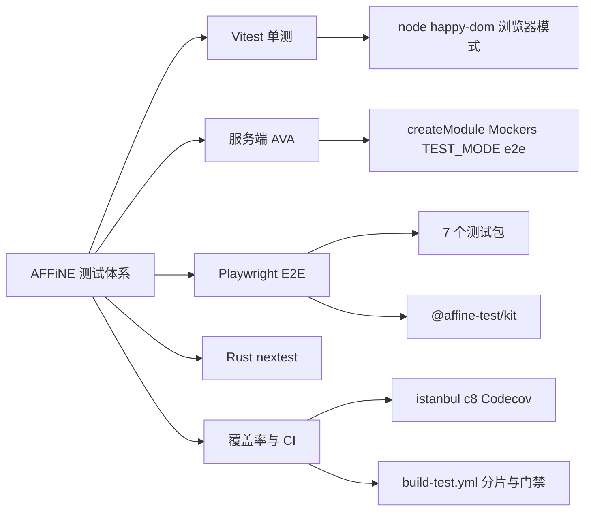
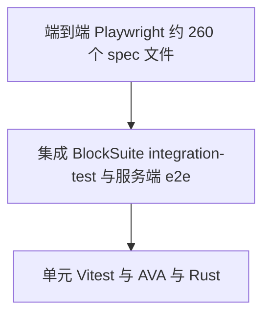
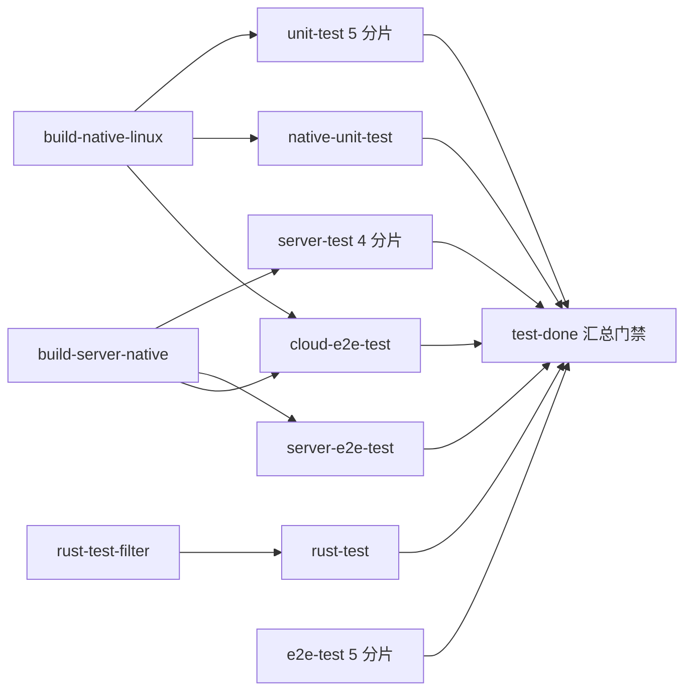

# 第 25 章 测试体系

Vitest、AVA、Playwright、cargo nextest 与 CI 编排全景

第 8 部分 · 质量保障 ｜ 难度 ★★★☆☆ ｜ 建议学时 6 小时

Note:
进入质量保障部分。AFFiNE 是本地优先加实时协作加多端加 AI 的产品，任何环节出错都可能丢用户数据。这一章我们逐层打开它的测试体系，最后亲手写一个单测和一个 E2E。

---

## 本章导读

- 前端与 BlockSuite：**Vitest**（node、happy-dom、浏览器模式）
- 服务端：**AVA**，默认模式与 `TEST_MODE=e2e` 两种
- 端到端：**Playwright**，7 个测试包覆盖多端与编辑器
- Rust：**cargo nextest** 与 criterion 基准
- 覆盖率：istanbul / c8 采集，上报 Codecov
- 编排：`.github/workflows/build-test.yml` 中 30 多个 job

Note:
先建立全局印象：每一层用什么框架、放在哪、怎么跑。这一章的配置文件大多在仓库根目录和 `tests/` 下，跟前面几章的源码目录不同。

---

## 学习目标

- 画出测试金字塔，说出每层框架、目录与命令
- 解读根 `vitest.config.ts` 的 projects、include、setupFiles
- 区分 node、happy-dom、浏览器模式三种环境
- 说明 AVA 两种模式及 `createModule`、Mockers 用法
- 读懂 Playwright 的 webServer、重试，并用 `@affine-test/kit` 写 E2E
- 说出 CI 中主要测试 job 的依赖与分片

Note:
最后要能独立写出并运行一个 Vitest 单测和一个 Playwright E2E，这是动手实践的验收目标。

---

## 知识地图



Note:
五个分支对应本章五大块。Rust 测试篇幅较短，覆盖率和 CI 放在最后，因为它们把前面各层串成一个整体。

---

## 测试金字塔



编辑器逻辑下沉到 BlockSuite 单测与集成；服务端默认连**真实** Postgres/Redis

Note:
底座是单测，中间是浏览器集成和服务端 e2e，顶端是 Playwright。两个取舍值得注意：编辑器逻辑尽量在 BlockSuite 层测，比完整产品 E2E 快得多；服务端不做全量 mock，而是连真实数据库，避免 Prisma 查询与迁移不一致。

---

## 各层位置与命令

| 层级 | 框架 | 位置 | 命令 |
| --- | --- | --- | --- |
| 前端单测 | Vitest | `packages/{common,frontend}/**/*.spec.ts(x)` | `yarn test` |
| BlockSuite | Vitest | `blocksuite/**/src/__tests__/**/*.unit.spec.ts` | `yarn test` |
| 服务端 | AVA | `packages/backend/server/src/**/*.spec.ts` | `yarn affine @affine/server test` |
| 服务端新 e2e | AVA | `src/__tests__/e2e/**/*.spec.ts` | `yarn affine @affine/server e2e` |
| E2E | Playwright | `tests/*/e2e` | `yarn affine @affine-test/<suite> e2e` |
| Rust | nextest | 各 crate `tests.rs` | `cargo nextest run` |

Note:
数量上，前端单测约 146 个文件，BlockSuite 单测约 73 个，服务端约 115 个，E2E 中 blocksuite 包最多有 122 个。注意 `yarn test` 不会运行服务端测试，服务端走的是 AVA。

---

## 根 vitest.config.ts

```ts
test: {
  projects: [
    '.',
    './packages/frontend/apps/electron',
    './blocksuite/**/*/vitest.config.ts',
  ],
  setupFiles: [
    resolve(rootDir, './scripts/setup/polyfill.ts'),
    // ... lit.ts、vi-mock.ts、global.ts
  ],
  include: [
    fg.convertPathToPattern(rootDir) +
      'packages/{common,frontend}/**/*.spec.{ts,tsx}',
  ],
```

`projects` 统一驱动 16 个项目；未设 `environment`，根项目默认 node

`alias.yjs` 强制单份 yjs；`coverage.provider: 'istanbul'` 输出 `.coverage/store`

Note:
`blocksuite/**/*/vitest.config.ts` 匹配 14 个 BlockSuite 子项目，加上根项目和 Electron 共 16 个。四个 setup 文件里最值得看的是 `scripts/setup/global.ts`：它用生产构建同一份 `getBuildConfig` 构造 `BUILD_CONFIG`，保证测试里的分支与真实 Web 产物一致。`lit.ts` 则 stub 掉 `customElements` 避免重复注册报错。

---

## 三种运行环境

| 环境 | 速度 | 能力 | 典型用途 |
| --- | --- | --- | --- |
| node | 最快 | 无 DOM | 纯函数、RxJS、Yjs、存储逻辑 |
| happy-dom | 快 | 模拟 DOM，无真实布局 | React 组件、Lit 模板 |
| 浏览器模式 | 慢 | 真实浏览器 | 编辑器宿主、选区、键盘 |

- 按文件切换：顶部注释 `/** @vitest-environment happy-dom */`
- 子项目整体设置：如 `blocksuite/affine/all` 的 `environment: 'happy-dom'`

Note:
LiveData 的逻辑测试跑在 node；React Hook 测试 `react.spec.tsx` 用文件顶部注释切到 happy-dom。BlockSuite 测试统一命名为 `*.unit.spec.ts`，不少子项目通过 `scripts/vitest-global.js` 把时区固定为 `Asia/Singapore`，保证日期快照在任何机器上一致。

---

## 浏览器模式：@blocksuite/std

```ts
export default defineConfig({
  test: {
    browser: {
      enabled: true,
      headless: true,
      instances: [{ browser: 'chromium' }],
      provider: playwright(),
      isolate: false,
    },
    include: ['src/__tests__/**/*.unit.spec.ts'],
    testTimeout: 500,
    // ... coverage、restoreMocks（esbuild 配置略）
  },
});
```

`blocksuite/integration-test` 在 chromium、firefox、webkit 三浏览器运行

Note:
这是 `blocksuite/framework/std/vitest.config.ts`，provider 来自 `@vitest/browser-playwright`。集成测试更进一步，三个浏览器同时跑、`fileParallelism: false`、CI 中 `retry: 3`。这就是 CI 的 unit-test job 要安装三种浏览器的原因。

---

## 前端单测：给真实实现可控底座

```ts
import 'fake-indexeddb/auto';
// ...
test('doc', async () => {
  // ... 创建 doc1 并写入 test.hello = 'world'
  const docStorage = new IndexedDBDocStorage({
    id: 'ws1',
    flavour: 'a',
    type: 'workspace',
  });
  docStorage.connection.connect();
  await docStorage.connection.waitForConnected();
  const frontend1 = new DocFrontend(docStorage, DocSyncImpl.dummy);
  frontend1.start();
  frontend1.connectDoc(doc1);
```

不 mock 存储层，用内存版 IndexedDB 测真实 `IndexedDBDocStorage`

MSW 在网络层拦截请求，`onUnhandledRequest: 'error'` 杜绝真实网络访问

Note:
这段来自 `packages/common/nbstore/src/__tests__/frontend.spec.ts`。`DocSyncImpl.dummy` 是空同步实现，把测试范围限定在 frontend 与 storage 之间；断言用 `expectYjsEqual` 把 Yjs 二进制解码后比较。MSW 用在 Electron 自动更新器的测试里，被测代码无需任何改造。

---

## 服务端 AVA：两种模式

| 模式 | 命令 | 收集文件 |
| --- | --- | --- |
| 默认 | `yarn affine @affine/server test` | `**/*.spec.ts`、`**/*.e2e.ts` |
| 新 e2e | `yarn affine @affine/server e2e` | `src/__tests__/e2e/**/*.spec.ts` |
| Copilot | `yarn affine @affine/server test:copilot` | `copilot-*.spec.ts` |
| 覆盖率 | `test:coverage` 等 | 同上，外层套 `c8` |

- 默认 `--concurrency 1 --serial`：共享 Postgres 与 Redis，避免互相污染
- 必须经 `yarn affine` 运行：由 CLI 注入 SWC 加载器转译 TS

Note:
`ava.config.js` 根据 `TEST_MODE === 'e2e'` 切换收集文件，并额外加载 `src/__tests__/e2e/prelude.ts`。`extensions: { ts: 'module' }` 只是告诉 AVA 把 ts 当 ESM，真正转译的是 CLI 注入的 `tools/cli/register.js`。串行慢一点，CI 用 4 个 runner 分片弥补。

---

## createModule 与 Mockers

```ts
export async function createModule(
  metadata: TestingModuleMetadata = {}
): Promise<TestingModule> {
  const { tapModule, ...meta } = metadata;
  const functionalityModules = [...FunctionalityModules];
  const builder = Test.createTestingModule({
    ...meta,
    imports: [...functionalityModules, ...(meta.imports ?? [])],
  });
  builder.overrideProvider(EventBus).useValue(new MockEventBus());
  // ... 覆盖 ServerConfigHandle（前置的测试运行时配置略）
  if (tapModule) {
    tapModule(builder);
  }
```

`tapModule` 可覆盖任意 provider；Mocker 直接用 `PrismaClient` 写库，避免触发事件

Note:
`createModule` 基于 `@nestjs/testing`，只装 `FunctionalityModules`；更完整的 `createTestingModule` 还带 GraphQL、Auth、Mail。`MockEventBus` 让测试能断言"某事件是否被发出"。Mocker 的源码注释解释了取舍：业务 Model 可能触发事件等副作用，会干扰事件断言。

---

## 新版 e2e：一个进程一个 App

```ts
import { app, e2e, Mockers } from '../test';

e2e('should be able to delete account', async t => {
  const user = await app.signup();
  const user2 = await app.create(Mockers.User);
  // ...
  await app.gql({
    query: deleteAccountMutation,
  });
  // assert session removed
  const { currentUser } = await app.gql({
    query: getCurrentUserQuery,
  });
  t.is(currentUser, null);
```

prelude 在每个 AVA worker 创建一次完整应用；查询常量来自 `@affine/graphql`

Note:
这段来自 `src/__tests__/e2e/user/account.spec.ts`。服务端 e2e 与前端使用完全相同的 GraphQL 文档，schema 变更导致前端查询失效时，服务端 e2e 会第一时间发现。CI 注释写着它应该"super fast"，所以不需要分片。

---

## Playwright：7 个测试包

| 包 | 被测对象 | 关键配置 |
| --- | --- | --- |
| `tests/affine-local` | Web 本地模式（8080） | CI `retries: 3`、`workers: '50%'` |
| `tests/affine-cloud` | Web + 服务端 | 检测 `http://localhost:3010/graphql` |
| `tests/affine-cloud-copilot` | AI 功能 | basic、chat-with、ai-action 等分组 |
| `tests/affine-desktop(-cloud)` | Electron（+ 服务端） | CI `retries: 5`、workers 1 |
| `tests/affine-mobile` | 移动 Web | `affine dev -p @affine/mobile` |
| `tests/blocksuite` | BlockSuite playground | `timezoneId: 'Asia/Tokyo'` |

Note:
表里把 desktop 和 desktop-cloud 合成一行，共 7 个包。`tests/fixtures/` 存放图片、PDF、zip 等素材，不是 workspace 包。云端测试需要先按第 11 章准备 Postgres、Redis 和 `@affine/server-native`。

---

## playwright.config.ts 要点

```ts
const config: PlaywrightTestConfig = {
  testDir: './e2e',
  fullyParallel: true,
  use: {
    baseURL: 'http://localhost:8080/',
    trace: 'retain-on-failure',
    video: 'retain-on-failure',
  },
  forbidOnly: !!process.env.CI,
  webServer: [
    {
      command: 'yarn run -T affine dev -p @affine/web',
      reuseExistingServer: !process.env.CI,
      // ...
```

webServer 自动拉起被测应用；失败留 trace 与视频到根目录 `test-results/`

Note:
这是 `tests/affine-local/playwright.config.ts` 的节选。`-T` 表示使用根 workspace 的脚本；本地 `reuseExistingServer` 为真，若你已开着 dev server 就直接复用。失败后用 `npx playwright show-trace` 回放；`BROWSER` 环境变量可以切到 firefox 或 webkit。

---

## tests/kit：fixture 与真实用例

```ts
import { test } from '@affine-test/kit/playwright';
// ... openHomePage、clickNewPageButton 等来自 kit/utils
test('click btn new page', async ({ page, workspace }) => {
  await openHomePage(page);
  await waitForEditorLoad(page);
  const originPageId = getCurrentDocIdFromUrl(page);
  await clickNewPageButton(page);
  const newPageId = getCurrentDocIdFromUrl(page);
  expect(newPageId).not.toBe(originPageId);
  const currentWorkspace = await workspace.current();

  expect(currentWorkspace.meta.flavour).toContain('local');
});
```

`context` fixture：注入 `playwright-test` class、`skipOnboarding`、收集覆盖率

Note:
这是 `tests/affine-local/e2e/local-first-new-page.spec.ts`。扩展的 `workspace` fixture 通过 `page.evaluate` 读取当前工作区。`tests/kit/src/utils/` 按领域封装了大量操作，比如 `cloud.ts` 里的 `createRandomUser`、`loginUser`。定位元素优先用 `getByTestId`，其次是 `getByRole`。

---

## Rust 测试与基准

```sh
cargo nextest run --workspace --exclude affine_server_native \
  --features use-as-lib --no-fail-fast
cargo nextest run -p affine_server_native --no-fail-fast --test-threads=1
cargo test -p affine_server_native blob_cleanup_projection_ \
  -- --ignored --nocapture
```

server-native 连真实 PG/Redis，需单线程；长耗时测试用 `#[ignore]` 单独跑

基准：criterion `packages/common/native/benches/hashcash.rs`、Vitest bench

Note:
这三条命令来自 CI 的 `rust-test` job，只有 Rust 相关改动时才运行，CI 固定 `nextest@0.9.98`。`use-as-lib` 特性让 nbstore 以库形式编译测试。原生模块的 JS 绑定测试则是 `yarn affine @affine/native test`，用 AVA 跑 `__tests__/*.spec.mts`。

---

## Copilot 测试：成本与覆盖的平衡

| 线路 | 触发 | 内容 |
| --- | --- | --- |
| PR 按路径 | `copilot-test-filter`（`dorny/paths-filter`） | API 测试 + E2E 5 分片 |
| 定时与发版 | 每天 08:00 UTC 或 canary tag | `copilot-test.yml`，E2E 10 分片 |
| 结果通知 | `tools/copilot-result/index.js` | 推送 Slack |

真实模型配置经 secret `TEST_SERVER_CONFIG` 写入 `config.json`

Note:
AI 测试依赖外部大模型 API，需要密钥、有成本、结果也不完全确定。所以策略是：平时只在改动涉及 copilot 相关路径时跑，每日和发版时全量跑，结果推送到 Slack。定时任务由 `copilot-test-automatically.yml` 通过 workflow-dispatch 触发。

---

## 覆盖率：只参考不门禁

| 来源 | 工具 | 输出 |
| --- | --- | --- |
| 根 Vitest | `@vitest/coverage-istanbul` | `.coverage/store/lcov.info` |
| BlockSuite 子项目 | istanbul | `.coverage/<子项目>/` |
| 服务端 | c8 | `packages/backend/server/.coverage/lcov.info` |
| E2E | 页面内插桩 + kit fixture | `.nyc_output/playwright_coverage_*.json` |

`codecov.yml`：`project: false`、`patch: false`，上传均 `fail_ci_if_error: false`

Note:
c8 基于 V8 原生覆盖率，不需要插桩；E2E 覆盖率要靠 playground 在 `COVERAGE` 为真时启用 `vite-plugin-istanbul`。Codecov 不会因覆盖率下降让 PR 变红，这是一个务实取舍：用 E2E 和关键单测保证质量，而不强求数字。

---

## CI 测试 job 编排



编译一次多处复用 + 分片 + 路径过滤 + `test-done` 单一必需检查

Note:
原生模块只在 build job 编译一次，通过 artifact 分发给各测试 job。`server-test` 还有 elasticsearch、manticoresearch、embedded 三个变体，Electron 在 Linux 上靠 `xvfb-run` 提供虚拟显示。`test-done` 的名字叫 "3, 2, 1 Launch"，任一依赖失败即退出，分支保护只需配置这一项。

---

## 源码导读 Top 5

| 优先级 | 路径 | 看什么 |
| --- | --- | --- |
| P0 | `vitest.config.ts` | projects、include、setupFiles、覆盖率 |
| P0 | `packages/backend/server/ava.config.js` | 两种模式、prelude、环境变量 |
| P0 | `tests/affine-local/playwright.config.ts` | webServer、重试、trace |
| P0 | `tests/kit/src/playwright.ts` | 扩展 fixture、覆盖率收集 |
| P0 | `.github/workflows/build-test.yml` | 测试 job 编排 |

Note:
这五个文件就是整个测试体系的骨架：两个单测配置、一个 E2E 配置、一个公共 fixture、一个 CI 编排。进阶可以读 `src/__tests__/create-module.ts` 和 `mocks/factory.ts`。

---

## 动手实践

| 练习 | 验收要点 |
| --- | --- |
| 1 运行现有单测 | livedata 测试通过，在 Vitest UI 单独重跑用例 |
| 2 写 `shallowEqual` 单测 | 3 个用例通过，能解释 `0` 与 `-0` 不等 |
| 3 运行服务端测试 | 说出 e2e 为何额外加载 prelude |
| 4 写一个 E2E | 通过后故意改错，用 trace 查看现场 |
| 5 阅读一次 CI 运行 | 说出 `test-done` 为何能作唯一必需检查 |

Note:
练习 2 给 `packages/common/infra/src/utils/shallow-equal.ts` 补测试，`0` 与 `-0` 不等是因为用了 `Object.is`，记得跑 `yarn lint:ox`。练习 4 新建 `tests/affine-local/e2e/my-first.spec.ts`，用 `--headed` 运行，练习后删除该文件。

---

## 自测

**Q1** `yarn test` 会运行服务端测试吗？

不会，根配置只收集 `packages/{common,frontend}`，服务端用 AVA <!-- .element: class="fragment" -->

**Q2** 根项目默认 node，某 `.spec.tsx` 需要 DOM 怎么办？

文件顶部加 `/** @vitest-environment happy-dom */` <!-- .element: class="fragment" -->

**Q3** 服务端测试为何必须用 `yarn affine @affine/server test`？

CLI 才会注入 SWC 加载器，支持装饰器与 metadata <!-- .element: class="fragment" -->

**Q4** `reuseExistingServer: !process.env.CI` 在本地有什么坑？

可能复用旧代码或不同配置的 dev server，结果与 CI 不一致 <!-- .element: class="fragment" -->

Note:
四题覆盖 Vitest 范围、环境切换、AVA 运行方式和 Playwright 配置。第四题在实际开发中很常见，遇到"本地过 CI 挂"时先想到它。

---

## 常见坑

| 现象 | 解决 |
| --- | --- |
| `yarn test` 报找不到浏览器 | `npx playwright install`（集成测试需三种浏览器） |
| BlockSuite 测试因 console 输出失败 | 修复警告源头，`onConsoleLog` 会把意外日志转为错误 |
| 服务端测试连接失败 | 启动 docker compose 并 `yarn affine server init` |
| 邮件相关测试失败 | 启动 mailpit/mailhog，MAILER 指向 `0.0.0.0:1025` |
| E2E 本地通过 CI 失败 | 本地设 `CI=1` 复现，或关闭已有 dev server |

Note:
第二条是 `blocksuite/affine/all/vitest.config.ts` 的严格策略：除少数已知日志外，测试中任何 console 输出都会抛错，逼你处理掉意外警告。另外别给服务端测试加并发，保持串行并用随机前缀隔离 Redis 键。

---

## 小结与下一步

- 金字塔：Vitest/AVA/Rust 单测 → 集成 → 7 个 Playwright 包
- Vitest 多项目，按需选 node、happy-dom 或浏览器模式
- 服务端连真实数据库，`createModule` 装配、Mockers 造数
- E2E 复用 `@affine-test/kit`，失败保留 trace 与视频
- CI：编译复用 + 分片 + 路径过滤 + `test-done` 门禁

<div class="callout">

下一章：**第 26 章 CI/CD 与 GitHub Actions**——这些测试如何融入完整的构建与发布流水线

</div>

Note:
测试体系的核心思想是"给真实实现一个可控底座"，而不是大面积 mock。下一章我们把视角拉到整个 CI/CD 流水线，看构建、测试、发布如何串起来。
