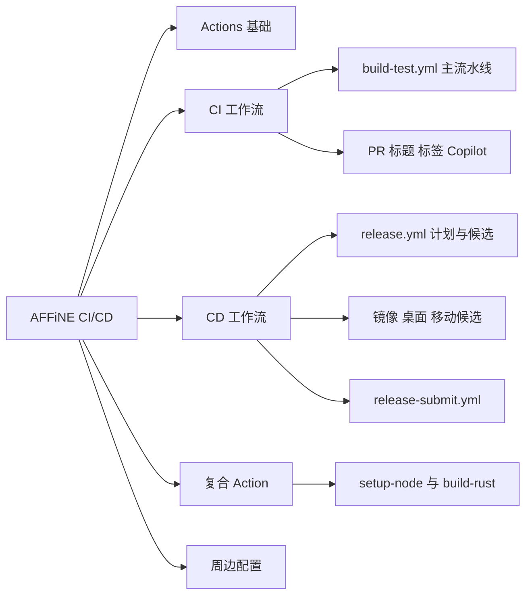
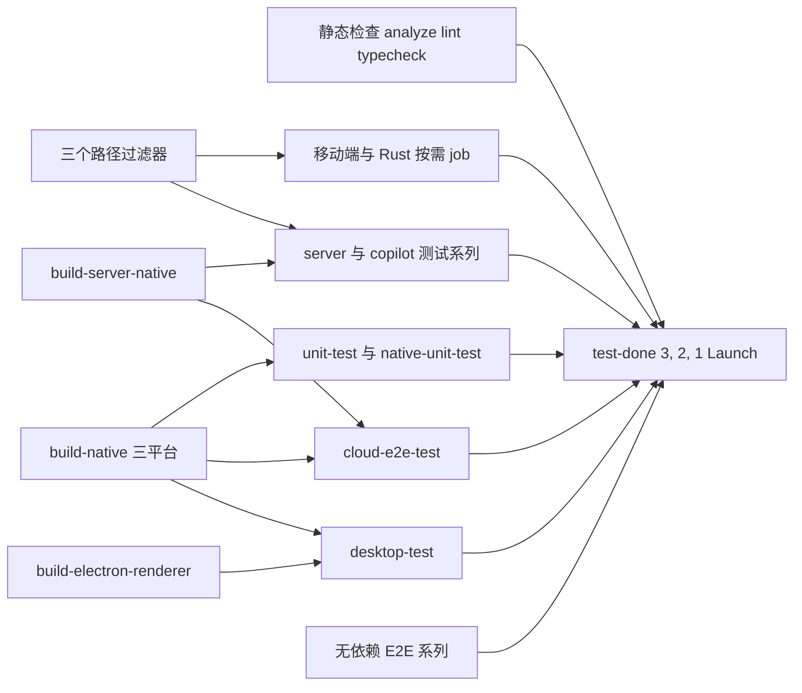
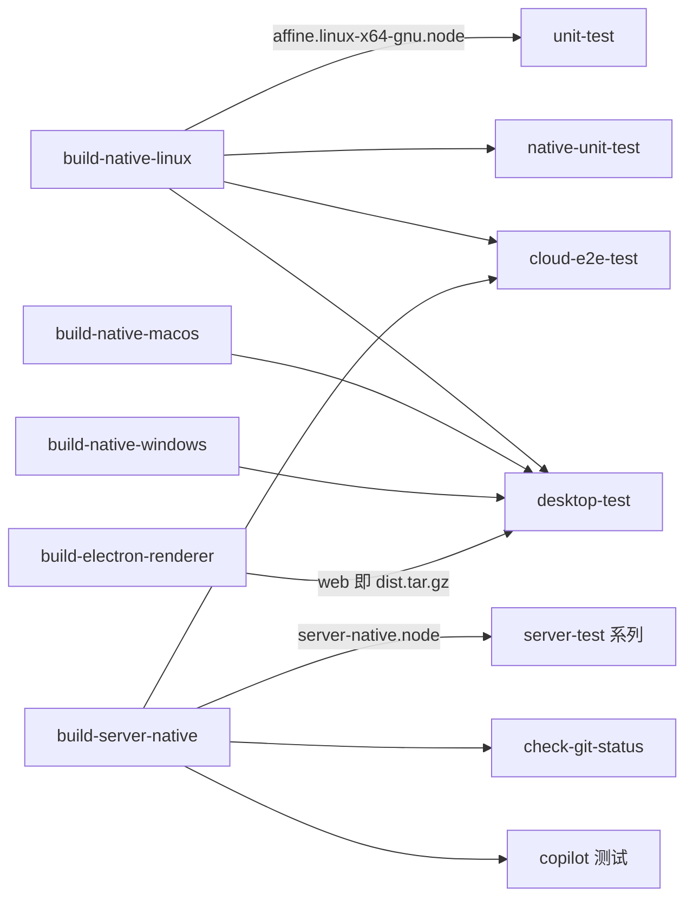
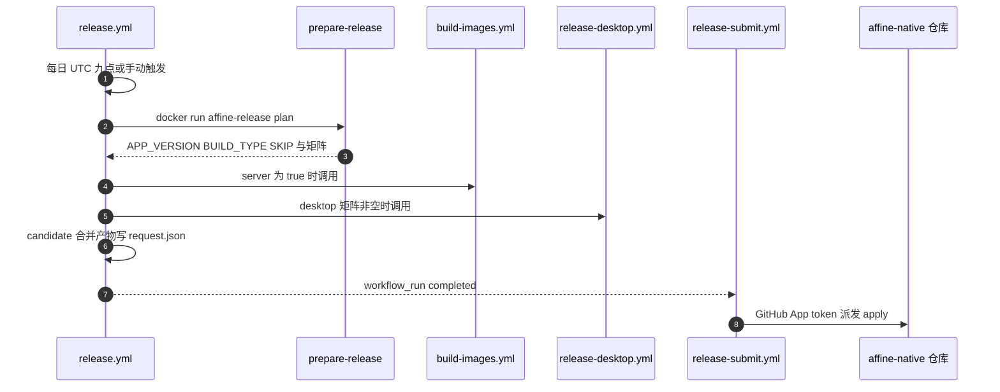

# 第 26 章 CI/CD 与 GitHub Actions

把代码变成产品的流水线：从 PR 检查到发布候选

第 9 部分 · 运维与部署 ｜ 难度 ★★★☆☆ ｜ 建议学时 6 小时

Note:
欢迎来到第 26 章。提交一个 PR 后，页面下方会出现几十个检查项，最后一个叫 "3, 2, 1 Launch"。这一章就来拆解这些检查从哪里来、如何组织、又如何把代码变成可发布的候选产物。

---

## 本章导读

- 每个 PR 都会触发几十个检查：Lint、Typecheck、E2E……
- 它们全部来自仓库的 `.github/` 目录
- **CI**：每次提交自动检查、测试、编译 Rust 原生模块
- **CD**：定时或手动构建镜像、桌面包、移动端资源
- 产出"发布候选"（candidate），再交给签名与发布系统
- 范围：11 个工作流 + 8 个复合 Action + 周边配置

Note:
CI 保证主干永远可发布，CD 负责把主干变成候选产物。本章覆盖 `.github/workflows` 下全部 11 个工作流和 `.github/actions` 下 8 个复合 Action。最后还会顺带讲 `render.yaml`、`.codesandbox` 这些周边配置。

---

## 学习目标

- 解释 workflow、job、step、matrix、needs、cache 等概念
- 画出 `build-test.yml` 的 job 依赖图，说清 `test-done` 作用
- 读懂 8 个复合 Action 的输入与复用方式
- 说明 `dorny/paths-filter` 如何实现按需构建
- 描述 `prepare` → `candidate` → `release-submit.yml` 发布链路
- 定位 Sentry sourcemap、codecov、Windows 签名检查配置

Note:
这六条目标对应本章的主线。前两条是基础概念和主流水线 DAG，中间两条是复用与按需构建技巧，最后两条是发布链路和周边集成。学完后你应该能在本地用 `actionlint` 校验工作流，并为新包设计 CI 接入方式。

---

## 知识地图



Note:
整张地图分五块。基础概念是地基；CI 部分以 `build-test.yml` 为核心；CD 部分从 `release.yml` 出发构建各类候选再提交；复合 Action 是它们共享的积木；周边配置包括 actionlint、renovate、codecov、render 等。

---

## Actions 概念速成

| 概念 | 一句话 | AFFiNE 例子 |
| --- | --- | --- |
| workflow | `.github/workflows/*.yml`，事件触发 | `build-test.yml` |
| job | 独立 runner 上的一组 step，默认并行 | `lint`、`unit-test` |
| matrix | 参数组合派生多实例 | `shard: [1, 2, 3, 4, 5]` |
| needs | 声明依赖，形成 DAG | `unit-test` needs `build-native-linux` |
| concurrency | 同组只保留一个运行 | 取消旧运行 |
| composite action | 多个 step 打包复用 | `setup-node`、`build-rust` |

Note:
workflow 是一个 yml 文件，由 push、pull_request、schedule 等事件触发。job 跑在独立机器上，默认并行，用 needs 串起依赖。另外还有 outputs、secrets、permissions、reusable workflow 等概念，比如 `build-images.yml` 就是 `workflow_call` 形式的可复用工作流。

---

## artifact 与 cache 的区别

| 维度 | artifact | cache |
| --- | --- | --- |
| 目的 | 同一次运行中 job 间传产物 | 不同运行间复用中间结果 |
| 可见性 | 运行页面可下载 | 不可直接下载 |
| 命中语义 | 按名字精确获取，缺失即失败 | 按 key 命中，未命中当无缓存 |
| AFFiNE 用法 | `.node` 原生模块、`dist.tar.gz` | `node_modules`、`~/.cargo` |

Note:
这是新手最容易混淆的一点。artifact 是"这次运行里上游给下游递文件"，比如 Rust 构建出的 `.node` 交给测试 job；cache 是"下次运行能少干点活"，比如 node_modules 和 cargo 目录。记住一句话：artifact 传产物，cache 省时间。

---

## build-test.yml：触发与并发

<p class="small">来源：.github/workflows/build-test.yml（节选）</p>

```yaml
on:
  push:
    branches:
      - canary
      - beta
      - stable
      - v[0-9]+.[0-9]+.x-staging
      - v[0-9]+.[0-9]+.x
  pull_request:
  merge_group:
concurrency:
  group: ${{ github.workflow }}-${{ github.ref }}
  cancel-in-progress: true
```

全局 env：`BUILD_TYPE: canary`、`COVERAGE: true`、`DEBUG: napi:*`；改 `README.md` 不触发。

Note:
触发分支与第 4 章的分支模型一一对应，原文还有 `paths-ignore: README.md`，这里省略了。`merge_group` 让 PR 进入合并队列后在临时合并提交上再跑一遍。concurrency 以 workflow 加 ref 分组，同一 PR 连续推送时会取消旧的运行，节省大量 runner 时间。

---

## job 依赖 DAG（按组聚合）



共 34 个 job；`test-done` 实际 needs 其余全部 33 个。

Note:
原图有三十多个节点，这里按职责聚合成 12 组。设计意图很清楚：把慢而通用的产物，也就是 Rust 原生模块和 Electron 渲染层，放在 DAG 上游一次性构建，下游大量测试通过 artifact 复用。注意 `check-git-status` 也依赖 `build-server-native`，图里归入了静态检查一类没有单独画出。

---

## 静态检查与生成物一致性

<div class="cols">
<div>

**lint / typecheck**

- `actionlint` 先检查工作流本身
- `yarn lint:ox` 与 `yarn lint:format`
- 格式检查前 `git checkout .yarnrc.yml`
- `yarn dedupe --check` 防锁文件冗余

</div>
<div>

**check-git-status**

- 重跑 `init`、`gql build`、`i18n build`
- 再跑 `yarn affine server genconfig`
- `git status --porcelain` 有差异即失败
- 依赖 server-native 才能加载服务端

</div>
</div>

Note:
lint job 从检查工作流自身开始，actionlint 会读取 `.github/actionlint.yaml`。`setup-node` 可能修改 `.yarnrc.yml`，所以格式检查前要先还原避免误报。check-git-status 的策略是"重新生成一遍再看 git 有没有差异"；`i18n-completenesses.json` 会被显式还原，翻译完成度变化不应阻塞 PR。

---

## 路径过滤：按需构建

<p class="small">来源：.github/workflows/build-test.yml（节选）</p>

```yaml
  rust-test-filter:
    outputs:
      run-rust: ${{ steps.rust-filter.outputs.rust }}
    steps:
      - uses: dorny/paths-filter@v3
        id: rust-filter
        with:
          filters: |
            rust:
              - '**/*.rs'
              - '**/Cargo.toml'
              - '.github/workflows/build-test.yml'
  lint-rust:
    if: ${{ needs.rust-test-filter.outputs.run-rust == 'true' }}
```

Note:
移动端原生构建和 Rust 测试都很慢，所以用一个轻量 job 计算"本次改动是否涉及某些路径"，通过 outputs 加 if 跳过下游。过滤规则里包含了 workflow 文件本身，改 CI 配置时会强制触发，避免"改坏了 CI 却没被验证"。完整规则还有 `Cargo.lock`、`.cargo/**`、`rust-toolchain*` 和 `build-rust` action。

---

## 三个过滤器对照

| 过滤 job | 输出 | 控制的下游 |
| --- | --- | --- |
| `mobile-native-build-filter` | `run-android` / `run-ios` | Android 构建与测试、iOS 构建 |
| `rust-test-filter` | `run-rust` | `lint-rust`、`rust-test` |
| `copilot-test-filter` | `run-api` / `run-e2e` | `copilot-api-test`、`copilot-e2e-test` |

<div class="callout">

被 `if` 跳过的 job 结果为 `skipped`，不会让 PR 变红。`build-native-*`、`unit-test` 没有路径过滤，每次都跑。

</div>

Note:
三个过滤器分别守住移动端、Rust 和 Copilot 三块最慢或最贵的测试。Copilot 测试会真实调用 AI 接口，所以只在相关路径改动时才跑。前端代码几乎处处依赖 `@affine/native`，因此原生构建和单测没有过滤。

---

## 原生模块与 artifact 流转



技巧：`workspaces focus` 聚焦安装、`parseTriple` 统一文件名、Windows 用 Dev Drive。

Note:
文件名由 `@napi-rs/cli` 的 `parseTriple` 计算，比如 `x86_64-unknown-linux-gnu` 对应 `affine.linux-x64-gnu.node`，上下游用同名 artifact 对接。CI 里还用 `CARGO_PROFILE_RELEASE_*` 把 release profile 改成 thin LTO、16 个 codegen units，在编译速度和性能间折中。`web` 产物最终被 `download-web` 解压到 Electron 的 `resources/web-static`。

---

## unit-test：分片与 codecov

<p class="small">来源：.github/workflows/build-test.yml（节选）</p>

```yaml
  unit-test:
    strategy:
      fail-fast: false
      matrix:
        shard: [1, 2, 3, 4, 5]
    steps:
      - name: Unit Test
        run: >-
          yarn test:coverage
          --shard=${{ matrix.shard }}/${{ strategy.job-total }}
      - uses: codecov/codecov-action@v5
        with:
          flags: unittest
          fail_ci_if_error: false
```

Note:
`strategy.job-total` 自动等于分片数 5，改分片时不用同步改命令。`fail-fast: false` 让一个分片失败时其他分片继续跑，一次看全所有失败。根目录 `codecov.yml` 把 project 和 patch 状态都关掉了，覆盖率下降不会让 PR 失败，只做可视化参考。

---

## server-test：services 容器

<div class="cols">
<div>

```yaml
services:
  postgres:
    image: pgvector/pgvector:pg16
  redis:
    image: redis
  mailer:
    image: mailhog/mailhog
```

</div>
<div>

- 先启动容器并等待健康检查
- 4 节点分片：`CI_NODE_INDEX` / `CI_NODE_TOTAL`
- 搜索变体靠 `indexer-provider` 切换
- `elasticsearch` / `embedded` / `manticoresearch`

</div>
</div>

Note:
服务端测试需要真实的 Postgres（带 pgvector）、Redis 和 SMTP，`services` 会在 job 开始前拉起容器，postgres 配了 `pg_isready` 健康检查。几个搜索相关 job 的差别只在复合 Action `server-test-env` 的 `indexer-provider` 输入和测试文件范围；`server-e2e-test` 则用 `disabled` 关闭索引。

---

## test-done：一个检查顶替几十个

<p class="small">来源：.github/workflows/build-test.yml（节选，条件已折行）</p>

```yaml
  test-done:
    needs:
      - analyze
      - lint
      # ... 共 33 个 job
    if: always()
    name: 3, 2, 1 Launch
    steps:
      - run: exit 1
        if: >-
          ${{ always() && (
            contains(needs.*.result, 'failure') ||
            contains(needs.*.result, 'cancelled')) }}
```

只把 "3, 2, 1 Launch" 设为分支保护的必需检查。

Note:
分支保护要求逐一列出必需检查的名字，而 job 和分片经常变化，维护这个列表很痛苦。于是只设一个汇总 job：`if: always()` 保证上游失败它也运行，结果里有 failure 或 cancelled 就退出 1，skipped 和 success 都算通过。注释说明这个技巧借鉴自 Next.js 仓库。

---

## 8 个复合 Action

<div class="cols">
<div>

- `setup-node`：Node、yarn、多级缓存
- `build-rust`：工具链、rust-cache、构建
- `server-test-env`：生成 config 并迁移
- `download-web`：下载解压 `web` 产物

</div>
<div>

- `setup-version`：调用 `set-version.sh`
- `setup-sentry`：安装 `@sentry/cli`
- `prepare-release`：生成 `release-plan.json`
- `copilot-test`：跑 Copilot E2E

</div>
</div>

Note:
复合 Action 把多个 step 打包复用。`setup-node` 几乎被所有 job 使用，`build-rust` 服务于原生构建、Rust 测试和移动端。`server-test-env` 用 jq 生成 `packages/backend/server/config.json` 并执行 prisma 迁移，这正好呼应第 27 章的配置体系。

---

## 缓存策略

| 组合 | 缓存内容 | key 维度 |
| --- | --- | --- |
| 非 full + Linux | `node_modules` + yarn 全局缓存 | 含 job 名 |
| 非 full + 非 Linux | 仅 yarn 全局缓存 | 含 job 名 |
| full + Linux | `node_modules` + yarn 全局缓存 | 全局共享 |
| `build-rust` | `Swatinem/rust-cache` | `save-if` 仅 canary |

<p class="small">key 不含 yarn.lock 哈希：命中率高，代价是缓存偏大。</p>

Note:
macOS 网络差、Windows 解压慢，所以非 Linux 平台不缓存 node_modules。`setup-node` 还单独缓存 Playwright 浏览器和 Electron 二进制。`build-rust` 的 `save-if: github.ref_name == 'canary'` 只让 canary 写缓存、PR 只读，既防止挤占 10GB 配额，也降低了恶意 PR 投毒缓存的风险。

---

## PR 辅助工作流的安全写法

<div class="cols">
<div>

**pr-title-lint.yml**

- 标题经 `env: TITLE` 传入
- 不在 `run` 中直接插值，防脚本注入
- commitlint 校验 `scope-enum`
- 合法示例 `feat(electron): add tray menu`

</div>
<div>

**auto-labeler.yml**

- 使用 `pull_request_target` 拿写权限
- 默认检出基础分支，不执行 PR 代码
- permissions 收窄为 `pull-requests: write`
- 按 `.github/labeler.yml` 路径打标签

</div>
</div>

Note:
直接写 `run: echo "${{ github.event.pull_request.title }}"` 会把用户可控文本拼进脚本，构成脚本注入，所以要用环境变量传。fork PR 在 `pull_request` 下只有只读 token 打不了标签，所以用 `pull_request_target`；它很危险，绝不能 checkout 并执行 PR 代码。Copilot 测试另有 `copilot-test-automatically.yml` 定时派发 `copilot-test.yml`。

---

## 发布链路：Release Candidates



移动端 `release-mobile.yml` 与桌面并行，只构建 Web 资源。

Note:
发布由 `release.yml` 驱动，先用外部发布工具镜像算出计划，再并行调用镜像、桌面、移动三个可复用工作流。candidate job 合并产物，工作流完成后由 `release-submit.yml` 通过 `workflow_run` 接力，派发到 `toeverything/affine-native` 仓库的 `affine-release.yml`。按向下键可以看关键设计。

--

## 发布链路的关键设计

- **计划与执行分离**：镜像 `affine-release` 算出 `release-plan.json`
- **幂等跳过**：读取 `affine-release-completed.json`，已完成则 `SKIP`
- **候选不可变**：重跑报 "Submitted candidates are immutable"
- **可选平台**：`desktop-linux?` 对应 `continue-on-error`
- **未签名候选**：`AFFINE_UNSIGNED_PACKAGE: '1'`，签名在外部仓库
- **动态矩阵**：`matrix: ${{ fromJSON(inputs.matrix) }}`

Note:
工作流本身只是执行者，版本号、渠道、平台都由发布工具计算。主仓库只产出未签名候选，签名、公证、上传都在外部仓库完成，主仓库因此不需要持有签名私钥。镜像构建还开启了 `provenance: true`，输出按 digest 引用的不可变地址。

---

## Sentry、签名与版本号

| 主题 | 位置 | 要点 |
| --- | --- | --- |
| web sourcemap | `tools/cli/src/rspack/index.ts` | 检测到 `SENTRY_AUTH_TOKEN` 才启用 |
| Electron sourcemap | `electron/scripts/common.ts` | `sentryEsbuildPlugin` |
| Windows 签名检查 | `scripts/check-windows-signer.mjs` | beta/stable 缺配置即失败 |
| 版本号 | `scripts/set-version.sh` | 统一改写所有 workspace 版本 |

<p class="small">PR 构建拿不到 secrets，插件自然不启用——无需 if 分支。</p>

Note:
Sentry 上传逻辑写在构建工具里，"有环境变量就启用"，所以同一份脚本在 PR 和发布中行为不同却不需要任何分支判断。Windows 签名检查对 canary 只发警告并输出 `signer_available=false`，跳过安装器 exe。版本号由 `setup-version` 调用脚本统一改写，保证所有包版本一致。

--

## 周边配置

- `renovate.json`：分组升级、每周 `lockFileMaintenance`
- `renovate.json` 还用 regex 跟踪 `rust-toolchain.toml`
- `render.yaml`：Render Blueprint，部署 `stable` 镜像
- `.render/start.sh`：先跑 `self-host-predeploy.js` 再启动
- `.codesandbox/task.json`：`yarn dev-core` 已过时，应改 `yarn dev`
- `.kuai.yaml`：0 字节未跟踪文件，可忽略

Note:
Renovate 的 `yarnDedupeHighest` 和 lint 中的 `yarn dedupe --check` 互相配合。`render.yaml` 严格说是一键自托管模板而非 PR 预览环境，它不构建 PR 代码。CodeSandbox 配置里引用的 `dev-core` 脚本在根 `package.json` 中已经不存在了。

---

## 源码导读 Top 5

| 优先级 | 路径 | 看什么 |
| --- | --- | --- |
| P0 | `.github/workflows/build-test.yml` | 触发、并发、needs 与 test-done |
| P0 | `.github/actions/setup-node/action.yml` | 输入参数、四种缓存组合 |
| P0 | `.github/actions/build-rust/action.yml` | 工具链来源、`save-if`、交叉编译 |
| P1 | `.github/workflows/release.yml` | prepare、动态矩阵、候选不可变 |
| P1 | `.github/workflows/pr-title-lint.yml` | 安全传参与 commitlint |

Note:
建议从 `build-test.yml` 读起，这个文件约 1700 行，先只看每个 job 的 needs 和 if。然后看两个最常用的复合 Action。发布相关的 `release.yml`、`prepare-release` 和 `build-images.yml` 可以放在第二轮。

---

## 动手实践

| 练习 | 验收要点 |
| --- | --- |
| 1 本地运行 actionlint | 解释 `self-hosted-runner.labels` 作用 |
| 2 画出完整 DAG | 找出关键路径到 `test-done` |
| 3 模拟路径过滤 | 写出两次改动运行与跳过的 job |
| 4 在 fork 中跑一次 CI | 说出哪些 job 因缺 secrets 行为不同 |
| 5 为新包设计 CI 接入 | ≤ 40 行 job 草稿，无需改分支保护 |

Note:
练习 1 里把 runner 标签改成 `win-signerx` 观察报错，再改回 `win-signer` 对比。练习 2 的提示是 `build-native-windows` 到 `desktop-test` 再到 `test-done`。练习 5 的关键是理解：新 job 只要加进 `test-done` 的 needs，就不需要改分支保护规则。

---

## 自测

1. 被路径过滤跳过的 job 会让 "3, 2, 1 Launch" 失败吗？

不会，只有 `failure` / `cancelled` 才 `exit 1`。 <!-- .element: class="fragment" -->

2. `check-git-status` 为什么依赖 `build-server-native`？

`genconfig` 要加载服务端代码，而它依赖 `server-native.node`。 <!-- .element: class="fragment" -->

3. 主仓库的桌面候选为什么未签名？

主仓库不持有签名私钥，签名在 `affine-native` 仓库完成。 <!-- .element: class="fragment" -->

Note:
先让大家思考再逐个揭晓答案。第一题考 test-done 的判定条件；第二题考生成物与原生模块的关系；第三题考发布链路的安全设计。还可以追问：Sentry sourcemap 在 PR 构建中会上传吗？答案是不会，因为拿不到 secrets。

---

## 常见坑

| 现象 | 原因与解决 |
| --- | --- |
| "make sure all changes are submitted" | 生成物未提交；本地重跑提示命令 |
| `yarn dedupe --check` 失败 | 本地 `yarn dedupe` 后提交 |
| PR Title Lint 失败 | scope 不在 `scope-enum` 白名单 |
| fork PR 中 Copilot 测试失败 | 缺 `TEST_SERVER_CONFIG`，属预期 |
| Ubuntu 上 Electron 起不来 | AppArmor 限制，需 `sysctl` 与 `xvfb-run` |
| 找不到 `affine.linux-x64-gnu.node` | 上游 `build-native-linux` 失败 |

Note:
最常见的 CI 失败是生成物没提交，提示信息里已经给出了完整命令。Ubuntu 24.04 上 Electron 的坑在 workflow 注释里写得很清楚，是 AppArmor 限制了非特权 user namespace。下游报找不到原生模块时，先去看上游 Rust 构建日志。

---

## 小结与下一步

- 主流水线集中在 `build-test.yml`，用 DAG 复用慢产物
- 路径过滤让 Rust、移动端、Copilot 测试按需运行
- `test-done` 一个必需检查顶替几十个 job
- 缓存只在 canary 写入，脚本注入与 `pull_request_target` 要小心
- 发布：计划与执行分离，主仓库只出未签名候选

**下一章**：第 27 章 部署与运维——镜像里有什么、怎么跑起来

Note:
这一章的核心取舍是：单一大流水线换来清晰的 DAG 和一个必需检查，按需构建节省最慢的部分，签名移到外部仓库缩小攻击面。CI 产出了多架构镜像 `ghcr.io/toeverything/affine`，下一章我们就来看这个镜像怎么部署、怎么运维。
