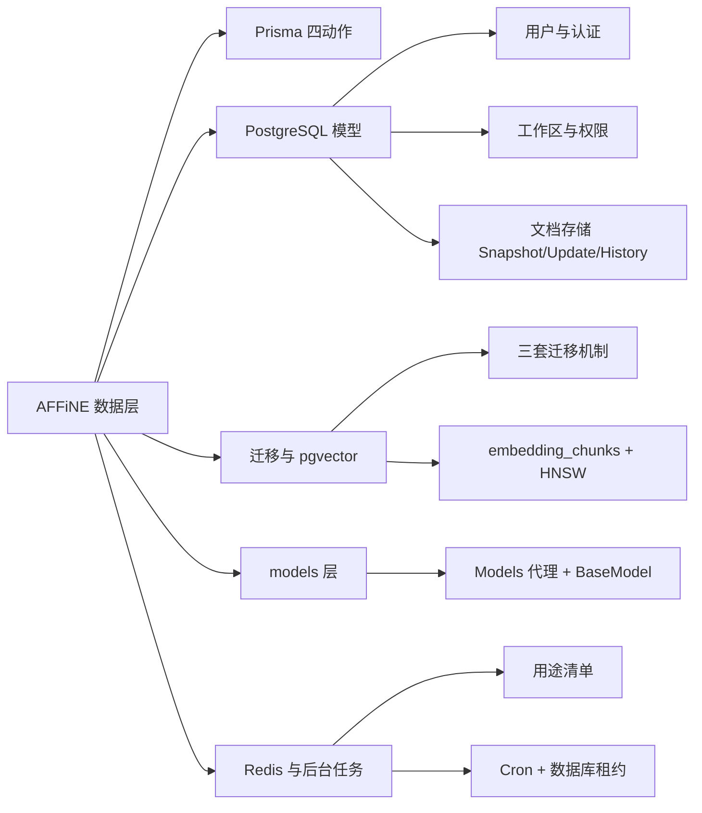
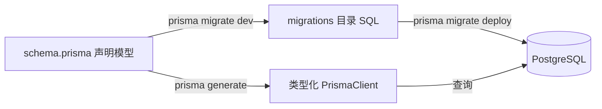
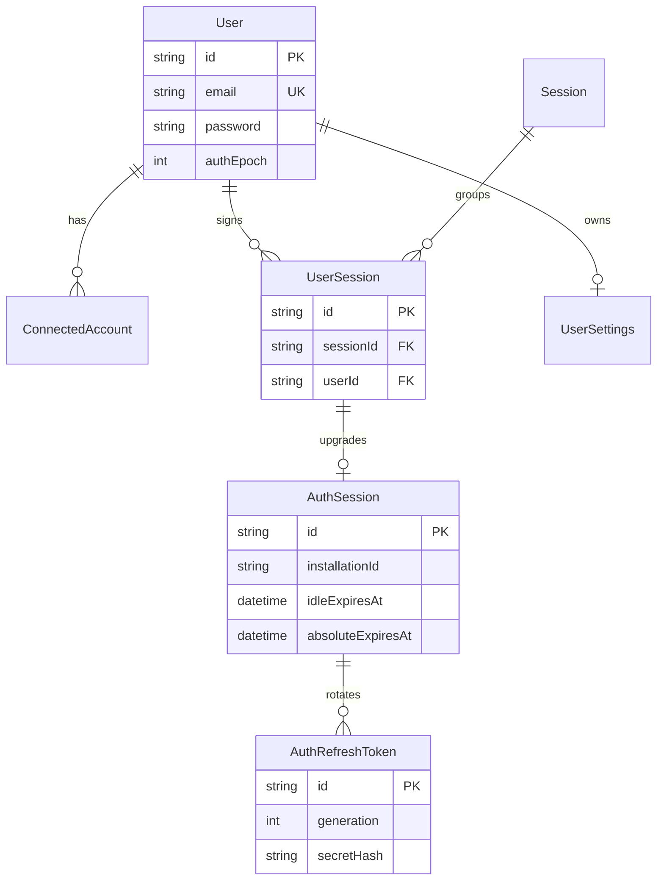
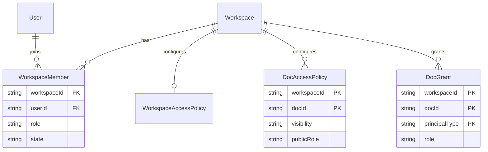
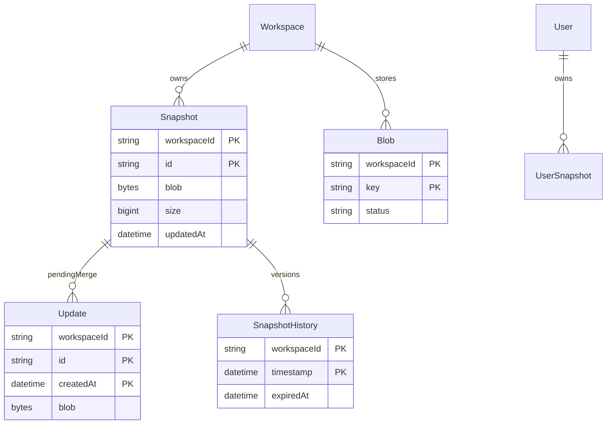
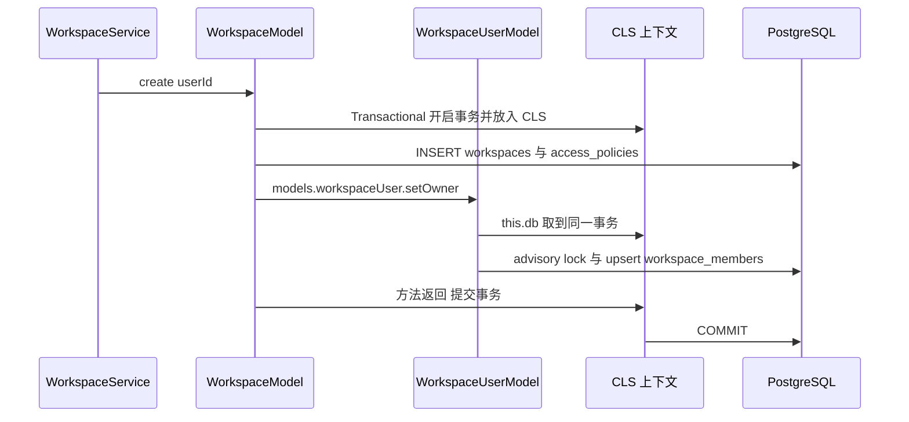

# 第 26 章 数据层：Prisma、PostgreSQL、Redis

> 权威数据落在 PostgreSQL，Prisma 描述表结构，Redis 只做缓存、计数与消息

第 7 部分 · 后端服务 ｜ 难度 ★★★☆☆ ｜ 建议学时 8 小时

===

## 本章要解决的问题

<p class="lead">前端把数据放在 <code>useState</code>、IndexedDB 或 nbstore；后端的数据最终都要落到数据库。AFFiNE 服务端的数据层由三块构成。</p>

它们分工清晰：**PostgreSQL 是唯一权威数据源**（用户、工作区、权限、文档快照、AI 会话、支付记录，还借 pgvector 存向量）；**Prisma 6 是 TypeScript ORM**，负责 `schema.prisma`、生成客户端、管理迁移；**Redis 只做缓存、限流、分布式锁与跨实例消息**，里面没有任何必须持久化的数据。

<div class="cards cols-3">
  <div class="card"><div class="card__icon">🐘</div><h4>PostgreSQL</h4><p>Source of Truth，65 个模型 + pgvector 向量表。</p></div>
  <div class="card"><div class="card__icon">🔷</div><h4>Prisma 6</h4><p>schema / generate / migrate / client 四个动作。</p></div>
  <div class="card"><div class="card__icon">⚡</div><h4>Redis</h4><p>缓存、限流、锁、socket.io 广播、失效通知。</p></div>
</div>

<div class="note note--warn">

最关键的背景：0.27.x 中**有一部分表不在 `schema.prisma` 里**，而由 Rust 原生运行时（`packages/backend/native/src/runtime/sql/*.sql`）自行建表和迁移——例如向量表 `embedding_chunks`、搜索投影 `search_projection.*`、运行时租约 `runtime_leases`。看到 `psql \dt` 里“schema 里没有的表”别慌，去那里找。

</div>

===

## 知识地图

本章围绕三个层次展开：**Prisma 四动作 → PostgreSQL 65 模型（三张核心 ER 图）→ 迁移、向量、models 层、Redis 与后台任务**。



<div class="note">

本章路径均相对仓库根目录 `AFFiNE/`。贯穿全章的一条主线是：**TS 层负责协议与装配，领域核心（权限、配额、向量、支付状态机）下沉到 Rust 运行时**——这与第 25、27、28 章一脉相承。

</div>

===

## 学习目标

学完本章，你应当能够：

<ol class="goals">
  <li>解释 Prisma 的 <code>schema</code>、<code>generate</code>、<code>migrate</code>、<code>client</code> 四个环节及其在 AFFiNE 中的文件与命令</li>
  <li>画出用户认证、工作区权限、文档存储三张 ER 图，说清 <code>Snapshot</code> + <code>Update</code> + <code>SnapshotHistory</code> 如何共同表示一篇 CRDT 文档</li>
  <li>区分 Prisma 迁移、Rust 运行时迁移、数据迁移三套机制及各自的记录表</li>
  <li>说明 pgvector 向量表在哪定义、用什么索引、如何查询</li>
  <li>描述 <code>BaseModel</code>、<code>Models</code> 代理、<code>@Transactional()</code> 如何协作</li>
  <li>列出 Redis 至少 6 种用途，解释 <code>FOR UPDATE SKIP LOCKED</code> 租约模式及不用队列的取舍</li>
</ol>

===

<!-- section -->
## 一、Prisma 四个动作

直接写 SQL 当然可以，但字段拼错只能运行时发现、结果没类型、表结构变更难追踪。ORM 把“表”映射成“类型”。

===

## schema → generate → migrate → client

Prisma 的四个动作构成一条从“声明”到“数据库”的链路：改 `schema.prisma`，生成类型化客户端供代码调用，同时产出 SQL 迁移推到 PostgreSQL。



| 动作 | 命令 | AFFiNE 中的位置 |
| --- | --- | --- |
| 声明 | 编辑 `schema.prisma` | `packages/backend/server/schema.prisma`（1537 行） |
| 生成客户端 | `prisma generate` | `package.json` 的 `postinstall` 自动执行，输出到根 `node_modules/.prisma/client` |
| 开发迁移 | `prisma migrate dev` | `yarn init` = `prisma migrate dev && yarn data-migration run` |
| 生产迁移 | `prisma migrate deploy` | `predeploy` 脚本中执行 |

<div class="note">

datasource 里 `extensions = [pgvector(map: "vector")]` 声明了向量扩展；`previewFeatures` 的 `relationJoins` 让关联查询走 SQL JOIN 而非多次往返，`metrics` 被 `PrismaMetricProducer` 用于导出连接池指标。

</div>

===

## 读懂一个模型

以 `User` 为例，Prisma 模型语法与 PostgreSQL 列一一对应。AFFiNE 的约定非常统一：**所有时间列都是 `Timestamptz(3)`**（带时区、毫秒精度），**表名列名一律 snake_case**，两者都由专门的标准化迁移统一改造过。

<div class="annotate">

```prisma [1|3|5|10|12-13]
model User {
  id              String    @id @default(uuid()) @db.VarChar
  email           String    @unique @db.VarChar
  emailVerifiedAt DateTime? @map("email_verified") @db.Timestamptz(3)
  password        String?   @db.VarChar
  registered      Boolean   @default(true)
  disabled        Boolean   @default(false)
  authEpoch       Int       @default(0) @map("auth_epoch")
  workspaceMembers WorkspaceMember[]
  sessions         UserSession[]
  @@index([email])
  @@map("users")
}
```

<ol class="annotate__notes">
  <li><b>第 5 行</b>：<code>password</code> 可空——为空表示 OAuth 注册。</li>
  <li><b>第 10 行</b>：<code>authEpoch</code> 自增可让该用户全部旧凭证一次性失效。</li>
  <li><b>第 12–13 行</b>：<code>@@index</code> 普通索引、<code>@@map</code> 把 TS 的驼峰类名映射到 snake_case 表名。</li>
</ol>
</div>

===

<!-- section -->
## 二、模型全景与领域分组

65 个模型、11 个枚举。按领域分组记忆，比逐个背表名高效得多。

===

## 65 个模型按领域分组

模型按业务领域聚类，数量分布揭示了产品重心——AI 与支付各占一大块。

<div class="stats">
  <div class="stat"><b>65</b><span>个模型</span></div>
  <div class="stat"><b>11</b><span>个枚举</span></div>
  <div class="stat"><b>122</b><span>个迁移目录</span></div>
</div>

| 领域 | 代表模型 | 数量 |
| --- | --- | --- |
| 用户与认证 | `User`、`Session`、`UserSession`、`AuthSession`、`AuthRefreshToken`… | 9 |
| 工作区与权限 | `Workspace`、`WorkspaceMember`、`DocGrant`、`DocAccessPolicy`… | 7 |
| 文档与文件存储 | `Snapshot`、`UserSnapshot`、`Update`、`SnapshotHistory`、`Blob` | 5 |
| 权益与配额 | `Entitlement`、`Effective*QuotaState`、`UserFeature`… | 5 |
| AI | `AiSession`、`AiSessionMessage`、`AiActionRun`、`McpCredential`… | 11 |
| 支付 / License | `ProviderSubscription`、`Invoice`、`PaymentEvent`、`License`… | 9 |
| 评论 / 通知 / 日历 / 统计 / 系统 | `Comment`、`Notification`、`CalendarEvent`、`AppConfig`… | 19 |

<div class="note note--tip">

**为何新表大多用 `String` 存状态而不用 Prisma `enum`？** PG 枚举增删值需要迁移，且滚动发布时新旧版本共存容易冲突。`AiSessionMessageRole` 上的 `@@map("AiPromptRole")` 就记录了一次“为兼容旧客户端而保留数据库枚举名”的痛苦经历。状态合法性改由应用层与 Rust 运行时校验。

</div>

===

<!-- section -->
## 三、三张核心 ER 图

用户认证、工作区权限、文档存储——这三张图是整个数据层的骨架。

===

## 用户与认证域

账号主体是 `User`，围绕它展开一套会话与令牌体系。核心亮点是**刷新令牌轮换（Refresh Token Rotation）**：每次刷新签发新令牌、旧令牌标记 `usedAt`；若一个已用过的旧令牌再次出现，说明可能被盗，可整条链吊销。



<div class="note">

`Session`（表名 `multiple_users_sessions`）是浏览器级“会话容器”，一个 cookie 可挂多个账号；`AuthSession` 是原生客户端的设备会话，可单独吊销；`AuthRefreshToken` 只存 `secretHash`，`generation` 递增、`replacedById` 自关联指向继任者。认证流程本身在第 27 章展开。

</div>

===

## 工作区与权限域

2026 年中一次大重构把权限拆成职责单一的多张表：`WorkspaceMember`（谁是成员）、`WorkspaceInvitation`（邀请流程）、`*AccessPolicy`（默认策略）、`DocGrant`（显式授权），权限计算统一交给 Rust 运行时。



<div class="note note--warn">

**数据库层面的兜底**：很多唯一性约束 Prisma 表达不了，只存在于迁移 SQL 的**部分唯一索引**中。例如 `workspace_members_active_owner_key ON workspace_members(workspace_id) WHERE role = 'owner' AND state = 'active'`——即便应用有 bug 也写不进第二个活跃 owner。结合 `setOwner` 里的 `pg_advisory_xact_lock`，这是“应用层串行化 + 数据库约束兜底”的双保险。

</div>

===

## 文档存储域：Snapshot + Update + History

这是与第 12 章 CRDT/Yjs 最紧密相关的部分。一篇文档的最新状态 = `Snapshot.blob`（基线）**加上**尚未合并的 `Update`（增量），注释原话：*"Snapshot + Updates are the latest state of the doc"*。



<ol class="steps">
  <li><h4>追加写 updates</h4><p>客户端经 WebSocket 推 Yjs 增量（<code>space:push-doc-update</code>），服务端先追加写入 <code>updates</code> 表——写入快、无冲突。</p></li>
  <li><h4>定时合并</h4><p>Worker 上 <code>DocJobRunner.compactPendingDocUpdates</code>（每 30 秒）把积压 update 交给 Rust 合并进 <code>snapshots.blob</code>，必要时存一个历史版本。</p></li>
  <li><h4>读取即合并</h4><p>读文档时 <code>Snapshot.blob</code> + 未合并 <code>Update</code> 合起来才是最新状态。</p></li>
</ol>

===

## 条件 upsert：乐观并发控制

`DocModel.upsert` 是一个 Prisma 做不到、只能写原生 SQL 的场景——它需要在唯一约束之外再加一个 `updated_at` 条件，**只有更新的快照才能覆盖旧快照**。

<div class="annotate">

```ts [3|5-6|8]
await this.db.$queryRaw`
  INSERT INTO "snapshots" (..., "updated_at", "updated_by")
  VALUES (..., ${updatedAt}, ${editorId})
  ON CONFLICT ("workspace_id", "guid")
  DO UPDATE SET "blob" = ${blob}, "updated_at" = ${updatedAt}
  WHERE "snapshots"."updated_at" <= ${updatedAt}
  RETURNING "snapshots"."updated_at" as "updatedAt"
`;
```

<ol class="annotate__notes">
  <li><b>第 3 行</b>：模板字符串参数自动参数化，<b>防 SQL 注入</b>；绝不用字符串拼接或 <code>$queryRawUnsafe</code>。</li>
  <li><b>第 5–6 行</b>：<code>ON CONFLICT ... DO UPDATE ... WHERE updated_at &lt;= 新时间</code>，并发写入时旧数据永远不会覆盖新数据。</li>
  <li><b>第 8 行</b>：<code>RETURNING</code> 为空即表示本次写入“落后”被拒绝。</li>
</ol>
</div>

<div class="note note--tip">

`Snapshot.updatedAt` 的语义很特殊：它记录的是**“最后一条被合并进快照的 update 的创建时间”**，而非这行记录被修改的时间——正因如此才能直接比较时间判断快照新旧。`Snapshot.size` 则冗余存储以避免在 `bytea` 上求和。

</div>

===

<!-- section -->
## 四、迁移演进与 pgvector

破坏性变更总是“扩展 → 回填 → 收缩”；向量表则完全由 Rust 运行时自管。

===

## 三套迁移机制并存

看到 `psql` 里有“schema.prisma 里没有的表”，是因为 AFFiNE 同时跑着三套相互独立的迁移机制，各有各的记录表。

| 机制 | 管理对象 | 执行入口 | 记录表 |
| --- | --- | --- | --- |
| Prisma Migrate | `schema.prisma` 中的表 | `prisma migrate deploy` | `_prisma_migrations` |
| Rust 运行时迁移 | 向量、搜索投影、租约等自管表 | `BackendRuntimeProvider.runMigrations()` | `native_schema_migrations` |
| 数据迁移 | 数据内容 | `yarn cli run` | `_data_migrations`（`DataMigration` 模型） |

<div class="note note--warn">

**expand / contract（扩展 → 收缩）**：破坏性变更总拆成多个版本。例如权限重构三步走——`20260512133700_workspace_runtime_states` 引入新表、`20260714000000_backfill_*` 回填数据、`20260714000001_drop_legacy_*` 才 `DROP TABLE` 旧表。这样滚动发布时新旧 Pod 可同连一个数据库而不出错。`schema.prisma` 里随处可见的 `TODO(0.27.5)`、`TODO(gc-convergence)` 注释，就是“等旧版本退场后再收缩”的待办。

</div>

<div class="note note--danger">

别让 Prisma “帮你”删表：`prisma migrate dev` 若想生成删除 `embedding_*` 等表的迁移，是因为它们不在 `schema.prisma`、被视为漂移。**不要接受删除**——这些表由 Rust 运行时管理。

</div>

===

## pgvector 与 embedding 存储

**Embedding** 把文本变成高维浮点数组，语义相近则向量距离近；AI 问答先把问题向量化，再找“最近”的片段喂给大模型，这就是 RAG。**pgvector** 提供 `vector(n)` 类型、`<=>` 余弦距离与 HNSW 近似最近邻索引。

<div class="split">
<div class="split__main">

关键事实：**`schema.prisma` 中没有任何向量字段**。早期的 `ai_context_embeddings` 等表已被 `DROP`，向量存储整体迁到 Rust 运行时自管的 `embedding_chunks`（`vector(1024)`）。

查询在 Rust 中完成（`candidate.rs`），用 `chunk.embedding <=> $5::vector` 排序取 TopK；TS 侧只通过 `BackendRuntimeEmbeddingService` 驱动。迁移会检测 pgvector 版本（`pgvector_at_least_0_8`），不满足时 `EmbeddingHealth::disabled(...)`——**没有 pgvector 的自托管实例 AI 检索降级，但服务照常启动**。

</div>
<div class="split__aside">

```sql
CREATE TABLE embedding_chunks (
  workspace_id TEXT NOT NULL,
  content TEXT NOT NULL,
  embedding vector(1024) NOT NULL,
  source_kind TEXT NOT NULL,
  doc_id TEXT,
  -- ...
);
CREATE INDEX embedding_chunks_hnsw
  ON embedding_chunks
  USING hnsw (embedding vector_cosine_ops)
  WITH (m = 32, ef_construction = 200);
```

</div>
</div>

<div class="note">

`embedding_v2.sql` 加了一个触发器：任一 revision 变化时自动把对应投影置为 `pending`——**用数据库触发器保证“内容变了就一定会重新向量化”**。第 28 章 Copilot 部分会继续讲检索与 rerank。

</div>

===

<!-- section -->
## 五、models 层：数据访问统一入口

如果每个 Service 都直接调 Prisma，业务规则会散落、事务边界难控、事件被重复发出。`src/models` 把一组强相关表封装成一个 Model 类。

===

## Models 代理：一个注入拿到全部 Model

`Models` 用 `Proxy` 把 35 个 Model 聚合成一个可注入对象。三个巧思：映射类型自动推导 `models.workspace` 的类型、`Proxy` 懒加载避免循环依赖、`MODELS_SYMBOL` 让任何 Model 内部都能调用其他 Model。

<div class="annotate">

```ts [2|5-8|11]
const ModelsProvider: FactoryProvider = {
  provide: Models,
  useFactory: (ref: ModuleRef) =>
    new Proxy({} as any, {
      get: (target, prop) => {
        if (prop in target) return target[prop];
        const Model = MODELS[prop];
        if (!Model) return undefined;
        return (target[prop] = ref.get(Model));
      },
    }),
  inject: [ModuleRef],
};
```

<ol class="annotate__notes">
  <li><b>第 2 行</b>：<code>provide: Models</code>，业务代码注入 <code>Models</code> 即可。</li>
  <li><b>第 5–8 行</b>：访问 <code>models.xxx</code> 时才通过 <code>ModuleRef</code> 取实例并缓存，避免 Model 互相注入造成循环依赖。</li>
  <li><b>第 11 行</b>：<code>inject: [ModuleRef]</code> 把 Nest 容器引用传入工厂。</li>
</ol>
</div>

<div class="note note--tip">

`BaseModel` 通过 `@Inject(MODELS_SYMBOL)` 拿到 `models`，所以任何 Model 内部都能写 `this.models.workspaceUser.setOwner(...)`。而 `this.db` 返回 `TransactionHost.tx`：在事务内是事务客户端、事务外是普通 `PrismaClient`。

</div>

===

## @Transactional() 嵌套写入

`WorkspaceModel.create` 在一个事务里完成三件事：建工作区、建默认访问策略（Prisma 嵌套写入）、设置 owner（跨 Model 调用）。`setOwner` 内部的 `this.db` 自动是同一个事务，任何一步失败全部回滚，不会出现“有工作区没 owner”的脏数据。



<div class="note">

Model 方法设计规范（从源码归纳）：**方法名是业务语义**（`DocModel.publish` 而非 `update`）；**多表写入加 `@Transactional()`**；**领域事件由 Model 发出**并在同文件 `declare global` 声明；**Prisma 表达不了的用 `$queryRaw`/`$executeRaw`**；**批量操作设上限**（`take: 100`）。

</div>

===

<!-- section -->
## 六、Redis 与后台任务

Redis 里没有任何“必须持久保存”的数据；后台任务则统一用“Cron + 数据库租约”，而非消息队列。

===

## Redis 用途清单

以下全部经源码 grep 确认。关键结论：**Redis 全部是缓存、计数器、锁和消息通道**；Redis 宕机时缓存 miss、限流降级到进程内存、锁获取失败、广播暂停，但权威数据都在 PostgreSQL，**服务可继续运行**。

| 用途 | 使用位置 | 操作 |
| --- | --- | --- |
| GraphQL 结果缓存 | `base/cache/interceptor.ts` | `get`/`set` |
| 接口限流 | `base/throttler/index.ts` | Lua `HINCRBY` + `PEXPIRE` |
| 登录频率限制 | `core/auth/service.ts` | 按邮箱、按 IP 计数 |
| 分布式锁 | `base/mutex/locker.ts` | Lua `SET NX EX` |
| socket.io 跨实例广播 | `base/websocket/adapter.ts` | pub/sub |
| EventBus 跨实例广播 | `base/event/eventbus.ts` | `serverSideEmit` |
| Rust 运行时失效通知 | `native/.../invalidation.rs` | `PUBLISH`/订阅 |

<div class="note note--tip">

`invalidation.rs` 的测试名把设计目标写得很直白：`degraded_redis_never_blocks_local_invalidation_and_reports_reconnects`——**Redis 降级绝不能阻塞本地逻辑**。

</div>

===

## 没有消息队列：Cron + 数据库租约

很多 Node 项目用 BullMQ（基于 Redis）做任务队列。AFFiNE 的 `package.json` **没有任何队列依赖**，后台任务统一采用“`@Cron` 定时轮询 + 数据库表即队列 + 租约认领”。核心是一句 `FOR UPDATE SKIP LOCKED`。

<div class="split">
<div class="split__main">

要点解读：

- **`FOR UPDATE SKIP LOCKED`**：多个 Worker 同时执行时，已被别人锁住的行直接跳过，**天然实现“每条任务只被一个 Worker 拿到”**，无需额外分布式锁；
- **租约 `locked_until`**：Worker 崩溃后租约到期，任务自动回到可认领状态——“至少一次”语义；
- **`attempt_count` / `max_attempts`**：有限重试；`send_after` 实现延迟退避；`priority` 实现优先级。

</div>
<div class="split__aside">

```sql
UPDATE mail_deliveries
SET status = 'sending',
    locked_by = ${workerId},
    locked_until = now() + ...
WHERE id IN (
  SELECT id FROM mail_deliveries
  WHERE status IN ('queued','retry_wait')
    AND send_after <= now()
    AND max_attempts > attempt_count
  ORDER BY priority, send_after
  FOR UPDATE SKIP LOCKED
  LIMIT ${batchSize}
)
RETURNING ...
```

</div>
</div>

同一模式在项目中反复出现：邮件投递（`mail_deliveries`）、向量化（`embedding_projections`）、支付 Webhook（`payment_events`）、日历同步（`calendar_subscriptions`）、运行时通用租约（`runtime_leases`）。

===

## 租约 vs 队列：一次取舍

同一道题——“如何可靠地分发后台任务”——数据库租约与 Redis 队列给出不同答案。对 AFFiNE 这种“自托管优先、任务量中等、强调一致性”的产品，前者更稳妥。

<div class="compare">
  <div class="compare__col"><h4>Redis 队列（如 BullMQ）</h4>

- 需额外处理“写库成功、入队失败”
- 需专用面板观测
- Redis 变强依赖且需持久化
- 毫秒级推送，高吞吐

  </div>
  <div class="compare__col compare__col--good"><h4>数据库租约（AFFiNE）</h4>

- 入队与业务写入可同事务（事务性发件箱）
- 一条 SQL 查积压与失败原因
- 只依赖 PostgreSQL，Redis 可降级
- 秒级轮询，适合中低吞吐

  </div>
</div>

<div class="note">

一次推送到广播的完整流程也复用了同一思路：本地与远端协作者的更新走**完全相同**的落库与广播路径，这正是 local-first 协同的基石（第 12、23 章）。

</div>

===

## 动手实践

<ol class="steps">
  <li><h4>对照 schema 看表</h4><p>启动开发 PostgreSQL 并 <code>yarn init</code>，用 <code>psql \dt</code> 查表；选 <code>User</code>/<code>Snapshot</code>/<code>DocGrant</code> 对照 <code>@map</code>/<code>@@map</code> 找到表与列；再找出 3 张“schema 里没有”的表并在 <code>native/src/runtime/sql/</code> 定位。<b>验收</b>：写出“模型→表→关键列”对照表，并说明那 3 张表由谁创建。</p></li>
  <li><h4>追踪文档存储生命周期</h4><p>新建文档输入文字，立刻查 <code>updates</code> 观察积压增量；等 30 秒后再查 <code>updates</code> 与 <code>snapshots.updated_at</code>。<b>验收</b>：描述合并前后两张表的变化，解释条件 upsert 防止了什么。</p></li>
  <li><h4>画租约竞态时间线</h4><p>读 <code>MailDeliveryModel.claimReady</code>，假设两个 Worker 同一毫秒认领、其中一个发送中途崩溃，画时间线。<b>验收</b>：指出崩溃后哪个条件让任务重新可认领，<code>max_attempts &gt; attempt_count</code> 如何避免无限重试。</p></li>
</ol>

===

## 自测：点击揭晓答案

<details class="quiz">
<summary>Q1. 为什么 AFFiNE 的新表大多用 String 存状态而不用 Prisma enum？</summary>

PG 枚举类型增删值需要迁移，且滚动发布时新旧版本共存会产生类型冲突（`AiSessionMessageRole` 的 `@@map("AiPromptRole")` 就是为兼容旧客户端保留的）。用文本列 + 应用层校验更灵活。

</details>

<details class="quiz">
<summary>Q2. Snapshot.updatedAt 的语义与普通“行更新时间”有何不同？</summary>

它记录“最后一条被合并进快照的 update 的创建时间”，而非这行记录被修改的时间。这样可直接比较时间判断快照新旧，`DocModel.upsert` 的 `WHERE updated_at <= 新时间` 实现“只有更新的快照才能覆盖”。

</details>

<details class="quiz">
<summary>Q3. schema.prisma 没有向量字段，embedding 存在哪？用什么索引？</summary>

存在 Rust 运行时自管的 `embedding_chunks` 表（`native/src/runtime/sql/embedding.sql`），列类型 `vector(1024)`，索引 `USING hnsw (embedding vector_cosine_ops)`，查询用 `<=>` 余弦距离。

</details>

<details class="quiz">
<summary>Q4. FOR UPDATE SKIP LOCKED 解决了什么？相比 BullMQ 的取舍？</summary>

它让多个 Worker 并发认领时自动跳过已被锁定的行，保证一条任务只被一个 Worker 拿到，无需额外分布式锁。优点：入队可与业务写入同事务、可观测性好、只依赖 PG；缺点：轮询带来秒级延迟，吞吐上限低于专用队列。

</details>

===

## 小结与下一步

<ul class="takeaways">
  <li>PostgreSQL 是唯一权威源，Prisma 管 schema/generate/migrate/client，Redis 只做缓存、计数、锁与广播。</li>
  <li>65 模型按领域分组；新表用 <code>String</code> 存状态以回避 PG 枚举的迁移成本。</li>
  <li>文档 = <code>Snapshot</code> 基线 + 未合并 <code>Update</code>；条件 upsert 实现乐观并发控制。</li>
  <li>三套迁移机制并存，破坏性变更遵循 expand/contract；向量表由 Rust 运行时自管。</li>
  <li><code>Models</code> 代理 + <code>BaseModel</code> + <code>@Transactional()</code> 统一数据访问与事务；后台任务用 Cron + <code>FOR UPDATE SKIP LOCKED</code> 租约。</li>
</ul>

<div class="note note--tip">

**下一章预告**：第 27 章进入 API 层——GraphQL、REST、WebSocket 三类入口如何共享 `AuthGuard`、`PermissionAccess`、`UserFriendlyError`，以及“TS 协议层 → Rust 领域核心”这条分界线如何贯穿认证与权限。

</div>
