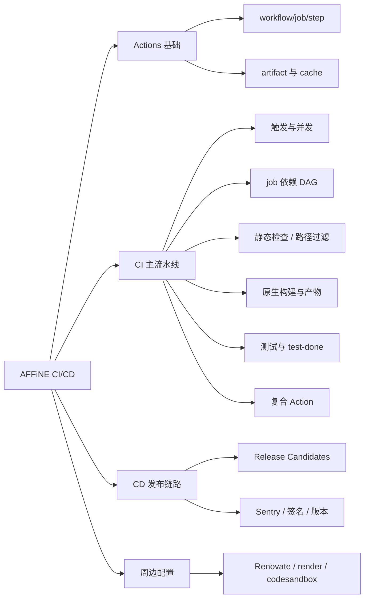
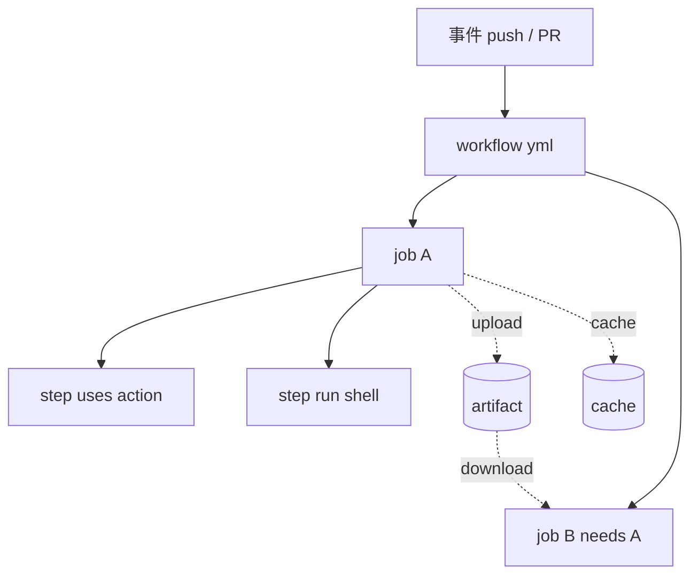
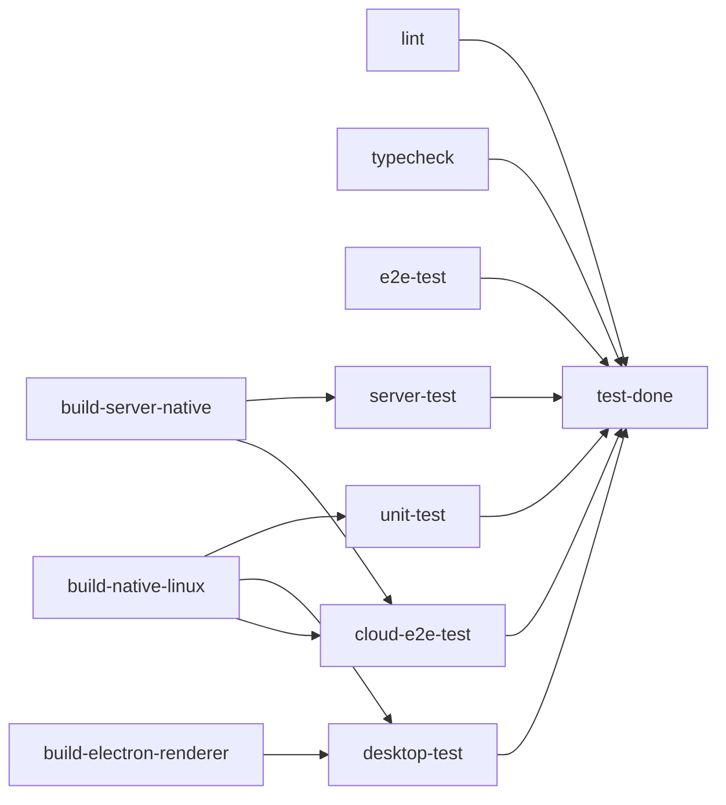
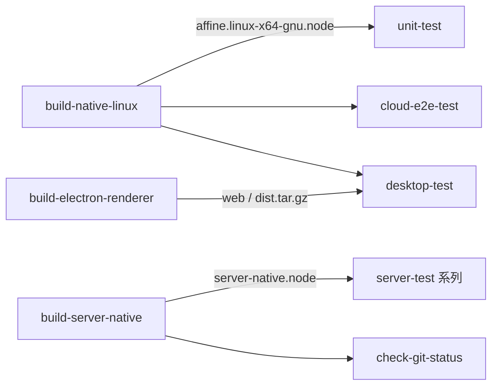
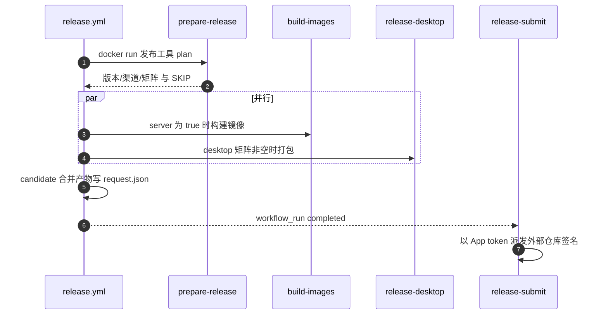

# 第 26 章 CI/CD 与 GitHub Actions

> 从一个 PR 下方几十个检查项出发，读懂 `.github/` 里那条"把代码变成产品"的流水线

第 9 部分 · 运维与部署 ｜ 难度 ★★★☆☆ ｜ 建议学时 6 小时

===

## 本章要解决的问题

<p class="lead">在 AFFiNE 提交一个 PR，几分钟后页面下方会冒出几十个检查项：Lint、Typecheck、E2E Test (1/5)……最后压轴的是一个名字很奇怪的 <code>3, 2, 1 Launch</code>。它们全都来自仓库的 <code class="path">.github/</code> 目录。</p>

对一个从前端走向全栈的开发者，CI/CD 是"把代码变成产品"的流水线：**CI** 每次提交都自动 lint、类型检查、跑单测与 E2E、编译 Rust 原生模块，保证主干永远可发布；**CD** 按计划或手动构建 Docker 镜像、桌面安装包、移动端 Web 资源，形成"发布候选"（candidate），再交签名与发布系统。

<div class="note note--warn">

学 CI 最容易犯的错，是把 `build-test.yml`（约 1700 行、34 个 job）从头读到尾。**正确顺序是先搭骨架**：先看清 job 依赖 DAG，再逐类理解 job，最后才是复合 Action、发布链路与周边配置。

</div>

<div class="cards cols-3">
  <div class="card"><div class="card__icon">🧱</div><h4>基础概念</h4><p>workflow / job / step / matrix / needs / artifact / cache / secrets。</p></div>
  <div class="card"><div class="card__icon">🕸️</div><h4>一条主流水线</h4><p><code>build-test.yml</code> 用 needs 织成 DAG，一个必需检查收口。</p></div>
  <div class="card"><div class="card__icon">🚀</div><h4>一条发布链路</h4><p><code>release.yml</code> 计划与执行分离，候选未签名、签名在外部仓库。</p></div>
</div>

===

## 知识地图

本章围绕"一条 CI 主流水线 + 一条 CD 发布链路 + 周边配置"展开，`build-test.yml` 是重头戏。



<div class="note">

本章路径均相对仓库根目录 `AFFiNE/`，对应 `@affine/monorepo` 0.27.5（canary）。所有 job 名、文件名、secret 名都从 `.github/` 原样摘取。

</div>

===

## 学习目标

学完本章，你应当能够：

<ol class="goals">
  <li>解释 <code>workflow</code>、<code>job</code>、<code>step</code>、<code>matrix</code>、<code>needs</code>、<code>concurrency</code>、<code>artifact</code>、<code>cache</code>、<code>secrets</code> 的含义与关系</li>
  <li>画出 <code>build-test.yml</code> 的 job <code>needs</code> 依赖图，说清 <code>test-done</code> 汇总 job 的作用</li>
  <li>读懂 <code>.github/actions</code> 下 8 个复合 Action 的输入与复用方式</li>
  <li>说明 <code>dorny/paths-filter</code> 如何实现"改了 Rust 才跑 Rust 测试"</li>
  <li>描述 Release Candidates 从 <code>prepare</code> 到 <code>candidate</code> 再到 <code>release-submit.yml</code> 的发布链路</li>
  <li>定位 Sentry sourcemap 上传、codecov 上报、Windows 签名检查的配置</li>
</ol>

===

<!-- section -->
## 一、GitHub Actions 基础

事件触发 workflow，workflow 由若干 job 组成，job 在 runner 上顺序执行 step。先把这几个词和 AFFiNE 的真实例子对上号。

===

## 概念层级：事件到 step

<div class="split">
<div class="split__main">

一次运行自上而下分四层：**事件**（push / pull_request / schedule / workflow_dispatch）触发 **workflow**（一个 `.yml`）；workflow 里的 **job** 默认并行、各自占一台 runner；job 里的 **step** 顺序执行，`run` 跑脚本、`uses` 调 Action。

两条"横向连线"最关键：job 之间用 **artifact** 传文件（跨 runner），用 **cache** 跨运行复用中间结果；`needs` 把 job 串成 DAG。

</div>
<div class="split__aside">



</div>
</div>

| 概念 | 一句话 | AFFiNE 例子 |
| --- | --- | --- |
| `matrix` | 用参数组合派生多个 job 实例 | `unit-test` 的 `shard: [1..5]` |
| `needs` | 声明依赖形成 DAG | `unit-test` needs `build-native-linux` |
| `concurrency` | 同组只保留一个运行 | 并取消旧运行 |
| `secrets` | 加密变量，fork PR 不可用 | `CODECOV_TOKEN`、`SENTRY_AUTH_TOKEN` |

===

## artifact 与 cache 别混淆

<p class="lead">新手最容易搞混这两者：artifact 是"同一次运行里 job 之间传产物"，cache 是"不同运行之间复用中间结果"。</p>

<div class="compare">
  <div class="compare__col"><h4>artifact</h4>

- 目的：同一次运行中 job 间传"产物"
- 可见性：运行页面可**下载**
- 命中：按名字精确获取，缺失即失败
- 用法：`.node` 原生模块、`dist.tar.gz`、测试报告

  </div>
  <div class="compare__col compare__col--good"><h4>cache</h4>

- 目的：不同运行之间复用"中间结果"
- 可见性：不可直接下载
- 命中：按 key 命中，未命中就当无缓存
- 用法：`node_modules`、`~/.cargo`、Playwright 浏览器

  </div>
</div>

<div class="note">

仓库里 11 个 workflow、8 个复合 Action。CI 类以 `build-test.yml` 为主流水线；CD 类 `release.yml` → `build-images.yml` / `release-desktop.yml` / `release-mobile.yml` → `release-submit.yml`，大多是 `workflow_call` 可复用工作流。

</div>

===

<!-- section -->
## 二、build-test.yml：主流水线

一个文件、34 个 job。先看它怎么被触发、如何并发去重，再看 job 如何用 `needs` 织成 DAG。

===

## 触发、环境与并发

`build-test.yml` 顶部三段决定了"什么时候跑、带什么环境、如何去重"：

<div class="annotate">

```yaml [2-6|9-11|13-15]
on:
  push:
    branches: [canary, beta, stable,
      "v[0-9]+.[0-9]+.x-staging", "v[0-9]+.[0-9]+.x"]
    paths-ignore: [README.md]
  pull_request:
  merge_group:
env:
  BUILD_TYPE: canary
  COVERAGE: true
  DEPLOYMENT_TYPE: affine
concurrency:
  group: ${{ github.workflow }}-${{ github.ref }}
  cancel-in-progress: true
```

<ol class="annotate__notes">
  <li><b>触发分支</b>对应第 4 章分支模型；<code>merge_group</code> 支持 Merge Queue，在合并后的临时提交上再跑一遍。</li>
  <li><b>全局 env</b>：<code>BUILD_TYPE: canary</code> 走 canary 预设；<code>COVERAGE: true</code> 开覆盖率。</li>
  <li><b>concurrency</b>：同一 PR 连续推送时取消旧运行，节约大量 runner 时间。</li>
</ol>
</div>

===

## job 依赖 DAG（精简版）

真实 DAG 有 34 个 job，拥挤到看不清。抓住**设计意图**就够了：把"慢而通用"的产物（Rust 原生模块、Electron 渲染层）作为上游一次性构建，下游大量测试 job 通过 artifact 复用。



<div class="note note--warn">

图中 `test-done` 只画了部分入边；实际它 `needs` 了**其余 33 个 job**。一次 Rust release 构建往往十几分钟，所以 `build-native-linux` / `build-server-native` / `build-electron-renderer` 做上游一次编译，`unit-test`、`server-test`、`cloud-e2e-test`、`desktop-test` 全靠下载 artifact。

</div>

===

## 静态检查：生成物必须提交

`lint`（`ubuntu-24.04-arm`）先用 `actionlint` 检查 workflow 本身，再跑 `oxlint`、`oxfmt`、`yarn dedupe --check`。更值得记的是 `check-git-status` 的套路——**重新生成一遍，有差异就失败**：

<div class="annotate">

```bash [2-5|6-9]
- name: Run Check
  run: |
    yarn affine init
    yarn affine gql build
    yarn affine i18n build
    yarn affine server genconfig
    git checkout .../i18n-completenesses.json
    if git status --porcelain | grep -q .; then
      exit 1
    fi
```

<ol class="annotate__notes">
  <li><b>生成四类代码</b>：i18n 类型、GraphQL 类型、服务端配置、BlockSuite 文档。</li>
  <li><b>有未提交改动就 <code>exit 1</code></b>。<code>check-git-status</code> 依赖 <code>build-server-native</code>，因为 <code>genconfig</code> 要加载服务端代码，而服务端 require <code>server-native.node</code>。</li>
</ol>
</div>

<div class="note note--tip">

忘记提交 `schema.gql`、`i18n.gen.ts` 等生成物，是新人最常见的 CI 失败原因。本地跑一遍提示里的命令再提交即可。

</div>

===

## 路径过滤：按需构建

移动端原生构建（Gradle、Xcode）与 Rust 测试都很慢。AFFiNE 用 `dorny/paths-filter@v3` 在轻量 job 里算出"本次改动是否涉及某些路径"，再用 `outputs` + `if` 跳过下游：

```yaml
rust-test-filter:
  outputs:
    run-rust: ${{ steps.rust-filter.outputs.rust }}
  steps:
    - uses: dorny/paths-filter@v3
      with:
        filters: |
          rust:
            - '**/*.rs'
            - '**/Cargo.toml'
            - '.github/workflows/build-test.yml'
```

| 过滤 job | 输出 | 控制的下游 |
| --- | --- | --- |
| `mobile-native-build-filter` | `run-android` / `run-ios` | 三个移动端 job |
| `rust-test-filter` | `run-rust` | `lint-rust`、`rust-test` |
| `copilot-test-filter` | `run-api` / `run-e2e` | `copilot-api-test`、`copilot-e2e-test` |

<div class="note note--warn">

两个细节：① 过滤规则**包含 workflow 文件本身**，改 CI 配置会强制触发对应 job；② 被 `if` 跳过的 job 结果是 `skipped`，而 `test-done` 只在 `failure`/`cancelled` 时失败，所以跳过不会让 PR 变红。

</div>

===

## 原生构建与产物传递

三个平台的原生构建 job 结构几乎一致：`setup-node`（`extra-flags: workspaces focus @affine/native` 聚焦安装）→ 用 `parseTriple` 算出文件名 → `build-rust` → `upload-artifact`。



<div class="note">

`build-electron-renderer` 把渲染层打成 `dist.tar.gz` 上传为 `web` artifact；`desktop-test` 通过复合 Action `download-web` 解压到 `.../electron/resources/web-static`——正是第 20 章 `protocol.ts` 读取静态资源的目录。Windows 构建用 `samypr100/setup-dev-drive` 创建 8GB NTFS 虚拟盘加速，注释写明 "too slow"。

</div>

===

## 测试类 job：分片与 services

单测用 matrix 分片 + codecov；服务端测试需要真实的 PostgreSQL（带 pgvector）、Redis、SMTP，用 `services` 容器拉起：

<div class="split">
<div class="split__main">

`unit-test` 的 `--shard=${{ matrix.shard }}/${{ strategy.job-total }}`——`job-total` 自动等于 5，改分片数不必改命令。`fail-fast: false` 让所有失败一次暴露。

codecov 用 `flags` 区分 `unittest` / `server-test`；根 `codecov.yml` 的 `status.project/patch: false` 意味着**覆盖率下降不卡 PR**，`fail_ci_if_error: false` 保证 codecov 故障不阻塞 CI。

四个搜索相关 job 仅在 `server-test-env` 的 `indexer-provider` 与测试范围上不同：`embedded` / `elasticsearch` / `manticoresearch` / `disabled`。

</div>
<div class="split__aside">

```yaml
services:
  postgres:
    image: pgvector/pgvector:pg16
    options: >-
      --health-cmd pg_isready
      --health-interval 10s
    ports: [5432:5432]
  redis:
    image: redis
  mailer:
    image: mailhog/mailhog
```

</div>
</div>

===

## test-done：一个必需检查顶替几十个

分支保护的 Required status checks 要逐一列出名字，而 job 数与分片经常变。于是只把 `3, 2, 1 Launch` 设为必需检查：

<div class="annotate">

```yaml [2|4-5]
test-done:
  needs: [analyze, lint, typecheck, ...其余 33 个]
  if: always()
  name: 3, 2, 1 Launch
  steps:
    - run: exit 1
      if: ${{ always() && (contains(needs.*.result,
        'failure') || contains(needs.*.result, 'cancelled')) }}
```

<ol class="annotate__notes">
  <li><b><code>if: always()</code></b>：即使上游失败它也运行。</li>
  <li><b><code>needs.*.result</code></b> 含 <code>failure</code>/<code>cancelled</code> 才 <code>exit 1</code>；<code>skipped</code> 与 <code>success</code> 都算通过。技巧借鉴自 Next.js 仓库。</li>
</ol>
</div>

===

<!-- section -->
## 三、复合 Action 与缓存

`.github/actions` 下 8 个复合 Action 把常用 step 打包复用，`setup-node` 和 `build-rust` 的缓存策略尤其值得学。

===

## 8 个复合 Action 一览

<div class="cards cols-2">
  <div class="card"><h4><code>setup-node</code></h4><p>装 Node（版本取 <code>.nvmrc</code>）、配 yarn、多级缓存、Playwright 与 Electron 二进制。几乎所有 job 用。</p></div>
  <div class="card"><h4><code>build-rust</code></h4><p>读 <code>rust-toolchain.toml</code> 装工具链、<code>Swatinem/rust-cache</code>、执行 <code>yarn workspace build --target</code>。</p></div>
  <div class="card"><h4><code>server-test-env</code></h4><p>用 jq 生成 <code>config.json</code>、prisma generate/migrate、data-migration。</p></div>
  <div class="card"><h4><code>prepare-release</code></h4><p>拉发布工具镜像生成 <code>release-plan.json</code>，输出版本、渠道、矩阵。</p></div>
</div>

其余四个：`download-web`（解压 `web` artifact）、`setup-version`（`set-version.sh` 改写所有包版本）、`setup-sentry`（装 `sentry-cli`）、`copilot-test`（跑 Copilot E2E）。

===

## 缓存策略的两个诀窍

<div class="split">
<div class="split__main">

**诀窍一：按系统差异分缓存内容**。Linux 缓存 `node_modules` + yarn 全局缓存；macOS 网络差、Windows 解压慢，只缓存 yarn 全局缓存。`full-cache` 的 job（lint、typecheck、unit-test）key 不含 job 名、全局共享；聚焦安装的 job 各自一份。

**诀窍二：key 里没有 `yarn.lock` 哈希**。缓存只按"job + 系统"维度命中，依赖变化由 `yarn install` 增量修正——换取极高命中率。

</div>
<div class="split__aside">

```yaml
- name: Cache cargo
  uses: Swatinem/rust-cache@v2
  with:
    save-if: ${{ github.ref_name
      == 'canary' }}
    shared-key: ${{ ... }}
```

<p class="small"><code>save-if</code> 只让 canary 分支写缓存，PR 只读。</p>

</div>
</div>

<div class="note note--tip">

`save-if: github.ref_name == 'canary'` 一石三鸟：防大量 PR 污染缓存、防挤占 10GB 配额、防"恶意 PR 投毒缓存"。工具链版本单一来源是 `rust-toolchain.toml` 的 `channel = "1.97.1"`。

</div>

===

<!-- section -->
## 四、发布链路与周边

CD 的核心思想是"计划与执行分离、候选不可变、签名在外部仓库"。

===

## Release Candidates 发布链路

每日 UTC 九点（或手动）触发 `release.yml`，由外部发布工具镜像算出计划，再并行构建各平台候选，最后交 `release-submit.yml` 派发到外部仓库签名。



<div class="cards cols-2">
  <div class="card"><h4>计划与执行分离</h4><p>版本号、渠道、平台由发布工具镜像算出 <code>release-plan.json</code>，工作流只是"执行者"。</p></div>
  <div class="card"><h4>候选不可变</h4><p>同一运行若已成功提交过候选，重跑直接报错 "Submitted candidates are immutable"。</p></div>
</div>

===

## 未签名候选 + 外部签名

<p class="lead">主仓库只产出<b>未签名</b>候选，签名、公证、上传由外部 <code>toeverything/affine-native</code> 仓库完成——主仓库不持有签名私钥，攻击面更小。</p>

<div class="split">
<div class="split__main">

`release-desktop-platform.yml` 设置 `AFFINE_UNSIGNED_PACKAGE: '1'`（对应第 20 章 `forge.config.mjs` 跳过 `osxSign`），产物 stage 记为 `unsigned`。动态矩阵以 JSON 字符串从 `prepare` 输出，下游用 `matrix: ${{ fromJSON(inputs.matrix) }}` 还原。

`build-images.yml` 构建 `linux/amd64,arm64,arm/v7` 多架构镜像，`provenance: true` 生成来源证明，job 输出按 digest 引用的不可变地址 `ghcr.io/toeverything/affine@sha256:...`。

</div>
<div class="split__aside">

```js
// check-windows-signer.mjs
const requireSigner =
  REQUIRE_SIGNER === 'true' ||
  ['beta', 'stable']
    .includes(BUILD_TYPE);
// beta/stable 缺签名配置就 fail
// canary 只警告并跳过 exe
```

</div>
</div>

===

## Sentry sourcemap 与版本号

sourcemap 上传不在 workflow 里硬编码，而在构建工具里"检测到环境变量就启用"——同一份脚本在 PR 与发布中行为不同，**不需要任何 if 分支**：

| 产物 | 插件位置 | 触发条件 |
| --- | --- | --- |
| web/admin/mobile | `tools/cli/.../rspack` 的 `@sentry/webpack-plugin` | 有 `SENTRY_AUTH_TOKEN` |
| Electron main/preload | `.../electron/scripts/common.ts` 的 `sentryEsbuildPlugin` | 有 `SENTRY_AUTH_TOKEN`+`ORG`+`PROJECT` |

<div class="note">

PR 构建（尤其 fork PR）拿不到这些 secret，插件自然不启用。版本号由 `setup-version` 调 `scripts/set-version.sh` 统一改写所有 workspace 的 `package.json`（本书写作时 0.27.5）。

</div>

===

## 周边配置：Renovate 与 render.yaml

<div class="cards cols-3">
  <div class="card"><div class="card__icon">🤖</div><h4>renovate.json</h4><p>依赖自动升级：按生态分组、<code>lockFileMaintenance</code> 每周、<code>yarnDedupeHighest</code>、自定义 regex 跟踪 <code>rust-toolchain.toml</code>。</p></div>
  <div class="card"><div class="card__icon">☁️</div><h4>render.yaml</h4><p>Render 平台 Blueprint：web(Docker)+keyvalue+Postgres16。<code>.render/start.sh</code> 在 <code>affine:stable</code> 上加启动脚本。</p></div>
  <div class="card"><div class="card__icon">📦</div><h4>.codesandbox</h4><p>云端环境自动装依赖并启动预览。注意其 <code>yarn dev-core</code> 已过时，应改 <code>yarn dev</code>。</p></div>
</div>

<div class="note note--warn">

`render.yaml` 严格说是"一键自托管模板"而非 PR 预览环境：它部署已发布的 `stable` 镜像，不构建 PR 代码。`self-host-predeploy.js` 的细节见第 27 章。

</div>

===

## 动手实践

<ol class="steps">
  <li><h4>本地跑 actionlint</h4><p><code>brew install actionlint</code> 后在仓库根执行 <code>actionlint</code>；把某 workflow 的 <code>runs-on</code> 改成 <code>win-signerx</code> 观察报错，再改 <code>win-signer</code>。<b>验收</b>：能解释 <code>.github/actionlint.yaml</code> 中 <code>self-hosted-runner.labels</code> 的作用。</p></li>
  <li><h4>列出完整 DAG</h4><p>用 <code>yaml</code> 解析 <code>build-test.yml</code> 打印每个 job 的 <code>needs</code>，与本章 DAG 对照。<b>验收</b>：找出"关键路径"（提示 <code>build-native-windows → desktop-test → test-done</code>）。</p></li>
  <li><h4>模拟路径过滤</h4><p>分别只改 <code>native/src/hashcash.rs</code> 和 <code>apps/ios/src/app.tsx</code>，对照过滤表推断哪些 job 跑、哪些跳过。<b>验收</b>：写出两次改动的 job 列表。</p></li>
  <li><h4>为新包设计 CI</h4><p>假设新增 Rust crate <code>packages/common/foo</code>（被 server-native 依赖）。<b>验收</b>：给出 ≤40 行 job 草稿，说明为何不必改分支保护规则。</p></li>
</ol>

===

## 自测：点击揭晓答案

<details class="quiz">
<summary>Q1. 被路径过滤跳过的 job 会让 "3, 2, 1 Launch" 失败吗？为什么？</summary>

不会。`test-done` 只在 `needs.*.result` 包含 `failure` 或 `cancelled` 时 `exit 1`；被 `if` 跳过的 job 结果是 `skipped`，不在其中，与 `success` 一样视为通过。

</details>

<details class="quiz">
<summary>Q2. 为什么 check-git-status 依赖 build-server-native？</summary>

它要运行 `yarn affine server genconfig` 重新生成服务端配置文件，这需要加载服务端代码，而服务端依赖 `server-native.node` 原生模块。

</details>

<details class="quiz">
<summary>Q3. build-rust 中 save-if: github.ref_name == 'canary' 的目的？</summary>

只允许 canary 分支写入 Rust 缓存、PR 只读。避免大量 PR 缓存挤占 10GB 配额、互相覆盖，同时防止不可信 PR 污染缓存。

</details>

<details class="quiz">
<summary>Q4. 为什么主仓库的桌面候选是未签名的？签名在哪里完成？</summary>

为让主仓库不持有签名私钥、缩小攻击面。`release-desktop-platform.yml` 设置 `AFFINE_UNSIGNED_PACKAGE: '1'`，候选标记 `unsigned`，由 `release-submit.yml` 派发到 `toeverything/affine-native` 的 `affine-release.yml` 完成签名公证。

</details>

===

## 小结与下一步

<ul class="takeaways">
  <li>CI 主流水线集中在 <code>build-test.yml</code>：34 个 job 用 <code>needs</code> 织成 DAG，慢而通用的产物做上游、测试靠 artifact 复用，<code>test-done</code> 一个必需检查收口。</li>
  <li>路径过滤让 Rust/移动/Copilot 按需跑；缓存按系统差异分内容，Rust 缓存只在 canary 写。</li>
  <li>8 个复合 Action 复用常用 step；<code>setup-node</code> 与 <code>build-rust</code> 的缓存设计是精华。</li>
  <li>发布链路计划与执行分离、候选不可变、未签名候选由外部仓库签名。</li>
  <li>Sentry/签名/版本号都靠"检测环境变量"或单一来源脚本，无需 if 分支区分 PR 与发布。</li>
</ul>

<div class="note note--tip">

**下一章预告**：第 27 章接着问——CI 产出的那个多架构镜像 `ghcr.io/toeverything/affine` 里到底有什么？怎样用 compose 跑起来、配置系统如何生效、迁移如何先于服务完成、如何按 Flavor 拆分水平扩展。

</div>
