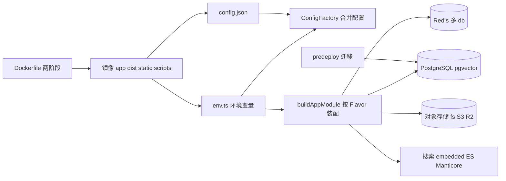
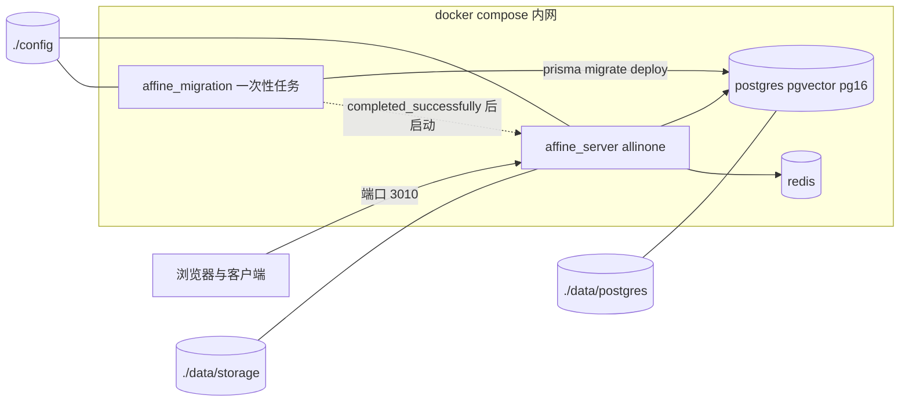
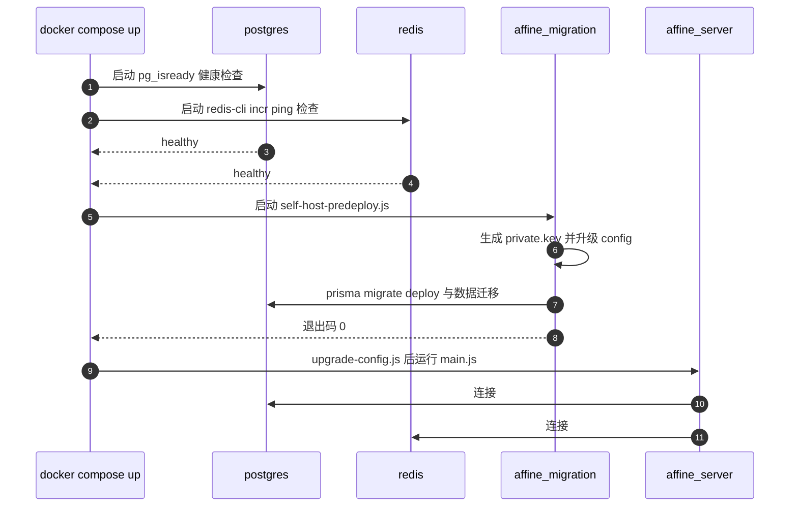
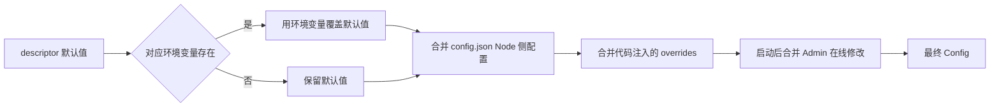
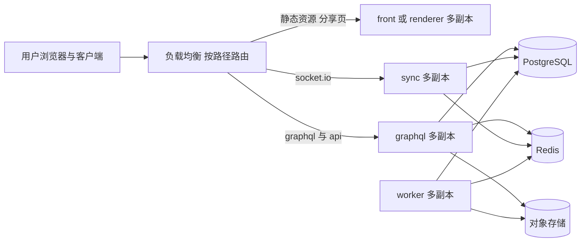

# 第 27 章 部署与运维

从镜像到线上：自托管、配置、扩展与排障

第 9 部分 · 运维与部署 ｜ 难度 ★★★★☆ ｜ 建议学时 8 小时

Note:
第 26 章 CI 产出了多架构镜像 `ghcr.io/toeverything/affine`。这一章回答下一个问题：镜像里有什么、怎样跑起来、跑起来后怎么运维。这是从"写代码"到"对线上负责"的关键一跃。

---

## 本章导读

- **镜像**：Dockerfile 如何装下 server、web、admin、mobile
- **自托管**：`compose.yml` 四个服务的职责与启动顺序
- **配置系统**：`config.json` + 环境变量 + Schema + Admin
- **启动前迁移**：`predeploy` 与 `self-host-predeploy.js`
- **角色拆分**：`SERVER_FLAVOR` 与 Redis adapter 水平扩展
- **依赖服务**：存储、搜索、邮件、可观测性
- **运维**：初始化、备份、升级、排障

Note:
本章内容比较多，分成镜像、自托管、配置、迁移、扩展、依赖服务、运维七块。服务端是 `packages/backend/server` 这个 NestJS 应用，依赖 Rust 原生模块 `@affine/server-native`。我们会始终围绕"同一个镜像如何以不同方式部署"这条主线展开。

---

## 学习目标

- 说明镜像分层结构与前端静态资源位置
- 用 `.docker/selfhost/compose.yml` 部署并解释 `affine_migration`
- 区分 `NODE_ENV`、`AFFINE_ENV`、`DEPLOYMENT_TYPE`、`SERVER_FLAVOR`
- 描述配置从 `defineModuleConfig` 到 `schema.json` 的链路
- 按 Flavor 规划多实例部署并说明 Redis 的作用
- 制定备份恢复与升级方案，会用排障手册

Note:
这六条目标覆盖了从部署到运维的全流程。特别注意第三条，这几个环境变量名字相近但含义完全不同，是新人最容易混的地方。最后一条是实打实的运维能力，练习 5 会让你做一次备份恢复演练。

---

## 知识地图



Note:
构建阶段产出镜像；运行时由 `env.ts` 决定进程级环境与 Flavor，由 ConfigFactory 合并各种来源的应用配置；`buildAppModule` 按 Flavor 装配模块，连接各个依赖服务。迁移是独立于服务进程的一步，只作用于数据库。

---

## 部署形态总览

| 形态 | 入口 | 特点 |
| --- | --- | --- |
| 本地开发 | `.docker/dev/compose.yml.example` | 只用 Docker 跑依赖，服务端在本机 |
| 单机自托管 | `.docker/selfhost/compose.yml` | `allinone` + 迁移容器 + Redis + PG |
| PaaS 一键部署 | `render.yaml` + `.render/` | 复用 stable 镜像 |
| 云端多角色 | 同一镜像 + 不同 `SERVER_FLAVOR` | 按角色拆分水平扩展 |

<p class="small">affine.pro 的具体编排清单不在本仓库中。</p>

Note:
四种形态共用同一份代码和镜像。本地开发只用 Docker 起 Postgres、Redis、Mailpit；单机自托管是本章重点；Render 在第 26 章讲过；云端多角色部署本章只依据仓库代码讲"支持怎样的拆分"，具体清单仓库里没有。

---

## 两阶段 Dockerfile

<p class="small">来源：.github/deployment/node/Dockerfile（节选）</p>

```dockerfile
FROM node:22-bookworm-slim AS assets
WORKDIR /app
COPY ./packages/backend/server /app
COPY ./packages/frontend/apps/web/dist /app/static
COPY ./packages/frontend/admin/dist /app/static/admin
COPY ./packages/frontend/apps/mobile/dist /app/static/mobile
RUN AFFINE_DOCKER_CLEAN=1 ... node ./scripts/docker-clean.mjs

FROM node:22-bookworm-slim
COPY --from=assets /app /app
ENV LD_PRELOAD=libjemalloc.so.2
EXPOSE 3010
CMD ["sh", "-c", "node ./scripts/upgrade-config.js && exec node ./dist/main.js"]
```

<div class="callout warn">镜像 CMD 不执行数据库迁移，迁移由独立容器负责。</div>

Note:
assets 阶段把服务端目录和三个前端 dist 放到 `/app/static` 下，`docker-clean.mjs` 按 `TARGETARCH` 删掉其他架构的原生模块和前端 sourcemap。运行阶段用 jemalloc 降低长期运行的内存碎片。CMD 用 `exec` 让 Node 直接成为 PID 1 以便正确接收 SIGTERM；迁移与服务分离，多副本启动时不会并发跑迁移。

---

## 自托管部署拓扑



postgres 与 redis 没有 `ports` 映射，只在 compose 内网可达。

Note:
compose 里有四个服务：主服务、迁移任务、Redis 和 Postgres。主服务和迁移任务使用同一个镜像 `ghcr.io/toeverything/affine:stable`，迁移任务只是把 command 覆盖为 `node ./scripts/self-host-predeploy.js`。三个宿主机目录分别存放 blob 文件、配置与私钥、数据库文件，都必须备份。

---

## compose 启动时序



Note:
`depends_on` 的 condition 决定了顺序：Redis 和 Postgres 要 `service_healthy`，迁移任务要 `service_completed_successfully`。所以迁移失败时主服务根本不会启动，这是排障时第一个要看的地方。迁移任务先生成私钥、升级配置，再跑 Prisma 迁移和数据迁移。

---

## 数据卷与安全提示

| 宿主机路径 | 内容 | 备份 |
| --- | --- | --- |
| `./data/storage` | 默认 fs 存储：`blobs`、`avatars` 桶 | 是 |
| `./config` | `config.json`、`private.key`、可选 `.env` | 是，尤其私钥 |
| `./data/postgres` | 数据库文件 | 是，建议 `pg_dump` |

<div class="callout warn">

`POSTGRES_HOST_AUTH_METHOD: trust` 表示无密码连接，仅限不暴露端口时使用。`private.key` 丢失会导致令牌与加密数据无法验证或解密。

</div>

Note:
`.docker/selfhost/` 下还有三个配置文件：`config.example.json` 是最小示例，`config.json.example` 多了 `externalUrl` 和 copilot 段，`schema.json` 是 genconfig 生成的 JSON Schema。注意 JSON 中可以直接写 `"provider.type"` 这样的点分键，因为配置系统以"模块加点分键"为最小单元。

---

## 进程级环境：env.ts

| 环境变量 | 取值 | 默认 | 影响 |
| --- | --- | --- | --- |
| `NODE_ENV` | development / test / production | production | 非法值直接抛错 |
| `AFFINE_ENV` | dev / beta / production | production | `NAMESPACE`，OTel 属性 |
| `DEPLOYMENT_TYPE` | affine / selfhosted | 非开发为 selfhosted | Setup、SelfhostModule |
| `SERVER_FLAVOR` | allinone / graphql / sync … | allinone | 装配哪些模块 |
| `DEPLOYMENT_PLATFORM` | gcp / 其他 | unknown | 加载 `GCloudModule` |

<p class="small">`readEnv` 校验取值，如 `SERVER_FLAVOR=api` 直接报错。</p>

Note:
`packages/backend/server/src/env.ts` 定义的是进程级环境，在 Nest 应用启动前就确定，不能在线修改。`SERVER_FLAVOR` 的完整取值还包括 renderer、front、worker、script。按向下键看 `DEPLOYMENT_TYPE` 那个有点绕的优先级规则。

--

## DEPLOYMENT_TYPE 的优先级

<p class="small">来源：packages/backend/server/src/env.ts（节选）</p>

```ts
const appPath = join(this.projectRoot, 'config.json');
const homePath = join(homedir(), '.affine/config/config.json');
if (configPath || existsSync(appPath) || existsSync(homePath)) {
  this.DEPLOYMENT_TYPE =
    this.serverConfigHandle.deploymentType === 'selfhosted'
      ? DeploymentType.Selfhosted
      : DeploymentType.Affine;
} else {
  this.DEPLOYMENT_TYPE = readEnv('DEPLOYMENT_TYPE', /* ... */);
}
```

只要存在 `config.json`，就以其中 `deployment.type` 为准。

Note:
`config.json` 的查找顺序是项目根优先，镜像里就是 `/app/config.json`，其次是 `~/.affine/config/config.json`，也就是 compose 挂载的 `./config` 目录。只有两处都没有时才读环境变量。源码里有 `TODO(0.27.5)` 注释，说明 home 路径回退和环境变量回退是为兼容旧部署保留的过渡逻辑。

---

## 应用配置：defineModuleConfig

<p class="small">来源：packages/backend/server/src/core/config/config.ts（节选）</p>

```ts
defineModuleConfig('server', {
  https: {
    desc: 'Whether the server is hosted on a ssl enabled domain (https://).',
    default: false,
    env: ['AFFINE_SERVER_HTTPS', 'boolean'],
    shape: z.boolean(),
  },
  host: {
    desc: 'Where the server get deployed(FQDN).',
    default: 'localhost',
    env: 'AFFINE_SERVER_HOST',
  },
});
```

一次声明：TS 类型、默认值、zod 校验、环境变量映射。

Note:
应用级配置按模块组织，所有声明汇总到 `base/config/register.ts` 的 `APP_CONFIG_DESCRIPTORS`。`redis`、`storages`、`indexer` 等模块改用 `defineNativeModuleConfig`，描述符和校验都来自 Rust 原生模块，这是存储、搜索等运行时下沉到 Rust 的体现。

---

## 配置合并顺序



**环境变量 < `config.json`**：环境变量只改变"默认值"。

Note:
对应源码是 `base/config/factory.ts` 的 `loadDefault`：先 `getDefaultConfig`，再 `override` 合并 `nodeOwnedJson`，再合并 overrides。由 Rust 管理的 native keys 在 Node 侧被排除，由 `ServerConfigHandle` 统一读取。boolean 环境变量只认 `1` 或 `true`。

---

## genconfig 与 upgrade-config

<div class="cols">
<div>

**`yarn affine server genconfig`**

- 生成 `.docker/selfhost/schema.json`
- 生成 `admin/src/config.json`
- 忽略 `db`、`redis`、`graphql`
- 自托管隐藏 `payment`、`telemetry` 等

</div>
<div>

**`upgrade-config.js`**

- 把旧环境变量别名写入 `config.json`
- 只在键不存在时写入
- 临时文件 + rename，权限 `0o600`
- 之后只改环境变量将**不生效**

</div>
</div>

Note:
genconfig 加载 `app.module` 触发所有配置声明，生成自托管 Schema 和 Admin 设置表单的元数据，第 26 章的 `check-git-status` 会确认它们已提交。upgrade-config 在每次容器启动和 predeploy 中运行，把 `MAILER_HOST`、`REDIS_SERVER_HOST` 等旧变量"固化"进 config.json。这就是升级后"改环境变量不生效"的根源。

---

## 启动前迁移

| 脚本 | 调用者 | 步骤 |
| --- | --- | --- |
| `predeploy` | 云端部署 / 手动 | admit-legacy-context-blobs → migrate deploy → cli run → validate-cutover |
| `self-host-predeploy.js` | `affine_migration`、`.render/start.sh` | 私钥 → 修复失败迁移 → migrate deploy → cli run |

- `yarn cli` 即 `SERVER_FLAVOR=script` 启动同一入口
- 私钥：首次生成 P-256 EC 私钥，已存在不覆盖
- 两类迁移：Prisma schema 迁移 + `src/data/migrations/` 数据迁移

Note:
`src/index.ts` 里判断 `env.flavors.script` 就进入 `cli.ts` 的 commander 命令行，否则启动服务。`fixFailedMigrations` 会对已知可能失败的迁移执行 `prisma migrate resolve --rolled-back`。注意自托管脚本没有执行 predeploy 中的两步额外校验，自己编排 Kubernetes Job 时应以 `predeploy` 为完整参考。

---

## Flavor 到模块的映射

| Flavor | ServerRole | 主要模块与职责 |
| --- | --- | --- |
| `allinone` | allinone | 几乎全部，单机默认 |
| `graphql` | api | `GqlModule`、业务 API、Copilot |
| `sync` | frontend | `SyncModule`，WebSocket 文档同步 |
| `renderer` / `front` | frontend | `DocRendererModule`；front 加静态资源 |
| `worker` | worker | 队列与定时任务，无 `AuthModule` |
| `script` | 无 | CLI 迁移与运维命令 |

<p class="small">核心：`app.module.ts` 的 `buildAppModule` 用 `useIf` 按条件装配。</p>

Note:
同一个镜像通过 `SERVER_FLAVOR` 决定装配哪些 Nest 模块。`isFlavor` 在 allinone 时对任何 flavor 都返回 true，但 front 和 script 例外，需要显式设置。worker 不挂 `RealtimeGatewayModule`，也不加载用户和认证模块。

---

## 多实例拓扑



多副本不能用本地 fs 存储；拆分部署必须有 worker 实例。

Note:
负载均衡按路径把流量分给不同角色，worker 不接外部流量，只消费队列。所有角色共享同一个 Postgres 和 Redis，front 和 renderer 同样连接它们，图中为简洁省略了。按向下键看 sync 多副本之间是如何广播的。

--

## socket.io Redis adapter

<div class="cols">
<div>

```ts
const pubClient = this.app.get(SocketIoRedis);
const subClient = pubClient.duplicate();
server.adapter(
  createAdapter(pubClient, subClient)
);
```

<p class="small">来源：base/websocket/adapter.ts（节选）</p>

</div>
<div>

| 实例 | db 偏移 |
| --- | --- |
| `CacheRedis` | +0 |
| `SessionRedis` | +2 |
| `SocketIoRedis` | +3 |

</div>
</div>

`redis.db` 不超过 11；polling 在负载均衡后需要粘滞会话。

Note:
A 用户连在副本 1、B 用户连在副本 2，副本 1 的更新通过 Redis Pub/Sub 扩散到所有副本。`duplicate()` 出来的订阅客户端不受 Nest 生命周期管理，需要在 close 时手动断开。`assertValidDBIndex` 要求基础 db 不超过 11，为偏移留出空间；托管 Redis 若只支持 db 0 就要注意。

---

## 存储、搜索与邮件

<div class="cols cols-3">
<div>

**存储 `storages`**

- 默认 fs：`~/.affine/storage`
- 可选 `aws-s3`、`cloudflare-r2`
- Rust 实现 `object_storage/`
- `r2-proxy.ts` 代理上传

</div>
<div>

**搜索 `indexer`**

- `embedded`：内置，推荐
- `elasticsearch`
- `manticoresearch`
- 只在 api/frontend 加载

</div>
<div>

**邮件 `mailer`**

- `SMTP.host` 为空则不发信
- 默认端口 465
- 投递表 + worker 领取
- 拆分时须有 worker

</div>
</div>

Note:
切换 S3 兼容存储只需改 `storages.blob.storage` 的 provider、bucket 和 config，具体字段以 `schema.json` 为准。r2-proxy 的意义在于浏览器只和 AFFiNE 服务端通信，不需要对象存储配 CORS，代价是流量经过服务端。邮件是异步模型，`MailWorkerModule` 只在 worker 角色加载。

---

## 可观测性

| 维度 | 默认实现 |
| --- | --- |
| 日志 | `AFFiNELogger` 前缀 `<requestId>`，响应头 `X-Request-Id` |
| 指标 | `PrometheusExporter`，库默认端口通常为 9464 |
| 追踪 | `ZipkinExporter`，采样 `TraceIdRatioBasedSampler(0.1)` |
| 资源属性 | `service.name` 为 FLAVOR，可按角色看指标 |
| 进程监控 | `MonitorService` 每分钟记录内存 |
| 健康检查 | `GET /info`：免鉴权，返回版本与 flavor |

Note:
排障时让用户提供 `X-Request-Id`，就能在日志里 grep 到整条请求链路。`metrics.enabled` 默认关闭，开启后 Prometheus exporter 是独立端口，需要额外映射。`/info` 只说明进程在响应 HTTP，并不检查数据库和 Redis 的连通性。服务端没有 Sentry 集成，Sentry 只用于前端和桌面端。

---

## 初始化与版本兼容

- `SetupMiddleware`：未初始化时全部重定向到 `/admin/setup`
- `initialized()` 判定为 `models.user.count() > 0`
- `CustomSetupController`：`SelfhostGuard` + 互斥锁
- 已初始化再调用抛 `ActionForbidden`
- `client.versionControl.requiredVersion` 默认 `>=0.25.0`

<div class="callout warn">部署完成后立刻创建管理员，否则任何人都能抢先注册。</div>

Note:
自托管首次访问会被重定向到 Admin 的 setup 三步向导：Welcome、CreateAdmin、SettingsDone，最后调用 `/api/setup/create-admin-user`。服务端用 `mutex.acquire('createFirstAdmin')` 防止并发创建，失败会回滚刚建的用户。客户端版本控制默认关闭，开启后可以强制旧版客户端升级。

---

## 备份、恢复与升级

<div class="cols">
<div>

**备份清单**

- PostgreSQL：`pg_dump -Fc`
- Blob：打包 `./data/storage`
- 配置与私钥：`./config`
- compose 与镜像 tag/digest

</div>
<div>

**升级要点**

- 先读发布说明，再备份
- 生产固定版本，别用 `:stable`
- 只能向前迁移，回滚靠备份
- 升级后检查 `/info` 的版本

</div>
</div>

Note:
恢复步骤是：停服务、恢复配置和文件、只起 postgres 用 `pg_restore` 恢复，再整体启动，迁移服务会把 schema 升到当前镜像版本。Prisma schema 迁移没有自动回滚，降级镜像通常不可行。跨大版本时还要留意带 `TODO(0.27.5)` 的兼容代码，它们之后会被删除。

---

## 源码导读 Top 5

| 优先级 | 路径 | 看什么 |
| --- | --- | --- |
| P0 | `.github/deployment/node/Dockerfile` | 两阶段构建、静态资源、CMD |
| P0 | `.docker/selfhost/compose.yml` | 四个服务、依赖条件、数据卷 |
| P0 | `packages/backend/server/src/env.ts` | Flavor、DEPLOYMENT_TYPE 优先级 |
| P0 | `packages/backend/server/src/app.module.ts` | `buildAppModule` 按 flavor 装配 |
| P0 | `server/scripts/self-host-predeploy.js` | 私钥生成、迁移步骤 |

Note:
这五个 P0 文件串起来就是"镜像怎么打、容器怎么起、进程怎么决定自己是谁、装配哪些模块、启动前做什么迁移"。第二轮可以读配置系统的 `register.ts`、`factory.ts`，以及 `upgrade-config.js` 和 `genconfig.ts`。

---

## 动手实践

| 练习 | 验收要点 |
| --- | --- |
| 1 compose 起一套自托管 | `/info` 返回 `selfhosted` 与 `allinone` |
| 2 追踪一个配置项的一生 | 解释第二次改环境变量为何不生效 |
| 3 模拟服务角色拆分 | 画出三实例拓扑，标出共享 PG 与 Redis |
| 4 开启 OpenTelemetry 指标 | 看到 `node_process_*` 指标 |
| 5 备份与恢复演练 | 恢复后无需重新初始化管理员 |

Note:
练习 1 是后面所有练习的基础，注意观察 `affine_migration_job` 变为 `exited (0)`。练习 3 复制 affine 服务为 worker 和 graphql 两个实例，分别用 curl 查看 `/info` 的 flavor。练习 5 要真的删掉 `./data` 和 `./config` 再恢复，才算验证了备份可用。

---

## 自测

1. 环境变量与 `config.json` 冲突时谁优先？

`config.json` 优先，环境变量只改变默认值。 <!-- .element: class="fragment" -->

2. compose 如何保证迁移先于服务完成？

`depends_on` 的 `service_completed_successfully` 条件。 <!-- .element: class="fragment" -->

3. 多个 sync 副本之间如何广播文档更新？

`@socket.io/redis-adapter`，使用 `SocketIoRedis`（db +3）。 <!-- .element: class="fragment" -->

Note:
三道题分别对应配置合并、迁移编排、水平扩展三个核心点。可以追问：`SERVER_FLAVOR=worker` 的实例不会加载哪些模块？答案是 RealtimeGateway、User、Auth、Permission、Mail 等，但会加载 MailWorkerModule，所以邮件必须靠 worker 发出。

---

## 常见坑

| 现象 | 原因与解决 |
| --- | --- |
| `affine_server` 一直不启动 | 迁移失败；看 `docker compose logs affine_migration` |
| 修改环境变量不生效 | 已被写入 `config.json`；直接改它 |
| 所有页面跳 `/admin/setup` | 库中无用户或连错库；检查 `DATABASE_URL` |
| 链接域名是 localhost | 未配 `server.externalUrl` |
| 多副本间不同步 | 副本未共用 Redis；检查 db 偏移 |
| 重启后用户全部掉线 | `private.key` 丢失；从备份恢复 |

Note:
前两条是升级和部署后最常见的困惑。生成的邮件、分享链接是 localhost，基本都是没配 `externalUrl`。另外还有 `redis.db` 大于 11 报 `Invalid database index`、Postgres 镜像不带 pgvector 报 `extension "vector" is not available` 等问题。

---

## 小结与下一步

- 一个镜像装下四类产物，迁移与服务分离
- compose 用 `depends_on` 条件编排启动顺序
- 配置：默认值 ← 环境变量 ← `config.json` ← Admin 在线修改
- `SERVER_FLAVOR` 让同一份代码扮演不同角色，Redis 串起多副本
- 务必备份数据库、blob 与 `private.key`

**下一章**：第 28 章 安全与合规——威胁模型与源码中的防线

Note:
部署和运维的核心是"同一个镜像，不同的配置与角色"。理解了配置的合并顺序和 Flavor 装配，绝大多数部署问题都能自己定位。下一章我们换个视角，从安全角度审视认证、限流、SSRF、Electron 加固和供应链。
