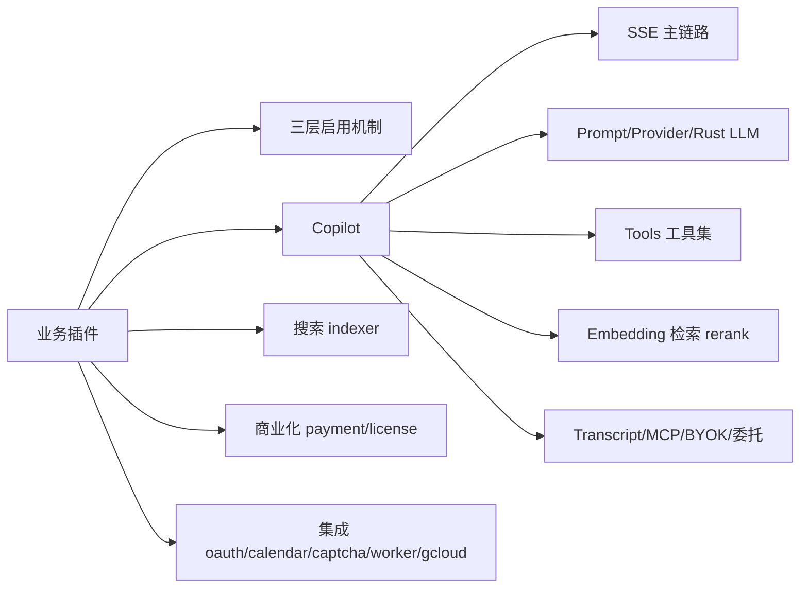
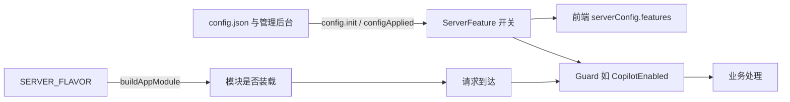
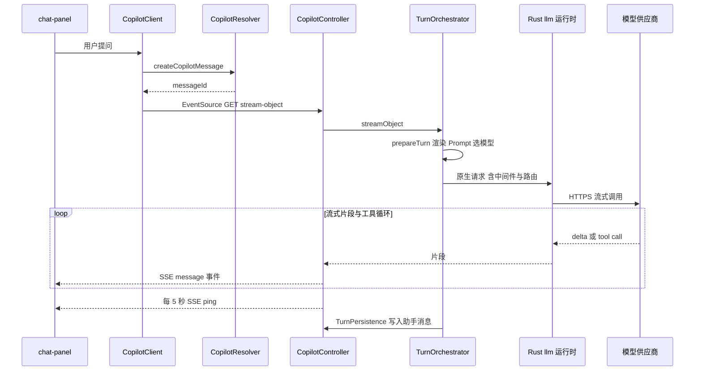
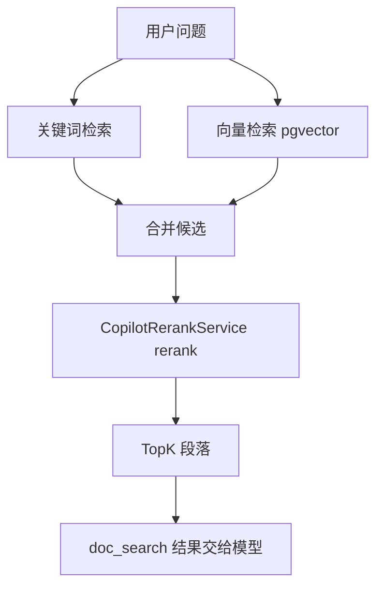
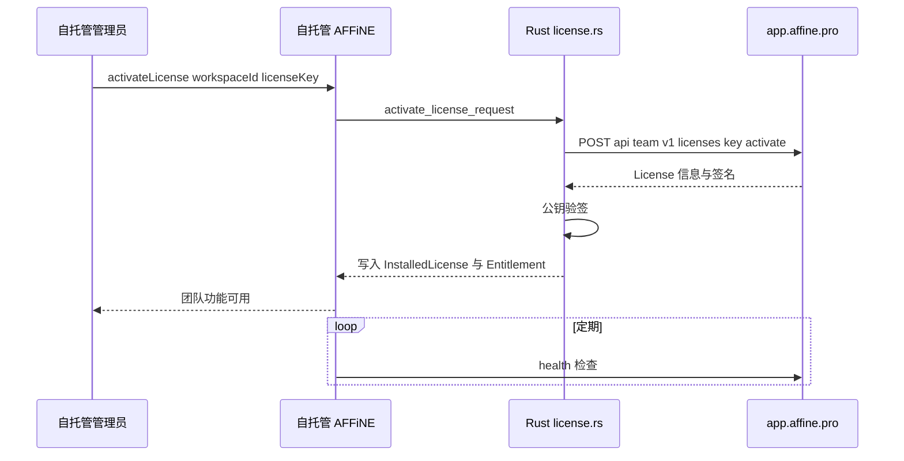

# 第 28 章 业务插件：AI、搜索、支付等

> 九个插件功能各异，却共享同一副骨架：TS 入口 + Rust 领域核心

第 7 部分 · 后端服务 ｜ 难度 ★★★★☆ ｜ 建议学时 12 小时

===

## 本章要解决的问题

<p class="lead"><code>src/plugins</code> 下有 9 个“插件”目录。它们和 <code>core</code> 的区别在于：<b>没有它们 AFFiNE 也能作为协同编辑器运行</b>，但有了它们才有 AI、搜索、付费、第三方登录、日历……</p>

它们规模差异极大：`copilot` 约 1.7 万行 TS（还不算 Rust 侧的 `llm`），`gcloud` 只有约 100 行。

<div class="cards cols-3">
  <div class="card"><div class="card__icon">🤖</div><h4>copilot</h4><p>AI 对话、Action、检索问答、转写、MCP、BYOK。</p></div>
  <div class="card"><div class="card__icon">🔎</div><h4>indexer</h4><p>全文搜索，三种 provider。</p></div>
  <div class="card"><div class="card__icon">💳</div><h4>payment / license</h4><p>Stripe/RevenueCat 订阅与自托管授权。</p></div>
  <div class="card"><div class="card__icon">🔗</div><h4>oauth / calendar</h4><p>第三方登录与日历同步。</p></div>
  <div class="card"><div class="card__icon">🛡️</div><h4>captcha / worker</h4><p>人机验证、链接预览与图片代理。</p></div>
  <div class="card"><div class="card__icon">☁️</div><h4>gcloud</h4><p>GCP 上替换追踪与日志实现。</p></div>
</div>

<div class="note note--warn">

反复出现的架构模式：**TS 负责协议入口（GraphQL/SSE/Webhook/MCP）与宿主能力（读文档、权限、存储），Rust 负责领域核心（模型路由、Prompt 渲染、搜索投影、支付状态机、License 校验）**。读懂这条分界线，比记住每个文件更重要。

</div>

===

## 知识地图

本章先讲“插件怎么被启用”，再用近一半篇幅深读 Copilot，最后依次过 indexer、payment、license 及四个集成插件。



===

## 学习目标

<ol class="goals">
  <li>说明插件三层启用：按 Flavor 装载模块、按配置开启能力（<code>ServerFeature</code>）、按守卫拦截请求</li>
  <li>画出 Copilot 一次对话从 <code>createCopilotMessage</code> 到 SSE 流式返回的完整链路</li>
  <li>说出 Prompt、Provider、Tool、Embedding、Retrieval、Transcript、MCP、BYOK 各自职责</li>
  <li>列出 Copilot 内置工具及其启用条件，解释混合检索的降级设计</li>
  <li>描述 Stripe/RevenueCat Webhook 的幂等设计，以及 License 的激活与离线校验</li>
</ol>

===

<!-- section -->
## 一、插件三层启用

模块装载了不代表功能可用，功能可用了不代表请求能通过——三道闸门层层递进。

===

## 三层启用机制

从 `SERVER_FLAVOR` 到单个请求，三层各管一段。



| 层 | 机制 | 例子 |
| --- | --- | --- |
| ① 装载 | `buildAppModule` 按 Flavor/环境装模块 | `CopilotModule` 需 `graphql`；`WorkerModule` 仅 dev/自托管 |
| ② 开关 | 插件在配置事件中调 `ServerService.enableFeature` | `ServerFeature.Copilot`、`Payment`、`OAuth`、`Indexer` |
| ③ 拦截 | 守卫在请求层断言 | `@CopilotEnabled()`、`@UseNamedGuard('captcha')` |

<div class="note">

前端通过 `serverConfig { features }` 查询得知开关，决定是否显示 AI 面板、订阅按钮、第三方登录按钮。另外，几乎所有插件配置都用 `defineNativeModuleConfig` 登记——**配置由 Rust 拥有**，TS 里注入的 `Config` 读不到 `oauth.providers.google.clientSecret` 之类的值，它们只存在于 Rust 运行时内存中。

</div>

===

<!-- section -->
## 二、Copilot 深读

AFFiNE 当前最复杂、演进最快的子系统。先看模块拆分，再追一次对话的完整链路。

===

## 模块拆分与目录地图

六个 Nest 模块按节点类型装配：`CopilotKernelModule`（核心服务）被其余模块依赖，API/Worker/Realtime 各装一部分。所有 provider 集中在 `module-providers.ts`，并用 `useExisting` 做接口与实现解耦。

| 子目录/文件 | 职责 |
| --- | --- |
| `session.ts` / `conversation/` | 会话创建、分叉、追加轮次；消息入站与持久化 |
| `prompt/` | 从 Rust 内置目录读取、渲染 Prompt |
| `runtime/` | `TurnOrchestrator`（一轮对话编排）、`CapabilityRuntime`、`ToolRuntime` |
| `tools/` | 全部内置工具 |
| `embedding/`、`retrieval/` | 向量化、检索、rerank |
| `transcript/` | 音频转写 |
| `mcp/`、`byok/`、`delegated/` | MCP 服务端、自带密钥、委托前端工具 |
| `controller.ts`、`resolver.ts` | HTTP/SSE 与 GraphQL 入口 |

===

## 主链路：从提问到 SSE 流

一次对话分两步：**先用 GraphQL `createCopilotMessage` 提交用户消息（含附件）拿到 `messageId`；再用浏览器原生 `EventSource` 以 GET 打开 SSE 流**，参数全放 query string。原因很实际——`EventSource` 只支持 GET 且不能带请求体，附件和长消息不适合放 URL。



<div class="note note--tip">

SSE 四个要点：**`ping` 每 5 秒一次**防代理空闲断连；**错误也走流内事件**（`mapSseError`，因响应头已发无法改状态码）；**优雅关闭**（`ongoingStreamCount$` 归零才允许进程退出，滚动发布不截断回答）；**客户端断开**转 `AbortSignal` 一路传给模型，关面板即停止计费。

</div>

===

## Prompt、Provider 与 Rust LLM

两类“配置型”核心——Prompt 目录与 Provider 中间件——都把领域逻辑放在 Rust。

<div class="split">
<div class="split__main">

**Prompt**：实际数据在 `native/src/llm/assets/prompts/built-in.json`（64 个，如 `Summary`、`Translate to`、`Transcript audio`）。早期存数据库，迁移后统一改为**随二进制发布的内置目录**——Prompt 跟代码一起版本化、评审、测试。

**Provider 中间件分两层**：请求与流事件的规范化在 Rust（`normalize_messages`、`citation_indexing`），面向展示的文本后处理（脚注、callout、思考过程格式化）在 Node。

**为何把 LLM 调用搬到 Rust？** 多供应商协议差异适合强类型合同统一；工具循环、引用索引对性能敏感；更关键是**安全边界**——BYOK 密钥解密、私网端点校验在原生层完成，TS 永远拿不到明文密钥。

</div>
<div class="split__aside">

```ts
export enum CopilotProviderType {
  Anthropic = 'anthropic',
  AnthropicVertex = 'anthropicVertex',
  CloudflareWorkersAi =
    'cloudflareWorkersAi',
  FAL = 'fal',
  Gemini = 'gemini',
  GeminiVertex = 'geminiVertex',
  OpenAI = 'openai',
}
```

<p class="small">每个 profile 有 <code>id</code>、<code>type</code>、<code>priority</code>、<code>enabled</code>、<code>models</code>、<code>middleware</code>。</p>

</div>
</div>

===

## Tools：AI 能调用的工具全表

工具在 `tool-runtime.ts` 中按会话配置动态组装，每个由 `createXxxTool` 工厂用 `defineTool` 定义。描述写得像“给模型看的 API 文档”，明确说明“不会做什么”以减少误用。

| 工具（模型可见） | 作用 | 启用条件 |
| --- | --- | --- |
| `doc_read` | 读已持久化文档的 Page 文本 | 经 `PermissionAccess` 校验可读 |
| `doc_search` | 搜工作区文档，运行时自选混合/关键词/向量 | 不搜文件、附件与网页 |
| `artifact_search` / `artifact_read` | 搜/读工作区制品与消息附件 | — |
| `doc_create` / `doc_update` / `doc_update_meta` | 新建/改正文/改标题 | **仅 dev 或 canary** |
| `doc_compose` / `section_edit` / `code_artifact` | 生成文档/改写一节/生成单文件 HTML | 内部再调一次 Prompt |
| `web_search_exa` / `web_crawl_exa` | Exa 搜网页/抓 URL | 需配置 `copilot.exa.key` |
| `frontend_read_selection` 等 | 读浏览器中尚未同步的编辑器状态 | 需前端委托租约 |

<div class="note">

四点设计观察：**读写分离、写操作灰度**（所有写文档工具只在 dev/canary 开放）；**持久化数据 vs 编辑器实时状态**（`doc_read` 读服务端已同步内容，`frontend_*` 读浏览器里未同步状态，描述中互相引用指导模型选择）；**工具错误统一**（`toolError` 返回结构化错误给模型，而非抛异常中断对话）。

</div>

===

## Embedding、检索与 Rerank

第 26 章讲了 pgvector 表与投影队列，这里看 Copilot 如何使用。核心设计：**关键词与向量两路并行（`Promise.allSettled`），任意一路失败都能降级**。

<div class="split">
<div class="split__main">

- 没配搜索服务时 `SearchProviderUnavailable` 被吞掉，只走向量路；
- 工作区关闭 embedding 时 `canEmbedding` 为假，只走关键词路；
- 关键词路取 **3 倍候选**给 rerank 留余量，最终上限 20；
- **权限过滤在检索阶段完成**：结果离开 Rust 运行时之前就按权威权限事实过滤。

这解释了为什么用 `Promise.allSettled` 而不是 `Promise.all`——`all` 会因任一路 reject 而整体失败，`allSettled` 让降级成为可能。

</div>
<div class="split__aside">



</div>
</div>

===

## Transcript、MCP、BYOK 与委托

Copilot 还有四块“宿主能力”，它们共同体现“服务端与前端/外部客户端如何协作”。

<ol class="steps">
  <li><h4>Transcript 音频转写</h4><p>典型长任务：前端提交录音 → 建 <code>AiTranscriptTask</code> → Worker 上 <code>CopilotCronJobs.reconcileTranscriptDispatches</code>（每分钟）收集待派发 → 切片后分段转写、再生成纪要。<code>dispatchGeneration</code> 防同一任务并发派发两次。</p></li>
  <li><h4>MCP 无状态服务端</h4><p>每个工作区暴露为一个 MCP 端点（<code>POST /api/workspaces/:id/mcp</code>），用 <code>Authorization: Bearer &lt;MCP 凭证&gt;</code> 认证。工具有 <code>read_document</code>、<code>doc_search</code>；写工具还需 <code>accessMode === READ_WRITE</code> 且 dev/canary。</p></li>
  <li><h4>BYOK 自带密钥</h4><p>工作区自带模型密钥，只存 <code>encryptedApiKey</code>；“本地租约”让密钥只在用户设备使用，前端拿 <code>byokLeaseId</code> 作为 SSE query 传入。</p></li>
  <li><h4>委托工具</h4><p><code>frontend_*</code> 工具读浏览器未同步状态：前端用 <code>copilot.delegated.editor.upsert</code> 建租约，服务端经 topic 推请求，前端回传——第 27 章实时协议在这里被用作“<b>服务端调用客户端</b>”的 RPC 通道。</p></li>
</ol>

===

<!-- section -->
## 三、搜索、商业化与集成

剩下八个插件，各给出“职责 / 关键设计 / 外部依赖”。它们的骨架高度一致。

===

## indexer：全文搜索

TS 层非常薄：`IndexerService` 全部调用 `runtime.searchAuthorized`、`aggregateAuthorized`——注意名字里的 **Authorized**，权限过滤在 Rust 内完成。

<div class="split">
<div class="split__main">

三种 provider：`embedded`（Rust `memory-indexer` 进程内倒排索引，自托管无需额外服务）、`elasticsearch`、`manticoresearch`。

关键注释一语道破设计：*"Canonical permission facts filter every ACL-scoped result before it leaves the runtime"*——**外部搜索引擎只负责召回候选，最终结果一定经过权威权限数据过滤**，搜索引擎里的数据即使滞后也不会造成越权。

Worker 上 `BackendRuntimeSearchJob.reconcileProjection` 定时把文档变化增量写入索引，含 `anti_entropy.rs` 反熵修复。

</div>
<div class="split__aside">

```rust
pub(super) enum SearchProvider {
  // Elasticsearch 兼容
  Elasticsearch(RemoteProvider),
  // Manticore 召回候选，
  // 权威权限事实在离开
  // 运行时前过滤每条结果
  ManticoreSearch(
    ManticoreSearchProvider),
}
```

</div>
</div>

===

## payment：先捕获，再处理

Webhook 处理的两条铁律：**必须用原始请求体验签**（`server.ts` 设 `rawBody: true`，JSON 解析再序列化会改字节导致验签失败）；**“捕获”而非“处理”**。

<div class="annotate">

```ts [3|5-7]
@Public()
@Post(['/api/stripe/webhook', '/api/worker/stripeWebhook'])
async handleWebhook(@Req() req: RawBodyRequest<Request>) {
  const signature = req.headers['stripe-signature'];
  return await this.runtime.capturePaymentWebhookV1(
    'stripe', Buffer.from(req.rawBody ?? ''),
    typeof signature === 'string' ? signature : ''
  );
}
```

<ol class="annotate__notes">
  <li><b>第 3 行</b>：读 <code>req.rawBody</code> 做签名校验。</li>
  <li><b>第 5–7 行</b>：<code>capturePaymentWebhookV1</code> 把事件写入 <code>PaymentEvent</code> 收件箱（<code>@@unique([provider, externalEventId])</code> 保证<b>幂等</b>）后立即返回 200，真正的状态变更由支付运行时异步处理并重试。</li>
</ol>
</div>

<div class="note note--tip">

这样 Webhook 响应快、Stripe 不会因超时重复投递、处理失败也不丢事件。业务联动靠事件总线：`workspace.members.updated` → 自动调整团队订阅席位，`user.preDelete` → 准备取消订阅——支付模块与工作区模块互不感知（第 25 章事件总线解耦的价值）。

</div>

===

## license：自托管授权

自托管用户购买团队版后需把 License 安装到自己的服务器。妙处在于：**同一份代码在云端扮演 License 服务器，在自托管扮演 License 客户端**。



<div class="note">

Rust `license.rs` 与云端通信有 10 秒超时与 1MB 响应上限，经 `safefetch` 发出；离线安装（`installLicense` 上传 License 文件）由 `license_import.rs` 解析。签名校验使用内嵌的 `AFFINE_PRO_PUBLIC_KEY`，自托管模式下强制要求该公钥已在原生构建中。

</div>

===

## oauth、calendar、captcha、worker、gcloud

五个集成插件，骨架一致但各有一个值得记的要点。

<div class="cards cols-2">
  <div class="card"><h4>oauth</h4><p>Google/GitHub/Apple/OIDC；state 生成校验、令牌交换、账号绑定都在 Rust <code>executeAuthSessionCommandV1</code> 完成。</p></div>
  <div class="card"><h4>calendar</h4><p>Google/CalDAV 同步，又一次用<b>数据库租约</b>（<code>claimDueForSync</code>）；CalDAV 允许任意服务器地址，故有 <code>blockPrivateNetwork</code> 等 SSRF 防护。</p></div>
  <div class="card"><h4>captcha</h4><p>用<b>模块扩充</b>把 <code>'captcha'</code> 加进具名守卫；Web 用 Cloudflare Turnstile，原生客户端用 Hashcash 工作量证明。</p></div>
  <div class="card"><h4>worker</h4><p>图片代理与链接预览，SSRF 高危区，由原生 <code>safe_fetch.rs</code>/<code>url_policy.rs</code> 统一处理；仅 dev/自托管装载。</p></div>
  <div class="card"><h4>gcloud</h4><p>纯“替换实现”插件：用 DI <code>useClass</code> 覆盖默认追踪工厂，把 trace 导出到 Google Cloud Trace——<b>业务代码完全不感知运行在哪个云上</b>。</p></div>
</div>

<div class="note note--tip">

九个插件共享的骨架：`config.ts` 声明配置、`index.ts` 拆分 API/Worker/Realtime 模块、`service.ts` 在配置事件中设 `ServerFeature`、领域核心委托 `BackendRuntimeProvider`、长任务用 `@Cron` + 数据库租约、外部回调做验签与幂等、对外抓取做 SSRF 防护。

</div>

===

## 动手实践

<ol class="steps">
  <li><h4>观察 Copilot 的 SSE 流</h4><p>配一个可用 provider profile 开启 Copilot，在 AI 面板提问，Network 中找到 <code>/api/copilot/chat/&lt;id&gt;/stream-object</code>，切 EventStream 视图观察 <code>message</code>/<code>ping</code> 间隔；回答中途关闭面板看后端是否中断。<b>验收</b>：说出 <code>messageId</code> 从哪个 GraphQL 获得、ping 间隔、错误事件长相。</p></li>
  <li><h4>画工具启用矩阵</h4><p>读 <code>tool-runtime.ts</code>，列出每个 <code>case</code> 的工具名、依赖服务、额外条件（dev/canary、委托租约、Exa 配置）。<b>验收</b>：产出含“依赖服务”列、与工具全表一致的矩阵。</p></li>
  <li><h4>追踪混合检索降级</h4><p>读 <code>retrieval/document.ts</code> 的 <code>search</code>，分别假设“未配 indexer”“关闭 embedding”“rerank 失败”，推导结果来自哪一路。<b>验收</b>：写出三种情况的结果来源，并说明为何用 <code>Promise.allSettled</code>。</p></li>
</ol>

===

## 自测：点击揭晓答案

<details class="quiz">
<summary>Q1. 插件“被启用”包含哪三层？分别由什么决定？</summary>

① 模块装载，由 `SERVER_FLAVOR`/部署环境在 `buildAppModule` 决定；② 能力开关，插件在配置事件中调 `ServerService.enableFeature`，前端经 `serverConfig.features` 获知；③ 请求拦截，如 `@CopilotEnabled()`、`@UseNamedGuard('captcha')`。

</details>

<details class="quiz">
<summary>Q2. Copilot 对话为何拆成“GraphQL 提交 + EventSource 拉流”两步？</summary>

浏览器原生 `EventSource` 只支持 GET 且不能带请求体，附件和长消息不适合放 URL；故先用 GraphQL（支持 multipart）提交消息拿 `messageId`，再用 GET 打开 SSE，参数放 query string。

</details>

<details class="quiz">
<summary>Q3. 混合检索如何做到“任一路失败都不影响回答”？外部搜索引擎为何不越权？</summary>

关键词与向量检索用 `Promise.allSettled` 并行，任一路 reject 不致整体失败；`SearchProviderUnavailable` 被吞、关闭 embedding 时跳过向量路。外部引擎只召回候选，ACL 结果在离开 Rust 运行时前用权威权限事实过滤（`searchAuthorized`）。

</details>

<details class="quiz">
<summary>Q4. Stripe Webhook 为何必须用 rawBody？“捕获/处理”分离的好处？</summary>

签名基于原始字节计算，JSON 解析再序列化会改内容导致验签失败。捕获后立即返回 200 让响应快、避免 Stripe 超时重投；事件落入带唯一约束的 `PaymentEvent` 收件箱保证幂等，后续处理失败可重试不丢事件。

</details>

===

## 小结与下一步

<ul class="takeaways">
  <li>插件三层启用：Flavor 装载 → <code>ServerFeature</code> 开关 → Guard 拦截。</li>
  <li>Copilot 对话 = GraphQL 提交 + SSE 拉流；Prompt/Provider/LLM 核心在 Rust，工具读写分离、写操作灰度。</li>
  <li>混合检索关键词+向量并行可降级，权限在检索阶段由 Rust 过滤。</li>
  <li>indexer 三 provider 均 <code>Authorized</code>；payment 先捕获后处理保证幂等；license 同一代码云端/自托管两副面孔。</li>
  <li>九插件共享骨架：config + 模块拆分 + ServerFeature + Rust 核心 + Cron 租约 + 验签幂等 + SSRF 防护。</li>
</ul>

<div class="note note--tip">

**下一章预告**：第 29 章进入质量保障——AFFiNE 的测试金字塔（Vitest、AVA、Playwright、cargo nextest）如何编排，“真实数据库为底座”“通知+拉取”“按路径触发 AI 测试”等取舍如何落到 CI 的 30 多个 job。

</div>
