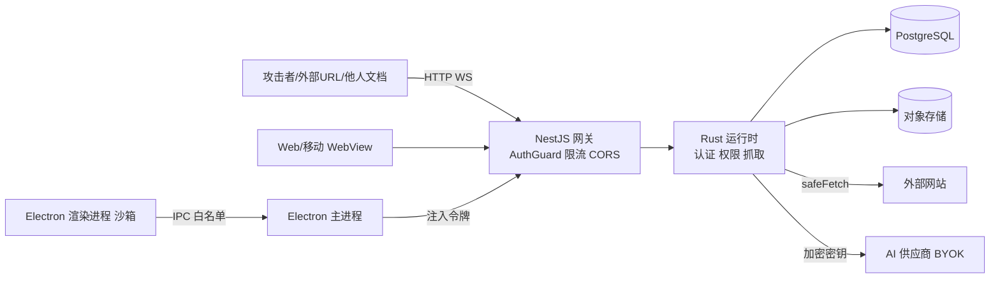
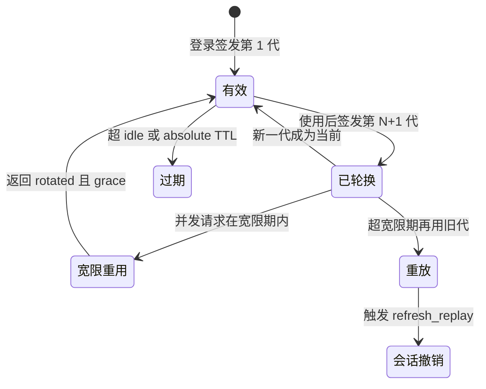

# 第 28 章 安全与合规

> 安全不是一个模块，而是贯穿"客户端—网络—服务端—数据—供应链—发布"的一组约束

第 9 部分 · 运维与部署 ｜ 难度 ★★★★☆ ｜ 建议学时 5 小时

===

## 本章要解决的问题

<p class="lead">AFFiNE 的攻击面特别宽：它是协作应用、支持分享与邀请、有服务端抓取、有 Electron 客户端、是开源 monorepo、还会存第三方密钥（BYOK）。安全不是某一个模块能解决的。</p>

<div class="cards cols-3">
  <div class="card"><div class="card__icon">👥</div><h4>协作应用</h4><p>要防越权访问他人工作区与文档。</p></div>
  <div class="card"><div class="card__icon">✉️</div><h4>分享与邀请</h4><p>给陌生人发邮件、渲染公开页，易被用于钓鱼。</p></div>
  <div class="card"><div class="card__icon">🌐</div><h4>服务端抓取</h4><p>链接预览、图片代理、CalDAV、自定义 AI 端点都可能被诱导访问内网（SSRF）。</p></div>
  <div class="card"><div class="card__icon">🖥️</div><h4>Electron</h4><p>渲染进程一旦 XSS，可能触及本地文件与系统能力。</p></div>
  <div class="card"><div class="card__icon">📦</div><h4>开源依赖</h4><p>几千 npm 包 + 几百 crate，供应链风险不可忽视。</p></div>
  <div class="card"><div class="card__icon">🔑</div><h4>BYOK 密钥</h4><p>泄露直接是用户的经济损失。</p></div>
</div>

<div class="note note--warn">

一个架构趋势：AFFiNE 把大量安全敏感逻辑（令牌签发校验、刷新轮换、权限判定、SSRF 防护、BYOK 加密）**下沉到 Rust** `packages/backend/native`，TS 层更多是"编排 + 错误映射"。读安全代码要习惯在 TS 与 Rust 间来回跳。

</div>

===

## 知识地图：信任边界

一切从信任边界开始：不可信的攻击者/外部 URL/他人文档，经客户端与 NestJS 网关，到 Rust 运行时与数据层。



<div class="note">

本章按 STRIDE 把威胁分六类：伪造身份、篡改、抵赖、信息泄露、拒绝服务、权限提升，逐一对照源码里的防护。路径均相对仓库根 `AFFiNE/`。

</div>

===

## 学习目标

<ol class="goals">
  <li>画出信任边界图，为每条边界列举威胁与防护</li>
  <li>说明 Cookie 会话与 JWT 访问令牌 + 刷新令牌两套机制的适用场景与轮换策略</li>
  <li>解释 hashcash 工作量证明、Turnstile 验证码、限流器、邀请滥用防护的协同</li>
  <li>定位 CORS、CSRF、SSRF、开放重定向、HTML 转义、内容策略的实现位置</li>
  <li>说明 BYOK 密钥在服务端（HKDF + AES-GCM + zeroize）与桌面端（<code>safeStorage</code>）的保护</li>
  <li>列出 Electron 至少 8 项安全加固并指出源码位置</li>
  <li>说明 <code>deny.toml</code>、<code>renovate.json</code>、<code>resolutions</code>、<code>.yarnrc.yml</code> 在供应链安全中的作用</li>
</ol>

===

<!-- section -->
## 一、认证与会话

浏览器用 HttpOnly Cookie，原生客户端用 JWT 访问令牌 + 刷新令牌。令牌签发校验、刷新轮换、重放检测都在 Rust 中完成。

===

## 两套凭证并存

<div class="compare">
  <div class="compare__col"><h4>Cookie 会话</h4>

- 客户端：浏览器 Web
- 载体：`affine_session` HttpOnly Cookie
- CSRF 风险：有，需额外防护
- TTL：session.ttl 15 天，ttr 7 天刷新

  </div>
  <div class="compare__col compare__col--good"><h4>访问令牌 + 刷新令牌</h4>

- 客户端：桌面、移动（原生）
- 载体：`Authorization: Bearer <JWT>` + 安全存储的刷新令牌
- CSRF 风险：无（浏览器不自动附加 Authorization）
- TTL：accessToken 15 分钟；refresh 30 天闲置/180 天绝对

  </div>
</div>

三种 Cookie 各司其职：会话 Cookie（HttpOnly，防 XSS 窃取）、CSRF Cookie（非 HttpOnly，供前端读后放入 `x-affine-csrf-token` 头做双提交）、用户 Cookie（非 HttpOnly，多账号标识）。`cookieOptions` 为 `sameSite: 'lax'`、`httpOnly: true`、`secure: server.https`。

<div class="note note--warn">

**部署要点**：`secure` 取决于 `server.https`。生产若通过 HTTPS 访问却没把 `server.https` 设 true，Cookie 不带 `Secure` 标志，可能在降级到 HTTP 的请求中被明文窃取。

</div>

===

## 访问令牌：HS256 + kid

令牌签名校验在 Rust `auth_session.rs` 完成，校验函数 `verify_auth_session_access_token` 的每一项检查都对应一类攻击：

| 检查 | 防御的攻击 |
| --- | --- |
| `header.alg != "HS256"` 拒绝 | `alg: none` 与算法混淆 |
| `header.kid != expected_key_id` 拒绝 | 用退役或伪造 key 签名 |
| `mac.verify_slice` 常量时间比较 | 计时攻击 |
| 校验 `typ`/`iss`/`aud` | 把其他用途令牌当访问令牌 |
| `iat > now + 容差` 拒绝 | 未来签发的令牌 |
| 过期单独返回 `expired` | 让客户端区分"刷新"与"重新登录" |
| 签名密钥 ≥ 32 字节 | 弱密钥 |

<div class="note note--tip">

令牌 claims 的 `sid` 绑定到一个**认证会话**，服务端可按会话撤销——弥补了"JWT 无法撤销"的经典缺陷：访问令牌只 15 分钟寿命，撤销会话后最多 15 分钟失效，刷新时则被拒。签名密钥环有 `active`/`retiring` 状态，`rotate` 用 `expectedActiveKeyId` 做乐观并发控制。

</div>

===

## 刷新令牌：只存哈希、轮换、重放检测

<div class="split">
<div class="split__main">

刷新令牌结构为 `前缀.id.secret`，256 位随机 secret；**数据库只存 SHA-256 哈希**，库泄露也无法直接用令牌。

每次刷新都轮换出新一代、旧代作废。若在宽限期（`refreshGracePeriod` 默认 30 秒，容忍并发刷新）之外有人再次使用旧代，说明令牌可能被复制——系统返回 `reused` 并发出 `auth.security.detected` / `refresh_replay` 安全事件，据此撤销整个会话。这正是 OAuth 2.0 安全最佳实践。

</div>
<div class="split__aside">

```rust
fn hash_refresh_secret(s: &[u8])
  -> String {
  hex::encode(
    Sha256::digest(s))
}
// token = 前缀.id.secret
// db 只存 secret_hash
```

</div>
</div>



===

## 魔法链接、OAuth 与密码哈希

<div class="cards cols-3">
  <div class="card"><h4>魔法链接</h4><p><code>safeLink</code> 规范化回调、<code>canonicalRedirectUri</code> 处理 <code>redirect_uri</code> 防开放重定向；OTP 用 <code>crypto.randomInt</code>。</p></div>
  <div class="card"><h4>OAuth/OIDC</h4><p>Google/GitHub/Apple/OIDC；<code>allowPrivateNetwork</code> 默认关（OIDC 拉 issuer 发现文档可能被 SSRF 利用）。</p></div>
  <div class="card"><h4>密码哈希</h4><p><code>@node-rs/argon2</code>（PHC 格式），内存困难型，抗 GPU 暴破；比较用 <code>timingSafeEqual</code>。</p></div>
</div>

<div class="note">

**Open App** 流程：网页端已登录用户 `create_open_app_code` 得到一次性 code，经 `affine://` 深链交给桌面端 `complete_open_app` 兑换会话；code 无效统一抛 `InvalidAuthState` 不泄露原因。密码长度规则 `auth.passwordRequirements` 默认 `{ min: 8, max: 32 }`。

</div>

===

<!-- section -->
## 二、防滥用与 Web 安全

验证码 + 工作量证明 + 限流对抗刷接口；CORS/SSRF/重定向/XSS/内容策略守住网络边界。

===

## 验证码、工作量证明与限流

<div class="split">
<div class="split__main">

**两种人机验证**：浏览器用 Cloudflare Turnstile（无感），原生客户端用 **hashcash 工作量证明**（原生环境难嵌第三方验证码）。hashcash 要求客户端找到 `counter` 使 `SHA3-256(stamp)` 前缀有 N 个 0——把"刷接口"成本转嫁给攻击者，服务端验证只需一次哈希。

**Redis 限流**基于 `@nestjs/throttler`，用 Lua 脚本保证原子性、用 Redis 服务器 `TIME` 避免时钟漂移，多副本共享计数。三档：`default`（60s/120）、`strict`（60s/20，用于登录发信）、`authenticated`。

</div>
<div class="split__aside">

```rust
// hashcash.rs check
if version == "1"
  && bits <= claim
  && check_expiration() // 5分钟
  && resource == expected {
  // 校验前缀 0 位数
}
```

</div>
</div>

<div class="note note--warn">

限流是**显式声明**的：注释强调"没被 Throttler 保护的接口永不限流"，新增接口要记得加 `@Throttle(...)`。`auth.signInRateLimit` 按 IP 与邮箱两维度计数对抗撞库；`auth.newAccountActionDelay` 默认 86400 秒让新账号 24 小时内不能发邀请，提高批量注册滥用成本。

</div>

===

## CORS、SSRF 与开放重定向

<div class="cards cols-3">
  <div class="card"><div class="card__icon">🚪</div><h4>CORS</h4><p><code>base/cors.ts</code> <b>精确白名单</b>：服务端来源 + 移动 WebView + 桌面 <code>assets://</code>。HTTP 与 socket.io <b>共用同一套判定</b>，WS 不成绕过点。</p></div>
  <div class="card"><div class="card__icon">🛡️</div><h4>SSRF</h4><p>Rust <code>safe_fetch.rs</code>：禁私网/回环（含 DNS 解析后 IP 防 rebinding）、限重定向/字节/超时、只转白名单头。</p></div>
  <div class="card"><div class="card__icon">↪️</div><h4>开放重定向</h4><p>Rust <code>url_policy.rs</code>：只允 http/https、拒 <code>user:pass@</code>、用 <code>Url::origin()</code> 精确比较、子域要求 <code>.domain</code> 后缀。</p></div>
</div>

```ts
// worker/controller.ts 图片代理
response = await safeFetch(targetURL.toString(),
  { method: 'GET', headers: cloneHeader(req.headers) },
  { timeoutMs: FETCH_TIMEOUT_MS, maxRedirects: MAX_REDIRECTS,
    maxBytes: IMAGE_PROXY_MAX_BYTES });
// catch: SsrfBlockedError -> BadRequest，日志只记 safeLogUrl 处理过的 URL
```

<div class="note">

`worker.allowedOrigin` 默认 `["localhost","127.0.0.1"]`，限定哪些来源页面可用代理端点，防被第三方网站当免费代理。

</div>

===

## XSS 转义与内容策略

<div class="split">
<div class="split__main">

**HTML 转义**：Rust `html_sanitize` 名为 sanitize，实为 HTML 实体转义（`v_htmlescape`），不保留任何标签，用于服务端渲染分享页 `<head>`。文档标题摘要由用户控制，不转义直接拼进 `<title>` 就是存储型 XSS。

**内容策略**：攻击者把工作区命名为"账户已冻结，请访问 evil.example 解冻"再群发邀请，正规邮件就成了钓鱼信。`containsUrlOrDomain` 在发信前检测——Rust `content_policy.rs` 的精妙在于**对抗混淆**：NFKC 规范化全角、Unicode 混淆字符骨架（西里尔 `е`→ASCII）、剔除零宽字符与双向控制符。

</div>
<div class="split__aside">

```rust
#[napi]
pub fn html_sanitize(
  input: String) -> String {
  v_htmlescape::escape(&input)
    .to_string()
}
```

```ts
// mail/job.ts
if (payload.name
  === 'MemberInvitation'
  && containsUrlOrDomain(
    workspaceProps.name)) {
  return; // 跳过发信
}
```

</div>
</div>

===

## 授权：默认拒绝 + 动作级判断

```ts
async canWorkspace(input) {
  const output = await this.workspacePermissions({
    ...input, actions: [input.action],
  });
  return output.decisions[0]?.allowed ?? false;  // 默认拒绝
}
```

<ul class="takeaways">
  <li><b>默认拒绝</b>：<code>decisions[0]?.allowed ?? false</code>，判定缺失按拒绝处理。</li>
  <li><b>按动作而非角色判断</b>：调用方问"能否执行 <code>Doc.xxx</code>"，角色到动作映射集中在 <code>permission-map.ts</code> 与 Rust，避免各处散落 <code>if (role === 'owner')</code>。</li>
  <li>全局 <code>AuthGuard</code> 默认所有接口需登录，只有 <code>@Public()</code> 例外——<b>默认安全</b>。</li>
</ul>

===

<!-- section -->
## 三、密钥、桌面端与供应链

BYOK 用信封加密保护，Electron 有近 20 项加固，供应链靠 deny/resolutions/yarnrc 三道防线。

===

## BYOK 信封加密

用户填入的 AI 供应商 API Key，服务端存储前用信封加密，三个 Rust 依赖各司其职：

| crate | 作用 |
| --- | --- |
| `hkdf` | 从根密钥派生专用子密钥，`info` 为 `AFFiNE/Copilot/BYOK/v1`，密钥用途隔离 |
| `aes-gcm` | AES-256-GCM（16 字节标签），**AAD 绑定 workspaceId/profileId/provider/endpoint** |
| `zeroize` | `Zeroizing` 包装密钥与明文，离开作用域内存清零 |

<div class="note note--danger">

**AAD 的价值**：把 A 工作区的密文挪到 B 工作区会解密失败，防"密文搬运"。密文格式 `byok:v1:` + base64url(nonce+ciphertext)，前缀带版本号为算法升级留余地。配置护栏：`allowCustomEndpoint`、`allowPrivateEndpoint` 默认关闭（防把密钥发给伪造端点、防 SSRF）。

</div>

桌面端 BYOK 与登录凭证由主进程用 Electron `safeStorage`（钥匙串/DPAPI/libsecret）加密；Linux 下若后端退化为 `basic_text`（明文混淆）则不落盘、只保留内存会话。

===

## Electron 安全加固清单

对照 Electron 官方安全清单，从架构到配置近 20 项：

<div class="cards cols-2">
  <div class="card"><h4>进程隔离</h4><p><code>app.enableSandbox()</code>、<code>contextIsolation: true</code>、<code>nodeIntegration: false</code>；preload 只在内部 URL 暴露 <code>__apis</code>。</p></div>
  <div class="card"><h4>IPC 校验</h4><p><code>checkSource</code> 校验发送 frame 的 URL；单通道 + 命名空间白名单路由 <code>allHandlers</code>。</p></div>
  <div class="card"><h4>导航限制</h4><p><code>will-navigate</code> 阻止外部导航；<code>setWindowOpenHandler</code> 拒绝新窗口；外链协议白名单。</p></div>
  <div class="card"><h4>Fuses</h4><p><code>RunAsNode: false</code>、禁 <code>NODE_OPTIONS</code>/<code>--inspect</code>、asar 完整性校验、仅从 asar 加载、Cookie 加密。</p></div>
</div>

<div class="note note--tip">

`checkSource` 的巧妙处：优先用**发送消息的 frame** 的 URL；若消息来自子 frame（iframe）且取不到 URL，当作空字符串拒绝而非回退主 frame——避免"内部页面嵌外部 iframe、iframe 借主页面身份调 IPC"。另有 `protocol.ts` 删除并重新注入 `Authorization`，令牌不进渲染进程，防 XSS 窃取。

</div>

===

## 供应链三道防线

<div class="split">
<div class="split__main">

**`.yarnrc.yml` 的 `enableScripts: false`** 是防 npm 投毒最有效的手段之一——默认禁止依赖的 postinstall 等生命周期脚本（大多数恶意包靠安装脚本执行）。需要构建的包在 `dependenciesMeta` 中逐个 `"built": true` 显式放行。

**`deny.toml`** 做 Rust 许可证合规：只允宽松许可证，三个 crate 例外允 AGPL。**`renovate.json`** 持续小步升级，比积累后大升级更易及时吸收补丁。**根 `package.json` 的 `resolutions`** 100 多条：nolyfill 替换缩小依赖树、安全版本下限、`.yarn/patches/` 自行补丁。

</div>
<div class="split__aside">

```yaml
enableScripts: false  # .yarnrc.yml
approvedGitRepositories:
  - "https://.../node-gyp.git"
npmAuthToken: "${NPM_TOKEN:-NONE}"
yarnPath: .yarn/releases/
  yarn-4.18.0.cjs
```

</div>
</div>

<div class="note">

CI 自身安全（第 26 章）：PR 标题经环境变量传入防脚本注入；`auto-labeler` 在 `pull_request_target` 中只读文件列表；Rust 缓存只在 canary 写；镜像 `provenance: true`、按 digest 引用；CodeQL 静态分析。

</div>

===

## 合规：披露、隐私与许可证

<div class="cards cols-3">
  <div class="card"><div class="card__icon">🔒</div><h4>漏洞披露</h4><p><code>SECURITY.md</code>：走 GitHub Security Advisory 私密通道，<b>不要</b>在公开 Issue 描述可利用细节；不接受 AI 生成的安全报告。</p></div>
  <div class="card"><div class="card__icon">📊</div><h4>遥测</h4><p>前端 <code>enableTelemetry</code> 开关关闭时 <code>sentry.disable()</code> + <code>opt_out_tracking()</code>；<code>telemetry</code> 模块在自托管 schema 中被忽略。</p></div>
  <div class="card"><div class="card__icon">⚖️</div><h4>双许可证</h4><p><code>packages/backend/**</code> 与 <code>common/native/**</code> 为 EE License，其余 MIT，第三方各自原许可证。</p></div>
</div>

<div class="note note--warn">

根 `package.json` 的 `license` 字段写 `MIT` 只是 npm 元数据，**以 `LICENSE` 文件的分区说明为准**。企业自托管或二次开发服务端前，务必让法务审阅 EE License 与订阅条款。本书仅技术说明，不构成法律意见。

</div>

===

## 自托管安全自查清单

部署后对照逐条核验（完整 14 项见文档 28.12.1）：

<ol class="steps">
  <li><h4>HTTPS 与初始化</h4><p>对外只暴露 HTTPS、<code>server.https: true</code>；部署后立即完成 <code>/admin/setup</code> 管理员创建。</p></li>
  <li><h4>收紧依赖服务</h4><p>Postgres/Redis 不暴露公网端口；若暴露则设强密码、不用 <code>trust</code>；<code>private.key</code> 权限收紧并离线备份。</p></li>
  <li><h4>关闭危险开关</h4><p>按需关 <code>auth.allowSignup</code>；<code>copilot.byok.allowCustomEndpoint/allowPrivateEndpoint</code> 保持关；OIDC 不开 <code>allowPrivateNetwork</code>。</p></li>
  <li><h4>限流与头部</h4><p>保持 <code>throttle.enabled</code>；不在 Cloudflare 后面就保持 <code>auth.trustedCloudflareHeaders: false</code>。</p></li>
</ol>

===

## 动手实践

<ol class="steps">
  <li><h4>观察 Cookie 与 CSRF</h4><p>登录后看三个 Cookie 的 HttpOnly/SameSite/Secure；用 curl 带会话 Cookie 但不带 <code>x-affine-csrf-token</code> 调登出接口。<b>验收</b>：得到拒绝响应，能解释为何会话 Cookie 是 HttpOnly 而 CSRF Cookie 不是。</p></li>
  <li><h4>解码访问令牌</h4><p>base64url 解码前两段，记 <code>alg</code>/<code>kid</code>/<code>sub</code>/<code>sid</code>/<code>exp-iat</code>；把 <code>alg</code> 改 <code>none</code> 思考在哪行被拒。<b>验收</b>：<code>exp-iat</code> = 900。</p></li>
  <li><h4>验证 SSRF 防护</h4><p>对图片代理分别请求公网图片、<code>127.0.0.1:3010/info</code>、<code>169.254.169.254</code>。<b>验收</b>：后两个被拒，日志有 <code>Blocked image proxy target</code> 与 reason。</p></li>
  <li><h4>自托管安全自查</h4><p>对第 27 章实例逐条执行 14 项检查，对不通过项给修复配置。<b>验收</b>：产出含 ≥10 项结论、≥3 项修复建议的报告。</p></li>
</ol>

===

## 自测：点击揭晓答案

<details class="quiz">
<summary>Q1. CSRF 双提交校验的原理？为什么 JWT 请求可以跳过？</summary>

服务端下发一个 JS 可读的随机 CSRF Cookie，前端放进 `x-affine-csrf-token` 头，服务端比较两者是否相等。攻击站点读不到受害站点 Cookie，无法构造正确的头。JWT 放在 Authorization 头、浏览器不会自动附加，跨站请求无法携带，因此不存在 CSRF。

</details>

<details class="quiz">
<summary>Q2. verify_auth_session_access_token 如何防御 alg:none 和退役密钥签发的令牌？</summary>

只接受 `alg == "HS256"` 且 `typ == "JWT"`，其他算法（含 none）直接返回 invalid；同时要求 `header.kid == expected_key_id`，用该 key 的 secret 做常量时间 HMAC 校验，退役或伪造 key 签发的令牌无法通过。

</details>

<details class="quiz">
<summary>Q3. BYOK 密文中的 AAD 绑定了哪些字段？没有 AAD 会怎样？</summary>

绑定 `"server"`、workspaceId、profileId、provider、endpoint identity。没有 AAD 时，有数据库写权限的攻击者可把 A 工作区密文复制到 B 工作区记录，让 B 使用 A 的密钥；有 AAD 后解密会失败。

</details>

<details class="quiz">
<summary>Q4. .yarnrc.yml 的 enableScripts: false 如何降低供应链风险？需要构建的包怎么处理？</summary>

禁止依赖包安装时执行 pre/postinstall 脚本，而这正是大多数恶意 npm 包的执行入口。确需构建的包在根 `package.json` 的 `dependenciesMeta` 中以 `"built": true` 显式放行。

</details>

===

## 小结与下一步

<ul class="takeaways">
  <li>认证两套凭证：浏览器 HttpOnly Cookie（+ CSRF 双提交），原生 JWT 访问令牌（HS256+kid，15 分钟）+ 可轮换刷新令牌（只存哈希、重放检测）。</li>
  <li>防滥用靠 Turnstile/hashcash + Redis 限流 + 邀请延迟；限流必须显式声明。</li>
  <li>Web 安全：CORS 精确白名单、<code>safeFetch</code> 防 SSRF、<code>url_policy</code> 防开放重定向、<code>htmlSanitize</code> 防 XSS、内容策略对抗混淆钓鱼。</li>
  <li>密钥：服务端 HKDF+AES-GCM+zeroize 信封加密、AAD 防搬运；桌面端 <code>safeStorage</code>。Electron 近 20 项加固。</li>
  <li>供应链三道防线：<code>enableScripts: false</code> + <code>deny.toml</code> + <code>resolutions/patches</code>；合规走私密披露、可关遥测、双许可证。</li>
</ul>

<div class="note note--tip">

**下一章预告**：第 29 章进入综合实战——用读源码的方法论，亲手追踪冷启动、协同编辑、图片上传、AI 对话四条贯穿前后端的真实链路，每条都配时序图与逐跳表。

</div>
