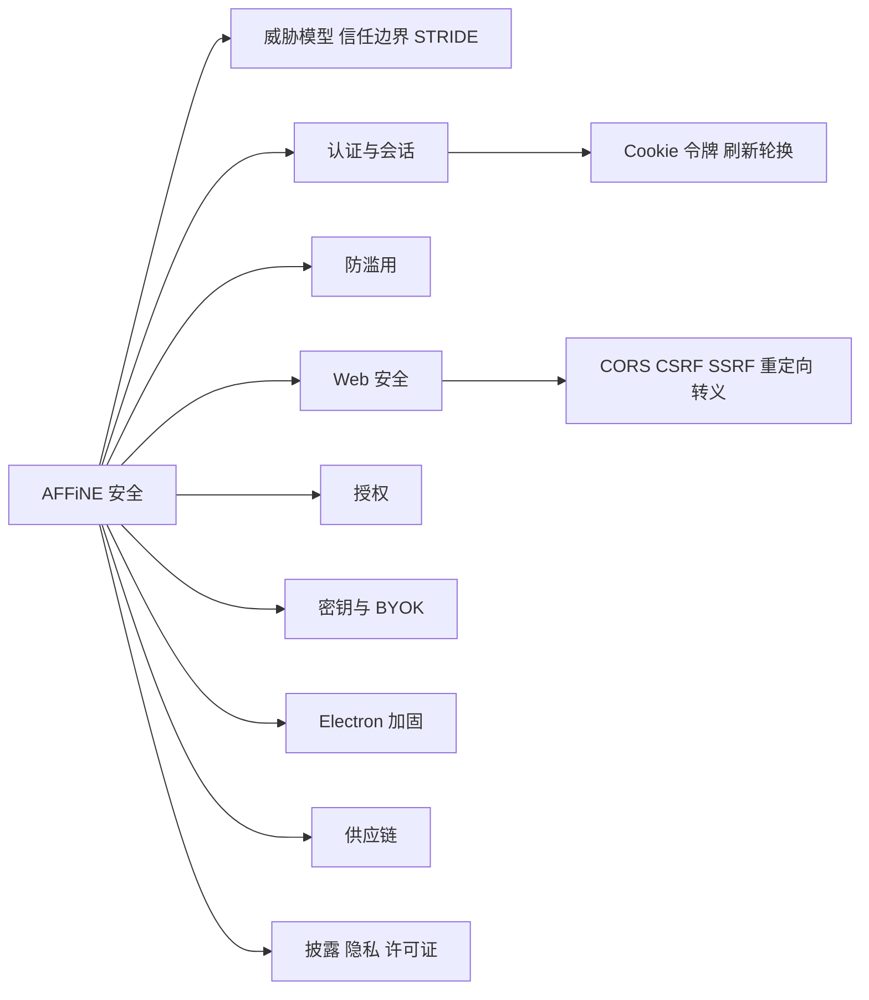
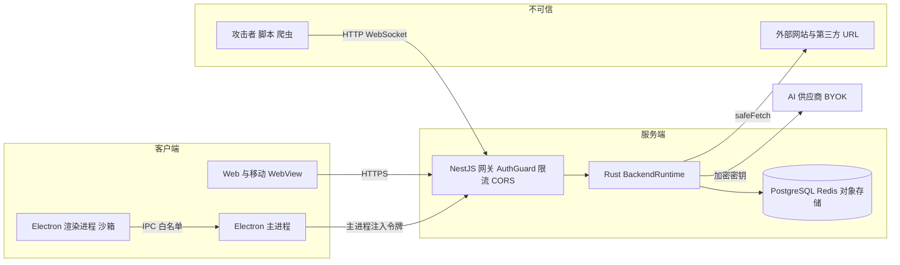
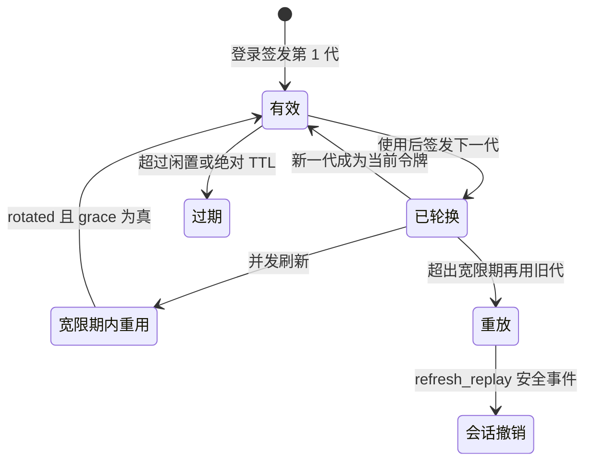

# 第 28 章 安全与合规

从威胁模型到源码防线：认证、防滥用、Web 安全、桌面与供应链

第 9 部分 · 运维与部署 ｜ 难度 ★★★★☆ ｜ 建议学时 5 小时

Note:
安全不是某一个模块，而是贯穿客户端、网络、服务端、数据、供应链和发布的一组约束。这一章我们先建立威胁模型，再逐一对照源码看 AFFiNE 是怎么防的，最后给出一份可以落地的自查清单。

---

## 本章导读：为什么攻击面这么宽

- **协作应用**：要防越权访问他人的工作区与文档
- **分享与邀请**：容易被用于钓鱼与垃圾信息
- **服务端抓取**：链接预览、图片代理可能被诱导 SSRF
- **桌面客户端**：渲染进程 XSS 可能触及本地能力
- **开源 monorepo**：几千个 npm 包与几百个 crate
- **存储 BYOK 密钥**：泄露直接造成用户经济损失

Note:
这六类特征叠加起来，让 AFFiNE 的攻击面比普通 Web 应用宽很多。还有一个架构趋势要提前说明：令牌签发校验、权限判定、SSRF 防护、BYOK 加密等敏感逻辑正在下沉到 Rust 原生模块 `packages/backend/native`，TypeScript 层更多做编排和错误映射。读安全代码时要习惯在 TS 和 Rust 之间来回跳。

---

## 学习目标

- 画出信任边界图，为每条边界列举威胁与防护
- 说明 Cookie 会话与访问令牌 + 刷新令牌的差异
- 解释 hashcash、Turnstile、限流器的协同关系
- 定位 CORS、CSRF、SSRF、开放重定向、转义的实现
- 列出至少 8 项 Electron 加固措施及源码位置
- 说明 `deny.toml`、`.yarnrc.yml` 等供应链配置作用

Note:
目标覆盖了本章的主要板块。除了这六条，还要理解 BYOK 在服务端和桌面端的保护方式，以及 AFFiNE 的双许可证结构与遥测关闭方式。学完之后，你应该能用本章清单完成一次自托管安全自查。

---

## 知识地图



Note:
地图按本章顺序排列：认证会话、防滥用、Web 安全、权限、密钥、Electron、供应链、漏洞披露、隐私和许可证。认证和 Web 安全是内容最密集的两块，图中展开了它们的子主题。

---

## 信任边界



Note:
每一条跨越方框的箭头都是一条信任边界。攻击者可以直接打网关；渲染进程只能通过 IPC 白名单找主进程；服务端访问外部 URL 必须走 safeFetch；BYOK 密钥加密存储后才发给 AI 供应商。原图还有 SMTP、OAuth 提供方和他人分享的文档内容，这里做了精简。

---

## STRIDE 对照

| 威胁 | 典型场景 | 主要防护 |
| --- | --- | --- |
| 伪造身份 | 盗用会话、撞库 | HttpOnly Cookie、`kid`、argon2、登录限流 |
| 篡改 | CSRF、篡改桌面应用 | CSRF 双提交、Fuses 与 asar 完整性 |
| 抵赖 | 事后无法追溯 | `X-Request-Id`、`auth.security.detected` |
| 信息泄露 | 越权、SSRF、密钥泄露 | Rust 权限判定、`safeFetch`、信封加密 |
| 拒绝服务 | 刷接口、注册轰炸 | Redis 限流、hashcash、上传大小限制 |
| 权限提升 | XSS 升级 RCE | Electron 沙箱与 IPC 校验、初始化互斥 |

Note:
STRIDE 是一个经典的威胁分类框架，六个字母分别对应六类威胁。这张表把每类威胁映射到 AFFiNE 的具体防护，后面每一节都会落到源码。比如信息泄露这一行，就对应权限、SSRF 和 BYOK 三个小节。

---

## 两套凭证并存

| 维度 | Cookie 会话 | 访问令牌 + 刷新令牌 |
| --- | --- | --- |
| 客户端 | 浏览器 Web | 桌面端、移动端 |
| 载体 | `affine_session` HttpOnly Cookie | `Authorization: Bearer <JWT>` |
| CSRF 风险 | 有，需额外防护 | 无，浏览器不自动附加 |
| 默认 TTL | `auth.session.ttl` 15 天 | access 15 分钟，refresh 闲置 30 天 |

<p class="small">实现目录：`packages/backend/server/src/core/auth/`，`guard.ts` 决定 `req.authType`。</p>

Note:
浏览器适合 HttpOnly Cookie，JS 读不到凭证；原生客户端用短期访问令牌加可轮换的刷新令牌，凭证由主进程或原生安全存储保管。刷新令牌还有一个 180 天的绝对上限 `refreshAbsoluteTtl`。`AuthGuard` 解析 Bearer 头或 Cookie，把 `req.authType` 设为 `jwt` 或 `session`。

---

## Cookie 属性与 CSRF 双提交

<p class="small">来源：packages/backend/server/src/core/auth/controller.ts（节选）</p>

```ts
if (req.authType === 'jwt') {
  const principal = session as Partial<AuthSessionPrincipal> | undefined;
  if (principal?.authSessionId) return;
} else if (req.authType === 'session') {
  const csrfCookie = getRequestCookie(req, AuthService.csrfCookieName);
  const csrfHeader = req.get('x-affine-csrf-token');
  if (csrfHeader && csrfCookie && csrfCookie === csrfHeader) return;
}
throw new ActionForbidden();
```

会话 Cookie：`sameSite: 'lax'`、`httpOnly: true`、`secure: server.https`。

Note:
服务端会下发三种 Cookie：会话 Cookie 是 HttpOnly；CSRF Cookie 是 JS 可读的随机 UUID，前端把它放进 `x-affine-csrf-token` 头；用户 Cookie 标识多账号场景的当前用户。攻击站点读不到受害站点的 Cookie，构造不出正确的头。GraphQL 侧另有 Apollo 的 `csrfPrevention`。注意 `secure` 取决于 `server.https`，HTTPS 部署忘了设就会少掉 Secure 标志。

---

## 访问令牌：HS256 + kid

| 检查 | 防御的攻击 |
| --- | --- |
| `header.alg != "HS256"` 直接拒绝 | `alg: none` 与算法混淆 |
| `header.kid != expected_key_id` 拒绝 | 退役或伪造 key 签名 |
| `mac.verify_slice` 常量时间比较 | 计时攻击 |
| 校验 `typ`、`iss`、`aud` | 跨用途令牌复用 |
| 签名密钥至少 32 字节 | 弱密钥 |
| claims 中 `sid` 绑定认证会话 | JWT 无法撤销的缺陷 |

<p class="small">实现：`packages/backend/native/src/auth_session.rs`</p>

Note:
签名和校验都在 Rust 中完成。`sid` 把令牌绑定到一个认证会话上，撤销会话后访问令牌最多 15 分钟内失效，刷新时会直接被拒绝。签名密钥环 `signing-key.ts` 支持 active 和 retiring 状态，轮换时要传 `expectedActiveKeyId` 做乐观并发控制。

---

## 刷新令牌：轮换与重放检测



令牌形如 `前缀.id.secret`，数据库**只存 SHA-256 哈希**。

Note:
攻击者偷到旧令牌后再用，会因"旧代被重用"暴露，系统返回 reused 并发出 `auth.security.detected` 事件，类型是 `refresh_replay`。`refreshGracePeriod` 默认 30 秒，容忍客户端多个请求并发刷新的正常情况。secret 是 256 位随机数，数据库泄露也无法直接使用令牌。

--

## 魔法链接、OAuth 与密码

- 魔法链接回调经 `safeLink` 与 `canonicalRedirectUri` 规范化
- 一次性验证码用 `crypto.randomInt` 生成
- Open App：一次性 code 经 `affine://` 深链兑换会话
- OAuth 支持 Google、GitHub、Apple、通用 OIDC
- OIDC `allowPrivateNetwork` 默认关闭，防 SSRF
- 密码：`@node-rs/argon2` 哈希，Rust 侧校验

Note:
魔法链接的回调 URL 必须规范化，否则会变成开放重定向。OAuth 的 `preflight` 生成带 state 的授权 URL，回调时校验 state。argon2 是内存困难型算法，能有效抵御 GPU 暴力破解；通用字符串比较用 `timingSafeEqual` 防计时攻击。

---

## 防滥用：验证码与工作量证明

<div class="cols">
<div>

| 客户端 | 验证方式 |
| --- | --- |
| 浏览器 | Cloudflare Turnstile |
| 原生客户端 | hashcash 工作量证明 |

`captcha.config.challenge.bits` 默认 20

</div>
<div>

**`hashcash.rs` 的 `check`**

- `version == "1"`
- `bits <= self.claim`
- 5 分钟内有效，防囤积
- `resource` 绑定挑战，防重用
- `SHA3-256` 前缀 0 位数

</div>
</div>

Note:
原生环境难以嵌入第三方验证码，所以用 hashcash：客户端平均要尝试 16 的 bits/4 次方次，服务端只需算一次哈希，把刷接口的成本转嫁给攻击者。客户端的 `mint` 逻辑是同一份 Rust 代码，桌面通过 `@affine/native`、移动端通过 `hashcash_mint` 复用。验证码在 `captcha.enabled` 为 true 时由 `CaptchaGuardProvider` 校验。

---

## 限流与邀请滥用

<div class="cols">
<div>

**Redis 限流**

- Lua 脚本保证原子性
- 用 Redis `TIME`，避免时钟漂移
- `default` 60 秒 120 次
- `strict` 60 秒 20 次
- 未声明 `@Throttle` 就不限流

</div>
<div>

**邀请滥用**

- 仅开启 `trustedCloudflareHeaders` 才信 CF 头
- 日志敏感值经 `hashLogValue`
- 配额判定在 Rust 中进行
- 新账号 24 小时内不能发邀请

</div>
</div>

Note:
限流基于 `@nestjs/throttler`，但计数放在 Redis 的 `CacheRedis` 里，多副本共享，水平扩展后依然准确。注释特别强调：没有挂限流装饰器的接口永远不会被限流，新增接口要记得加。`auth.signInRateLimit` 按 IP 和邮箱两个维度专门对抗撞库。

---

## CORS 精确白名单

<p class="small">来源：packages/backend/server/src/base/cors.ts（节选）</p>

```ts
export function buildCorsAllowedOrigins(url: URLHelper) {
  return new Set<string>([
    ...url.allowedOrigins,
    ...MOBILE_CLIENT_ORIGINS,
    ...DESKTOP_CLIENT_ORIGINS,
  ]);
}
```

- 精确白名单，不用正则或 `*`；开发/测试才放行回环地址
- HTTP 与 socket.io **共用同一套判定**，WebSocket 不是绕过点

Note:
白名单由三部分组成：服务端自身来源，由 `server.externalUrl`、`host`、`hosts` 推导；移动端 WebView 来源如 `capacitor://localhost`；桌面端 `assets://` 来源。没有 Origin 头的请求直接放行，因为 CORS 本来就是浏览器机制，真正的鉴权在 `AuthGuard`。

---

## SSRF 防护：safeFetch

| 参数 | 防护 |
| --- | --- |
| `allow_private_target_origin` | 默认禁止内网与回环，防 DNS rebinding |
| `max_redirects` | 限制重定向，每跳重新校验 |
| `max_bytes` | 响应体上限，防内存耗尽 |
| `timeout_ms` | 防慢速连接占用资源 |
| `allowed_headers` | 只转发白名单头，不泄露 Cookie |
| `allow_http` | 可强制 HTTPS |

<p class="small">`safe_fetch.rs` → `safefetch` crate；调用点如 `plugins/worker/controller.ts` 图片代理。</p>

Note:
服务端抓取外部 URL 的场景包括图片代理、链接预览、CalDAV 日历同步，以及 BYOK 自定义端点和 OIDC 发现。TS 侧捕获 `SsrfBlockedError` 并转成 BadRequest，日志只记录经 `safeLogUrl` 处理的 URL。`worker.allowedOrigin` 默认只有 localhost，防止被第三方网站当免费代理。

---

## 开放重定向与 XSS

<div class="cols">
<div>

**`url_policy.rs`**

- 只允许 `http` / `https`
- 拒绝带 `user:pass@` 的 URL
- 用 `Url::origin()` 精确比较
- 子域匹配要求 `.domain` 后缀

</div>
<div>

**`html_sanitize.rs`**

```rust
#[napi]
pub fn html_sanitize(input: String) -> String {
  v_htmlescape::escape(&input).to_string()
}
```

用于分享页 `<title>` 与摘要。

</div>
</div>

Note:
开放重定向是钓鱼的常用跳板，`url_policy` 导出三个 NAPI 函数，TS 侧通过 `native.ts` 的 `evaluateRedirectUri` 等使用。前导点很关键，它防止 `evilexample.com` 匹配上 `example.com`。`html_sanitize` 名字叫 sanitize，实际是 HTML 实体转义；文档标题和摘要由用户控制，不转义拼进 head 就是存储型 XSS。

---

## 内容策略与授权

<div class="cols">
<div>

**内容策略**

- 工作区名含 URL/域名则不发邀请邮件
- `containsUrlOrDomain` 调 Rust 扫描
- NFKC 规范化、同形字符骨架
- 剔除零宽字符与双向控制符

</div>
<div>

**授权**

- 默认拒绝：`allowed ?? false`
- 按动作判断，而非按角色
- 判定下沉 Rust `authorize`
- 全局 `AuthGuard`，`@Public()` 例外

</div>
</div>

Note:
攻击者把工作区命名成"账户已冻结请访问某某网站"再大量邀请，AFFiNE 发出的正规邮件就成了钓鱼信，所以 `core/mail/job.ts` 在发信前做内容检测。Rust 实现会对抗全角字符、西里尔同形字母、零宽字符等混淆。授权方面，调用方问的是"能否执行 Doc.xxx"，角色到动作的映射集中在 `permission-map.ts` 和 Rust 中。

---

## 密钥管理与 BYOK

| 组件 | 作用 |
| --- | --- |
| `crypto.privateKey` | 服务端根密钥，签名与 `aes-256-gcm` 加密 |
| `hkdf` | 以 `AFFiNE/Copilot/BYOK/v1` 派生专用子密钥 |
| `aes-gcm` | 16 字节标签；AAD 绑定工作区与供应商 |
| `zeroize` | 密钥与明文离开作用域即清零 |
| `allowCustomEndpoint` | 默认 `false`，防密钥发往伪造端点 |

<p class="small">桌面端：主进程用 Electron `safeStorage` 加密 BYOK 与登录凭证。</p>

Note:
BYOK 的信封加密在 `llm/byok/envelope.rs`，AAD 绑定 workspaceId、profileId、provider 和 endpoint，把 A 工作区的密文挪到 B 工作区会解密失败，防止"密文搬运"。密文前缀 `byok:v1:` 带版本号，为算法升级留余地。Linux 桌面端若 safeStorage 退化为 `basic_text`，就只保留内存会话不落盘。

---

## Electron 安全加固（节选）

| 措施 | 源码位置 |
| --- | --- |
| `sandbox`、`contextIsolation`、关闭 `nodeIntegration` | `src/main/web-preferences.ts` |
| preload 只在内部 URL 暴露 API | `src/preload/index.ts` |
| IPC 来源校验 `checkSource` | `src/main/security-restrictions.ts` |
| 禁止外部导航与新窗口 | `will-navigate`、`setWindowOpenHandler` |
| 外链仅 `http:` `https:` `mailto:` | `src/main/security/open-external.ts` |
| Fuses：禁 `RunAsNode`、asar 完整性 | `forge.config.mjs` |

Note:
完整清单有 19 项，这里挑了最关键的六项。另外两项特别值得记住：令牌不进渲染进程，`protocol.ts` 在请求头里删除并重新注入 Authorization；`assets://` 协议用路径白名单防路径穿越。按向下键看 `checkSource` 的一个精妙细节。

--

## checkSource 的细节

<p class="small">来源：packages/frontend/apps/electron/src/main/security-restrictions.ts（节选）</p>

```ts
export const checkSource = (
  e: Electron.IpcMainInvokeEvent | Electron.IpcMainEvent
) => {
  const url =
    e.senderFrame?.url ||
    (e.senderFrame && e.senderFrame !== e.sender.mainFrame
      ? ''
      : e.sender.getURL() || pendingInternalNavigation.get(e.sender) || '');
  const result = isInternalUrl(url);
  if (!result) logger.error('invalid source', url);
  return result;
};
```

子 frame 取不到 URL 时按空串拒绝，不回退到主 frame。

Note:
它优先使用发送消息的 frame 的 URL。如果消息来自子 frame 又取不到 URL，就当作空字符串拒绝，而不是借用主 frame 的 URL。这避免了"内部页面嵌了一个外部 iframe，iframe 冒用主页面身份调用 IPC"的攻击。

---

## 供应链安全

<div class="cols">
<div>

**Rust 与升级**

- `deny.toml` 只配 `[licenses]`
- 宽松许可证白名单，3 个 AGPL 例外
- CI 中未见 `cargo deny` 调用
- Renovate 持续小步升级

</div>
<div>

**npm 与 yarn**

- `enableScripts: false` 禁安装脚本
- `dependenciesMeta` 逐个放行构建
- `resolutions` 强制安全版本下限
- `yarnPath` 固定 yarn 二进制

</div>
</div>

Note:
大多数恶意 npm 包靠 postinstall 等安装脚本执行，`enableScripts: false` 是防投毒最有效的手段之一。`resolutions` 里有大量 nolyfill 替换来缩小依赖树，还有 `ws`、`tar` 等的安全版本下限。CI 自身也有防护：标题经环境变量传入、Rust 缓存只在 canary 写、镜像开启 provenance。

---

## 披露、隐私与许可证

<div class="cols cols-3">
<div>

**SECURITY.md**

- 仅支持 `0.27.x`
- GitHub Security 私密报告
- 不接受 AI 生成报告

</div>
<div>

**遥测**

- `enableTelemetry` 开关
- 关闭即 `sentry.disable()`
- 服务端经 GA4 转发

</div>
<div>

**许可证**

- `packages/backend/**` 为 EE
- `common/native` 同为 EE
- 其余为 MIT

</div>
</div>

Note:
作为贡献者，不要在公开 Issue 里描述可利用的漏洞细节，要走 GitHub Security Advisory 私密通道。遥测模块在自托管 schema 里被隐藏，没配 GA4 时不会向第三方发送。许可证以根目录 `LICENSE` 的分区说明为准，而不是 package.json 里的 license 字段；企业自托管服务端前务必让法务审阅 EE License，本课程不构成法律意见。

---

## 源码导读 Top 5

| 优先级 | 路径 | 看什么 |
| --- | --- | --- |
| P0 | `server/src/core/auth/guard.ts` | 默认需登录、JWT 与 Cookie 两条路径 |
| P0 | `backend/native/src/auth_session.rs` | HS256 签名校验、刷新令牌哈希 |
| P0 | `server/src/core/auth/auth-session.ts` | 刷新轮换、重放检测事件 |
| P0 | `electron/src/main/security-restrictions.ts` | 导航、新窗口、IPC 来源校验 |
| P1 | `backend/native/src/safe_fetch.rs` | SSRF 防护参数 |

Note:
前三个文件构成认证主线，第四个是桌面端的第一道防线，第五个是服务端抓取的统一出口。路径前缀做了缩写，`server` 指 `packages/backend/server`。第二轮可以读 `url_policy.rs`、`byok/envelope.rs`、`cors.ts` 和 `throttler/index.ts`。

---

## 动手实践

| 练习 | 验收要点 |
| --- | --- |
| 1 观察 Cookie 与 CSRF | 不带 CSRF 头的请求被拒绝 |
| 2 解码一个访问令牌 | `exp - iat` 等于 900，指出拒绝 `none` 的代码 |
| 3 体验 hashcash 成本 | 说出 bits 每加 4 成本变几倍 |
| 4 SSRF 防护验证 | 内网目标被拒，日志有 `reason` |
| 5 自托管安全自查 | ≥ 10 项结论与 3 项修复建议 |

Note:
练习 4 分别请求公网图片、`127.0.0.1:3010/info` 和 `169.254.169.254`，后两个应被拒绝，注意请求要满足 `worker.allowedOrigin`。练习 5 用第 27 章搭的实例，按下一页的清单逐项检查。按向下键查看自查清单节选。

--

## 自托管安全自查（节选）

- 只暴露 HTTPS，`server.https: true`
- 部署后立即完成 `/admin/setup`
- Postgres、Redis 不暴露公网，不用 `trust`
- `private.key` 收紧权限并离线备份
- BYOK 自定义端点与私网端点保持关闭
- 不在 Cloudflare 后则 `trustedCloudflareHeaders: false`
- 镜像固定版本，订阅安全公告

Note:
完整清单有 14 项，还包括按需关闭注册、保持限流开启、OIDC 不开私网、SMTP 使用 TLS、反向代理配置、日志不外露和许可证义务。代码贡献也有一份 12 项清单，核心是：新接口默认不加 `@Public()`、记得加 `@Throttle`、访问外部 URL 一律走 safeFetch。

---

## 自测

1. JWT 请求为什么可以跳过 CSRF 校验？

Authorization 头浏览器不会自动附加，跨站请求带不上。 <!-- .element: class="fragment" -->

2. 刷新令牌的"重放检测"如何发现令牌被盗？

宽限期外再次使用旧代，返回 `reused` 并发 `refresh_replay`。 <!-- .element: class="fragment" -->

3. BYOK 密文没有 AAD 会有什么风险？

密文可被搬到其他工作区记录中使用。 <!-- .element: class="fragment" -->

Note:
第一题考 CSRF 的本质：它利用浏览器自动携带凭证。第二题考令牌轮换的价值。第三题考认证加密中 AAD 的作用。还可以追问：`enableScripts: false` 时确实需要构建的包怎么办？答案是在 `dependenciesMeta` 中以 `"built": true` 显式放行。

---

## 常见坑

| 现象 | 原因与处理 |
| --- | --- |
| 登出等接口返回 403 | 缺 `x-affine-csrf-token` 或与 Cookie 不一致 |
| 原生客户端频繁重新登录 | 并发刷新超出宽限期被判重用 |
| 图片代理全部失败 | `worker.allowedOrigin` 未包含站点域名 |
| 内网 OIDC 登录失败 | 默认禁私网 issuer，评估后开启 |
| 邀请邮件没发出 | 工作区名含域名被内容策略拦截 |
| 某个原生包装完不可用 | `enableScripts: false`，需显式放行 |

Note:
这些坑大多是"安全设计按预期工作"的表现，关键是知道去哪里放行以及放行的代价。比如 OIDC 私网和 BYOK 私网端点，开启前要评估工作区管理员可能借此探测内网的风险。Linux 桌面端无法保存 BYOK，则需要安装并启动 libsecret 或 KWallet。

---

## 小结与下一步

- 先画信任边界，再对照 STRIDE 找防护
- 浏览器用 Cookie + CSRF，原生用短令牌 + 轮换刷新
- 抓取走 `safeFetch`，跳转走 `url_policy`，输出要转义
- 敏感逻辑下沉 Rust：令牌、权限、SSRF、BYOK
- 供应链：禁安装脚本、锁版本、许可证白名单

**下一章**：第 29 章 端到端链路追踪——把全书积木串起来

Note:
安全是一组跨层的约束，本章给你的是一张"在哪里找防线"的地图。到这里，运维与部署部分就结束了。下一章进入综合实战，我们要亲手追踪四条贯穿前后端的真实链路。
