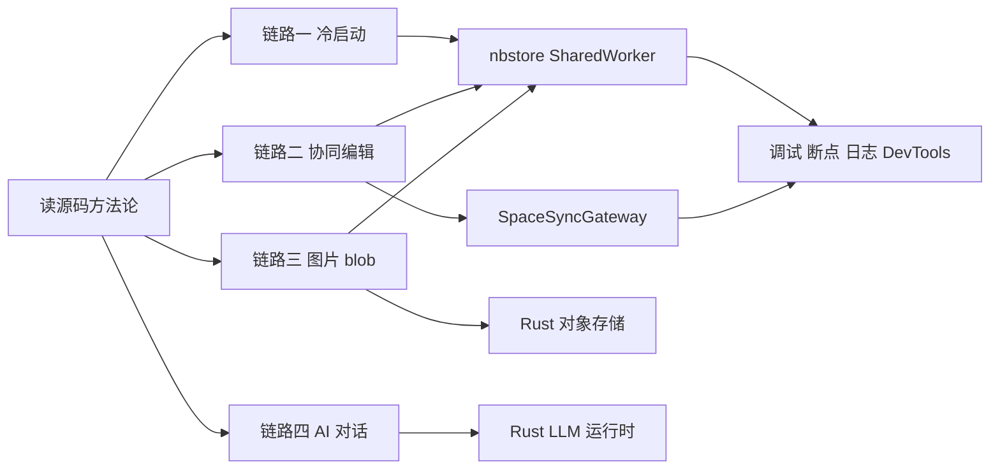
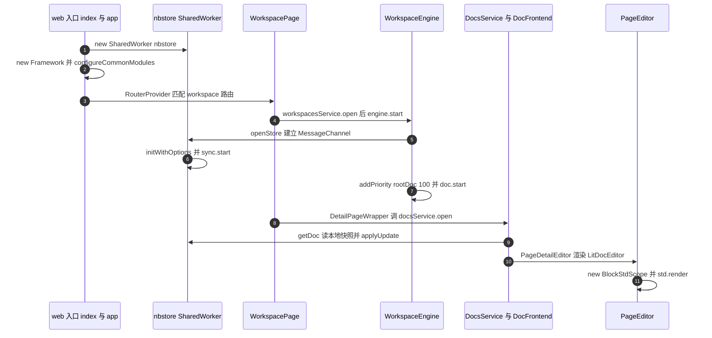
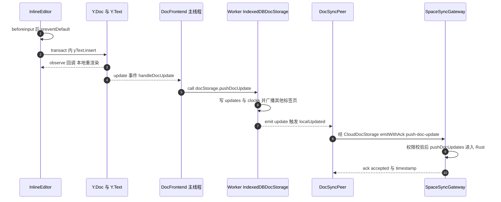
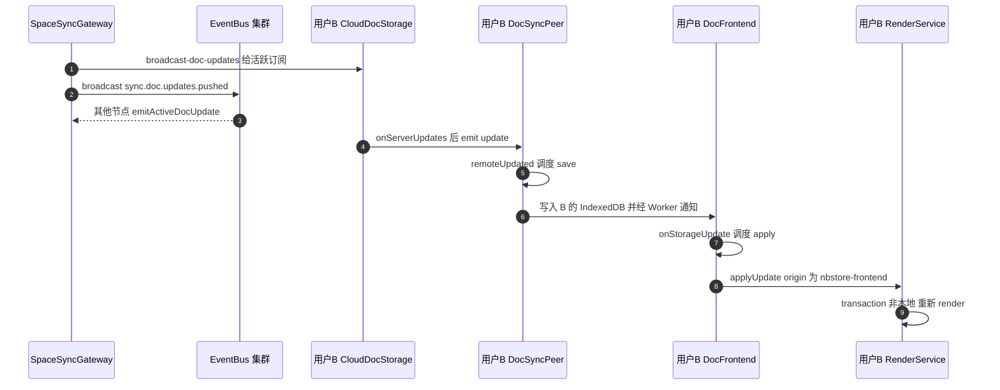
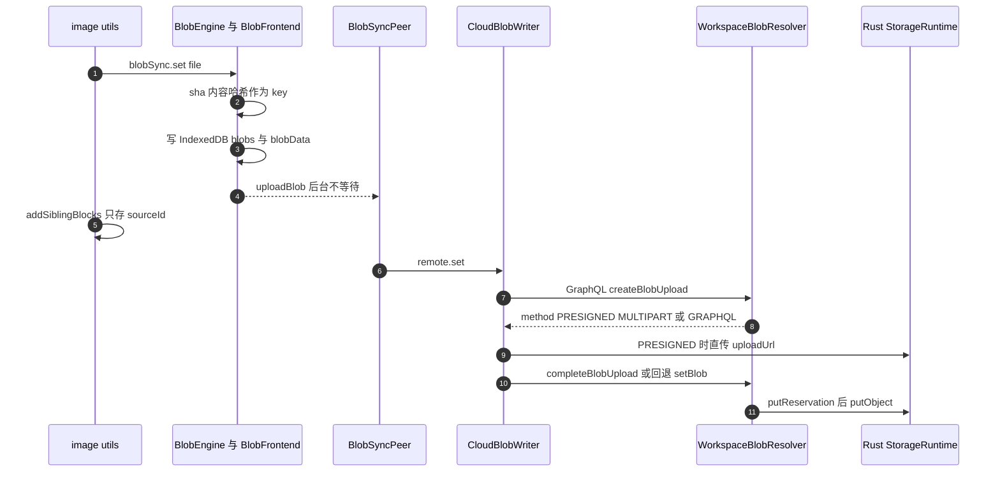
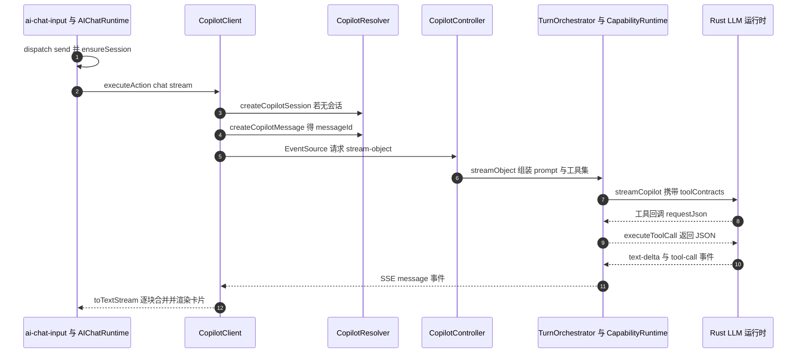

# 第 29 章 端到端链路追踪

读源码方法论 + 四条贯穿前后端的真实链路

第 10 部分 · 综合实战 ｜ 难度 ★★★★★ ｜ 建议学时 8 小时

Note:
这是全书的"串珠"章节。前面我们把 AFFiNE 拆成了一块块积木，但真实的 bug 从来不按章节边界出现。这一章先讲怎么读大型项目，再亲手追踪四条链路：冷启动、协同编辑、插入图片、AI 对话。

---

## 本章导读

- 用户说"我打的字同事看不到"，问题可能在任何一环
- 先学 **6 种读源码方法**，再用它们追踪 4 条链路
- 链路一：冷启动 → 编辑器挂载
- 链路二：键入一个字符 → 协作者看到
- 链路三：插入一张图片 → 对象存储
- 链路四：一次 AI 对话 → 流式工具卡片
- 重点标出 **TS 与 Rust 的边界**

Note:
"字同事看不到"这个问题，可能出在 `beforeinput` 事件、Yjs 事务、Worker 消息、IndexedDB、socket.io 房间、PostgreSQL 写入中的任何一处。新版后端把文档写入、对象存储、LLM 调用等热路径下沉到了 Rust 原生运行时，TS 层更多是编排、权限和协议，这正是读新版源码最容易"追丢"的地方。

---

## 学习目标

- 说出 6 种读源码方法，并为不同问题选对方法
- 复述 Web 冷启动链路直到 `BlockStdScope.render`
- 画出"键入一个字符"的时序图，指出异步边界
- 解释 `origin` / `uniqueId` 如何防止 update 回环
- 说明 blob 三种上传方式及选择逻辑
- 追踪 AI 对话到 `executeToolCall` 的全过程

Note:
此外还要能说明服务端何时把 updates 合并为 snapshot，以及在 DevTools 中观察 IndexedDB、WebSocket 帧和 SSE 事件流。建议打开两个窗口，一边看幻灯片，一边在 IDE 里按表格逐跳打开文件。

---

## 知识地图



Note:
四条链路都从方法论出发，又在几个"枢纽"汇合：前三条都经过 nbstore 所在的 SharedWorker；协同编辑的服务端枢纽是同步网关；图片和 AI 分别进入 Rust 的对象存储和 LLM 运行时。最后都落到调试技巧上。

---

## 读源码的六种方法

| 方法 | 适合回答 | AFFiNE 技巧 |
| --- | --- | --- |
| 自顶向下 | 功能如何启动/挂载 | 只看组装代码，遇接口搜 `.impl(` |
| 自底向上 | 数据最终写到哪里 | 从 `pushDocUpdate` 反查调用者 |
| 断点法 | 回调到底被谁调用 | Worker 用 `chrome://inspect/#workers` |
| grep 法 | 跨越线程/网络边界 | 搜事件名、Op 名、GraphQL 名 |
| 日志法 | 运行时状态 | URL 加 `?debug` 开启 `DebugLogger` |
| 测试反推 | 模块被设计成怎么用 | 看 `describe`、arrange、assert |

Note:
读源码的本质是带着问题找路径，六种方法通常要组合使用。AFFiNE 大量使用 DI，自顶向下时看到的是接口，真正实现在 `framework.impl(...)` 处注入。跨线程调用通过字符串操作名进行，调用栈会在这里断开，这时就用 grep 法接上另一端。

---

## 字符串是跨边界的胶水

<div class="cols">
<div>

**常用"胶水"字符串**

- socket：`'space:push-doc-update'`
- Worker：`'blobSync.uploadBlob'`
- GraphQL：`createBlobUpload`
- 事件总线：`'doc.snapshot.updated'`

</div>
<div>

**通用追踪模板**

1. 明确输入与输出/副作用
2. 自顶向下找触发点
3. 自底向上找落点
4. grep 跨越字符串边界
5. 断点验证、画时序图

</div>
</div>

Note:
前端 emit 和后端 `@SubscribeMessage` 一一对应，Worker 的 `client.call` 和 `consumer.registerAll` 一一对应。小技巧：后端方法名经常与 GraphQL 字段同名，前端生成代码会加 `Mutation` 或 `Query` 后缀，搜索时去掉后缀就能同时命中两端。模板完整版还有"用测试或日志确认边界条件"和"形成逐跳表笔记"两步。

---

## 链路一：冷启动到编辑器挂载



Note:
用户打开 `/workspace/<wid>/<docId>`，代码一路从 `index.tsx` 走到 `EditorHost`。注意 Worker 在 `app.tsx` 模块顶层就创建了，比 React 渲染还早。工作区打开时根文档优先级 100，当前文档在 `useLoadDoc` 中设为 10。按向下键看逐跳关键文件。

--

## 链路一：逐跳关键文件

| 层 | 文件 | 关键方法 |
| --- | --- | --- |
| Web 入口 | `apps/web/src/app.tsx` | Worker 创建、Framework 组装 |
| 工作区仓库 | `modules/workspace/services/repo.ts` | `open` / `instantiate` |
| 引擎 | `modules/workspace/entities/engine.ts` | `WorkspaceEngine.start` |
| Worker | `nbstore/src/worker/store.ts` | `StoreConsumer.initWithOptions` |
| 文档页 | `detail-page/detail-page-wrapper.tsx` | `useLoadDoc` |
| 编辑器 | `blocksuite/editors/page-editor.ts` | `connectedCallback` / `render` |

<p class="small">完整逐跳表共 32 跳，见章节 29.2.2。</p>

Note:
路径做了缩写：`modules` 指 `packages/frontend/core/src/modules`，`nbstore` 指 `packages/common/nbstore`。`instantiate` 会用 `ObjectPool` 复用工作区，`createScope(WorkspaceScope, ...)` 后调用 `engine.start()`。最后一跳在 `blocksuite/framework/std` 的 `BlockStdScope.render` 中 new 一个 `EditorHost`。

---

## 组装：Worker 与 Framework

<p class="small">来源：packages/frontend/apps/web/src/app.tsx（节选）</p>

```tsx
if (
  window.SharedWorker &&
  localStorage.getItem('disableSharedWorker') !== 'true'
) {
  const worker = new SharedWorker(workerUrl, {
    name: 'affine-shared-worker',
  });
  storeManagerClient = new StoreManagerClient(new OpClient(worker.port));
}
// ...
const framework = new Framework();
configureCommonModules(framework);
framework.impl(NbstoreProvider, { /* realtime, openStore */ });
frameworkProvider.get(LifecycleService).applicationStart();
```

Note:
这是 Web 应用最重要的几十行。所有标签页共享一个 SharedWorker，同一工作区在多个 tab 中只有一份同步连接。`NbstoreProvider` 是一个"端口"，Electron 版会注入完全不同的实现。不支持 SharedWorker 或手动禁用时降级为普通 Worker。

--

## 冷启动的两个细节

- `addPriority` 同时作用于本地加载队列与远端同步队列
- 根文档 100、当前文档 10：当前文档总最先可编辑
- `PageEditor.render`：`if (!this.doc.root) return nothing;`
- 新设备首次打开云端文档，先渲染空
- 同步拉到根块后 `rootAdded` 触发 `requestUpdate`
- 三层作用域：`WorkspaceScope → DocScope → EditorScope`

Note:
`DocFrontend.addPriority` 内部会调用 `this.sync?.addPriority`，所以一个优先级同时影响本地和远端。"编辑器先空白一下再出现"就是 `rootAdded` 机制的表现。三层作用域由 `WorkspacePage` 和 `DetailPageWrapper` 中的 `FrameworkScope` 提供给 React 子树，所以任何组件都能 `useService(WorkspaceService)`。

---

## 链路二（上）：本地写入与推送



Note:
顺序是：视图先刷新，然后 IndexedDB 落盘，最后才是网络推送，后两者都是异步的。服务端的 socket 事件名完整写法是 `space:push-doc-update`。网关做 `hasActiveDocSubscription`、`Doc.Update` 权限和 `permissionGeneration` 校验后，经适配器调用 `appendWorkspaceDocUpdatesV1` 进入 Rust 原生运行时写入 updates 表。

---

## 链路二（下）：广播与对端应用



Note:
网关只把带 update 的精确推送发给"活跃订阅了该文档"的 socket，同时通过事件总线通知集群其他节点，让它们对本节点上的活跃 socket 再下发一次。B 端拿到 update 后先落 IndexedDB，再通过 Worker 的 Observable 回到主线程应用到 Y.Doc，最终 `RenderService._onYTextChange` 让用户 B 看到那个字。

---

## 关键：两层防回环

<p class="small">来源：packages/common/nbstore/src/frontend/doc.ts（节选）</p>

```ts
private readonly handleDocUpdate = (
  update: Uint8Array,
  origin: any,
  doc: YDoc,
  transaction: YTransaction
) => {
  if (origin === NBSTORE_ORIGIN) {
    return;
  }
  // ...
  this.schedule({ type: 'save', docId: doc.guid, update });
};
```

`NBSTORE_ORIGIN` 防"读来的又写回"；`uniqueId` 防"写进去的又应用回来"。

Note:
Y.Doc 层用 `NBSTORE_ORIGIN = 'nbstore-frontend'` 标记来自存储的变化；存储层用 `uniqueId = frontend:${nanoid()}` 标记自己写进去的，`onStorageUpdate` 里 `origin !== this.uniqueId` 才会 apply。`DocSyncPeer` 同样会过滤自己的 uniqueId 和 `sync:${peerId}:` 前缀。另一个关键：`EventService._onBeforeInput` 几乎总是 `preventDefault`，DOM 永远不是数据源。

---

## 两种通知与读时合并

<div class="cols">
<div>

**两种服务端通知**

- `broadcast-doc-updates`：活跃订阅，带 update
- `broadcast-doc-invalidation`：工作区房间，只带时间戳
- 失效后 50ms 去抖，`repairInvalidatedDocs`
- 空 update 触发 `pull`，按需拉差量

</div>
<div>

**何时合并 snapshot**

- **读时合并**，不是写时合并
- `getDocUnderLock` 发现 updates 即 squash
- 写新快照、旧快照入历史
- 合并后发 `doc.snapshot.updated`

</div>
</div>

Note:
失效通知让没打开的文档不会被大量 update 淹没，客户端拉 `space:load-doc-timestamps` 后只对变新的文档按需拉差量。合并的常见触发是客户端 `space:load-doc`。前端 IndexedDB 采用完全相同的策略，注释直言不立即合并能省大量写时间。按向下键看服务端合并代码。

--

## 服务端读时合并

<p class="small">来源：packages/backend/server/src/core/doc/storage/doc.ts（节选）</p>

```ts
protected async getDocUnderLock(spaceId: string, docId: string) {
  const snapshot = await this.getDocSnapshot(spaceId, docId);
  const updates = await this.getDocUpdates(spaceId, docId);

  if (updates.length) {
    const docUpdate = await this.squash(
      snapshot ? [snapshot, ...updates] : updates
    );
    return await this.squashUpdatesToSnapshot(
      spaceId, docId, updates, snapshot, docUpdate
    );
  }
  return { doc: snapshot, snapshotUpdated: false };
}
```

Note:
`squashUpdatesToSnapshot` 带 `@Transactional`，做三件事：写新快照、旧快照入历史（页面历史功能的数据来源）、标记 updates 已合并。`doc.snapshot.updated` 由 `DocEventsListener.markDocContentCacheStale` 消费。章节里还提示：Rust 侧写入时是否有额外的阈值合并，TS 层无法确证，建议断点验证。

---

## 链路三：插入图片 blob



入口：slash menu "Image" → `insertImagesCommand` → `addSiblingImageBlocks`。

Note:
图片插入是"秒出"的：写完 IndexedDB 就返回，块立即渲染读本地 blob，上传在后台进行。块里只存 `sourceId`，块本身走链路二同步。服务端选择上传方式后，最终都由 `StorageRuntimeProvider.putObject` 进入 Rust，`fs`、`assetpack` 走本地文件系统，`aws-s3`、`cloudflare-r2` 走 S3 兼容客户端。

---

## 三种上传方式的选择

<p class="small">来源：packages/common/nbstore/src/impls/cloud/blob-writer.ts（节选）</p>

```ts
const upload = init.createBlobUpload;
if (upload.alreadyUploaded) {
  return;
}
try {
  if (upload.method === BlobUploadMethod.PRESIGNED) {
    // ... uploadViaPresigned 后 completeUpload
  }
  if (upload.method === BlobUploadMethod.MULTIPART) {
    // ... uploadViaMultipart 后 completeUpload
  }
} catch (error) {
  // ... '[blob] direct upload failed'
}
await this.uploadViaGraphql(blob, signal);
```

Note:
服务端 `createBlobUpload` 先预留配额，再根据 `WorkspaceBlobStorage.capabilities()` 和文件大小选择：大于阈值且支持则 MULTIPART，支持预签名则 PRESIGNED，默认 GRAPHQL。直传失败会回退到 GraphQL 的 `setBlob`。"预留、写对象、定稿"三段式保证配额统计与对象存储一致，写失败会 `abortStorageReservationV1` 回滚。

--

## blob 的设计要点

- key = `sha(await value.arrayBuffer())`：内容寻址，天然去重
- `alreadyUploaded` 直接跳过重复上传
- `BlobFrontend.set`：先写本地，再 `uploadBlob(blob, true)`
- 上传状态经 `blobState$` 暴露给 UI
- 对端下载：`/api/workspaces/${workspaceId}/blobs/v1/${key}`
- 下载鉴权：按"引用该 blob 的文档是否可读"判断

Note:
二进制放进 Yjs 文档会让文档膨胀、同步变慢，所以块里只存 key。对端下载时会带上当前文档作为 source，服务端在 Rust 中 `openBlobV1` 鉴权并流式返回，响应头是 `cache-control: private, no-store`。配置项 `storages.blob.storage` 默认使用 fs provider。

---

## 链路四：一次 AI 对话



Note:
前端乐观追加 user 消息和一条 loading 状态的 assistant 消息，再走 `AIRequestService.executeAction`，动作定义里 chat 对应 `Endpoint.StreamObject`、超时 5 分钟。服务端 SSE 入口是 `@Sse('/chat/:sessionId/stream-object')`，编排层 `TurnOrchestrator` 结束后还会 `persistObjectResult` 持久化回复。

---

## TS 与 Rust 的边界：工具回调

<p class="small">来源：plugins/copilot/runtime/capability-runtime.ts（节选，参数已精简）</p>

```ts
const rawStream = this.backend.streamCopilot<
  LlmToolLoopStreamEvent | CopilotRuntimeEvent
>(
  { slot, workspaceId: options.workspace, userId: options.user, request },
  async requestJson => {
    const toolRequest = JSON.parse(requestJson) as LlmToolCallbackRequest;
    return JSON.stringify(
      await executeToolCall(toolSet, toolRequest, { /* signal, runId */ })
    );
  },
  { maxSteps: 20, signal: options.signal }
);
```

模型循环在 Rust（最多 20 步），工具实现仍在 TS。

Note:
这是新版 Copilot 架构的核心。工具需要访问 Prisma、DocReader、检索服务和权限体系，所以留在 TS；Rust 每需要执行一个工具，就通过 NAPI 回调这个函数。第 24 章介绍的 provider 抽象，在本版本中已大部分迁入 `packages/backend/native/src/llm`。

--

## AI 链路的两个设计

- **先建消息，再开流**：用户消息经 GraphQL 持久化
- 断线重试 `retry: true` 只重开流，不重复提交
- 工具名两套：prompt 配置用驼峰 `'docSearch'`
- 暴露给模型与前端用蛇形 `tools.doc_search`
- 前端 `ChatContentStreamObjects` 按 `type` 分派渲染
- `text-delta` 富文本，`tool-call` 渲染工具卡片

Note:
SSE 只负责单向把回复流回来，用浏览器原生 EventSource 和服务端 `@Sse` 加 RxJS Observable 就能实现。工具两套命名在 `ToolRuntime.getTools` 的 switch 中完成映射，新增工具时两处都要对上，第 30 章练习 ⑨ 会用到。前端 `appendAssistantContent` 会把相邻的 text-delta 合并。

---

## 推荐断点位置

| 场景 | 断点位置 |
| --- | --- |
| 字符没写进去 | `inline/services/event.ts` `_onBeforeInput` |
| 本地没保存 | `nbstore/src/frontend/doc.ts` `handleDocUpdate` |
| 不推送 | `nbstore/src/sync/doc/peer.ts` `jobs.push` |
| 服务端拒绝 | `core/sync/gateway.ts` `onReceiveDocUpdate` |
| 图片上传失败 | `impls/cloud/blob-writer.ts` `CloudBlobWriter.set` |
| AI 无响应 | `runtime/tool/bridge.ts` `executeToolCall` |

Note:
记住 Worker 里的代码要在 Worker 自己的 DevTools 中打断点：打开 `chrome://inspect/#workers` 找 `affine-shared-worker`，或者 `localStorage.setItem('disableSharedWorker', 'true')` 降级为普通 Worker。启动卡 loading 时看 `WorkspacePage` 的 `isRootDocReady`；协作者收不到时看 `emitActiveDocUpdate` 里的 `activeDocSockets`。

---

## 在 DevTools 中观察

<div class="cols cols-3">
<div>

**IndexedDB**

- 库名 `${flavour}:${type}:${id}`
- `updates`：未合并增量
- `snapshots`：合并后快照
- `peerClocks`：推拉时钟

</div>
<div>

**WebSocket 帧**

- `42["space:push-doc-update",…]`
- 带 ack：`421[…]` 与 `431[…]`
- update 为 base64 Yjs 二进制
- `globalThis.Y` 可解码

</div>
<div>

**SSE 与 GraphQL**

- 看 `operationName`
- 类型为 `eventsource`
- 逐条显示 `message` 事件
- ping 来自 `mergePingStream`

</div>
</div>

Note:
一个好实验：打开文档记下 `updates` 表行数，敲几个字后行数增加，刷新页面重新打开后行数归零、snapshots 时间戳更新，你就亲眼见证了读时合并。用两个账号打开同一文档，A 端出现 push-doc-update，B 端出现 broadcast-doc-updates，只打开工作区的 C 只收到 invalidation。

---

## 源码导读 Top 5

| 优先级 | 路径 | 看什么 |
| --- | --- | --- |
| ★★★ | `apps/web/src/app.tsx` | SharedWorker、Framework 组装 |
| ★★★ | `common/nbstore/src/frontend/doc.ts` | job 队列、防回环、`applyUpdate` |
| ★★★ | `common/nbstore/src/sync/doc/peer.ts` | push/pull/save 任务与时钟 |
| ★★★ | `backend/server/src/core/sync/gateway.ts` | 接收、广播、活跃订阅 |
| ★★★ | `backend/server/src/core/doc/storage/doc.ts` | `getDocUnderLock` 与合并 |

Note:
这五个文件覆盖了冷启动和协同编辑两条最核心的链路。图片链路建议再读 `blob-writer.ts` 和后端 `resolvers/blob.ts`；AI 链路读 `capability-runtime.ts` 和前端 `runtime/chat/runtime.ts`。路径省略了 `packages/` 前缀和 `packages/frontend/` 中间段。

---

## 动手实践

| 实践 | 验收要点 |
| --- | --- |
| 1 给冷启动打点 | 找出最慢的一跳 |
| 2 亲眼看 updates 被合并 | 在 Worker 中断点 `SnapshotDocStorageBase.getDoc` |
| 3 协作帧抓包 | 抓到 push 与 broadcast 两类帧 |
| 4 断网离线编辑 | 恢复后看到补推的合并 update |
| 5 追踪一个工具调用 | 记录 `request.name` 与 EventStream 事件 |

Note:
实践 1 用 `performance.mark` 只在本地临时打点，不要提交。实践 3 需要本地服务端，用 `dev@affine.pro` 和 `pro@affine.pro` 两个账号。实践 4 在 Network 面板设为 Offline，观察 updates 表增长但 WS 无帧，恢复网络后看 `DocSyncPeer.jobs.push`。

---

## 自测

1. 键入一个字时，视图、IndexedDB、socket 推送的顺序？

视图同步刷新 → 异步写 IndexedDB → 异步推送网络。 <!-- .element: class="fragment" -->

2. 图片块为什么只存 `sourceId`？

避免文档膨胀；key 为内容哈希，天然去重。 <!-- .element: class="fragment" -->

3. 模型循环与工具执行分别在哪里？如何通信？

循环在 Rust，工具在 TS，经 NAPI 回调 `requestJson`。 <!-- .element: class="fragment" -->

Note:
第一题是本章最核心的考点，要能说清哪里是同步、哪里是异步边界。第二题考内容寻址的好处。第三题考新版 Copilot 的架构边界。还可以追问：`broadcast-doc-updates` 和 `broadcast-doc-invalidation` 有什么区别？

---

## 常见坑

| 现象 | 排查方向 |
| --- | --- |
| 打开工作区一直转圈 | `isRootDocReady`；`space:join-batch` 是否有 ack |
| Worker 中断点不生效 | 用 `chrome://inspect` 或禁用 SharedWorker |
| "edited by"总显示自己 | 开 debug 看"应用远端 update 触发本地修改"警告 |
| 协作者刷新后才能看到 | 对端只收到失效通知或修复失败 |
| S3 直传 CORS 报错 | 配置 bucket CORS 或回退 GRAPHQL |
| SSE 很快结束且无内容 | 无 data 的 error 被视为正常结束 |

Note:
"edited by 总显示自己"这类 bug，是在应用远端 update 时又有代码写了 Y.Doc，debug 模式下 `DocFrontend.handleDocUpdate` 会打印警告并列出 key。SSE 无内容时去看服务端 `mapSseError` 日志和 `chat_object_stream_errors` 指标的 stage。

---

## 小结与下一步

- 读源码 = 带着问题找路径，六种方法组合用
- 字符串常量是跨线程、跨网络的"胶水"
- 协同编辑：DOM 不是数据源，两层防回环，读时合并
- 图片：内容寻址、本地优先、三种上传方式
- AI：先建消息再开流，Rust 循环 + TS 工具

**下一章**：第 30 章 贡献实战与进阶路线——让你的代码进入 canary

Note:
这四条链路把全书的积木串成了一条条可以亲手点击验证的路径。真正的收获来自你在 IDE 里逐跳打开文件、在 DevTools 里看到帧和表的变化。下一章是全书收官，我们把这些能力转化为向上游提交 PR 的实战。
