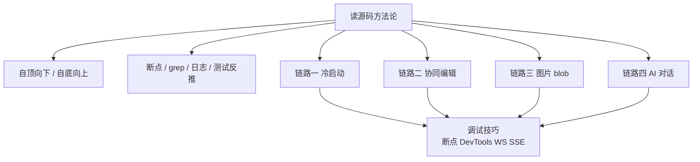
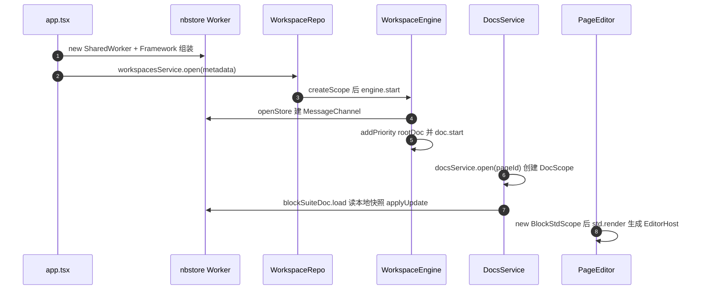
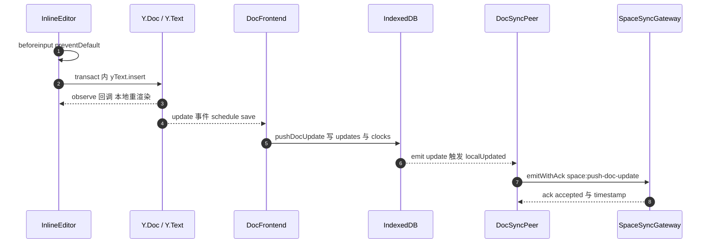
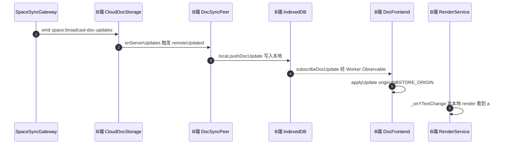
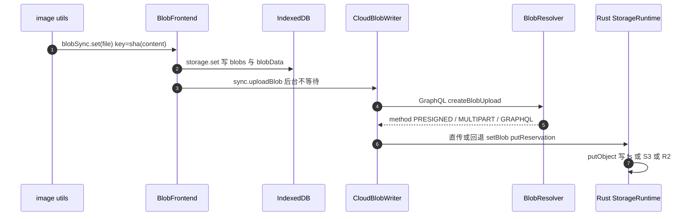
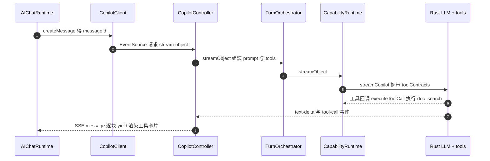

# 第 29 章 端到端链路追踪

> 全书的"串珠"章：用读源码的方法论，亲手把四条贯穿前后端的真实链路走一遍

第 10 部分 · 综合实战 ｜ 难度 ★★★★★ ｜ 建议学时 8 小时

===

## 本章要解决的问题

<p class="lead">前面 28 章把 AFFiNE 拆成了一块块积木：Store/Std、DI 与 nbstore、NestJS 网关与 Prisma、Copilot……但真实的 bug 从不按章节边界出现。</p>

用户说"我打的字同事看不到"，问题可能出在 `beforeinput` 事件、Yjs 事务、Worker 消息、IndexedDB 事务、socket.io 房间、PostgreSQL 写入中的任何一环。本章先讲**怎么读百万行大项目**，再用这些方法追踪四条链路：冷启动、协同编辑、图片上传、AI 对话。

<div class="cards cols-2">
  <div class="card"><div class="card__icon">🚀</div><h4>链路一 · 冷启动</h4><p>从 <code>index.tsx</code> 到 <code>EditorHost</code> 渲染出第一个段落块。</p></div>
  <div class="card"><div class="card__icon">⌨️</div><h4>链路二 · 协同编辑</h4><p>从 <code>beforeinput</code> 穿过 Y.Text、nbstore、socket.io、PostgreSQL，再回到对端。</p></div>
  <div class="card"><div class="card__icon">🖼️</div><h4>链路三 · 图片 blob</h4><p>从 slash menu 到 <code>createBlobUpload</code>，再到 Rust 对象存储。</p></div>
  <div class="card"><div class="card__icon">🤖</div><h4>链路四 · AI 对话</h4><p>从回车到 SSE 流，再到 Rust LLM 运行时与工具回调。</p></div>
</div>

<div class="note note--tip">

打开两个窗口，一边看本章、一边在 IDE 里按逐跳表 `Cmd+P` 打开文件。把每一跳亲手点一遍，比读十遍文字都有用。版本 `@affine/monorepo` 0.27.5（canary）。

</div>

===

## 知识地图

方法论是工具箱，四条链路是演练场，调试技巧贯穿始终。



<div class="note">

一个贯穿全章的边界：这一版后端已把大量热路径（文档 update 写入、对象存储、LLM 调用）下沉到 Rust `packages/backend/native`，TS 层更多扮演"编排 + 权限 + 协议"——这正是读新版源码最容易"追丢"的地方，本章会明确标出 TS 与 Rust 的边界。

</div>

===

## 学习目标

<ol class="goals">
  <li>说出至少 6 种读大型源码的方法，并为"找入口/找实现/找调用者"选对方法</li>
  <li>复述 Web 端冷启动链路：<code>index.tsx → app.tsx → Framework → router → WorkspaceEngine.start → DocsService.open → BlockStdScope.render</code></li>
  <li>画出"键入一个字符"的时序图，指出本地视图刷新、IndexedDB 落盘、socket 推送三者的先后与异步边界</li>
  <li>解释 <code>NBSTORE_ORIGIN</code> 与 <code>uniqueId</code> 如何防止 update 回环</li>
  <li>说明服务端何时、由哪个方法把 updates 合并为 snapshot</li>
  <li>描述 blob 上传三种方式（PRESIGNED/MULTIPART/GRAPHQL）及选择逻辑</li>
  <li>追踪 AI 对话从 <code>AIChatInput.send</code> 到 <code>executeToolCall</code> 的全过程</li>
</ol>

===

<!-- section -->
## 一、读大型项目源码的方法

AFFiNE 同时含 TS、Rust、Swift/Kotlin，"从头读到尾"不可能。读源码的本质是**带着问题找路径**。

===

## 六种方法 + 一个模板

<div class="cards cols-3">
  <div class="card"><h4>自顶向下</h4><p>从进程入口顺藤摸瓜，只看"组装代码"。陷阱：DI 下看到的是接口，搜 <code>.impl(接口名</code> 找实现。</p></div>
  <div class="card"><h4>自底向上</h4><p>从"必经之地"（如 <code>IndexedDBDocStorage.pushDocUpdate</code>）用 Find References 往上找调用者。</p></div>
  <div class="card"><h4>断点法</h4><p>让运行时告诉你调用栈。注意 nbstore 跑在 SharedWorker，需 <code>chrome://inspect/#workers</code>。</p></div>
  <div class="card"><h4>grep 法</h4><p>用字符串常量（socket 事件名、Op 操作名、GraphQL 名）跨越任何边界。</p></div>
  <div class="card"><h4>日志法</h4><p>前端 URL 加 <code>?debug</code> 开 <code>DebugLogger</code>；后端 NestJS Logger 调到 verbose。</p></div>
  <div class="card"><h4>测试反推</h4><p>测试用例是最权威的"用法文档"，且一定能跑通。</p></div>
</div>

<div class="note note--tip">

通用追踪模板：① 明确输入与副作用 → ② 自顶向下找"触发点" → ③ 自底向上找"落点" → ④ grep 跨越字符串边界 → ⑤ 断点验证每一跳 → ⑥ 用测试/日志确认边界 → ⑦ 画时序图 + 逐跳表。下面四条链路都严格按此模板。

</div>

===

<!-- section -->
## 二、链路一：冷启动到编辑器挂载

用户打开 `/workspace/<wid>/<docId>`，代码如何一步步走到 BlockSuite 把段落渲染出来？

===

## 冷启动时序图

应用壳只做组装、业务层用 DI 管生命周期、编辑器只认 Store 与扩展——三层结构一图看清。



<div class="note">

关键跳：`app.tsx` 优先 `new SharedWorker(getWorkerUrl('nbstore'))`——所有标签页共享一个 Worker，同一工作区多 tab 只有一份同步连接；`NbstoreProvider` 是个"端口"，Electron 版注入完全不同的实现（第 20 章）。

</div>

===

## 优先级：当前文档最先可编辑

```ts
// modules/workspace/entities/engine.ts  start()
const rootDoc = this.workspaceService.workspace.docCollection.doc;
this.doc.addPriority(rootDoc.guid, 100);   // 根文档优先级 100
this.indexer.addPriority(rootDoc.guid, 100);
this.doc.start();
```

<div class="split">
<div class="split__main">

`addPriority` 同时作用于 `DocFrontend` 的本地加载队列和 `DocSync` 的远端同步队列。根文档优先级 100，当前打开的文档在 `useLoadDoc` 中设为 10——这就是"打开大工作区时当前文档总是最先可编辑"的原因。

冷启动时本地 IndexedDB 可能还没数据（首次在新设备打开云端文档），`PageEditor.render` 里 `if (!this.doc.root) return nothing;` 先渲染空，等同步拉到根块后 `rootAdded` 触发 `requestUpdate`，编辑器才真正出现。

</div>
<div class="split__aside">

```ts
// page-editor.ts
override render() {
  if (!this.doc.root)
    return nothing;
  return html`...
    ${guard([std],
      () => std.render())}`;
}
```

</div>
</div>

===

<!-- section -->
## 三、链路二：键入一个字符到协作者看到

用户 A 敲下 `a`，B 的屏幕如何出现它？服务端何时把增量合并成快照？

===

## 本地写入与推送时序图

A 侧：阻止原生 DOM 修改 → 写 Y.Text → 本地视图同步刷新 → 异步落 IndexedDB → 异步经 socket 推送。



<div class="note note--warn">

理解 BlockSuite 的钥匙：**DOM 永远不是数据源**。浏览器想改 DOM 被 `preventDefault` 拦下（Firefox 甚至会删掉 Lit 标记注释节点导致崩溃），BlockSuite 改 Y.Text，Y.Text 的 observe 再驱动 Lit 重渲染。IME 组合输入是例外：组合期间允许原生行为，`compositionend` 时一次性写入。

</div>

===

## 服务端广播与对端应用

B 侧：socket 收到 → 落 B 的 IndexedDB → 回主线程 → `applyUpdate`（origin 为 `NBSTORE_ORIGIN`）→ 对端渲染。



<div class="note">

新版协议两种通知：**精确推送** `space:broadcast-doc-updates` 只发给活跃订阅了该文档的 socket、带 update 本身；**失效通知** `space:broadcast-doc-invalidation` 发给整个工作区批量房间、只带 timestamp。没打开的文档收到失效通知后去抖 50ms，`repairInvalidatedDocs` 按需拉差量，不被大量 update 淹没。

</div>

===

## 防回环的两把锁

```ts
// nbstore/src/frontend/doc.ts
private readonly handleDocUpdate = (update, origin, doc, transaction) => {
  if (origin === NBSTORE_ORIGIN) return;   // 锁一：来自存储的变化不回写
  if (!this.status.docs.has(doc.guid)) return;
  this.schedule({ type: 'save', docId: doc.guid, update });
};
// jobs.save 里 pushDocUpdate({ docId, bin: merged }, this.uniqueId)
// onStorageUpdate 里 origin !== this.uniqueId 才 apply  // 锁二
```

<ul class="takeaways">
  <li><b><code>NBSTORE_ORIGIN</code></b>（<code>'nbstore-frontend'</code>）：<code>applyUpdate</code> 的 origin，<code>handleDocUpdate</code> 看到它就不再 save，防"从存储读来的 update 又被写回存储"。</li>
  <li><b><code>uniqueId</code></b>（<code>frontend:${nanoid()}</code>）：<code>pushDocUpdate</code> 的 origin，<code>onStorageUpdate</code> 看到 <code>origin === this.uniqueId</code> 就不 apply，防"自己写进存储的 update 又被应用回自己的 Y.Doc"。</li>
</ul>

===

## 服务端何时合并成快照

<p class="lead">答案是<b>读时合并（lazy squash）</b>，不是写时合并——"如果我们不立刻把 updates 合并进 snapshot，会省下大量写入时间"。</p>

```ts
// core/doc/storage/doc.ts  getDocUnderLock
const snapshot = await this.getDocSnapshot(spaceId, docId);
const updates = await this.getDocUpdates(spaceId, docId);
if (updates.length) {
  const docUpdate = await this.squash(snapshot ? [snapshot, ...updates] : updates);
  return await this.squashUpdatesToSnapshot(spaceId, docId, updates, snapshot, docUpdate);
}
```

| 触发者 | 路径 |
| --- | --- |
| 客户端拉文档 | `space:load-doc` → `getDocDiff` → `getDoc` |
| 服务端读内容 | `DocReader`、HTTP `/api/workspaces/:id/docs/:guid` |
| 合并后下游 | `snapshotUpdated` 时发 `doc.snapshot.updated` → `markDocContentCacheStale` |

<div class="note">

`squashUpdatesToSnapshot`（`@Transactional`，超时 60s）做三件事：写新快照、旧快照入历史（页面历史功能的数据来源）、标记 updates 已合并。前端 IndexedDB 用完全相同的策略（`SnapshotDocStorageBase.getDoc`）。

</div>

===

<!-- section -->
## 四、链路三：插入图片 blob

图片数据如何从浏览器进入 S3/R2？对端又如何看到？核心是"块里只存 key，二进制走 blob 通道"。

===

## 图片上传时序图

内容寻址（key = 文件 sha）天然去重；本地写完就返回、上传后台化，所以图片"秒出"。



<div class="note">

图片块只存 `sourceId`（blob key），不存二进制——块本身走链路二同步。`buildPropsWith` 并行 `readImageSize(file)` 与 `std.store.blobSync.set(file)`，拿到 `{ size, sourceId, width, height }`。

</div>

===

## 本地优先 + 三种上传方式

<div class="split">
<div class="split__main">

`BlobFrontend.set` 写完 IndexedDB 就返回，**不等待上传**；块立即渲染（读本地 blob），上传状态通过 `blobState$` 暴露给 UI。

服务端 `createBlobUpload` 按 `capabilities()`（provider 能力 + `uploadURLConfig`）与文件大小决定 `method`：大文件且支持走 **MULTIPART**（分片直传、断点续传），支持预签名走 **PRESIGNED**，默认回退 **GRAPHQL**（`setBlob` 把文件发给服务端）。直传失败会打印 `[blob] direct upload failed`、abort 分片，除超大外回退 GRAPHQL。

</div>
<div class="split__aside">

```ts
// blob.ts set
await this.storage.set(blob);
// 不等上传完成
this.sync.uploadBlob(blob, true)
  .catch(() => {});
return;
```

</div>
</div>

<div class="note note--tip">

服务端"预留 reservation → 写对象 → 定稿 finalize"三段式保证配额统计与对象存储一致：写失败 `abortStorageReservationV1` 回滚配额。对端下载走 `/api/workspaces/.../blobs/v1/<key>`，`runtime.openBlobV1` 在 Rust 中按 source 鉴权"引用该 blob 的文档你是否可读"。

</div>

===

<!-- section -->
## 五、链路四：AI 对话

用户输入"总结这篇文档"并回车，消息如何到大模型？工具调用时发生了什么？流式结果如何出现？

===

## AI 对话时序图

"先建消息，再开流"：用户输入经 GraphQL 持久化得 `messageId`，SSE 只负责把回复流回来。



<div class="note">

设计要点：用户消息通过 GraphQL 变更持久化（带权限检查与互斥锁）得到 `messageId`，SSE 只单向推送回复。断线重试（`retry: true`）时无需重新提交用户消息。

</div>

===

## TS 与 Rust 的边界：工具回调

<p class="lead">新版 Copilot 架构的核心：<b>模型调用与"思考-调用工具-再思考"的循环（最多 20 步）在 Rust 完成</b>，<b>工具本身仍在 TS 实现</b>（因为工具需访问 Prisma、DocReader、检索、权限）。</p>

```ts
// capability-runtime.ts  stream
const rawStream = this.backend.streamCopilot(
  { slot, workspaceId, userId, access, request },
  async requestJson => {
    const toolRequest = JSON.parse(requestJson);
    return JSON.stringify(
      await executeToolCall(toolSet, toolRequest, { signal, messages, runId })
    );
  },
  { maxSteps: 20, signal: options.signal }
);
```

<div class="note">

Rust 每需执行一个工具，就通过 NAPI 回调这个 `async requestJson => ...`。工具名有两套：prompt 配置里的**驼峰名**（`docSearch`）与暴露给模型/前端的**蛇形名**（`doc_search`），在 `getTools` 的 switch 中映射。新增工具时两处都要对上（见第 30 章练习 ⑨）。

</div>

===

## 流式渲染

每个 SSE `message` 的 `data` 在 `stream-object` 端点下是一个 JSON 序列化的 `StreamObject`（判别联合：`text-delta` / `reasoning` / `tool-call` / `tool-result`）。

<div class="split">
<div class="split__main">

`AIChatRuntime.appendAssistantContent` 尝试 `JSON.parse`：成功则合并进 `streamObjects` 数组（相邻 text-delta 会被合并），然后 `commit` 产生新快照；组件订阅快照后 `ChatContentStreamObjects` 按 `type` 分派：`text-delta` → 富文本、`reasoning` → 折叠思考区、`tool-call`/`tool-result` → 工具卡片组（统计调用数与失败数）。

</div>
<div class="split__aside">

```ts
// doc-search.ts
defineTool({
  description: 'Search ...',
  inputSchema: z.object({
    query: z.string().min(1),
    doc_ids: z.array(z.string())
      .optional(),
    limit: z.number().optional(),
  }).strict(),
  execute: ({ query }, opt) =>
    search(query),
});
```

</div>
</div>

===

## 调试技巧

<div class="cards cols-3">
  <div class="card"><div class="card__icon">🔬</div><h4>IndexedDB</h4><p>库名 <code>${flavour}:${type}:${id}</code>；看 <code>updates</code>（每敲一字多一行，打开文档被 squash 清掉）与 <code>snapshots</code>，亲眼见证"读时合并"。</p></div>
  <div class="card"><div class="card__icon">📡</div><h4>WebSocket 帧</h4><p>Network 过滤 WS；帧形如 <code>42["space:push-doc-update",{...}]</code>，带 ack 回 <code>43...</code>。两个窗口对比 push 与 broadcast。</p></div>
  <div class="card"><div class="card__icon">🌊</div><h4>SSE 与 GraphQL</h4><p>GraphQL payload 看 <code>operationName</code>；SSE 类型 <code>eventsource</code>，EventStream 逐条看 <code>message</code> 事件。</p></div>
</div>

<div class="note note--warn">

调 SharedWorker 里的 nbstore 代码：主线程 DevTools 看不到，需打开 `chrome://inspect/#workers` 找 `affine-shared-worker` 单独 inspect；降级办法 `localStorage.setItem('disableSharedWorker', 'true')` 让它退化为普通 Worker，出现在主 DevTools 的 Threads 中。

</div>

===

## 动手实践

<ol class="steps">
  <li><h4>给冷启动打点</h4><p>在 <code>app.tsx</code>、<code>instantiate</code>、<code>WorkspaceEngine.start</code>、<code>DocFrontend.jobs.load</code>、<code>PageEditor.connectedCallback</code> 临时加 <code>performance.mark</code>。<b>验收</b>：回答"冷启动最慢的一跳"。</p></li>
  <li><h4>看 updates 被合并</h4><p>观察 <code>updates</code> 与 <code>snapshots</code> 表变化；在 <code>SnapshotDocStorageBase.getDoc</code>（Worker 中）打断点。<b>验收</b>：确认合并发生在打开文档时。</p></li>
  <li><h4>协作帧抓包</h4><p>两账号两浏览器打开同一云端文档，抓 <code>space:push-doc-update</code> 与 <code>space:broadcast-doc-updates</code>。<b>验收</b>：在 <code>onReceiveDocUpdate</code> 观察 <code>permissionGeneration</code>。</p></li>
  <li><h4>追踪一个工具调用</h4><p>AI 面板提问"搜索包含 roadmap 的文档"，在 <code>executeToolCall</code> 打断点记 <code>request.name</code>/<code>args</code>，在 EventStream 找 tool-call 与 tool-result。</p></li>
</ol>

===

## 自测：点击揭晓答案

<details class="quiz">
<summary>Q1. A 敲一个字，A 本地 IndexedDB 写入、A 视图刷新、socket 推送三件事的先后？哪些同步哪些异步？</summary>

视图刷新最先且同步：`transact` 结束时 Y.Text observe 回调同步触发 `RenderService.render()`；同一时刻 Y.Doc `update` 事件同步触发 `handleDocUpdate` 但只入队；随后 `mainLoop` 异步取任务经 Worker 写 IndexedDB；写入后 `DocSyncPeer` 入队 push 再异步经 socket 推送。顺序：视图 → IndexedDB → 网络，后两者异步。

</details>

<details class="quiz">
<summary>Q2. 服务端在什么时候把 updates 合并成 snapshot？合并后触发哪个事件？</summary>

读时合并：`getDoc` → `getDocUnderLock` 发现未合并 updates 时 `squash` 并 `squashUpdatesToSnapshot`（写新快照、旧快照入历史、标记已合并）。常见触发是客户端 `space:load-doc` 或服务端读内容。快照更新时发 `doc.snapshot.updated`，由 `DocEventsListener.markDocContentCacheStale` 消费。

</details>

<details class="quiz">
<summary>Q3. 为什么图片块里只存 sourceId？key 如何计算？</summary>

二进制放进 Yjs 会让文档膨胀、同步变慢且无法用对象存储/CDN。key 由 `BlobEngine.set` 对文件内容计算 `sha` 得到，是内容寻址：相同图片只存一份（自然去重），服务端 `alreadyUploaded` 可直接跳过重复上传。

</details>

<details class="quiz">
<summary>Q4. 新版 Copilot 中模型调用循环与工具执行分别在 TS 还是 Rust？如何通信？</summary>

模型调用、路由选型与多步工具循环（`maxSteps: 20`）在 Rust（`streamCopilot` → `executeCopilotStream`）；工具实现在 TS（`plugins/copilot/tools/*`）。Rust 需执行工具时通过 NAPI 回调 `async requestJson => ...`，TS 用 `executeToolCall` 执行并返回 JSON 字符串。

</details>

===

## 小结与下一步

<ul class="takeaways">
  <li>读源码六法：自顶向下/自底向上/断点/grep/日志/测试反推，按"找入口/找实现/找调用者"组合使用。</li>
  <li>冷启动揭示三层结构：应用壳组装、业务层 DI 管生命周期、编辑器只认 Store；优先级让当前文档最先可编辑。</li>
  <li>协同编辑：DOM 不是数据源；<code>NBSTORE_ORIGIN</code> 与 <code>uniqueId</code> 两把锁防回环；服务端读时合并快照。</li>
  <li>图片：块只存 key（内容寻址去重），本地优先、上传后台化、三种上传方式按能力与大小选择。</li>
  <li>AI 对话：先建消息再开流；模型循环在 Rust、工具在 TS，经 NAPI 回调打通。</li>
</ul>

<div class="note note--tip">

**下一章预告**：第 30 章是收官——把前 29 章的知识转化为贡献能力：完整 PR 流程、十级实战练习阶梯、毕业考核清单与五条进阶路线。真正"毕业"的标志是你的代码出现在 canary 分支里。

</div>
