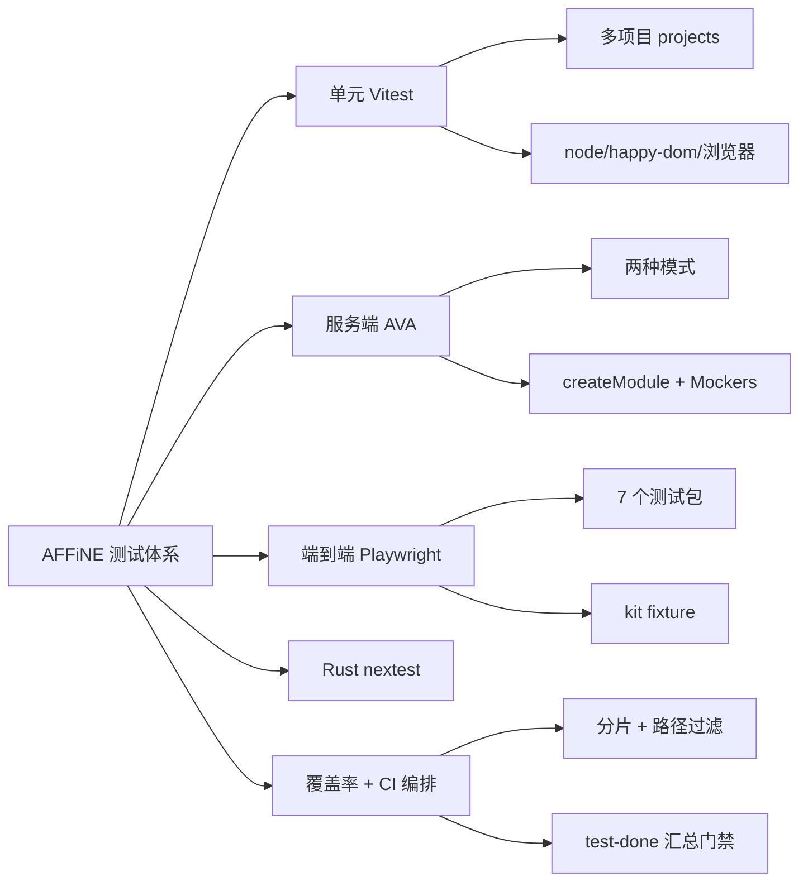
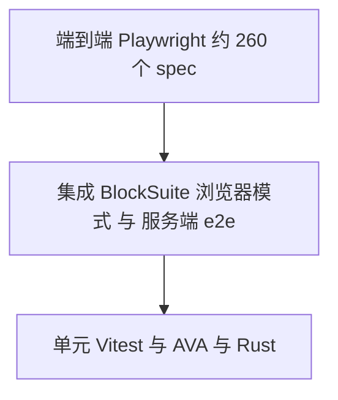

# 第 29 章 测试体系

> 本地优先 + 实时协作 + 多端 + AI，任何一环出错都可能丢数据——用金字塔守住质量

第 8 部分 · 质量保障 ｜ 难度 ★★★☆☆ ｜ 建议学时 6 小时

===

## 本章要解决的问题

<p class="lead">AFFiNE 为“本地优先 + 实时协作 + 多端 + AI”建立了一套覆盖面很广的测试体系，被编排进 <code>build-test.yml</code> 的 30 多个 job。</p>

不同层用不同框架，各取所长。

<div class="cards cols-2">
  <div class="card"><div class="card__icon">⚡</div><h4>Vitest</h4><p>前端与 BlockSuite 单测，含 node、happy-dom、浏览器三种环境。</p></div>
  <div class="card"><div class="card__icon">🅰️</div><h4>AVA</h4><p>服务端单元/集成与新版 e2e，直连真实 Postgres/Redis。</p></div>
  <div class="card"><div class="card__icon">🎭</div><h4>Playwright</h4><p>7 个 E2E 测试包：Web 本地、云端、AI、桌面、移动、编辑器。</p></div>
  <div class="card"><div class="card__icon">🦀</div><h4>cargo nextest</h4><p>Rust 单测/集成与 criterion 基准。</p></div>
</div>

<div class="note">

覆盖率由 istanbul/c8 采集并上报 Codecov，但**不设合并门槛**。本章先给金字塔，再逐层打开配置与示例，最后看 CI 如何把庞大矩阵控制在可接受时长内。

</div>

===

## 知识地图

从底座单测到顶端 E2E，再到横切的覆盖率与 CI 编排。



===

## 学习目标

<ol class="goals">
  <li>画出 AFFiNE 测试金字塔，说出每层的框架、目录与运行命令</li>
  <li>解读根 <code>vitest.config.ts</code> 的 <code>projects</code>、<code>include</code>、<code>setupFiles</code> 与覆盖率</li>
  <li>区分 Vitest 的 node、happy-dom、浏览器三种环境及其适用场景</li>
  <li>说明服务端 AVA 的两种模式与 <code>createModule</code>、<code>Mockers</code> 的用法</li>
  <li>读懂 Playwright 配置的 <code>webServer</code>、重试、分片，用 <code>@affine-test/kit</code> 写 E2E</li>
  <li>说出 CI 中 <code>unit-test</code>、<code>server-test</code>、<code>e2e-test</code> 等 job 的依赖与分片</li>
</ol>

===

<!-- section -->
## 一、测试金字塔

底座是快速单测，中间是浏览器集成与服务端 e2e，顶端是关键用户路径的 E2E。

===

## 金字塔与 AFFiNE 分层

层级越往上越慢、越真实、越少。设计取舍是：**编辑器逻辑尽量下沉到 BlockSuite 单测与集成测试**（比完整 E2E 快得多），**服务端以真实数据库为默认**（避免 Prisma 查询与迁移不一致），**E2E 只覆盖关键用户路径**并靠分片与重试控制时长。



| 层级 | 框架 | 位置 | 运行命令 |
| --- | --- | --- | --- |
| 前端单测 | Vitest | `packages/{common,frontend}/**/*.spec.{ts,tsx}` | `yarn test` |
| BlockSuite 单测 | Vitest（node/happy-dom/浏览器） | `blocksuite/**/src/__tests__/**/*.unit.spec.ts` | `yarn test`（作为 project） |
| 服务端单测/集成 | AVA | `packages/backend/server/src/**/*.spec.ts`、`*.e2e.ts` | `yarn affine @affine/server test` |
| 服务端新 e2e | AVA + `TEST_MODE=e2e` | `src/__tests__/e2e/**/*.spec.ts` | `yarn affine @affine/server e2e` |
| 原生模块 | AVA / cargo nextest | `native/__tests__`、各 crate `tests.rs` | `cargo nextest run` |
| E2E | Playwright | `tests/*/e2e` | `yarn affine @affine-test/<suite> e2e` |

===

<!-- section -->
## 二、Vitest 单元测试

一个根配置 + 多 `projects` 统一驱动 16 个 Vitest 项目，按需选 node、happy-dom 或浏览器模式。

===

## 根配置与多项目

根 `vitest.config.ts` 的几个关键决定，都指向“测试与生产保持一致”。

<div class="annotate">

```ts [2|7|11|14]
test: {
  projects: ['.', './packages/frontend/apps/electron',
    './blocksuite/**/*/vitest.config.ts'],
  setupFiles: [/* polyfill / lit / vi-mock / global */],
  include: ['.../packages/{common,frontend}/**/*.spec.{ts,tsx}'],
  coverage: {
    provider: 'istanbul',
    reporter: ['lcov'],
    reportsDirectory: '.coverage/store',
  },
},
resolve: { alias: {
  yjs: '.../node_modules/yjs',
  '@affine/core': '.../core/src',
} },
```

<ol class="annotate__notes">
  <li><b>第 2 行</b>：多项目模式——<code>'.'</code> 根项目 + electron + 14 个 BlockSuite 子项目，一次 <code>yarn test</code> 跑全部。</li>
  <li><b>第 7 行</b>：根项目只收集 <code>common</code>/<code>frontend</code>；<code>backend</code> 不在其中（服务端用 AVA）。</li>
  <li><b>第 11 行</b>：覆盖率用 <code>@vitest/coverage-istanbul</code>，输出 lcov。</li>
  <li><b>第 14 行</b>：<code>alias.yjs</code> 强制单份 yjs，避免测试用到两套 yjs。</li>
</ol>
</div>

<div class="note note--tip">

`scripts/setup/global.ts` 用生产同一份 `getBuildConfig(new Package('@affine/web'), ...)` 构造 `BUILD_CONFIG`，而非另起一套假配置——**保证 `BUILD_CONFIG.isWeb` 等分支在测试中与真实 Web 产物一致**。

</div>

===

## 三种运行环境

同一套 Vitest，按文件需求切换环境。根项目默认 `node`，需要 DOM 的文件用顶部注释 `/** @vitest-environment happy-dom */` 切换；需要真实布局/选区的用浏览器模式。

| 环境 | 速度 | 能力 | 典型用途 |
| --- | --- | --- | --- |
| node（默认） | 最快 | 无 DOM | 纯函数、RxJS、Yjs、存储逻辑 |
| happy-dom | 快 | 模拟 DOM，无真实布局 | React 组件、Lit 模板、HTML 适配器 |
| 浏览器模式 | 慢 | 真实浏览器 | 编辑器宿主、选区、键盘、截图 |

<div class="note">

`@blocksuite/std` 用浏览器模式（`@vitest/browser` + Playwright）测 EditorHost、选区、自定义元素；`blocksuite/integration-test` 更进一步在 chromium、firefox、webkit **三浏览器**运行，CI `retry: 3`——这正是 unit-test job 需要装三种浏览器的原因。`blocksuite/affine/all` 还配了严格的 `onConsoleLog`：**测试中出现任何意外 console 输出都会抛错**，逼开发者处理警告。

</div>

===

## 前端单测：给真实实现一个底座

前端单测的风格不是大面积 mock 内部模块，而是“**给真实实现一个可控的底座**”，测的仍是真实逻辑。

<div class="split">
<div class="split__main">

- **fake-indexeddb**：`import 'fake-indexeddb/auto'` 在 Node 提供内存版 IndexedDB，**不 mock 存储层本身**，测的是真实的 `IndexedDBDocStorage`；配 `DocSyncImpl.dummy` 把范围限定在 frontend ↔ storage。
- **MSW**：在网络层拦截请求，被测代码（如 Electron 自动更新器）无需改造；`onUnhandledRequest: 'error'` 保证不意外访问真实网络。
- **最小化依赖**：`CommandManager` 测试用空对象 + `@ts-expect-error`（带说明，符合 oxlint 规则）替代 `std`，命令本身用 `vi.fn` 记录调用。

</div>
<div class="split__aside">

```ts
import 'fake-indexeddb/auto';
// ...
const docStorage =
  new IndexedDBDocStorage({
    id: 'ws1', flavour: 'a',
    type: 'workspace',
  });
docStorage.connection.connect();
const frontend1 = new DocFrontend(
  docStorage, DocSyncImpl.dummy);
frontend1.connectDoc(doc1);
await vitest.waitFor(async () => {
  const doc =
    await docStorage.getDoc('test-doc');
  expectYjsEqual(doc!.bin, {});
});
```

</div>
</div>

===

<!-- section -->
## 三、服务端 AVA

服务端测试以真实 Postgres/Redis 为底座，`createModule` 装配 Nest 模块，Mockers 造数据。

===

## 两种模式与真实数据库

`ava.config.js` 靠 `TEST_MODE` 环境变量切换两套行为；默认 `--concurrency 1 --serial`，因为测试共享同一个 Postgres 与 Redis，**串行避免数据互相污染**，CI 通过 4 个 runner 分片弥补速度。

| 模式 | 命令 | 收集文件 | prelude |
| --- | --- | --- | --- |
| 默认 | `... @affine/server test` | `**/*.spec.ts`、`**/*.e2e.ts` | `src/prelude.ts` |
| 新 e2e | `... @affine/server e2e`（`TEST_MODE=e2e`） | `src/__tests__/e2e/**/*.spec.ts` | 再加 `e2e/prelude.ts` |
| Copilot | `... test:copilot` | `copilot/copilot-*.spec.ts` | 同默认 |

<div class="note note--warn">

`extensions: { ts: 'module' }` 告诉 AVA 把 `.ts` 当 ESM，但**真正把 TS 转成 JS 的是 CLI 注入的 SWC 加载器**（`tools/cli/register.js`，支持 legacy 装饰器与 metadata）。所以服务端测试必须用 `yarn affine @affine/server ...` 运行，不能用 `yarn workspace`。`prelude.ts` 首行 `import 'reflect-metadata'` 并加载 `.env`，与正式启动一致。

</div>

===

## createModule、Mockers 与新版 e2e

三个工具撑起服务端测试：装配、造数、快速 e2e。

<ol class="steps">
  <li><h4>createModule / createTestingModule</h4><p>基于 <code>@nestjs/testing</code> 构建测试模块，把 <code>EventBus</code> 替换为 <code>MockEventBus</code>（可断言“某事件是否被发出”而不触发真实处理链）；<code>tapModule</code> 钩子允许单测再覆盖任意 provider。</p></li>
  <li><h4>Mockers 造数据</h4><p><code>Mocker</code> 基类<b>直接用 PrismaClient 写库</b>而不调业务 Model——注释说明：Model 方法可能触发事件等副作用，会干扰“事件断言”。<code>yarn affine server seed</code> 复用的正是这些 Mocker。</p></li>
  <li><h4>新版 e2e：共享 App + GraphQL 文档</h4><p><code>TEST_MODE=e2e</code> 时每个 worker 创建一次完整应用；测试直接用 <code>@affine/graphql</code> 的查询常量调 API——<b>与前端使用完全相同的 GraphQL 文档</b>，schema 变更导致前端查询失效时服务端 e2e 第一时间发现。</p></li>
</ol>

<div class="note note--tip">

注释写着“the new version of server e2e test should be super fast, so sharding testing is not needed”——新版 e2e 够快，CI 的 `server-e2e-test` 无需分片。

</div>

===

<!-- section -->
## 四、E2E 与更广的测试

Playwright 统一了 webServer、重试、trace 与报告；kit 封装 fixture 与领域操作。

===

## Playwright：测试包与配置

7 个测试包各测一种形态，`webServer` 自动拉起被测应用。失败留证据是贯穿设计的原则。

| 包 | 被测对象 | 关键配置 |
| --- | --- | --- |
| `tests/affine-local` | Web 本地模式 | `fullyParallel`，CI `retries: 3` |
| `tests/affine-cloud` | Web + 服务端 | 超时 120s；非 `COPILOT` 时 workers 1 |
| `tests/affine-cloud-copilot` | AI 功能 | 按 basic/chat-with/ai-action 分组 |
| `tests/affine-desktop(-cloud)` | Electron(+服务端) | CI `retries: 5`、workers 1 |
| `tests/affine-mobile` | 移动 Web | — |
| `tests/blocksuite` | playground | 固定 `timezoneId: 'Asia/Tokyo'` |

<div class="note">

配置要点：**`webServer` 自动拉起**（本地 `reuseExistingServer` 为真，复用你已开的 dev server）；**失败留证据**（`trace`、`video` 均 `retain-on-failure`，用 `npx playwright show-trace` 回放）；**`forbidOnly`** 在 CI 禁止残留 `test.only`；`BROWSER` 环境变量可切 firefox/webkit。

</div>

===

## kit：fixture 与领域操作

`@affine-test/kit` 扩展了 Playwright 的 `test`，提供 `workspace` fixture 与大量领域操作函数。写 E2E 时应优先复用它，定位元素优先用 `getByTestId`。

<div class="split">
<div class="split__main">

`context` fixture 做三件事：注入 `playwright-test` class（让 CSS 动画在测试中保持 0.1s）、`skipOnboarding` 跳过引导、在 `enableCoverage` 时把 `window.__coverage__` 写到 `.nyc_output/`。

`utils/` 按领域组织：`load-page.ts`（`openHomePage`）、`page-logic.ts`（`waitForEditorLoad`、`clickNewPageButton`、`getBlockSuiteEditorTitle`）、`cloud.ts`（`createRandomUser`、`runPrisma` 直接用服务端 PrismaClient 操作数据库）。

</div>
<div class="split__aside">

```ts
test('click btn new page',
  async ({ page, workspace }) => {
  await openHomePage(page);
  await waitForEditorLoad(page);
  const origin =
    getCurrentDocIdFromUrl(page);
  await clickNewPageButton(page);
  const next =
    getCurrentDocIdFromUrl(page);
  expect(next).not.toBe(origin);
  const ws = await workspace.current();
  expect(ws.meta.flavour)
    .toContain('local');
});
```

</div>
</div>

===

<!-- section -->
## 五、Rust、Copilot、覆盖率与 CI

最后三块横切关注点，共同体现“务实的取舍”。

===

## Rust 测试、Copilot 测试与覆盖率

三者各有一个值得记住的取舍。

<div class="cards cols-3">
  <div class="card"><h4>Rust</h4><p><code>cargo nextest</code> 跑单测/集成；连真实 PG/Redis 的 <code>server-native</code> 测试<b>单线程串行</b>；长耗时集成测试用 <code>#[ignore]</code> 标记、CI 单独显式运行；criterion 做基准。</p></div>
  <div class="card"><h4>Copilot</h4><p>AI 测试依赖外部大模型（有成本、结果不定）：<b>平时按路径触发、每日与发版全量跑、结果推送 Slack</b>，在成本/速度/覆盖间平衡。</p></div>
  <div class="card"><h4>覆盖率</h4><p><code>codecov.yml</code> 设 <code>project: false</code>、<code>patch: false</code>——<b>覆盖率只作参考、不作门槛</b>，下降不会让 PR 变红。</p></div>
</div>

<div class="note">

覆盖率来源多样但统一上报 lcov：根 Vitest（`@vitest/coverage-istanbul`，flag `unittest`）、服务端 c8（基于 V8 原生覆盖、无需插桩，flag `server-test`）、E2E（页面内 istanbul 插桩 + kit fixture 收集）。CI 上传步骤都设 `fail_ci_if_error: false`——这是快速迭代产品中的务实选择：用 E2E 与关键单测保证质量，而不强求数字。

</div>

===

## CI 编排：编译一次，多处复用

`build-test.yml` 的 30 多个 job 用四招控制时长：**构建产物复用、分片、路径过滤、汇总门禁**。

| job | 做什么 | 分片 |
| --- | --- | --- |
| `unit-test` | 下载 native 产物、装三浏览器、`test:coverage` | 5 |
| `server-test` | PG(pgvector)+Redis+mailhog，`test:coverage` | 4 |
| `server-e2e-test` | 新版 e2e，indexer 关闭 | 无 |
| `e2e-test` | `affine-local e2e` | 5 |
| `cloud-e2e-test` | Cloud E2E + Cloud Desktop（`xvfb-run`） | 3 |
| `desktop-test` | macOS/Linux/Windows 矩阵 | 4 平台 |
| `test-done` | 名为 "3, 2, 1 Launch"，任一 needs 失败即 `exit 1` | — |

<div class="note note--tip">

四招细节：**构建复用**——原生模块只在 `build-native-*` 编译一次，经 artifact 分发给各测试 job；**按需安装**——`workspaces focus` 只装测试所需 workspace，`playwright-platform` 只装需要的浏览器；**Linux 跑 Electron**——`sysctl` 调 AppArmor + `xvfb-run` 提供虚拟显示；**汇总门禁**——`test-done` 把 30 多个 job 汇成一个必需检查，分支保护只需配这一项。

</div>

===

## 动手实践

<ol class="steps">
  <li><h4>写一个单测</h4><p>为 <code>packages/common/infra/src/utils/shallow-equal.ts</code> 补测试（同目录有可参考样例），覆盖“同引用/原始值”“仅比较一级键”“null 与非对象”三组；运行 <code>yarn test</code> 与 <code>yarn lint:ox</code>。<b>验收</b>：3 组用例通过，能解释 <code>0</code> 与 <code>-0</code> 为何不等（<code>Object.is</code>）。</p></li>
  <li><h4>运行服务端测试</h4><p>启动 <code>.docker/dev</code> 服务、构建 <code>@affine/server-native</code>、<code>yarn affine server init</code> 后运行 <code>... test src/__tests__/mutex.spec.ts</code> 与 <code>... e2e src/__tests__/e2e/user/account.spec.ts</code>。<b>验收</b>：两者通过，说出第二条为何额外加载 <code>e2e/prelude.ts</code>。</p></li>
  <li><h4>写一个 E2E</h4><p>用 kit 写“新建文档并输入标题”：<code>openHomePage</code> → <code>waitForEditorLoad</code> → <code>clickNewPageButton</code> → 断言标题；<code>--headed</code> 运行；故意改错期望用 <code>show-trace</code> 看失败现场。<b>验收</b>：通过后能在 trace 中看到每步截图与 DOM 快照。</p></li>
</ol>

===

## 自测：点击揭晓答案

<details class="quiz">
<summary>Q1. 根 vitest.config.ts 的 projects 有哪三类？yarn test 会跑服务端测试吗？</summary>

根项目 `'.'`（`packages/{common,frontend}`）、electron、`blocksuite/**` 的 14 个子项目。不会跑服务端测试——服务端用 AVA。

</details>

<details class="quiz">
<summary>Q2. 服务端为何必须用 yarn affine @affine/server test 而非 yarn workspace？</summary>

只有经 CLI 才会在 `NODE_OPTIONS` 注入 `tools/cli/register.js`（SWC，支持 legacy 装饰器与 metadata），AVA 才能加载 NestJS 的 TS 源码。

</details>

<details class="quiz">
<summary>Q3. Mocker 为何直接用 PrismaClient 而不调业务 Model？</summary>

业务 Model 可能触发事件等副作用，会干扰测试中对事件的断言；Mocker 直接写库，副作用可控。

</details>

<details class="quiz">
<summary>Q4. codecov.yml 的 project: false、patch: false 意味着什么？</summary>

Codecov 不为整体与补丁覆盖率设置状态检查，覆盖率下降不会导致 PR 失败，仅作参考。

</details>

===

## 小结与下一步

<ul class="takeaways">
  <li>金字塔底座是 Vitest/AVA/Rust 单测，中间是浏览器集成与服务端 e2e，顶端是 7 个 Playwright 包。</li>
  <li>Vitest 一根配置多 projects，按需选 node/happy-dom/浏览器；单测给真实实现“可控底座”而非大面积 mock。</li>
  <li>服务端 AVA 以真实 Postgres/Redis 为默认，串行避污染；新版 e2e 共享 App 并复用前端 GraphQL 文档。</li>
  <li>Playwright 自动拉 webServer、失败留 trace；kit 封装 fixture 与领域操作。</li>
  <li>覆盖率不设门禁；CI 用“编译一次多处复用 + 分片 + 路径过滤 + <code>test-done</code> 汇总门禁”控制时长。</li>
</ul>

<div class="note note--tip">

**下一章预告**：第 30 章进入 CI/CD 与 GitHub Actions——本章看到的 `build-test.yml` 只是冰山一角，发布、打包、多端分发、canary/stable 通道如何在流水线中协同。

</div>
