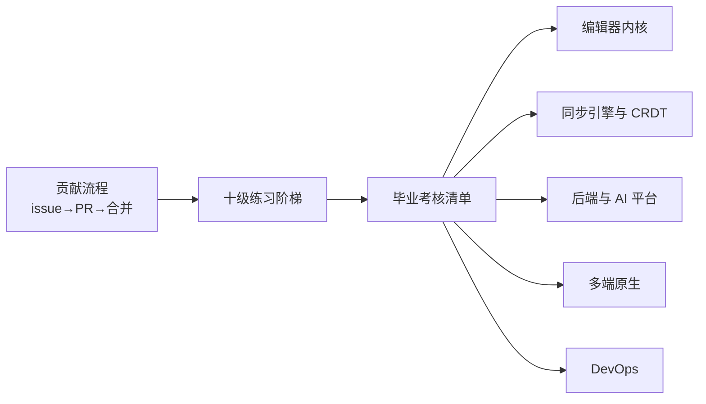
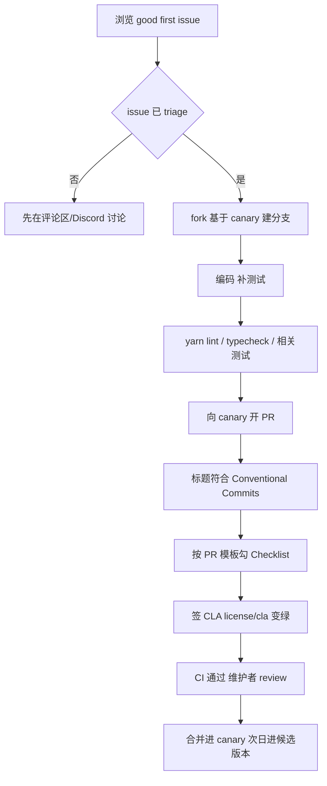

# 第 30 章 贡献实战与进阶路线

> 读懂源码只是开始，真正"毕业"的标志是：你的代码出现在 AFFiNE 的 canary 分支里

第 10 部分 · 综合实战 ｜ 难度 ★★★☆☆ ｜ 建议学时 6 小时

===

## 本章要解决的问题

<p class="lead">全书收官，目标是把前 29 章的知识转化为<b>可落地的贡献能力</b>。</p>

内容分四块：完整贡献流程（从找 issue 到合并进 canary）、十级实战练习阶梯（从改一条文案到新增 Copilot tool）、毕业考核清单、五条进阶方向。所有规则都直接引用仓库里的 `.github/PULL_REQUEST_TEMPLATE.md`、`docs/CONTRIBUTING.md`、`tools/commitlint/.commitlintrc.json` 与 `.github/workflows/*.yml`。

<div class="cards cols-2">
  <div class="card"><div class="card__icon">🔁</div><h4>一条贡献流程</h4><p>找 issue → fork 建分支 → 编码测试 → lint/typecheck → Conventional Commits 标题 → PR 模板 + CLA → review + CI → 合并进 canary。</p></div>
  <div class="card"><div class="card__icon">🪜</div><h4>十级练习阶梯</h4><p>从 ★ 的 i18n 文案到 ★★★★★ 的 Copilot tool，每级给出目标、改动位置、思路、验收。</p></div>
</div>

<div class="note note--warn">

本章练习是"练习"，不是"必须提交的 PR"。建议在 fork 上完成，挑真正有价值、与现有 issue 对应的改动再提交上游。**不要为刷贡献而提交没有需求背景的 PR**——PR 模板明确写着维护者可直接关闭质量过低的 PR。

</div>

===

## 知识地图

一条流程走通、一级级练习爬升、一份清单自评，最后选一条进阶路线。



<div class="note">

`docs/CONTRIBUTING.md` 把流程浓缩为五步：找活干 → 搭环境 → 在 `canary` 分支改 → 开 Conventional Commits 标题的 PR → `license/cla` 绿、CI 过、维护者批准后合并。

</div>

===

## 学习目标

<ol class="goals">
  <li>按 <code>docs/CONTRIBUTING.md</code> 五步流程完成一次从 issue 到 PR 的贡献</li>
  <li>写出符合 <code>.commitlintrc.json</code> 约束的 PR 标题（type 与 scope 均合法）</li>
  <li>本地运行 <code>yarn lint</code>、<code>yarn typecheck</code>、相关测试，读懂 CI 失败原因</li>
  <li>完成 CLA 签署并排查 <code>license/cla</code> 一直为红的常见原因</li>
  <li>独立完成练习阶梯中至少 6 个，覆盖前端 UI、编辑器扩展、GraphQL 打通、数据库迁移</li>
  <li>用 Docker Compose 自托管并把 blob 存储切到 S3 兼容服务</li>
  <li>对照毕业考核清单评估短板，选定一条进阶方向</li>
</ol>

===

<!-- section -->
## 一、完整贡献流程

从找 issue 到合并进 canary，每一步都有仓库里的规则文件背书。

===

## 流程总览



<div class="note note--tip">

只挑已过 triage 且状态 `Open` 的 issue 动手；`Untriaged` 官方明确建议不要先动手。自己发现的问题先按模板提 issue 等待 triage，而不是直接甩 PR。大改动先在 Discussions/Discord 对齐方案。

</div>

===

## Conventional Commits 标题

PR 标题由 `pr-title-lint.yml` 在 opened/edited/synchronize 时检查，规则来自 `.commitlintrc.json`：

```jsonc
{
  "extends": ["@commitlint/config-conventional"],
  "rules": {
    "scope-enum": [2, "always", [
      "admin", "electron", "server", "core", "web", "mobile", "ios",
      "android", "mobile-native", "docs", "component", "env", "graphql",
      "hooks", "i18n", "native", "templates", "debug", "nbstore", "infra",
      "editor", "tools", "y-octo", "client"
    ]]
  }
}
```

<div class="compare">
  <div class="compare__col"><h4>会被拒</h4>

- `feat(blocksuite): ...`（`blocksuite` 不在枚举，应用 `editor`）
- `Fix: xxx`（type 必须小写）
- `feat(server) add x`（缺冒号）

  </div>
  <div class="compare__col compare__col--good"><h4>合法</h4>

- `fix(editor): keep selection after paste`
- `feat(core): add custom icons for folders`
- `docs: update building guide`（scope 可省略）

  </div>
</div>

<div class="note">

CI 只校验 **PR 标题**而不校验每个 commit；canary 上的提交形如"PR 标题 + `(#PR号)`"，推断为 squash 合并。所以标题比单个 commit 更重要。

</div>

===

## 本地检查与生成物

`yarn lint`（oxlint + oxfmt）、`yarn typecheck`（`tsc -b`）、`yarn test`（vitest）。按改动范围选测试，改了 GraphQL/i18n 还要额外跑代码生成并**提交生成文件**：

| 改动范围 | 建议运行 |
| --- | --- |
| 前端/BlockSuite 单元 | `yarn test`（可加路径过滤） |
| 后端 | `yarn workspace @affine/server test`（需本地 postgres/redis） |
| Web 交互 | `yarn workspace @affine-test/affine-local e2e` |
| GraphQL 变更 | 额外 `yarn affine @affine/graphql build` 并提交 |
| i18n 变更 | 额外 `yarn affine @affine/i18n build` 并提交 |

<div class="note note--warn">

**`check-git-status` 是新人最常见的 CI 失败点**：忘记提交 `schema.gql`、`schema.ts`、`i18n.gen.ts` 等生成文件。本地跑对应生成命令与 `yarn lint:fix`，把全部变更提交即可。

</div>

===

## PR 模板与 CLA

`.github/PULL_REQUEST_TEMPLATE.md` 的 Checklist 逐项都要真正做到：

<ol class="steps">
  <li><h4>Description</h4><p>一句话说清"做了什么、为什么"，<code>Closes #1234</code> 关联 issue；UI 改动附前后截图。</p></li>
  <li><h4>CLA</h4><p>打开 <code>cla-assistant.io/toeverything/AFFiNE</code> 用 GitHub 账号签署；未签署 PR 永远无法合并。</p></li>
  <li><h4>目标分支与标题</h4><p>base 选 <code>toeverything/AFFiNE:canary</code>，标题通过 commitlint。</p></li>
  <li><h4>Tests + lint/typecheck</h4><p>bug 修复尽量附"修复前失败、修复后通过"的测试；本地实际跑过 lint 与 typecheck，不要只勾选。</p></li>
</ol>

<div class="note note--danger">

`license/cla` 仍为红的两大原因：① **每一位 committer 都要签**（含 co-author），bot 评论中标 ❌ 的名字都要签；② **commit 邮箱必须关联到 GitHub 账号**——`git log --format='%an %ae'` 查看，在 Settings → Emails 添加，或改写提交身份后 force-push 自己的 PR 分支，再点 recheck。

</div>

===

## 合并之后：进入 canary 发布

<div class="split">
<div class="split__main">

`release.yml`（`Release Candidates`）配了 `schedule: cron '0 9 * * *'`——每天 UTC 09:00 自动构建候选，也支持手动选目标。所以你的 PR 合并后，**最快第二天就会出现在 canary 版本中**；进入 beta/stable 则取决于发布节奏（第 4 章）。

canary 版本命名形如 `v2026.10.27-canary.909`，beta/stable 形如 `v0.27.5-beta.2`。处理 review 意见时**追加 commit** 而非频繁 force-push，方便 reviewer 看增量；同步上游用 `git rebase upstream/canary`。

</div>
<div class="split__aside">

```bash
git fetch upstream
git checkout -b \
  fix/editor-keep-selection \
  upstream/canary
yarn lint   # 编码后
yarn typecheck
git push origin HEAD
```

</div>
</div>

===

<!-- section -->
## 二、十级实战练习阶梯

从改一条文案到新增 Copilot tool，难度递增，每级都给真实改动位置。

===

## 阶梯总览

十级练习按难度与涉及层次排布，建议从你完成得最轻松的那级对应方向切入：

<ol class="steps">
  <li><h4>① i18n 文案（★）</h4><p>改 <code>i18n/src/resources/en.json</code>（基准语言），跑 <code>yarn affine @affine/i18n build</code> 生成 <code>i18n.gen.ts</code>。</p></li>
  <li><h4>② 编辑器设置项（★★）</h4><p><code>editor-setting/schema.ts</code> 加 zod 字段 + 设置页 <code>Switch</code>，仿 <code>displayBiDirectionalLink</code>。</p></li>
  <li><h4>③ UI 组件（★★）</h4><p>在 <code>@affine/component</code> 新建 <code>Kbd</code>，vanilla-extract 样式 + Storybook 故事 + 一处真实使用。</p></li>
  <li><h4>④ core module（★★★）</h4><p>新建 <code>reading-progress</code> 模块（Store/Service），在 <code>configureCommonModules</code> 注册，选 <code>WorkspaceScope</code>。</p></li>
  <li><h4>⑤ slash menu 项（★★★）</h4><p>用 <code>SlashMenuConfigExtension</code> 加"插入当前时间"，推荐在应用层注册不改 BlockSuite 核心。</p></li>
</ol>

===

## 阶梯总览（续）

<ol class="steps">
  <li><h4>⑥ 自定义 Block（★★★★）</h4><p>实现 <code>affine:countdown</code> 块：model + view + adapter，仿 <code>divider</code> 块包，在 <code>all/src/extensions</code> 注册（完整步骤见第 15 章）。</p></li>
  <li><h4>⑦ GraphQL 打通（★★★★）</h4><p>新增 <code>workspaceDocCount</code> query：后端 resolver + 权限断言 → <code>schema.gql</code> 自动生成 → <code>.gql</code> + <code>yarn affine @affine/graphql build</code> → 前端 Store 消费。</p></li>
  <li><h4>⑧ Prisma 迁移（★★★★）</h4><p>新建表 <code>user_doc_reading_progress</code>：改 <code>schema.prisma</code> → <code>prisma migrate dev</code> → 新建 Model 类并在 <code>models/index.ts</code> 注册。</p></li>
  <li><h4>⑨ Copilot tool（★★★★★）</h4><p>新增 <code>doc_outline</code>：<code>defineTool</code> + <code>tools/index.ts</code> 导出 + <code>PromptToolsSchema</code> 加驼峰名 + <code>tool-runtime.ts</code> switch 加蛇形名 + built-in.json 启用 + 前端渲染分支。</p></li>
  <li><h4>⑩ 自托管 + S3（★★★★）</h4><p><code>compose.yml</code> 起 AFFiNE + MinIO，<code>config.json</code> 把 <code>storages.blob.storage</code> 切到 <code>aws-s3</code>，插图后在 bucket 验证对象。</p></li>
</ol>

===

## 练习难度与知识点对照

| 练习 | 主要章节 | 前端 | 编辑器 | 后端 | 运维 |
| --- | --- | :-: | :-: | :-: | :-: |
| ① i18n | 18 | ✓ | | | |
| ② 编辑器设置 | 16、18 | ✓ | ✓ | | |
| ③ UI 组件 | 18 | ✓ | | | |
| ④ core module | 16、17 | ✓ | | | |
| ⑤ slash menu | 13、14 | | ✓ | | |
| ⑥ 自定义 Block | 12–15 | | ✓ | | |
| ⑦ GraphQL | 21、23 | ✓ | | ✓ | |
| ⑧ Prisma | 22 | | | ✓ | |
| ⑨ Copilot tool | 24、29 | ✓ | | ✓ | |
| ⑩ 自托管 + S3 | 27、28 | | | ✓ | ✓ |

<div class="note">

这张表是选方向的依据：你在哪一列勾得最顺，就从那条进阶路线开始（见本章末）。

</div>

===

## 样例：练习 ② 编辑器设置项

<div class="annotate">

```ts [2|5-8]
// schema.ts 中 AffineEditorSettingSchema（仿 displayBiDirectionalLink）
displayWordCount: z.boolean().default(false),

// page.tsx 新增 SettingRow + Switch
const handleChange = useCallback(
  (checked: boolean) =>
    editorSetting.set('displayWordCount', checked),
  [editorSetting]
);
```

<ol class="annotate__notes">
  <li><b>zod <code>default</code></b> 保证老用户没有该字段时取默认值。</li>
  <li><b><code>editorSetting</code></b> 来自 <code>useService(EditorSettingService).editorSetting</code>，<code>settings$</code> 是 LiveData，用 <code>useLiveData</code> 订阅即可。</li>
</ol>
</div>

<div class="note note--tip">

**验收**：开关状态刷新后保持、立即影响编辑器；为 `data-testid` 补一条 `tests/affine-local` E2E；`yarn typecheck` 通过。i18n key 错误会直接类型报错——这是改 ① 时 `yarn typecheck` 能帮你兜底的原因。

</div>

===

## 样例：练习 ⑩ 自托管接入 MinIO

<div class="split">
<div class="split__main">

在 `compose.override.yml` 加 MinIO 服务，控制台建 bucket `affine-blobs`，然后把 `config.json` 的 `storages.blob.storage` 切到 `aws-s3`。插入图片后在 MinIO 控制台能看到对象，对应第 29 章链路三的 `putObject`。

**安全提醒**：样例 compose 的 `POSTGRES_HOST_AUTH_METHOD: trust` 仅适合本机实验；生产要设数据库密码、不暴露 5432/6379/9000 端口、为 `externalUrl` 配 HTTPS 反向代理。若浏览器直传 presigned URL 遇 CORS，为 bucket 配 CORS 或关直传让其回退 GRAPHQL。

</div>
<div class="split__aside">

```json
"blob.storage": {
  "provider": "aws-s3",
  "bucket": "affine-blobs",
  "config": {
    "endpoint":
      "http://minio:9000",
    "region": "us-east-1",
    "forcePathStyle": true,
    "credentials": { ... }
  }
}
```

</div>
</div>

===

<!-- section -->
## 三、毕业考核与进阶

按 10 个部分自评，每部分勾到 80% 再进入进阶方向。

===

## 毕业考核清单（节选）

每部分至少勾选 80%：

<div class="cards cols-2">
  <div class="card"><h4>编辑器内核（P5）</h4><p>解释 Store/Block/Schema/Transformer 关系；独立实现含 model+view+adapter 的自定义块（练习 ⑥）。</p></div>
  <div class="card"><h4>前端应用（P6）</h4><p>用 Framework 的 service/store/entity/scope 编模块（练习 ④）；复述冷启动与三层作用域。</p></div>
  <div class="card"><h4>后端服务（P7）</h4><p>新增 Prisma 模型与迁移（练习 ⑧）；新增带权限的 GraphQL 操作（练习 ⑦）；复述同步网关与快照合并。</p></div>
  <div class="card"><h4>运维部署（P9）</h4><p>读懂 <code>build-test.yml</code>/<code>release.yml</code>；自托管接入 S3（练习 ⑩）；列出安全基线。</p></div>
</div>

<div class="note note--danger">

综合实战（P10）的终极一项：**至少有 1 个 PR 被合并到 `toeverything/AFFiNE` 的 canary 分支**。这是全书唯一无法靠自学完成、必须走完整贡献流程的目标。

</div>

===

## 五条进阶方向

| 方向 | 核心目录 | 进阶课题 |
| --- | --- | --- |
| 编辑器内核 | `blocksuite/framework/std`、`affine/gfx` | inline 与 IME、Edgeless 渲染性能、adapter 体系 |
| 同步引擎与 CRDT | `common/nbstore`、`backend/.../sync`、`y-octo` | 离线合并、update 压缩、权限代次、跨节点广播 |
| 后端与 AI 平台 | `backend/.../copilot`、`backend/native/src/llm` | 工具调用循环、检索 embedding、BYOK、Rust/TS 边界 |
| 多端原生 | `apps/electron`、`apps/ios`、`frontend/native` | IPC 设计、SQLite 存储、NAPI-rs、自动更新签名 |
| DevOps | `.github/workflows`、`.docker`、`tools/cli` | 构建缓存、矩阵发布、K8s 部署、OTel 指标 |

<div class="note note--tip">

选择建议：① 从练习阶梯中你完成得最轻松的那级对应方向开始；② 找 2–3 个该方向已合并 PR 逆向阅读；③ 每月完成一次"读一个模块 → 写一篇笔记 → 提一个小 PR"的循环。

</div>

===

## 持续跟进社区

<div class="cards cols-3">
  <div class="card"><div class="card__icon">📦</div><h4>Releases</h4><p><code>github.com/toeverything/AFFiNE/releases</code>，canary 几乎每天有。</p></div>
  <div class="card"><div class="card__icon">💬</div><h4>Discussions / Discord</h4><p>方案讨论、问答、翻译协作、贡献者沟通。</p></div>
  <div class="card"><div class="card__icon">📚</div><h4>仓库内文档</h4><p><code>docs/</code>（CONTRIBUTING、BUILDING、developing-server），随代码演进的一手资料。</p></div>
</div>

<div class="note">

跟进节奏：每周看一次 canary commit 列表（`git log upstream/canary --oneline --since="1 week ago"`），关注与你方向相关的 scope（如 `fix(nbstore)`、`feat(editor)`）；每个大版本读一次 Release Notes。安全问题走 `SECURITY.md` 私密渠道，不要公开提 issue。

</div>

===

## 动手实践

<ol class="steps">
  <li><h4>零代码贡献演练</h4><p>fork、基于 <code>upstream/canary</code> 建分支，改一处文档错别字，本地 <code>yarn lint</code>，用 <code>docs: fix typo in building guide</code> 作标题在自己 fork 内开 PR，熟悉模板。</p></li>
  <li><h4>标题校验演练</h4><p>执行 <code>echo "feat(blocksuite): test" | yarn workspace @affine/commitlint-config commitlint -g ./.commitlintrc.json</code> 观察报错；换 <code>feat(editor): test</code> 观察通过。</p></li>
  <li><h4>完成练习 ① + ②</h4><p>新增设置项及文案，跑 <code>yarn affine @affine/i18n build</code> 与 <code>yarn typecheck</code>，截图验收。</p></li>
  <li><h4>完成练习 ⑩</h4><p>自托管 + MinIO，上传图片后在 bucket 找到对象，记录 <code>docker compose ps</code> 与 MinIO 截图。</p></li>
</ol>

===

## 自测：点击揭晓答案

<details class="quiz">
<summary>Q1. 一个 PR 被合并需要满足哪三个条件？</summary>

`license/cla` 检查为绿（所有 committer 签署 CLA）；CI 通过（构建、测试、PR 标题校验）；维护者 review 并批准。

</details>

<details class="quiz">
<summary>Q2. 这些标题哪些会被 PR Title Lint 拒绝？a. feat(blocksuite): ... b. fix(editor): ... c. Docs: ... d. chore: ...</summary>

a 被拒：`blocksuite` 不在 `scope-enum`（应用 `editor`）；c 被拒：type 必须小写 `docs`（type-case 规则）。b、d 合法（scope 可省略）。

</details>

<details class="quiz">
<summary>Q3. 签了 CLA 但 license/cla 仍为红，最可能的两个原因？</summary>

① PR 中存在其他未签署的 committer（含 co-author）；② commit 作者邮箱没关联到你的 GitHub 账号，CLA assistant 无法匹配。解决：让所有人签；在 GitHub Emails 添加该邮箱或改写提交身份后 force-push，再点 recheck。

</details>

<details class="quiz">
<summary>Q4. 新增一个 Copilot tool 至少改动哪几处？为什么工具名有驼峰和蛇形两套？</summary>

至少：`defineTool` 定义 + `tools/index.ts` 导出 + `PromptToolsSchema` 加驼峰名 + `tool-runtime.ts` 的 `getTools` switch 加 `case` 并以蛇形名注册 + 在 prompt 配置启用 + 前端可选渲染分支。驼峰名是 prompt 配置/内部能力标识，蛇形名是暴露给模型 function calling 与前端渲染的工具名，两者在 switch 中映射。

</details>

===

## 小结与全书完

<ul class="takeaways">
  <li>贡献流程五步：找 issue → fork 建分支 → 编码测试 → Conventional Commits 标题 → CLA + CI + review 后合并进 canary，次日进候选版本。</li>
  <li>CI 失败多在 <code>check-git-status</code>（生成物未提交）与 PR Title Lint（scope/type/冒号）；<code>license/cla</code> 要每位 committer 都签、邮箱要关联账号。</li>
  <li>十级练习从 i18n 文案爬到 Copilot tool，覆盖前端、编辑器、GraphQL、Prisma、运维全栈。</li>
  <li>毕业考核的终极一项是"至少 1 个 PR 合并进 canary"；之后沿五条进阶方向之一深耕。</li>
</ul>

<div class="note note--tip">

**全书完**。你已经从"产品定位"一路走到"把代码合进 canary"。接下来，带着这套读源码与贡献的方法论，去你最感兴趣的那条进阶路线上，持续"读模块 → 写笔记 → 提 PR"。

</div>
