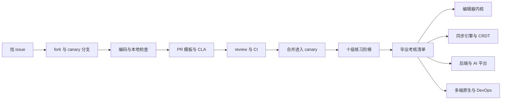
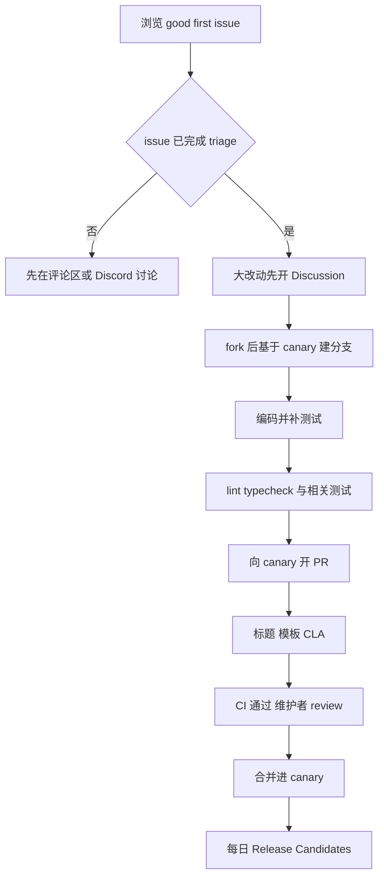
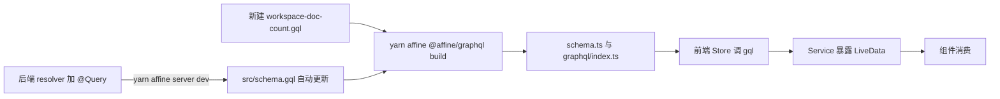

# 第 30 章 贡献实战与进阶路线

从 issue 到合并进 canary：贡献流程、十级练习与进阶方向

第 10 部分 · 综合实战 ｜ 难度 ★★★☆☆ ｜ 建议学时 6 小时

Note:
这是全书的收官章节。读懂源码只是开始，真正"毕业"的标志是你的代码出现在 AFFiNE 的 canary 分支里。这一章把前 29 章的知识转化为可落地的贡献能力。

---

## 本章导读

- **贡献流程**：找 issue → fork → 提交 → 检查 → PR → CLA → 合并
- 规则全部出自仓库：PR 模板、`CONTRIBUTING.md`、commitlint 配置
- **十级练习阶梯**：从改 i18n 文案到自托管接入 S3
- **毕业考核清单**：按全书 10 个部分自评
- **进阶方向**：编辑器、同步、后端与 AI、多端、DevOps

<div class="callout warn">练习不是"必须提交的 PR"，不要为刷贡献提交无需求背景的 PR。</div>

Note:
建议在自己的 fork 上完成练习，挑选真正有价值、与现有 issue 对应的改动再提交上游。PR 模板里明确写着：维护者认为质量过低时可以直接关闭 PR。本章所有规则都直接引用仓库里的文件，不是凭经验总结。

---

## 学习目标

- 按 `docs/CONTRIBUTING.md` 五步完成一次完整贡献
- 写出符合 commitlint 约束的 PR 标题
- 本地运行 lint、typecheck、测试并读懂 CI 失败
- 完成 CLA 签署并排查 `license/cla` 常见问题
- 独立完成至少 6 级练习
- 对照毕业清单找短板，选定一条进阶方向

Note:
第五条是本章的重头戏，六级练习要覆盖前端 UI、编辑器扩展、前后端 GraphQL 打通、数据库迁移。还有一个目标是能用 Docker Compose 自托管 AFFiNE 并把 blob 存储切换到 S3 兼容服务，这对应练习 ⑩。

---

## 知识地图



Note:
地图分三段：先把贡献流程走通，再用十级练习积累真实改动经验，最后用毕业清单自评并选择进阶方向。进阶方向一共五条，图中把多端原生和 DevOps 合在了一起。

---

## 贡献流程总览



合并三条件：`license/cla` 为绿、CI 通过、维护者批准。

Note:
`docs/CONTRIBUTING.md` 把流程浓缩为五步：找事做、搭环境、在 canary 分支上改、向 canary 开 PR、获得合并。注意第一步就有一个判断：还在 triage 中的 issue 不要先动手。合并之后，每日的 Release Candidates 会把你的改动带进 canary 版本。

---

## 第一步：找 issue

- 入口：`https://github.com/toeverything/AFFiNE/contribute`
- 看状态：`docs/issue-triaging.md`，只挑已 triage 的
- `Untriaged` 的 issue 官方建议不要先动手
- Bug 用 `BUG-REPORT.yml`，功能用 `FEATURE-REQUEST.yml`
- 先在 issue 下留言认领，说明方案与范围
- 自己发现的问题：先提 issue 等 triage

Note:
contribute 页面是 GitHub 自动聚合 good first issue 等新手友好标签的页面。triage 状态还有 Open、Upvoting、Shelved、Waiting for Info 等，挑 Open 一类团队希望近期实现的。大改动比如新功能、跨模块重构，先在 Discussions 或 Discord 对齐方案，而不是直接甩一个 PR。

---

## 第二步：fork 与建分支

```bash
git clone https://github.com/<你的用户名>/AFFiNE.git
cd AFFiNE
git remote add upstream https://github.com/toeverything/AFFiNE.git
git fetch upstream
git checkout -b fix/editor-keep-selection upstream/canary
corepack enable
yarn install
yarn affine @affine/native build
yarn dev -p @affine/web
```

永远基于最新 `upstream/canary` 建分支；Node 版本以 `.nvmrc` 为准。

Note:
canary 是默认开发分支。`yarn install` 的 postinstall 会执行 `yarn affine init` 并安装 git hooks。需要后端时按 `docs/developing-server.md` 用 Docker 起 postgres、redis、mailhog，再 `yarn affine server init` 和 `yarn affine server dev`。Windows 用户要先开启开发者模式并设置 `core.symlinks true` 再 clone。

---

## 第三步：Conventional Commits

<p class="small">来源：tools/commitlint/.commitlintrc.json（节选）</p>

```jsonc
{
  "extends": ["@commitlint/config-conventional"],
  "rules": {
    "scope-enum": [2, "always", [
      "admin", "electron", "server", "core", "web", "mobile", "ios", "android",
      "mobile-native", "docs", "component", "env", "graphql", "hooks", "i18n",
      "native", "templates", "debug", "nbstore", "infra", "editor", "tools",
      "y-octo", "client"
    ]]
  }
}
```

合法：`fix(editor): keep selection after paste`；错误：`feat(blocksuite)`、`Fix:`

Note:
PR 标题由 `pr-title-lint.yml` 检查，type 可以是 feat、fix、docs、style、refactor、perf、test、build、ci、chore、revert。scope 可以省略，写了就必须在枚举里，编辑器相关请用 `editor` 而不是 `blocksuite`。CI 只校验 PR 标题；从提交历史推断合并方式是 squash，所以标题比单个 commit 信息更重要。

---

## 第四步：本地检查

| 改动范围 | 建议运行 |
| --- | --- |
| 通用 | `yarn lint`、`yarn typecheck` |
| 前端 / BlockSuite 单元逻辑 | `yarn test`（可加路径过滤） |
| 后端 | `yarn workspace @affine/server test` |
| Web 端交互 | `yarn workspace @affine-test/affine-local e2e` |
| GraphQL 变更 | `yarn affine @affine/graphql build` 并提交 |
| i18n 变更 | `yarn affine @affine/i18n build` 并提交 |

Note:
`yarn lint` 是 oxlint 加 oxfmt 格式检查，`yarn lint:fix` 可以自动修复。后端测试需要本地 postgres 和 redis。忘记提交 `schema.gql`、`schema.ts`、`i18n.gen.ts` 等生成文件，是新人最常见的 CI 失败原因，会在 `check-git-status` 这个 job 报出来。

---

## 第五步：PR 模板与 CLA

<div class="cols">
<div>

**PR 模板 Checklist**

- 已签署 CLA，`license/cla` 为绿
- 目标 `canary`，标题合规
- 视情况补充或更新测试
- 本地跑过 lint 与 typecheck
- AI 生成代码已逐行 review

</div>
<div>

**CLA 一直为红？**

- 每位 committer 都要签，含 co-author
- commit 邮箱须关联 GitHub 账号
- `git log --format='%an %ae'` 查看
- 签完点 bot 评论中的 recheck

</div>
</div>

Note:
Description 里一句话说明做了什么、为什么，用 `Closes #1234` 关联 issue，UI 改动附截图或录屏。CLA 在 `cla-assistant.io/toeverything/AFFiNE` 签署，全文见 `.github/CLA.md`。另外 `labeler.yml` 会按路径自动打标签，`auto_assign.yml` 把作者设为 assignee。

---

## Review、CI 与合并之后

- 自动 reviewer 的评论也要逐条回应
- CI 失败先看是哪个 job，lint/typecheck 本地可复现
- E2E 偶发失败可说明后请求重跑
- 处理意见时**追加 commit**，少用 force-push
- 同步上游：`git fetch upstream && git rebase upstream/canary`
- `release.yml` 每天 UTC 09:00 构建候选，最快次日发布

Note:
追加 commit 方便 reviewer 看增量。canary 版本的 tag 形如 `v2026.10.27-canary.909`，beta 和 stable 形如 `v0.27.5-beta.2`。进入 beta 或 stable 则取决于发布节奏，流程见 `docs/contributing/releases.md`，需要核心团队授权。

---

## 十级练习阶梯（①–⑤）

| 练习 | 难度 | 改动位置 | 验收要点 |
| --- | --- | --- | --- |
| ① i18n 文案 | ★☆☆☆☆ | `i18n/src/resources/en.json` | typecheck 通过，生成文件已提交 |
| ② 编辑器设置项 | ★★☆☆☆ | `editor-setting/schema.ts` | 开关刷新后保持且立即生效 |
| ③ UI 组件 Kbd | ★★☆☆☆ | `component/src/ui/kbd/` | Storybook 亮暗主题正常 |
| ④ core module | ★★★☆☆ | `modules/reading-progress/` | Service 单测，刷新后位置恢复 |
| ⑤ slash menu 项 | ★★★☆☆ | `SlashMenuConfigExtension` | `/now` 可搜到，可撤销 |

Note:
前五级以前端为主。练习 ① 要先改基准语言 `en.json`，再运行 `yarn affine @affine/i18n build` 生成 `i18n.gen.ts`。练习 ④ 参考 `modules/tag/index.ts` 的写法，作用域选 `WorkspaceScope`。练习 ⑤ 推荐在应用层仿照 `ai-slash-menu.ts` 注册，不改 BlockSuite 核心。

---

## 十级练习阶梯（⑥–⑩）

| 练习 | 难度 | 改动位置 | 验收要点 |
| --- | --- | --- | --- |
| ⑥ 自定义 Block | ★★★★☆ | 仿 `blocks/divider/src/` | 协作实时可见，adapter 有单测 |
| ⑦ GraphQL 打通 | ★★★★☆ | resolver + `.gql` + codegen | 三个生成文件已提交 |
| ⑧ Prisma 迁移 | ★★★★☆ | `schema.prisma` + `migrations/` | 空库上可重放 |
| ⑨ Copilot tool | ★★★★★ | `copilot/tools/doc-outline.ts` | 看到 tool-call 卡片 |
| ⑩ 自托管 + S3 | ★★★★☆ | `.docker/selfhost/compose.yml` | 图片出现在 MinIO bucket |

Note:
后五级进入编辑器内核、后端和运维。练习 ⑥ 的完整步骤在第 15 章。练习 ⑧ 为练习 ④ 的阅读进度增加云端持久化，表名 `user_doc_reading_progress`。每一级都对应前面的章节，比如 ⑦ 对应第 21、23 章，⑨ 对应第 24、29 章，⑩ 对应第 27、28 章。

---

## 练习 ② 示例：编辑器设置项

<p class="small">示意代码，仿照 `displayBiDirectionalLink`</p>

```tsx
// schema.ts 中 AffineEditorSettingSchema
displayWordCount: z.boolean().default(false),

// page.tsx
const handleDisplayWordCountChange = useCallback(
  (checked: boolean) => editorSetting.set('displayWordCount', checked),
  [editorSetting]
);
<Switch data-testid="display-word-count-trigger"
        checked={settings.displayWordCount}
        onChange={handleDisplayWordCountChange} />
```

zod `default` 保证老用户没有该字段时取默认值。

Note:
`editorSetting` 来自 `useService(EditorSettingService).editorSetting`，`settings$` 是 LiveData，用 `useLiveData` 订阅即可。开关放在设置页的 `SettingRow` 里，文案写进 `en.json`。消费处参考 `lit-adaper.tsx` 中对 `displayBiDirectionalLink` 的读取方式。

---

## 练习 ⑦：GraphQL 前后端打通



权限断言参考 `this.ac.user(user.id).workspace(workspaceId).assert(...)`。

Note:
目标是新增查询 `workspaceDocCount(workspaceId)`。开发模式下 NestJS 的 `autoSchemaFile` 会把 schema 写入 `./src/schema.gql`，codegen 再依据 `packages/common/graphql/codegen.yml` 生成 `workspaceDocCountQuery` 常量与类型。验收时后端测试要覆盖"有权限返回正确数量、无权限抛错"两种情况。

---

## 练习 ⑨：新增 Copilot tool

- 新建 `copilot/tools/doc-outline.ts`，用 `defineTool` 定义
- `tools/index.ts` 中导出
- `providers/types.ts`：`PromptToolsSchema` 加 `'docOutline'`
- `runtime/tool-runtime.ts`：`case 'docOutline'` 注册 `tools.doc_outline`
- `built-in.json` 中启用，需重建 `@affine/server-native`
- 前端 `stream-objects.ts` 可加专用渲染分支

Note:
这是难度最高的一级，因为它跨越前端、TS 后端和 Rust 资源文件。驼峰名是 prompt 配置和服务端内部的能力标识，蛇形名是暴露给模型和前端的工具名，两者在 `getTools` 的 switch 中映射。错误用 `toolError(...)` 返回结构化失败而不是抛异常，Rust 运行时会把结果回传给模型继续推理。

---

## 练习 ⑩：自托管接入 S3 兼容存储

<p class="small">`./config/config.json`（省略 `$schema` 与 `server` 段）</p>

```json
{
  "storages": {
    "blob.storage": {
      "provider": "aws-s3",
      "bucket": "affine-blobs",
      "config": {
        "endpoint": "http://minio:9000",
        "region": "us-east-1",
        "forcePathStyle": true,
        "credentials": { "accessKeyId": "affine", "secretAccessKey": "..." }
      }
    }
  }
}
```

MinIO 用 `compose.override.yml` 加入；键名以 `schema.json` 为准。

Note:
步骤是：复制 compose 文件，用 override 加入 MinIO 服务，在控制台建 bucket `affine-blobs`，写好 config.json 后 `docker compose up -d`。插入一张图片，在 MinIO 控制台确认出现对象，这对应第 29 章链路三的 `putObject`。安全提醒：样例的 postgres 用 trust 认证，仅适合本机实验，凭据要通过 `.env` 或密钥管理注入。

---

## 毕业考核清单（节选）

| 部分 | 核心检查 | 部分 | 核心检查 |
| --- | --- | --- | --- |
| 1 产品认知 | Page/Edgeless 双模式 | 6 前端应用 | 复述冷启动与三层作用域 |
| 2 开源协作 | 写出合法 PR 标题 | 7 后端服务 | 复述同步网关处理过程 |
| 3 基础技术 | Yjs update 与 origin | 8 质量保障 | 写 vitest 与 ava 测试 |
| 4 工程化 | 本地启动 Web 与 Server | 9 运维部署 | 自托管并接入 S3 |
| 5 BlockSuite | 实现一个自定义块 | 10 综合实战 | 至少 1 个 PR 被合并 |

<p class="small">每部分至少勾选 80% 再进入进阶方向。</p>

Note:
完整清单每个部分有 3 到 5 项，这里每部分只挑了一项最有代表性的。最后一项"至少有 1 个 PR 被合并到 canary"是真正的毕业标志。自评时要诚实，短板就是你下一步的学习重点。

---

## 后续进阶方向

| 方向 | 核心目录 | 进阶课题 |
| --- | --- | --- |
| 编辑器内核 | `blocksuite/framework/std`、`store` | IME 兼容、Edgeless 渲染性能 |
| 同步引擎与 CRDT | `common/nbstore`、`core/sync` | 离线合并、快照、y-octo |
| 后端与 AI 平台 | `plugins/copilot`、`native/src/llm` | 工具循环、检索、BYOK |
| 多端原生 | `apps/electron`、`apps/ios` | IPC、SQLite、NAPI-rs |
| DevOps | `.github/workflows`、`.docker` | 构建缓存、K8s、OpenTelemetry |

Note:
选择建议：先从练习阶梯中你完成得最轻松的那一级对应的方向开始。找两三个该方向已合并的 PR，用第 29 章的方法逆向阅读它们改了哪些文件、为什么这样改。每月至少完成一次"读一个模块、写一篇笔记、提一个小 PR"的循环。

---

## 持续跟进社区

| 渠道 | 用途 |
| --- | --- |
| GitHub Releases | 版本变更，canary 几乎每天都有 |
| GitHub Discussions | 方案讨论、问答、功能提议 |
| Discord | 实时交流、翻译协作 |
| 仓库 `docs/` | 随代码演进的一手资料 |
| `SECURITY.md` | 漏洞走私密渠道 |

<p class="small">每周：`git log upstream/canary --oneline --since="1 week ago"`</p>

Note:
跟进节奏建议每周看一次 canary 的提交列表，关注与你方向相关的 scope，比如 `fix(nbstore)`、`feat(editor)`。每个大版本读一次 Release Notes 和 `CHANGELOG.md`。官方文档 `docs.affine.pro` 和博客也值得订阅。

---

## 源码导读 Top 5

| 优先级 | 路径 | 看什么 |
| --- | --- | --- |
| ★★★ | `docs/CONTRIBUTING.md` | 五步贡献流程、CLA |
| ★★★ | `docs/BUILDING.md` | 环境、测试、lint/typecheck、排错 |
| ★★★ | `.github/PULL_REQUEST_TEMPLATE.md` | Checklist 各项 |
| ★★★ | `tools/commitlint/.commitlintrc.json` | scope 枚举 |
| ★★☆ | `.github/workflows/pr-title-lint.yml` | 标题校验命令 |

Note:
这一章的"源码"主要是流程文档和配置文件，它们决定了你的 PR 能不能被合并。做练习时还要读对应的代码入口，比如 `editor-setting/schema.ts`、`codegen.yml`、`schema.prisma` 和 `tool-runtime.ts`。

---

## 动手实践

| 实践 | 验收要点 |
| --- | --- |
| 1 零代码贡献演练 | 在自己 fork 内开 PR，熟悉模板 |
| 2 标题校验演练 | `feat(blocksuite)` 报错，`feat(editor)` 通过 |
| 3 完成练习 ① + ② | 生成文件与 typecheck 截图 |
| 4 完成练习 ⑩ | `docker compose ps` 与 MinIO 截图 |
| 5 挑选一个真实 issue | 留言认领并提交上游 PR |

Note:
实践 1 修改一处文档错别字，用 `docs: fix typo in building guide` 作为标题，base 选你自己 fork 的 canary。实践 2 用 `echo "feat(blocksuite): test" | yarn workspace @affine/commitlint-config commitlint -g ./.commitlintrc.json` 观察报错。实践 5 是持续性的，从你完成过的练习相关的 issue 入手。

---

## 自测

1. `feat(blocksuite): add countdown block` 能通过吗？

不能，`blocksuite` 不在 `scope-enum` 中，应用 `editor`。 <!-- .element: class="fragment" -->

2. 签了 CLA 但 `license/cla` 仍为红，最可能的原因？

有未签署的 co-author；或 commit 邮箱未关联 GitHub。 <!-- .element: class="fragment" -->

3. 改了 resolver 与 `.gql`，必须提交哪些生成文件？

`schema.gql`、`schema.ts`、`graphql/index.ts`。 <!-- .element: class="fragment" -->

Note:
这三题都是新人第一次贡献时真实会遇到的问题。还可以追问：PR 合并到 canary 后最快什么时候出现在可下载版本中？答案是次日，因为 `release.yml` 每天 UTC 09:00 定时构建候选版本。

---

## 常见坑

| 现象 | 原因与解决 |
| --- | --- |
| `yarn install` 版本报错 | Node 不符 `.nvmrc`；`corepack enable` |
| PR Title Lint 失败 | scope 不在枚举、type 大写或缺冒号 |
| `check-git-status` 失败 | 生成文件未提交；本地重跑生成命令 |
| typecheck 报 i18n key 不存在 | 未重新生成 `i18n.gen.ts` |
| 找不到新 GraphQL 常量 | 先启动服务端更新 schema，再 codegen |
| 切到 S3 后上传失败 | bucket、凭据、`forcePathStyle` 或 CORS |

Note:
修改 PR 标题会重新触发标题检查，不需要推新 commit。`prisma migrate dev` 提示重置数据库时，只限本地开发库按提示操作，切勿对共享或生产库执行。macOS 上原生模块构建失败，往往是用了 binutils 的 `strip`，改用系统自带的即可。

---

## 小结与全书收官

- 贡献五步：找事、搭环境、在 canary 上改、开 PR、合并
- 标题必须合规，生成文件必须提交，CLA 必须签
- 十级练习从 i18n 到 Copilot tool、自托管 + S3
- 用毕业清单找短板，选一条方向持续深入
- 毕业标志：你的 PR 被合并进 canary

**全书完**：感谢一路同行，期待在 AFFiNE 的提交记录里看到你

Note:
三十章走到这里，你已经从产品认知、工程化、编辑器内核、前后端服务一路走到了运维、安全和端到端链路。最后一步是把它变成真实的贡献。挑一个 good first issue，留言认领，按本章流程提交你的第一个 PR 吧。
