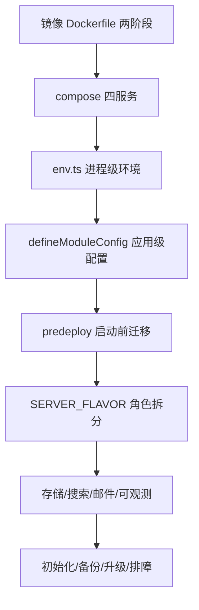
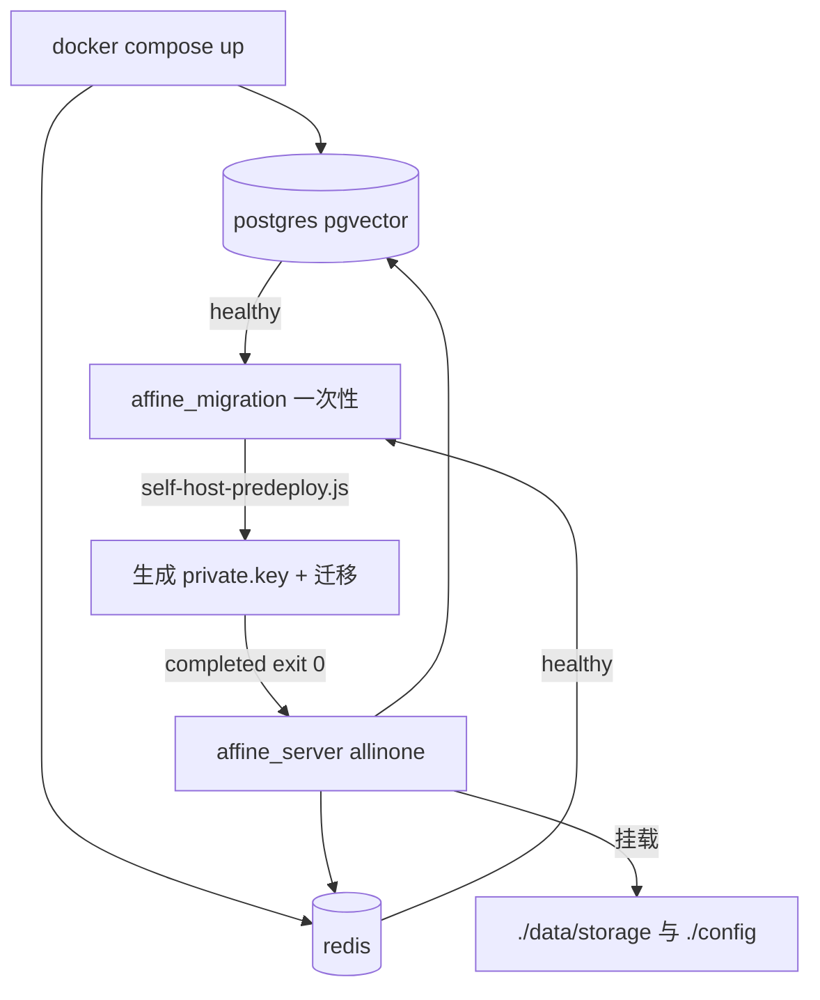
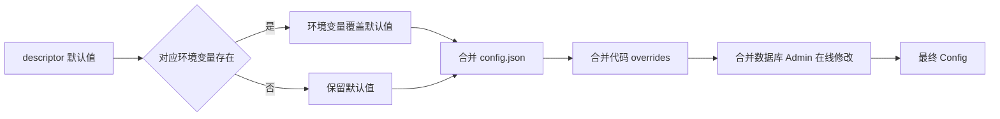
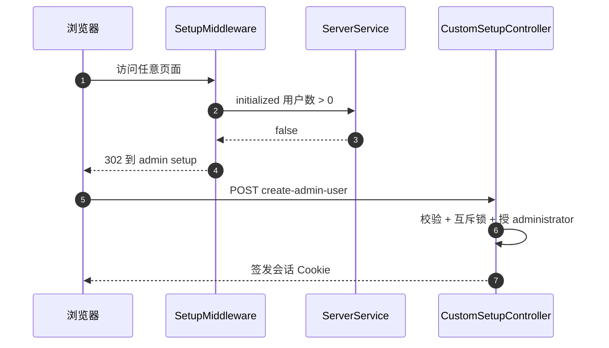

# 第 31 章 部署与运维

> 镜像里有什么、怎么跑起来、跑起来后怎么运维——从"写代码"到"对线上负责"的一跃

第 9 部分 · 运维与部署 ｜ 难度 ★★★★☆ ｜ 建议学时 8 小时

===

## 本章要解决的问题

<p class="lead">第 30 章 CI 产出了一个多架构镜像 <code>ghcr.io/toeverything/affine</code>。本章回答下一个问题：<b>这个镜像里有什么、怎样把它跑起来、跑起来后怎么运维？</b></p>

AFFiNE 服务端（`packages/backend/server`，包名 `@affine/server`）是一个 NestJS 应用，依赖 Rust 原生模块 `@affine/server-native`。它的部署有四种典型形态：

<div class="cards cols-2">
  <div class="card"><div class="card__icon">💻</div><h4>本地开发</h4><p><code>.docker/dev/compose.yml.example</code> + <code>yarn affine server dev</code>：只用 Docker 跑依赖，服务在本机。</p></div>
  <div class="card"><div class="card__icon">📦</div><h4>单机自托管</h4><p><code>.docker/selfhost/compose.yml</code>：allinone 容器 + 迁移容器 + Redis + Postgres。</p></div>
  <div class="card"><div class="card__icon">☁️</div><h4>PaaS 一键</h4><p><code>render.yaml</code> + <code>.render/</code>，复用 stable 镜像（第 30 章）。</p></div>
  <div class="card"><div class="card__icon">🏢</div><h4>云端多角色</h4><p>同一镜像 + 不同 <code>SERVER_FLAVOR</code>，按角色拆分水平扩展。</p></div>
</div>

===

## 知识地图

本章从"构建镜像 → 跑起来 → 配置生效 → 拆分扩展 → 运维"一路展开。



<div class="note">

本章路径均相对仓库根 `AFFiNE/`。一个贯穿全章的要点：AFFiNE 近期把存储、搜索、认证等运行时下沉到 Rust（`packages/backend/native/src/runtime/`），TS 层更多是"编排 + 配置 + 错误映射"。

</div>

===

## 学习目标

<ol class="goals">
  <li>说明镜像分层结构，以及 web/admin/mobile 静态资源在镜像中的位置</li>
  <li>用 <code>compose.yml</code> 部署自托管实例，解释 <code>affine_migration</code> 服务的作用</li>
  <li>区分 <code>NODE_ENV</code>、<code>AFFINE_ENV</code>、<code>DEPLOYMENT_TYPE</code>、<code>SERVER_FLAVOR</code>、<code>DEPLOYMENT_PLATFORM</code></li>
  <li>描述配置从 <code>defineModuleConfig</code> 到 <code>config.json</code>、环境变量、<code>schema.json</code> 的完整链路</li>
  <li>按负载规划按 Flavor 拆分的多实例部署，说明 Redis 的作用</li>
  <li>为自托管配置 S3 存储、外部搜索引擎、SMTP 与 OpenTelemetry</li>
  <li>制定备份恢复与升级方案，用排障手册定位常见故障</li>
</ol>

===

<!-- section -->
## 一、镜像与自托管

一个两阶段 Dockerfile 把四类产物装进镜像；一个 compose 用四个服务把它跑起来，关键是"迁移与服务分离"。

===

## 两阶段 Dockerfile

<div class="annotate">

```dockerfile [1-4|6|11-12]
FROM node:22-bookworm-slim AS assets
WORKDIR /app
COPY ./packages/backend/server /app
COPY ./packages/frontend/apps/web/dist /app/static
RUN AFFINE_DOCKER_CLEAN=1 node ./scripts/docker-clean.mjs
FROM node:22-bookworm-slim
COPY --from=assets /app /app
ENV LD_PRELOAD=libjemalloc.so.2
EXPOSE 3010
CMD ["sh", "-c",
  "node ./scripts/upgrade-config.js && exec node ./dist/main.js"]
```

<ol class="annotate__notes">
  <li><b>assets 阶段</b>：服务端整目录拷到 <code>/app</code>，三个前端 dist 放到 <code>/app/static</code>、<code>/static/admin</code>、<code>/static/mobile</code>——正是 <code>core/selfhost/static.ts</code> 读取的位置。</li>
  <li><b>docker-clean.mjs</b>：删掉其他架构原生模块与前端 sourcemap，只留服务端 sourcemap。</li>
  <li><b>CMD</b>：先 <code>upgrade-config.js</code>（旧环境变量迁入 config.json），再 <code>exec</code> 让 Node 成为 PID 1 正确接收 <code>SIGTERM</code>。</li>
</ol>
</div>

<div class="note note--warn">

镜像 CMD **不执行数据库迁移**——迁移由独立容器负责。这是"迁移与服务分离"的经典做法：多副本同时启动时不会并发跑迁移。

</div>

===

## 自托管部署拓扑

四个服务按健康检查与完成状态串起来：Postgres、Redis 先就绪，`affine_migration` 跑完迁移退出码 0 后，`affine` 主服务才启动。



| 服务 | 作用 | 关键配置 |
| --- | --- | --- |
| `affine` | 主服务（默认 `allinone`） | 端口 3010；等待迁移成功 |
| `affine_migration` | 一次性：生成密钥、跑迁移 | `command` 覆盖为 `self-host-predeploy.js` |
| `redis` | 缓存、会话、socket.io 广播 | `redis-cli --raw incr ping` |
| `postgres` | 主库（pgvector，AI 向量检索） | `POSTGRES_HOST_AUTH_METHOD: trust` |

===

## 数据卷里存了什么

三个卷都必须备份，`private.key` 尤其关键：

<div class="cards cols-3">
  <div class="card"><h4><code>./data/storage</code></h4><p>默认 fs 存储：图片、附件（<code>blobs</code> 桶）、头像（<code>avatars</code> 桶）。</p></div>
  <div class="card"><h4><code>./config</code></h4><p><code>config.json</code>、<code>private.key</code>（服务端签名私钥）、可选 <code>.env</code>。</p></div>
  <div class="card"><h4><code>./data/postgres</code></h4><p>数据库文件；建议另用 <code>pg_dump</code> 做逻辑备份。</p></div>
</div>

<div class="note note--danger">

两个安全点（第 32 章展开）：① `POSTGRES_HOST_AUTH_METHOD: trust` 是**无密码连接**，只在 Postgres 不暴露端口、仅 compose 内网可达时可接受（compose 中 postgres/redis 都没有 `ports` 映射）；② `private.key` 丢失会导致已签发令牌、加密数据无法验证解密，**必须与数据库一起备份**。

</div>

===

<!-- section -->
## 二、配置系统

进程级环境（env.ts，启动前定死）+ 应用级配置（defineModuleConfig，可在线改）两套体系，合并顺序有讲究。

===

## 进程级：env.ts 的五个变量

`packages/backend/server/src/env.ts` 定义了启动前就确定、不可在线修改的运行环境：

| 环境变量 | 取值 | 默认 | 影响 |
| --- | --- | --- | --- |
| `NODE_ENV` | development/test/production | production | `env.dev`/`testing`/`prod` |
| `AFFINE_ENV` | dev/beta/production | production | 命名空间、OTel 资源属性 |
| `DEPLOYMENT_TYPE` | affine/selfhosted | 开发 affine 否则 selfhosted | 是否自托管 |
| `SERVER_FLAVOR` | allinone/graphql/sync/... | allinone | 装配哪些模块 |
| `DEPLOYMENT_PLATFORM` | gcp/其他 | unknown | gcp 时加载 GCloudModule |

<div class="note note--warn">

`DEPLOYMENT_TYPE` 优先级有点绕：**只要存在 `config.json`，就以其中 `deployment.type` 为准**；否则才读环境变量。`config.json` 查找顺序是项目根（镜像 `/app/config.json`）优先，其次 `~/.affine/config/config.json`（compose 挂载的 `./config`）。源码有 `TODO(0.27.5)` 标注这是过渡兼容逻辑。

</div>

===

## 应用级：defineModuleConfig

应用配置按"模块"组织，每个模块一次性声明配置项的默认值、校验与环境变量映射：

```ts
defineModuleConfig('server', {
  externalUrl: {
    desc: 'Base url of AFFiNE server...',
    default: '',
    env: 'AFFINE_SERVER_EXTERNAL_URL',
  },
  https: {
    default: false,
    env: ['AFFINE_SERVER_HTTPS', 'boolean'],
    shape: z.boolean(),
  },
  // host / listenAddr / port / path ...
});
```

<div class="note">

这段代码同时完成四件事：TS 类型（扩充 `AppConfigSchema`）、默认值、zod 校验、环境变量映射。部分模块（`redis`、`storages`、`indexer`）改用 `defineNativeModuleConfig`——描述符与校验都来自 Rust 原生模块，体现了存储、搜索运行时下沉 Rust 的趋势。

</div>

===

## 配置合并顺序

环境变量只改"默认值"，`config.json` 会覆盖它——**这是升级后最常见的困惑点**。



<div class="note note--warn">

**环境变量 < config.json**。更要命的是 `upgrade-config.js` 会在首次启动时把一批"别名环境变量"（如 `REDIS_SERVER_HOST`、`AFFINE_SERVER_PORT`）**固化进 config.json**（只在该键缺失时写入、原子 rename、权限 `0o600`）。之后若只改环境变量而不改 config.json，**新值不会生效**。

</div>

===

## genconfig 生成的两份文件

`yarn affine server genconfig` 加载 `app.module`（触发所有 `defineModuleConfig`），生成两份文件：

<div class="compare">
  <div class="compare__col"><h4>schema.json</h4>

- 路径 `.docker/selfhost/schema.json`
- 自托管用户编辑 `config.json` 时校验与补全
- 描述含 `@default`、`@environment`、`@link`

  </div>
  <div class="compare__col compare__col--good"><h4>admin config.json</h4>

- 路径 `packages/frontend/admin/src/config.json`
- Admin 后台"设置"页据此渲染表单
- `db`/`redis`/`graphql` 等被忽略，`payment`/`telemetry` 只对云端有意义

  </div>
</div>

<div class="note note--tip">

第 30 章 `check-git-status` 会重跑 genconfig 确认这两份已提交。自托管可配置的模块一览：`crypto`、`throttle`、`auth`、`mailer`、`doc`、`storages`、`websocket`、`server`、`client`、`copilot`、`indexer`、`oauth`、`worker` 等。

</div>

===

## 启动前迁移：两套脚本

<div class="split">
<div class="split__main">

`self-host-predeploy.js`（compose 的 `affine_migration` 调用）做四件事：准备配置目录、**首次生成 P-256 EC 私钥** `private.key`、修复已知失败迁移（`prisma migrate resolve --rolled-back`）、`prisma migrate deploy` + `yarn cli run` 数据迁移。

`yarn cli` 对应 `SERVER_FLAVOR=script node ./dist/main.js`——以 script flavor 启动同一入口进入 commander CLI。

**两类迁移**：Schema 迁移（`migrate deploy` 应用 SQL）与数据迁移（`cli run` 执行按时间戳排序的 TS 脚本，回填/转换数据）。

</div>
<div class="split__aside">

```js
function generatePrivateKey() {
  return generateKeyPairSync('ec', {
    namedCurve: 'prime256v1',
  }).privateKey.export({
    type: 'sec1',
    format: 'pem',
  });
}
// 已存在则不覆盖
prepare();
fixFailedMigrations();
runPrismaMigrations();
runDataMigrations();
```

</div>
</div>

<div class="note note--warn">

自托管脚本**没有**执行云端 `predeploy` 里的 `admit-legacy-context-blobs` 与 `validate-cutover`。自己编排 K8s Job 时，以 `package.json` 的 `predeploy` 为更完整参考。

</div>

===

<!-- section -->
## 三、角色拆分与水平扩展

同一镜像靠 SERVER_FLAVOR 扮演不同角色，Redis adapter 让多副本间广播文档更新。

===

## Flavor 到模块的映射

`buildAppModule(env)` 按 `env.flavors.*` 用 `.useIf(...)` 决定装配哪些 Nest 模块：

| Flavor | 职责 | 主要模块 |
| --- | --- | --- |
| `allinone` | 单机默认 | 几乎全部 |
| `graphql` | API | `GqlModule`、Copilot、OAuth、Indexer |
| `sync` | WebSocket 同步 | `SyncModule`、Realtime handlers |
| `renderer` | 分享页 SSR | `DocRendererModule` |
| `front` | 静态资源+渲染+同步 | 以上 + `StaticFileModule` |
| `worker` | 后台队列/定时 | `DocJobsModule`、`MailWorkerModule`，**不加载** Auth/User/Realtime |
| `script` | 迁移运维命令 | CLI 模块 |

<div class="note note--warn">

**拆分部署时必须有 worker 实例**：邮件采用"写投递表 → worker 租约领取 → 发送"的异步模型（`MailWorkerModule` 只在 worker 角色加载），没有 worker 邮件就发不出去，后台任务、存储清理也不执行。

</div>

===

## 多实例拓扑与 Redis adapter

`sync` 拆成多副本后，A 连副本 1、B 连副本 2，副本 1 收到的更新如何广播给 B？答案是 `@socket.io/redis-adapter`——每个副本既 publish 也 subscribe，room 广播经 Redis Pub/Sub 扩散。

<div class="split">
<div class="split__main">

Redis 的 db 编号按用途偏移：`CacheRedis` +0、`SessionRedis` +2、`SocketIoRedis` +3。`assertValidDBIndex` 要求基础 db ≤ 11（预留偏移空间）——**配置 `redis.db` 别用 12 以上**。

负载均衡后若用 `polling` 传输需会话粘滞（sticky session），否则建议只启 `websocket`。`websocket.maxHttpBufferSize` 默认 100MB。

</div>
<div class="split__aside">

```ts
export class SocketIoRedis
  extends Redis {
  constructor(h: ServerConfigHandle) {
    super(...redisConnection(h, 3));
  }
}
// duplicate() 的 sub 客户端
// 不受 Nest 生命周期管理
// 需手动 disconnect
```

</div>
</div>

===

## 存储、搜索、邮件三选项

<div class="cards cols-3">
  <div class="card"><div class="card__icon">🗄️</div><h4>存储</h4><p><code>storages.blob.storage</code>：<code>fs</code>（默认 <code>~/.affine/storage</code>）/ <code>aws-s3</code> / <code>cloudflare-r2</code> / <code>assetpack</code>。实现在 Rust <code>runtime/object_storage/</code>。</p></div>
  <div class="card"><div class="card__icon">🔍</div><h4>搜索</h4><p><code>indexer.provider.type</code>：<code>embedded</code>（内置推荐）/ <code>elasticsearch</code> / <code>manticoresearch</code>。只在 api/frontend 角色加载。</p></div>
  <div class="card"><div class="card__icon">📧</div><h4>邮件</h4><p><code>mailer.SMTP.*</code>：host 为空则不发信。投递走 worker 异步模型。</p></div>
</div>

<div class="note note--warn">

**多副本不能用本地 fs 存储**（除非共享文件系统），否则不同副本看到的文件不一致。`r2-proxy.ts` 的 `R2UploadController` 在开启 `proxyUpload` 时由服务端代理分片上传，避开浏览器直传的 CORS 与企业网络拦截，代价是流量过服务端。

</div>

===

## 可观测性：OpenTelemetry

`metrics.enabled`（默认 false）开启后，`OpentelemetryProvider` 启动 Node SDK：

| 维度 | 默认实现 | GCP 实现 |
| --- | --- | --- |
| 指标 | `PrometheusExporter`（库默认约 9464 端口 `/metrics`） | 继承默认 |
| 追踪 | `ZipkinExporter` | Cloud Trace `TraceExporter` |
| 采样 | 10%（`TraceIdRatioBasedSampler(0.1)`） | 同 |
| 资源属性 | `service.name`=FLAVOR | + HOSTNAME/CONTAINER_NAME |

<div class="note">

`service.name` 用 FLAVOR，拆分部署时可在 Grafana 按角色看延迟与错误率。即使不开 metrics，`MonitorService` 也每分钟输出一行内存日志（`node_process_rss` 等）。日志前缀 `<requestId>`，排障时让用户提供响应头 `X-Request-Id` 即可 grep 整条链路。健康检查用免鉴权的 `GET /info`（返回版本、部署类型、flavor）。

</div>

===

## 首次初始化流程

<p class="lead">自托管首次启动，数据库无用户，所有页面都会重定向到 <code>/admin/setup</code> 创建管理员——<b>这之前任何能访问该地址的人都能抢先创建管理员</b>。</p>



<div class="note note--danger">

防护：`initialized()` 检查用户数、已有则抛 `ActionForbidden`；`mutex.acquire('createFirstAdmin')` 防并发；`SelfhostGuard` 只在自托管放行；密码强度校验。但最根本的措施是**部署后立即完成初始化**或在初始化前限制网络访问。

</div>

===

## 备份、升级与排障

<ol class="steps">
  <li><h4>备份</h4><p>Postgres 用 <code>pg_dump -Fc</code>；fs 打包 <code>./data/storage</code>；<code>./config</code>（含 <code>private.key</code>）每次修改后备份。</p></li>
  <li><h4>升级</h4><p>读发布说明 → 备份 → 改镜像 tag / <code>docker compose pull</code> → <code>up -d</code> → <code>affine_migration</code> 跑 schema 与数据迁移 → 校验 <code>/info</code>。<b>只能向前迁移</b>，回滚靠备份。</p></li>
  <li><h4>排障</h4><p>按 <code>X-Request-Id</code> grep 日志；<code>affine_migration</code> 失败时 <code>docker compose logs affine_migration</code>。</p></li>
</ol>

| 现象 | 原因 | 解决 |
| --- | --- | --- |
| 改环境变量后不生效 | 已被 `upgrade-config.js` 固化进 `config.json` | 直接改 `config.json` 或 Admin |
| 链接域名是 localhost | 未配 `server.externalUrl` | 设 `externalUrl` |
| 协作不实时、多副本不同步 | Redis 不可用或连了不同 Redis | 所有 sync 副本共用 Redis |
| `redis` 报 Invalid database index | `redis.db` > 11 | 改为 0–11 |

===

## 动手实践

<ol class="steps">
  <li><h4>起一套自托管实例</h4><p>复制 <code>compose.yml</code> 与 <code>config.example.json</code>，<code>docker compose up -d</code>，观察 <code>affine_migration_job</code> 变 <code>exited (0)</code>，完成管理员创建。<b>验收</b>：<code>/info</code> 返回 <code>type: selfhosted</code>、<code>flavor: allinone</code>，<code>private.key</code> 存在。</p></li>
  <li><h4>追踪配置项的一生</h4><p>给 compose 加 <code>AFFINE_SERVER_EXTERNAL_URL</code>，重启后看 <code>config.json</code> 是否被写入；再改环境变量重启观察是否变化。<b>验收</b>：能解释"为什么第二次修改不生效"。</p></li>
  <li><h4>模拟角色拆分</h4><p>复制 <code>affine</code> 为 <code>affine_worker</code>（<code>SERVER_FLAVOR=worker</code>）与 <code>affine_graphql</code>。<b>验收</b>：画出三实例拓扑，说明 worker 为何没有 <code>/graphql</code>。</p></li>
  <li><h4>备份恢复演练</h4><p>建文档、传图，<code>pg_dump</code> + 打包卷，删除后恢复。<b>验收</b>：恢复后无需重新初始化管理员，图片正常显示。</p></li>
</ol>

===

## 自测：点击揭晓答案

<details class="quiz">
<summary>Q1. 为什么镜像 CMD 不执行数据库迁移？compose 用什么机制保证迁移先完成？</summary>

迁移应只执行一次，多副本同时启动时并发迁移有风险，且迁移失败不应导致服务反复重启。compose 中 `affine` 的 `depends_on.affine_migration.condition: service_completed_successfully`——迁移容器退出码 0 后服务才启动。

</details>

<details class="quiz">
<summary>Q2. 同时存在 config.json 和 DEPLOYMENT_TYPE 环境变量，以哪个为准？环境变量与 config.json 冲突呢？</summary>

都以 `config.json` 为准。`env.ts` 构造函数发现存在 `config.json` 时从 `deployment.type` 读取；环境变量只在 `getDefaultConfig` 中改变默认值，随后被 `config.json` 覆盖。

</details>

<details class="quiz">
<summary>Q3. 多个 sync 副本之间如何广播文档更新？用 Redis 哪个 db 偏移？</summary>

通过 `@socket.io/redis-adapter`，每个副本用 `SocketIoRedis` 作 pub、`duplicate()` 一个 sub，经 Redis Pub/Sub 广播。`SocketIoRedis` 使用基础 db + 3。

</details>

<details class="quiz">
<summary>Q4. self-host-predeploy.js 会生成什么文件？丢失它有什么后果？</summary>

生成 `~/.affine/config/private.key`（P-256 EC 私钥）。丢失后服务端签名与加密数据（令牌等）无法验证解密，表现为用户会话失效，需从备份恢复。

</details>

===

## 小结与下一步

<ul class="takeaways">
  <li>两阶段 Dockerfile 把 server 与三个前端 dist 装进镜像，CMD 先 <code>upgrade-config.js</code> 再 <code>exec main.js</code>，迁移与服务分离。</li>
  <li>配置两套：进程级 <code>env.ts</code>（启动前定死）+ 应用级 <code>defineModuleConfig</code>（可在线改）；<b>环境变量 < config.json</b>，且会被固化。</li>
  <li><code>SERVER_FLAVOR</code> 让同一镜像扮演 graphql/sync/renderer/front/worker/script；拆分必须有 worker。</li>
  <li>多副本靠 Redis adapter 广播同步，本地 fs 存储不可用于多副本。</li>
  <li>可观测性靠 OpenTelemetry（Prometheus+Zipkin，10% 采样），健康检查用 <code>/info</code>；只能向前迁移、回滚靠备份、<code>private.key</code> 必须持久化。</li>
</ul>

<div class="note note--tip">

**下一章预告**：第 32 章把部署里反复出现的安全点系统化——信任边界、认证会话与令牌轮换、防滥用、SSRF/CSRF/XSS、BYOK 信封加密、Electron 加固、供应链，最后给出一份自托管安全自查清单。

</div>
