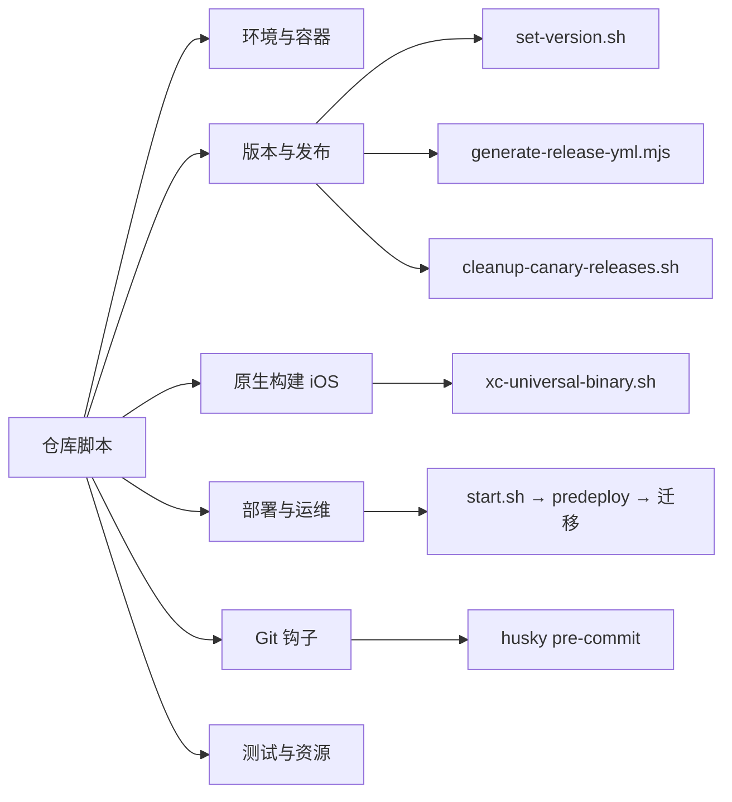
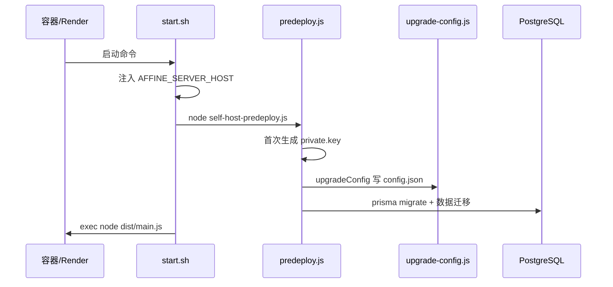

# 第 35 章 脚本与自动化工具

> 散落在仓库各处的 shell / Node 脚本，是自动化流水线的“毛细血管”

第 11 部分 · 附录 ｜ 难度 ★★★☆☆ ｜ 建议学时 4 小时

===

## 本章要解决的问题

<p class="lead">前 30 章讲完了产品、内核、前后端与运维，但还有一类“隐形基础设施”没归纳——脚本。</p>

它们不属于任何业务模块，却在**装依赖、改版本、出安装包、起服务、跑钩子**时默默工作。此前它们零散出现在第 4、11、14、15、24、30、31 章里。

<div class="note note--tip">

本章把仓库里的脚本**集中成一张地图**：每个脚本是什么语言、干什么、何时被谁触发、有哪些坑。目标不是逐行精读，而是遇到“这个 `.sh`/`.mjs` 是干嘛的”时能立刻定位。

</div>

<div class="stats">
  <div class="stat"><b>9</b><span>个 *.sh 脚本</span></div>
  <div class="stat"><b>6</b><span>大用途分类</span></div>
  <div class="stat"><b>2</b><span>种脚本语言</span></div>
</div>

===

## 知识地图

脚本按用途分六类，用 shell 与 Node 两种语言实现。



===

## 学习目标

<ol class="goals">
  <li>画出仓库脚本的分类地图（环境 / 版本发布 / 原生构建 / 部署 / 钩子 / 测试资源）</li>
  <li>说清 <code>set-version.sh</code> 为何同时改 workspace 版本、AppStream、iOS MARKETING_VERSION</li>
  <li>解释 <code>start.sh → self-host-predeploy.js → upgrade-config.js</code> 启动链与“环境变量优先级低于 config.json”</li>
  <li>说明 iOS <code>xc-universal-binary.sh</code> 为何重置 PATH、<code>apollo-codegen-chore.sh</code> 为何下载 CLI</li>
  <li>区分 shell 脚本与 Node 脚本的适用场景，及其与 <code>yarn affine</code> CLI 的分工</li>
</ol>

===

## 两种语言，一条分工规律

<div class="lead">跨平台、要调 Node 生态的用 <code>.mjs</code>；只在类 Unix shell 串联命令行工具的用 <code>.sh</code>。</div>

<div class="compare">
  <div class="compare__col"><h4>.sh（bash / zsh / sh）</h4>

- 串联 `jq`、`sed`、`gh`、`cargo`、`xcodebuild`
- 绑定具体平台：iOS 构建、容器初始化、Git 钩子
- 依赖类 Unix 环境（Windows 需 WSL）

  </div>
  <div class="compare__col compare__col--good"><h4>.mjs / .js（Node）</h4>

- 读 `package.json`、算 sha512、写 `config.json`、调 `@blocksuite/*`
- 跨平台、可复现
- 后端与发布的“数据处理”偏这类

  </div>
</div>

<div class="note">

更上层还有 `yarn affine` CLI（`tools/cli`，第 14 章）承担日常开发命令。三层分工：CLI 管日常、`.mjs` 管数据处理、`.sh` 管平台胶水。

</div>

===

## 脚本全景表

| 类别 | 代表脚本 | 语言 | 触发入口 |
| --- | --- | --- | --- |
| 环境与容器 | `devcontainer/build.sh`、`ios/setup.sh` | bash/zsh | 容器构建 / 手动 |
| 版本与发布 | `set-version.sh` | bash | CI setup-version action |
| 版本与发布 | `generate-release-yml.mjs` | Node | 桌面发布工作流 |
| 版本与发布 | `cleanup-canary-releases.sh` | bash | 维护者手动（dry-run） |
| 原生构建 | `xc-universal-binary.sh` | bash | Xcode Build Phase |
| 原生构建 | `apollo-codegen-chore.sh` | zsh | 手动更新 GraphQL |
| 部署运维 | `start.sh` / `self-host-predeploy.js` / `upgrade-config.js` | sh/Node | 容器启动 |
| Git 钩子 | `.husky/pre-commit` | sh | `git commit` |
| 测试资源 | `download-blocksuite-fonts.mjs`、`vitest-global.js` | Node | 构建前 / 测试 |

===

<!-- section -->
## 一、环境与版本发布

从“把新人踩过的坑固化成脚本”，到发版时一处改动多处同步。

===

## 环境与容器脚本

<div class="cards cols-3">
  <div class="card"><div class="card__icon">📦</div><h4>devcontainer/build.sh</h4><p>install → 构建 server-native → prisma migrate reset，走 <code>yarn affine</code> CLI。</p></div>
  <div class="card"><div class="card__icon">🌿</div><h4>setup-user.sh</h4><p>装 Graphite CLI，<code>gt init --trunk canary</code>，印证单主干模型。</p></div>
  <div class="card"><div class="card__icon">🍎</div><h4>ios/setup.sh</h4><p>校验 .git、install、临时调 pbxproj objectVersion=56 兼容工具链。</p></div>
</div>

===

## set-version.sh：一次改动，多处同步

发版时版本号要在很多地方保持一致。这个 126 行 bash 用 `jq`/`sed` 统一处理：

<div class="annotate">

```bash
for DIR_ITEM in $(yarn workspaces list --json | jq -r '.location'); do
  DIR=$(echo -n "$DIR_ITEM" | tr -d '\r\n')
  [ -f "$DIR/package.json" ] && \
    jq ".version = \"$1\"" "$DIR/package.json" > tmp.json \
      && mv tmp.json "$DIR/package.json"
done
```

<ol class="annotate__notes">
  <li><b>遍历所有 workspace 包</b>改 <code>version</code>。</li>
  <li>另有 <code>update_app_stream_version</code>（Linux AppStream <code>.metainfo.xml</code>）。</li>
  <li><b>iOS</b> <code>MARKETING_VERSION</code> 规范化为<b>日期式</b> <code>YYYY.M.D</code>（从最近 stable/beta tag 推导）。</li>
</ol>
</div>

<div class="note note--warn">

**为何日期式？** Apple 要求 `CFBundleShortVersionString` **单调递增**；频繁出包时语义版本可能回退/重复，日期式天然满足。触发入口：`.github/actions/setup-version/action.yml`（第 30 章）。

</div>

===

## 发布辅助：清单、清理、门禁

<div class="cards cols-3">
  <div class="card"><h4>generate-release-yml.mjs</h4><p>扫描 <code>./release</code> 安装包，算 <b>sha512</b> 与大小，生成 electron-updater 的 <code>latest*.yml</code>。</p></div>
  <div class="card"><h4>cleanup-canary-releases.sh</h4><p>基于 <code>gh</code> 清理旧 canary release，<b>默认 dry-run</b>，保守删除。</p></div>
  <div class="card"><h4>check-windows-signer.mjs</h4><p>beta/stable 校验签名密钥是否齐全，缺失则让 CI 失败。</p></div>
</div>

<div class="note note--danger">

`cleanup-canary-releases.sh` 具破坏性且作用于远程仓库：`--keep N` 保留最新、`--dedupe-by-commit` 同 commit 只留最新、解析失败则保留。学习时**只读不执行**，试跑务必不加 `--yes`。

</div>

===

<!-- section -->
## 二、原生构建与部署

iOS 构建要在 Xcode 里调 Rust；自托管启动是一条 predeploy 链。

===

## iOS 原生构建两脚本

<div class="split">
<div class="split__main">

**`xc-universal-binary.sh`**（Xcode Build Phase）调 `cargo` 构建 Rust 通用库（第 11 章）。两个坑：

- **Xcode 篡改 `PATH`** → 找不到 cargo，脚本首行 `PATH="$(bash -l -c 'echo $PATH')"` 恢复；
- 需设 `IPHONEOS_DEPLOYMENT_TARGET` 供 `cc` crate 交叉编译。

**`apollo-codegen-chore.sh`** 下载 `apollo-ios-cli` 二进制，按配置生成 GraphQL 的 Swift 代码后清理——下载而非全局安装，保证版本可控、CI 可复现。

</div>
<div class="split__aside">

```bash
set -eEuvx
trap error_help ERR
# XCode 覆盖 PATH，这里重置
PATH="$(bash -l -c 'echo $PATH')"
# 解析 cargo：~/.cargo/bin → PATH → rustup
```

</div>
</div>

===

## 自托管启动链

`.render/start.sh` 只有三步，却串起整个自托管启动流程：



<div class="note">

`self-host-predeploy.js` **幂等**：私钥已存在则跳过，所以可每次启动安全运行。

</div>

===

## upgrade-config.js：config 固化之谜

第 31 章著名困惑“改了环境变量却不生效”的根源就在这里。它维护一张**别名表**，把旧的扁平环境变量映射到结构化配置并写入 `config.json`：

<div class="annotate">

```js
const aliases = [
  ['mailer', 'SMTP.host', 'MAILER_HOST'],
  ['redis', 'host', 'REDIS_SERVER_HOST'],
  ['redis', 'port', 'REDIS_SERVER_PORT', 'integer'],
];
```

<ol class="annotate__notes">
  <li>启动时把这些环境变量的值<b>写进 <code>config.json</code></b>。</li>
  <li>之后应用以 <code>config.json</code> 为准 → 首次固化后再改同名环境变量不生效。</li>
</ol>
</div>

<ul class="takeaways">
  <li>升级自托管时：要么改 <code>~/.affine/config/config.json</code>，要么删掉它让其按新环境变量重建。</li>
</ul>

===

<!-- section -->
## 三、Git 钩子与测试资源

本地质量第一道闸，以及锁时区、下字体等小而关键的脚本。

===

## pre-commit 与测试资源脚本

<div class="split">
<div class="split__main">

**`.husky/pre-commit`** 只有一行，却是本地质量第一道闸：先对暂存文件 `lint-staged`（`oxfmt --write` + 分类型 `oxlint --fix`），再对**全仓** `oxlint --deny-warnings`。

仓库**没有** `commit-msg` 本地钩子——提交规范改由 CI 校验 PR 标题（第 14、30 章）。

</div>
<div class="split__aside">

```sh
# .husky/pre-commit
yarn lint-staged && yarn lint:ox
```

</div>
</div>

<div class="cards cols-3">
  <div class="card"><div class="card__icon">🔤</div><h4>download-blocksuite-fonts.mjs</h4><p>下载白板 canvas 字体到前端资源（第 18 章文字渲染要用）。</p></div>
  <div class="card"><div class="card__icon">🕐</div><h4>vitest-global.js</h4><p>三行，锁 <code>TZ=Asia/Singapore</code> 防跨时区用例漂移。</p></div>
  <div class="card"><div class="card__icon">🧪</div><h4>setup/*.ts</h4><p>Vitest 环境预置：global / lit / polyfill / vi-mock。</p></div>
</div>

===

## 源码导读 Top 5

| 优先级 | 路径 | 看什么 |
| --- | --- | --- |
| P0 | `scripts/set-version.sh` | workspace 遍历 + AppStream/iOS 特殊处理 |
| P0 | `backend/.../upgrade-config.js` | 别名表与 config.json 固化 |
| P0 | `.husky/pre-commit` | 两段式本地门禁 |
| P1 | `.render/start.sh` + `self-host-predeploy.js` | 自托管启动链与幂等 |
| P1 | `xc-universal-binary.sh` | Xcode 篡改 PATH 的应对 |

===

## 动手实践

<ol class="steps">
  <li><h4>画脚本调用图</h4><p>从 package.json、<code>.github/</code>、<code>.husky/</code>、平台配置出发，为每个脚本标出“谁触发它”。<b>验收</b>：找出至少一个只能手动执行的脚本。</p></li>
  <li><h4>安全试跑清理脚本</h4><p><code>cleanup-canary-releases.sh --help</code>，对测试仓库跑 dry-run（不加 <code>--yes</code>）。<b>验收</b>：解释 keep/dedupe/pattern 组合且确认未真正删除。</p></li>
  <li><h4>复现 config 固化坑</h4><p>设 <code>REDIS_SERVER_HOST</code> 启动自托管，看 config.json 是否写入；改环境变量重启看是否生效。<b>验收</b>：用别名表解释现象。</p></li>
  <li><h4>给 set-version 加同步</h4><p>假设新增一个带版本号的文件，说明在脚本何处、用 jq 还是 sed 加同步。<b>验收</b>：给出 diff 思路与工具选择理由。</p></li>
</ol>

===

## 自测：点击揭晓答案

<details class="quiz">
<summary>Q1. 为什么 iOS 的 MARKETING_VERSION 用日期式而非 app 版本号？</summary>

Apple 要求 `CFBundleShortVersionString` 单调递增；频繁出包时语义版本可能回退/重复，日期式（YYYY.M.D）天然单调且与具体发布解耦，面向用户的版本另在 App Store Connect 设置。

</details>

<details class="quiz">
<summary>Q2. 改了环境变量但自托管不生效，是哪个脚本导致的？</summary>

`self-host-predeploy.js` 启动时调 `upgrade-config.js`，按别名表把环境变量写进 `~/.affine/config/config.json`，之后以 config.json 为准，首次固化后再改同名环境变量不覆盖。

</details>

<details class="quiz">
<summary>Q3. 仓库用什么规则决定任务写成 .sh 还是 .mjs？</summary>

需要 Node 生态/数据处理（读 package.json、算 sha512、写 config、调 @blocksuite）用 .mjs/.js；只在 shell 里串联命令行工具（jq/sed/gh/cargo/xcodebuild）用 .sh；日常开发命令走 `yarn affine` CLI。

</details>

===

## 小结与回顾

<ul class="takeaways">
  <li>仓库脚本分六类、两种语言：shell 管平台胶水，Node 管数据处理，<code>yarn affine</code> 管日常命令。</li>
  <li><code>set-version.sh</code> 一次同步 workspace / AppStream / iOS 日期式版本。</li>
  <li>自托管启动链 <code>start.sh → predeploy → upgrade-config</code>，config.json 固化是“环境变量不生效”的根因。</li>
  <li>iOS 构建脚本要应对 Xcode 篡改 PATH；发布脚本以 dry-run、密钥门禁保证安全。</li>
  <li><code>.husky/pre-commit</code> 是本地两段式质量闸。</li>
</ul>

<div class="note note--tip">

**这是全书最后一章（附录）**。至此，从产品认知到脚本毛细血管，你已经拥有一张完整的 AFFiNE 工程地图。回到总目录，挑一条实战练习动手贡献吧。

</div>
